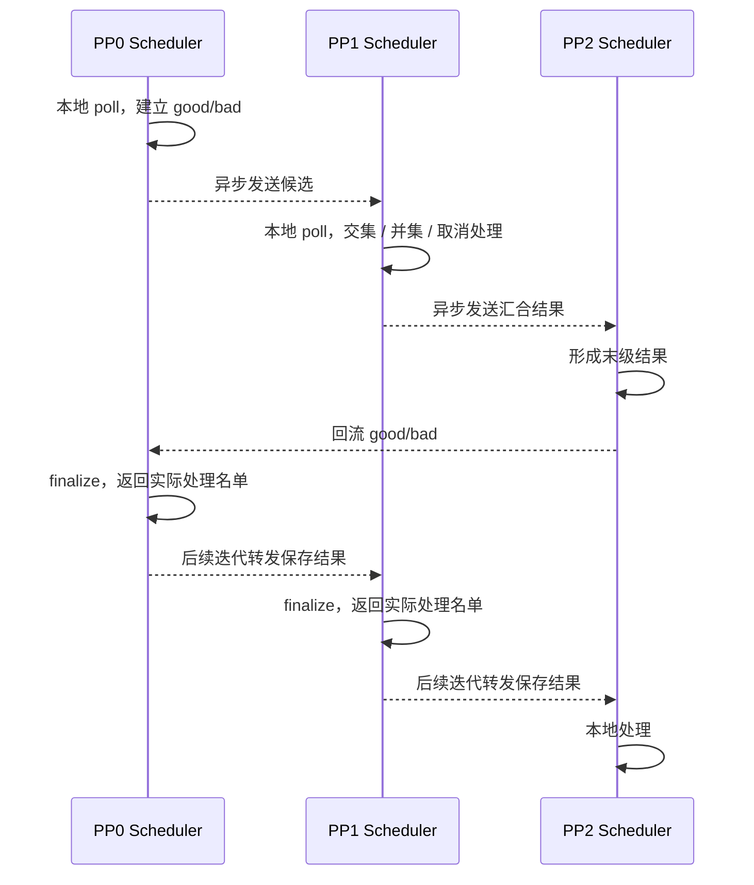
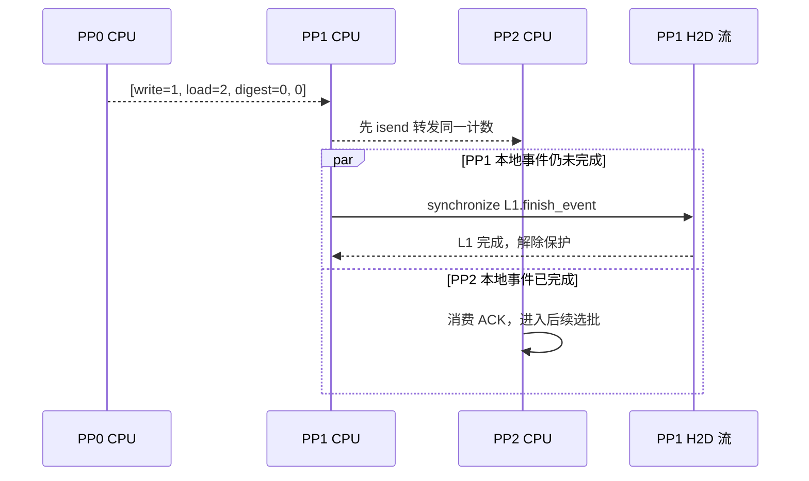

# SGLang PP 共识与缓存 ACK 机制

本文围绕三个问题：哪些请求能进入待调度队列，哪些请求能进入本地收尾检查，哪些缓存完成记录可以消费。先读 [Prefill 请求生命周期](../../pages/sglang/pd-prefill-lifecycle/index.html)，再用 [PP 共识交互专题](../../pages/sglang/pp-consensus/index.html) 对照以下过程。

## 0. 阅读基线与范围

| 项目 | 内容 |
| --- | --- |
| 源码仓库 | [sgl-project/sglang](https://github.com/sgl-project/sglang) |
| 分支与固定提交 | `main` / `279339f113b79af84f27fd3ac92d0a13bd3f4cbd` |
| 读取日期 | 2026-11-09 |
| 工作区状态 | 外部检出含未跟踪文件；只读固定 Git 对象，不改写检出目录 |
| 操作边界 | 静态源码阅读、教学模型与 CPU 替身检查；未运行 SGLang、GPU 或 RDMA 实验 |
| 路径 | PD Prefill 的 bootstrap / release；UnifiedRadixCache 的 HiCache cache 模式 ACK 路径 |
| 示例配置 | PP=3、Attention TP=CP=1、`pp_async_batch_depth=0`；关闭乐观 Prefill、staging、external linker、L3 与 buffer pipeline |

这里的“共识”是实现中的状态协调，不是通用容错共识协议。三个模式分别播放，不意味着一次请求必须依次执行三种动画。HiCache 的协调也可用于启用相应缓存的其他 PP 路径。

官方 [PD 文档](https://docs.sglang.io/docs/advanced_features/pd_disaggregation) 用于理解角色分离的背景（读取于 2026-11-09）；具体算法、对象与条件只依照上述固定提交。

| 术语 | 本文中的含义 |
| --- | --- |
| PP0–PP2 | 三段模型层的流水级；示例每级一个 Scheduler 进程与 GPU，物理主机放置未指定 |
| R0–R2 / rid | 请求 ID；相同 rid 在各进程中对应不同的本地 Req |
| good / bad | 本轮 bootstrap 的就绪 / 失败及取消请求名单 |
| release_rids | 本轮允许进入本地收尾检查的终态请求名单 |
| ACK | 缓存搬运的完成记录，含节点信息和本地完成事件；不是请求 ID |
| W0 / L0–L2 | 一条写入 ACK、三条回载 ACK 的教学编号，各级对应自己的层数据 |
| bmbs / tmbs | PP loop 保存 bootstrap / transfer 候选的环形槽位状态，不是 KV buffer |

## 1. 先区分协调对象

| 路径 | 先观察什么 | 跨 PP 传什么 | 收到后仍要检查什么 |
| --- | --- | --- | --- |
| Bootstrap | bootstrap 队列中的 sender poll、取消状态 | `[good_rids, bad_rids]` | metadata 容量、`finalize_bootstrap`，然后才移入 waiting |
| Release | inflight 队列中的 sender 是否为 Success / Failed | 终态 rid 的交集 | 本地再次 poll，成功和失败走不同收尾分支 |
| HiCache ACK | PP0 的 ACK 队首连续完成数 | write/load 计数、校验摘要 | 本地 ACK 的 `finish_event`，之后解除加载保护 |

这三条路径不会传输激活或 KV。本地进度只是输入，发布名单或计数不会让尚未完成的数据操作自动完成。

## 2. Bootstrap：逐级汇合，再沿环路处理

### 参与者与消息

`get_rids` 先通过 `poll_and_all_reduce_attn_cp_tp_group` 取得级内一致状态：先 Attention TP，再 Attention CP。跨级 PyObject 消息由每个 Attention DP shard 内 TP=CP=0 的代表通过 CPU group 收发，接收后向级内广播。本例 TP=CP=1，因此画面只展开三级。

PP0 从自己的 bootstrap 队列得到 good/bad。后级收到上游候选后再采样本地，计算：

```text
good = upstream_good ∩ local_WaitingForInput
bad  = upstream_bad ∪ local_Failed
good = good − local_aborted
bad  = bad ∪ local_aborted
```

取消请求即使仍 poll 为 WaitingForInput，也通过 `_route_aborts_to_bad` 退出 good、进入 bad。成功需要所有参与级具备前提；失败或取消可由任意一级带入 bad，并不是多数投票。



图意：虚线是控制消息，不是 Req 对象、KV 或 output tensor 的搬运；CPU 提交异步发送与接收完成是不同事件。

### 共同 good 与实际准入

`process_bootstrapped_queue` 将回流名单交给 `pop_bootstrapped`。普通 WaitingForInput 路径先调用 `finalize_bootstrap`：取得 metadata 槽，读取 Decode 前缀长度、初始化 sender，清除 `pending_bootstrap`，再加入 waiting queue。metadata 不足时返回 False，请求继续留队。

**回流不是在各级原样重放末级名单。** `process_bootstrapped_queue` 返回实际处理成功、失败的 rid；loop 将结果保存为 `consensus_bootstrapped_rids`，非末级在后续迭代转发它。例如末级得到 good={R0,R1,R2}，PP0 没有给 R1 分配到 metadata，实际转发 good={R0,R2}，PP1/PP2 不会仅凭自己对 R1 的本地就绪绕过名单。

未被名单覆盖的请求会被单独本地检查，观察到 Failed 时可进入失败处理；观察到本地 WaitingForInput 并不会因此直接准入。页面的 metadata 场景假设这些未覆盖请求没有新增失败。

### 采样与循环的关系

候选在本地 loop 前部采样、尾部向后发送；回流处理位于选批之后。因此本次新进入 waiting 的请求要等后续选批。后台握手变为就绪，也不会修改已经发出的名单；晚就绪示例用第二轮采样纳入 R1。

图中已提交的其他 batch GPU 工作可以继续。它与等待准入的请求不是同一批任务，不把独立活动画成绕过准入门槛。

## 3. Release：终态交集与本地复查

### 数据变化

每级从 `disagg_prefill_inflight_queue` 采样：

```text
local_terminal = { rid | poll ∈ {Success, Failed} }
terminal = upstream_terminal ∩ local_terminal
```

PP0 → PP1 → PP2 汇合后，末级向 PP0 回流，非末级继续转发保存的 `release_rids`。KV worker 可以在名单传播期间继续工作，但各级 CPU 尚未取得名单时不能按本地成功直接执行这一 PP 收尾路径。

`process_disagg_prefill_inflight_queue` 再次 poll 本地队列。rid 不在名单内，或者在名单内但 poll 仍不是 Success/Failed，都放入 `undone_reqs`。后者是源码明确保留的防御分支；教学输入不代表所有后端都会发生观察暂态。

### 成功、失败与资源边界

- Success：解除请求 KV 引用、调用 `tree_cache.finish(..., SUCCESS)`、清理 sender、完成相关统计与应答。
- Failed：调用 `handle_inflight_transfer_failure`，不是成功交接。
- 完成请求随后归还 metadata，inflight 更新为 `undone_reqs`。

若 R1 在 PP1 失败、在另外两级成功，R1 仍可以进入共同终态集合，各级按本地结果处理。终态交集不是“所有级成功”；本级收尾也不证明 Decode 已生成完整回答。解除请求引用不等于擦除物理 KV 缓存。

## 4. HiCache ACK：计数传播与本地 event

### 发布计数

`check_hicache_events` 先 `_drain_async_work`，再同步 write/load ready counts。PP0 对各队列调用 `_count_ready_acks`，从队首累计直到第一条 event.query=False；不能跨过未就绪条目统计后面的项。

关闭 L3 时张量为 `[write_count, load_count, digest, -digest]`。仅 PP0 调用相关 Attention 组的 MIN 归约，再通过 `_pp_sync` 传给后级。多 rank 示例：两个 PP0 参与者的 load 数为 2 和 1，发布数为 1。不是把 PP0/PP1/PP2 的完成数一起 MIN。

摘要用于验证 write_back 重复回收顺序：`[digest,-digest]` 经 MIN 后等价于 `[min,-max]`；调用方断言匹配。它不是另两项 ACK 数量。本例摘要取 0，不展开重复回收策略。

### 为什么可以先转发，再等待

`_pp_sync` 中，后级先 recv；有下一级就 clone 张量、isend，并将 work 放入 `work_list`。函数返回后才依次 `writing_check`、`loading_check`。每条 ACK 先 pop，再同步本地 `finish_event`；load 分支随后从 ongoing_load_back 移除节点，解除 device/host 锁，结束加载保护。



图意：PP2 可以比 PP1 更早完成本轮缓存事件处理。计数约束的是消费数量，不规定同时完成。下一轮回收历史 send work 仍可能形成背压，不能据此宣称发送无限不阻塞。

HiCache 动画只展示一轮 ACK 处理。未计入的 L2 保持排队；load count=0 时后级即便数据已经完成，也不自行多消费。GPU attention 使用回载 KV 的逐层事件依赖见 [PP loop 说明](../../pages/sglang/pd-prefill-pp-loop/notes.html#section-5)，不能将 ACK 的整条记录收尾误画成整批 forward 的统一屏障。

## 5. 源码阅读路线

以下路径均相对 `python/sglang/srt/`，点击进入固定提交。

| 行为 | 源码 |
| --- | --- |
| loop 中采样、选批、回流与保存 | [scheduler_pp_mixin.py:235](https://github.com/sgl-project/sglang/blob/279339f113b79af84f27fd3ac92d0a13bd3f4cbd/python/sglang/srt/managers/scheduler_pp_mixin.py#L235) |
| 本地准入结果作为回流内容 | [process_bootstrapped_queue:574](https://github.com/sgl-project/sglang/blob/279339f113b79af84f27fd3ac92d0a13bd3f4cbd/python/sglang/srt/managers/scheduler_pp_mixin.py#L574) |
| bootstrap / 终态 / 回流 | [scheduler_pp_mixin.py:593](https://github.com/sgl-project/sglang/blob/279339f113b79af84f27fd3ac92d0a13bd3f4cbd/python/sglang/srt/managers/scheduler_pp_mixin.py#L593) |
| 跨级代表与级内广播 | [scheduler_pp_mixin.py:735](https://github.com/sgl-project/sglang/blob/279339f113b79af84f27fd3ac92d0a13bd3f4cbd/python/sglang/srt/managers/scheduler_pp_mixin.py#L735) |
| metadata / sender 初始化 | [prefill.py:395](https://github.com/sgl-project/sglang/blob/279339f113b79af84f27fd3ac92d0a13bd3f4cbd/python/sglang/srt/disaggregation/prefill.py#L395) |
| 未覆盖请求与实际出队 | [prefill.py:450](https://github.com/sgl-project/sglang/blob/279339f113b79af84f27fd3ac92d0a13bd3f4cbd/python/sglang/srt/disaggregation/prefill.py#L450) |
| release 本地复查 | [prefill.py:972](https://github.com/sgl-project/sglang/blob/279339f113b79af84f27fd3ac92d0a13bd3f4cbd/python/sglang/srt/disaggregation/prefill.py#L972) |
| PP0 规约与后级异步转发 | [unified_radix_cache.py:333](https://github.com/sgl-project/sglang/blob/279339f113b79af84f27fd3ac92d0a13bd3f4cbd/python/sglang/srt/mem_cache/unified_radix_cache.py#L333) |
| 连续前缀、计数与摘要 | [unified_radix_cache.py:3065](https://github.com/sgl-project/sglang/blob/279339f113b79af84f27fd3ac92d0a13bd3f4cbd/python/sglang/srt/mem_cache/unified_radix_cache.py#L3065) |
| pop 与本地事件 | [unified_radix_cache.py:3187](https://github.com/sgl-project/sglang/blob/279339f113b79af84f27fd3ac92d0a13bd3f4cbd/python/sglang/srt/mem_cache/unified_radix_cache.py#L3187) |

## 6. 排障与自测

| 观察到的现象 | 先核对 |
| --- | --- |
| 本级 WaitingForInput，但请求还留在 bootstrap | 其他级的采样快照、回流 good/bad、metadata、实际转发名单 |
| sender 成功但源请求仍持有资源 | 共同终态交集、release 回流槽位、本地第二次 poll |
| 终态名单有请求，某级却走失败清理 | 终态包含 Failed，不能把交集视为成功投票 |
| HiCache 收到计数后 CPU 仍阻塞 | 本地哪条 ACK 的 finish_event 未完成；不要反查为 PP 全局 barrier |
| HiCache 后级已有完成项但没有消费 | PP0 公布数量、连续队首前缀、下一轮历史发送 work |

推荐操作：先预测 metadata 不足会不会影响后级收到的 good 名单，再在图中逐跳观察；把 release 切为失败场景，解释为何请求仍在终态交集中；在 HiCache 默认场景暂停于 PP1 等待而 PP2 继续的位置，说明两者的独立条件。

现有 [PP loop 综合案例](../../pages/sglang/pd-prefill-pp-loop/quick.html) 保留 batch/slot/完整调度循环的用途；本专题集中解释名单和计数，不替换原有课程，也不混入历史私有分支结论。
