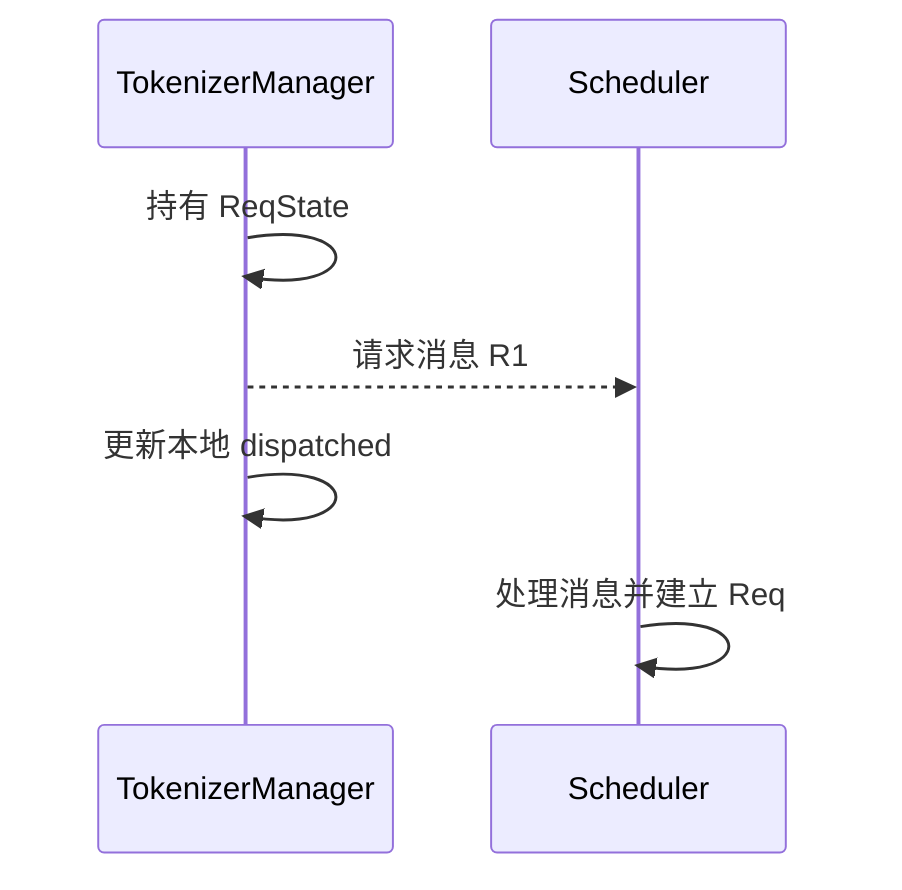
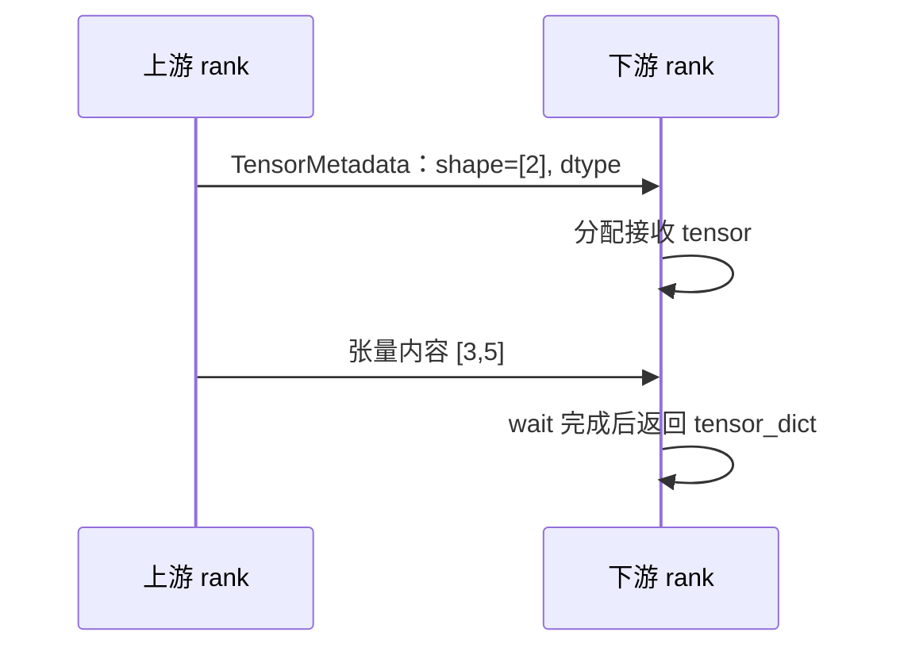
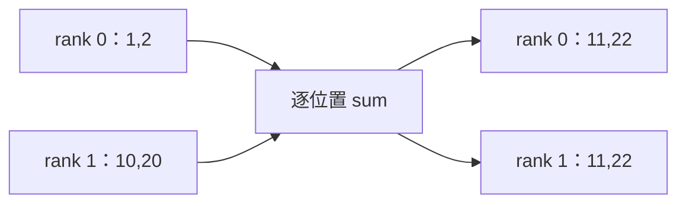
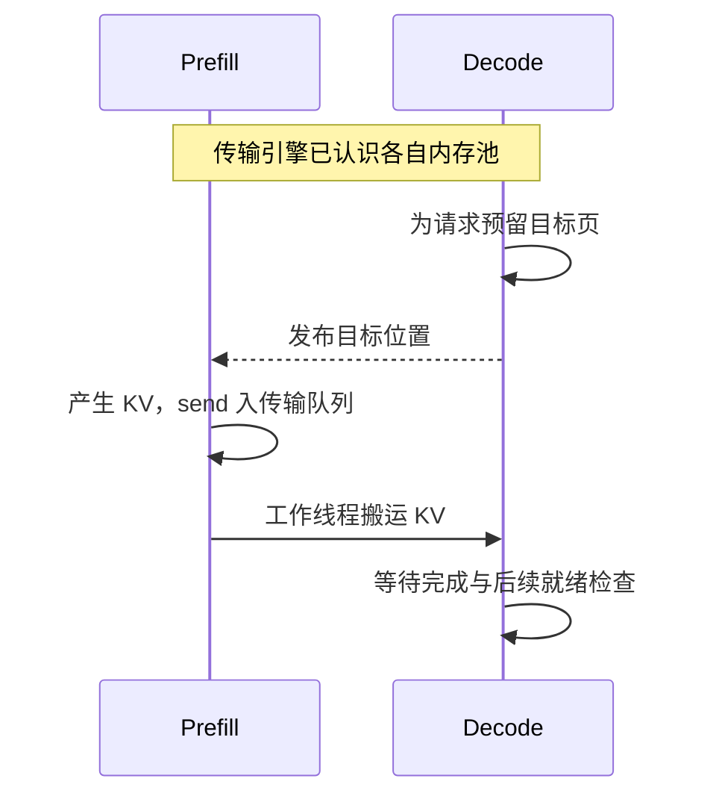
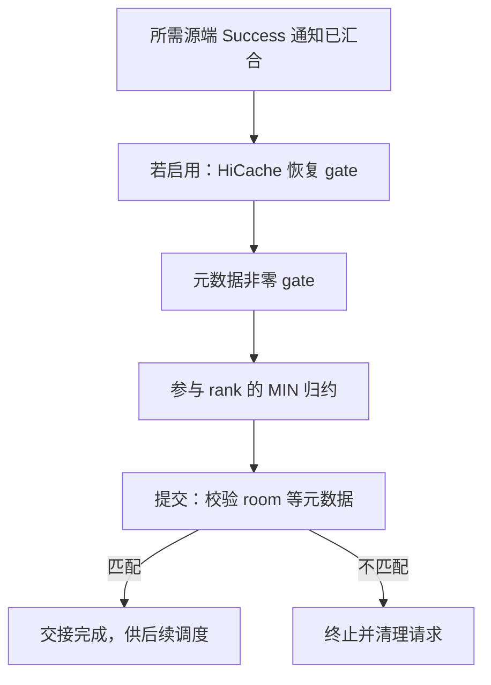
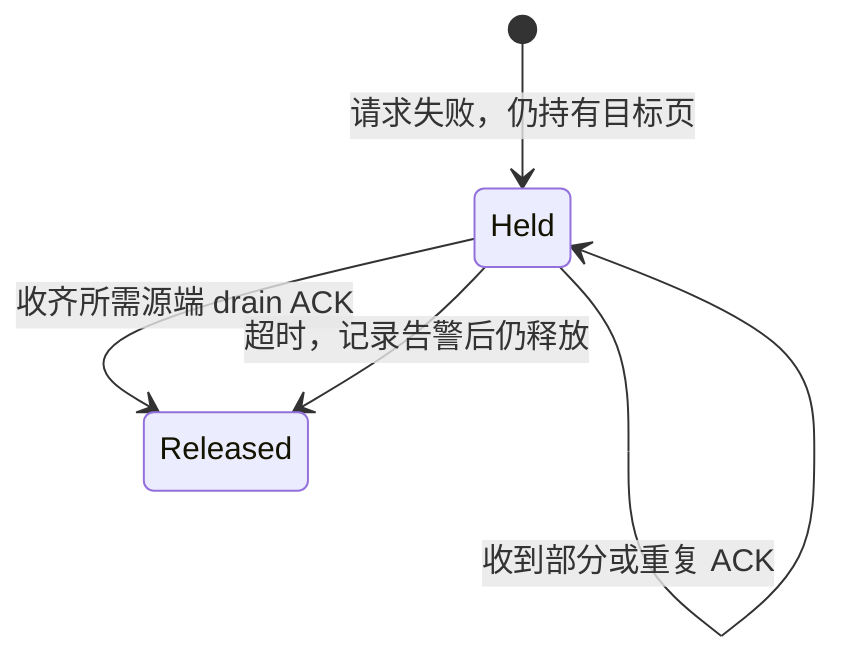

# SGLang 通信与传输机制学习文档

本文沿“发送什么 → 接收需要什么 → 何时可用 → 何时回收”分析 SGLang 通信。先修为[并行分工与执行拓扑](<SGLang 并行分工与执行拓扑学习文档.md>)及[请求运行时](<../运行时/README.md>)。对应 [Pages 交互课程](https://asher-xunzhang.github.io/ai-infra-wiki/sglang/communication/) 沿六条可独立播放的过程观察实现：请求 IPC、PP 张量、组内通信、KV 搬运、Decode 就绪与异常释放。

## 0. 阅读基线与范围

| 项目 | 内容 |
| --- | --- |
| 类型 | 源码分析型学习资料 |
| 源码仓库 | https://github.com/sgl-project/sglang |
| 分支 | 公开上游 main 的固定快照，不声明为最新 main |
| commit | `279339f113b79af84f27fd3ac92d0a13bd3f4cbd` |
| 读取时间 | 2026-09-23；2026-11-06 复核通信接口与动画分支 |
| 工作区状态 | 使用本地已有 Git 对象只读分析；检出分支与分析快照不同，原有未跟踪资料未修改 |
| 操作边界 | 只读源码；以记录型替身执行关键函数分支，未启动 SGLang、加载模型或运行 GPU / RDMA 通信实验 |
| 范围 | 普通请求派发、张量字典 P2P、三个 collective、Mooncake KV 页映射、Decode 就绪与延迟回收 |

下文箭头表示逻辑依赖，数值、页号、缓冲区基址与完成顺序是教学算例。真实通信算法、时延、设备拓扑和带宽不由这些图推导。已有[传输接口地图](<../source-study/07-disaggregation/04-KV传输接口与后端实现地图.md>)采用独立基线，不能把其历史行为直接并入本文。

| 术语 | 本文中的含义 |
| --- | --- |
| rank / group | 参与通信的进程身份 / 一次通信的成员集合 |
| metadata | 描述形状、类型、位置、请求身份等的信息，不是相应张量或 KV 内容 |
| collective | 一组 rank 共同参与、具有明确输入输出语义的算子 |
| registration | 把一段内存及长度交给传输引擎管理；不是给每条请求分配 KV 页 |
| work | 通信操作句柄；获得句柄与操作完成不同 |
| drain ACK | 源端回报排空的确认；接收侧按源端身份去重，作为延迟回收条件之一 |

## 1. 请求消息：跨进程的是信息，各自持有对象

前端和 Scheduler 要围绕同一请求协调，但不共享同一个 Python 请求对象。`_dispatch_to_scheduler` 调用 `sock_send`；`_send_one_request` 在派发后更新自己的 dispatched 状态。这只能说明发送侧走过对应分支，不能推出 Scheduler 已经接收、排队或执行。[派发入口][ipc]、[前端发送状态][send-request]。

图意：前端的标记与调度侧的处理不是同一事件；图不要求对端处理必然晚于标记，也不增加实际源码中不存在的确认消息。传输层封装或共享内存优化不改变两处对象生命周期的区别。Scheduler 的[请求处理入口][handle]建立对应对象。

**例子：** HTTP 已接受请求，但尚无模型输出。先区分输入处理、派发、调度、执行与结果返回的位置，而不是把它们都称为“网络慢”。本节只画普通生成请求，不展开多模态编码、DP 分发和异常旁路。

## 2. 点对点张量：先有形状，才能接住内容

所选 `send_tensor_dict` / `recv_tensor_dict` 路径把字典拆成元数据与张量。元数据先告诉接收侧需要分配的 shape、dtype、device；后者再分配 tensor、接收内容并等待 work 完成。[发送][send]、[接收][receive]。

图意：分配了两个元素的空间，并不等于其中已有可用的 `[3,5]`。示例只有一个张量、两个 rank，不包含可选 send-allgather 优化。实际实现分别使用 CPU 元数据组与按张量设备选择的进程组。`send_object` 用 CPU group 发送 pickle 描述的长度和字节；`recv_tensor_dict` 按描述列表逐项执行 `torch.empty → irecv → work.wait`，并非先为所有张量统一分配。网页的 PP 算例进一步展示 `hidden_states` 和 `residual` 两项。实际 PP 发送入口还加入 `__msg_type__="proxy"`；`_pp_recv_typed_dict` 只返回期望类型，其他类型放进对应 inbox，避免与 output 消息混淆。这里 TP=1，调用方仍传入 Attention TP group，但单成员不改变载荷分片。[PP 发送入口][pp-send]、[类型分流][pp-recv]。

异步发送会把 work 与 payload 一起放入 `P2PWork`，保留张量引用；不能把 isend 返回当成接收方已经可读。`_pp_commit_comm_work` 后续逐个 wait 并清空句柄列表。发送前的 `current_stream.wait_event(launch_event)` 建立对本 stage 计算的依赖；下游 `_pp_launch_batch` 使用 `forward_stream.wait_stream(schedule_stream)` 衔接接收与计算。不能把 GPU Work.wait 画成主机确认全部设备已同步。[句柄回收][pp-work]、[计算 stream 交接][pp-launch]。

## 3. Collective：算子决定每张卡最后得到什么

同样两个 rank，都可能互相交换数据，但求和、拼接、按目的地分发不能替代。

图意：All-reduce 合并同一输出的局部贡献。All-gather 则沿选定维度收齐分片，本例两边都得到 `[1,2,10,20]`，没有相加。两者对应不同的数据布局需求。[all_reduce][reduce]、[all_gather][gather]。

网页 All-to-all 的教学输入为 rank 0 的 `[A0,A1]`、rank 1 的 `[B0,B1]`。字母代表来源，数字代表目的地；rank 0 收到 `[A0,B0]`，rank 1 收到 `[A1,B1]`。每个元素保有一个目的地，元素总数守恒。这里选择等长分片，仅解释 [all_to_all_single][exchange] 的交换语义，不代表所有 EP dispatcher 都走此接口。

网页选择 CUDA、已启用 PyNCCL、非编译且不进入其他加速规约分支，进一步追踪实现而不是重复通信原理：

- `all_reduce → _all_reduce_in_place → PyNcclCommunicator.all_reduce` 将同一个 `tensor.data_ptr()` 作为输入、输出指针。
- `all_gather` 先分配输出，调用通信后按 `dim` 恢复形状；教学条件固定 `dim=0`。
- `all_to_all_single` 使用调用方提供的输出，在 PyNCCL 中用 `ncclGroupStart/End` 包裹等分的 `ncclSend/Recv`。

[PyNCCL 接口][pynccl]把指针、数量、类型、communicator 与 stream 交给 NCCL。按 [NCCL stream 语义](https://docs.nvidia.com/deeplearning/nccl/user-guide/docs/usage/streams.html)，CPU 调用返回表示任务已提交，设备仍可能执行前序任务。网页固定后续消费者使用同一 stream，以执行顺序表达依赖，没有额外虚构全设备同步；跨 stream 消费需要另外建立依赖。

**自测：** All-reduce 与 All-gather 的输出分别存在哪里？CPU 提交后、设备通信完成前，后续消费者为什么还在等待？其他通信后端与编译分支须按其实际接口另行核对。

## 4. KV 搬运：先约定位置，再把内容写进去

### 注册池、预留页与请求完成是不同动作

SGLang 的 Mooncake manager 将可注册区域的指针与长度交给引擎；D 的 receiver 用控制消息发送目标 KV 索引、辅助信息等。发送这些位置并不意味着 KV 数据已经到达。[内存注册][register]、[目标元数据][metadata]。

图意：动画选择普通 MHA、无额外 state、关闭乐观 Prefill 的路径。先交接目标信息，bootstrap 达到 WaitingForInput 后准入计算，再展示源端 K/V；`pop_bootstrapped` 另有受配置控制的 optimistic 分支，本图没有把“等待 D 后计算”推广成所有配置。[准入分支][bootstrap]。池注册使某段内存可用于引擎操作；请求的页分配与生命周期仍由上层管理。`MooncakeKVSender.send` 调用 `add_transfer_request`，后者把 `TransferKVChunk` 放入工作队列；入队不是写入完成。[传输队列][queue]。

### 页号不必相同，连续性必须两边同时成立

只画一层的 K buffer：每页 `4 token × 1 head × 2 dimensions × 2 bytes = 16 B`。逻辑 KV 段 A/B/C 在 P 的物理页 `[7,8,12]`，D 给它们预留 `[3,4,9]`。假设基址分别是 1000、2000：

- A：`1000+7×16=1112` → `2000+3×16=2048`。
- B：`1128` → `2064`。与 A 在源、目标两端都相邻，因此可合为 32 B。
- C：`1192` → `2144`，另外传 16 B。

这是 2 个传输段、共 48 B，并非整个模型 KV 的字节数。画面只放大这个 buffer；实际传输仍处理所需 V 与其他层，不能仅凭这一层 K 已到就通知整个请求成功。并行重排与 staging 未在本例展开。地址加法是帮助理解的教学简化；真实实现根据 buffer、层与配置建立传输计划。[KV 计划构造][kv-plan]。

打散 D 的位置为 `[3,9,4]` 后，逻辑 A/B/C 仍相同，A/B 却不再能合并，变成 3 段。`group_concurrent_contiguous` 在源或目标任一侧相邻差不为 1 时切段；只看 P 连续还不够。[连续分组][blocks]。

**排查方向：** 页已分配不证明位置已发布；消息已发出不证明 worker 已搬运；页内看见部分内容不证明所有源端已完成。应逐层确认所观察的是哪个事件，不能把传输等待桶直接当作原始拷贝耗时。

网页搬运动画按上述地址计划画传输段：普通布局把 A/B 合并为 32 B，C 为 16 B；打散目标页后变为三个 16 B 段。它们是交给引擎的逻辑地址范围，不是底层网络数据包，也不据此推断实际链路并发或先后。

末块还要通过 [`send_aux`](https://github.com/sgl-project/sglang/blob/279339f113b79af84f27fd3ac92d0a13bd3f4cbd/python/sglang/srt/disaggregation/mooncake/conn.py#L1247) 搬运辅助数据。本例选择常规 Transfer Engine 路径，按两端 aux index 计算地址；它与随后 [`conclude_transfer`](https://github.com/sgl-project/sglang/blob/279339f113b79af84f27fd3ac92d0a13bd3f4cbd/python/sglang/srt/disaggregation/common/conn.py#L507) 发送的终态通知不同。动画分开显示 aux 数据与 Success，不把通知画成 KV 或 aux 内容的副本。`transfer_worker` 检查 KV、可选额外状态及末块 aux 的结果；目标数量满足后才尝试成功通知。`conclude_transfer` 会保留已记录的失败，room 已清理则直接返回，不让迟到的成功通知重新创建 room。

## 5. Decode 就绪：几个条件在这里汇合

本节换用两个可能贡献数据的源端，与上一节单源算例独立。receiver 对成功通知按源端 rank 去重，收齐 expected 数量后才推进；一个源端重复通知两次仍只有一个。[完成计数][success]。

图意：箭头是依赖关系，不表示现实中每件事都要串行等待。某些元数据或缓存恢复可以先完成，交互页选择一种便于观察的事件顺序。

`_apply_metadata_gate` 仅检查元数据区的 bootstrap_room 非零，不在这里验证它等于期望 room；未到达则把 Success 保持为 Transferring。`poll_and_all_reduce` 再归约各参与 rank 的 poll，以免单 rank 提前提交。[元数据 gate 与归约][gate]。

普通非 staging 路径开启 Decode HiCache 时，`_poll_with_metadata_gate` 先包裹 `HiCacheRestoreGatedKVReceiver`：若 `hicache_restore_status == HiCacheRestoreResult.PENDING`，即使底层 poll 为 Success，也先降为 Transferring；随后才执行 metadata gate 与 MIN。不能显示 MIN 已成功而本地恢复仍 PENDING。[HiCache poll 包装层][hicache-gate]。`pop_transferred` 循环内还保留 PENDING 检查。之后 `_commit_transfer_to_req` 校验实际 room，0 或不匹配会中止。只有未被标成 FINISH_ABORT 的请求才追加到 transferred 列表。[提交检查][commit]、[交接队列出口][ready]。

## 6. 失败回收：结束请求不等于马上复用页

本图选择已启用延迟回收、后端支持该功能、且 abort 已通知的 Decode 发起失败分支。其他条件下的释放路径另有处理，不能推广成所有请求取消都这样执行。

图意：release-safe 判断按源端身份集合计数。重复 ACK 不能提前释放。`resolve_deferred_releases` 同时有超时出口；这个固定版本会在未收齐 ACK 时记录告警并释放，所以“槽位释放”不能被画成“已经证明所有远端写入排空”。[延迟释放与超时][release]。

源端接到 ABORT 后先将 room 标为 Failed，阻止后续新 chunk 准入，再登记 ACK 目标；`_maybe_ack_drained_abort` 在 `_staging_outstanding` 不大于零时取出目标并回报，接收侧按 `_prefill_unique_rank()` 去重。这里核对了两端源码条件，未验证实际并发竞态、网络丢失或 DMA 安全性。[排空 ACK][drain-ack]。

## 7. 传输层与下一步

同机 / 跨机是放置方式，P2P / collective 是参与方式，TCP / RDMA 是底层传输选择。它们不一一对应。SGLang 的 [Mooncake wrapper][engine] 负责注册与传入 transport 配置，代码包含默认 RDMA、TCP 等配置路径；本文不验证外部 Mooncake 版本的内部实现或硬件支持。

### 把接口、内存与硬件路径放在一起读

网页为 PP 和 Collective 增加两种显式教学部署：同机 GPU P2P 可用，以及跨机 GPUDirect RDMA 可用。选择只改变设备归属和传输路径，不改变源码控制顺序、输入输出语义，也不制造两种部署的耗时差异。GPU 编号是图中的设备标识，不能当成各进程的 CUDA local device index。

| 图中对象 / 线条 | 实际含义与边界 |
| --- | --- |
| 主机外框 | 放置条件；rank、进程、GPU 与主机是不同概念，两个 rank 不必属于两台主机 |
| CPU / DRAM | CPU 执行 Scheduler、构造任务和调用通信接口；请求对象、张量描述与所选普通 CUDA aux 位于主机内存 |
| GPU / HBM | 保存本卡激活或 KV；GPU 按 stream 依赖执行设备操作，CPU 传入地址并不等于把内容读回主机 |
| 紫色虚线 | 请求/控制信息或本地调用依赖，例如 shape 描述、目标索引、Success、drain ACK；不代表它们使用同一种协议 |
| 蓝色 / 金色实线 | GPU 张量 / KV 内容；所选直接传输路径不经过 CPU DRAM 中转 |
| 粉色实线 | aux 缓冲区数据从源 DRAM 写到目标 DRAM；它不是随后发送的 Success 控制通知 |
| 网卡、网络交换机 | 所选跨机路径的搬运和转发设备，不执行 Scheduler，也不替 GPU 做图中的规约或模型计算 |

[`MetadataBuffers`](https://github.com/sgl-project/sglang/blob/279339f113b79af84f27fd3ac92d0a13bd3f4cbd/python/sglang/srt/disaggregation/utils.py#L329) 在普通 CUDA 路径使用 `device="cpu"`，包括 `output_ids`、`bootstrap_room` 等缓冲区。NPU、特定 NVLink 等分支另有处理；“aux 在 CPU 内存中”只对应网页列明的分支。字段叫 metadata 不等于没有实际数据搬运，也不等于所有 metadata 都与 KV 放在 GPU 中。

跨机图选择 `GPU HBM ↔ PCIe ↔ RNIC ↔ 网络交换机 ↔ RNIC ↔ PCIe ↔ GPU HBM`；CPU 控制信息和 aux 则从主机内存出发，经网卡和网络到达对端主机内存。不同颜色可以共用相同的物理网卡、链路与交换机，不表示控制流与数据流必有两张独立网络，也不表示控制消息必用 RDMA。同机 P2P 图不经过外部网卡和网络交换机；机内 PCIe 桥接器、NVSwitch 与链路细节不展开。

这些硬件条件依据 [NVIDIA GPUDirect RDMA 文档](https://docs.nvidia.com/cuda/gpudirect-rdma/index.html)与 [NCCL GPU 间及 GPU-to-NIC 通信说明](https://docs.nvidia.com/deeplearning/nccl/user-guide/docs/troubleshooting/gpu_troubleshooting.html)解释，读取于 2026-11-06。它们是硬件背景，不是固定 SGLang 提交的依赖版本说明。图不探测实际部署，不模拟 GPUDirect 不可用时的回退、网络分包或 NCCL 内部算法。

**自测：** CPU 提交了 GPU buffer 的指针，是否表示载荷经过 CPU 内存？aux 和 Success 都涉及请求身份，为什么在图中属于不同类型的流？切换同机放置后，哪些硬件设备应当消失？

需要跨引擎对照时，读 [SGLang 与 vLLM V1 架构差异](<../../大模型推理/推理基础/SGLang 与 vLLM V1 架构差异源码学习文档.md>) 第 4 节：分别核对 ZMQ socket 模式、bind/connect、pickle / MsgPack、共享内存和 rank 控制协同。它使用独立固定提交，编码默认值不可直接套回本文。

继续阅读：

- [并行专题](<README.md>)：把通信算子放回 TP、PP、EP 等分工中。
- [分离部署与状态交接](<../分离部署/README.md>)：把传输完成放回请求全生命周期。
- [请求、调度与执行主链](<../运行时/README.md>)：区分等待队列、执行与输出。

## 8. 行为复核与动画简化边界

### 调用顺序、设备依赖与独立执行

讲解章节的顺序不是全系统的执行顺序。网页执行轨道与主图共用时钟，分别表现发送 CPU、接收 CPU、GPU stream、传输 worker 和 D 本地条件。示例选择一种合法交错；“调用已返回、可继续”表示该调用不再要求主机等待，不表示主机必有另一个任务运行，也不代表能复用仍在通信中的 buffer。

| 范围 | 可以独立推进的部分 | 必须保留的依赖 |
| --- | --- | --- |
| IPC | 发送侧 dispatched 更新与接收进程拉取消息可以交错 | Req 要在消息被拉取、解码后构造；没有额外接收 ACK |
| PP | async_send=True 时依次投递描述和两个张量的 isend，返回 work；接收 CPU 在默认 NCCL wait 语义下可继续投递下一项 | CPU 元数据先接收才能分配 CUDA 张量；设备消费者必须满足对应接收与 stream 依赖 |
| Collective | CPU 提交可与 GPU 前序任务、之后的设备通信重叠 | 同一 stream 的消费者排在通信之后；不凭双向箭头推断具体 NCCL 链路并发 |
| KV | Scheduler 入队返回后，后台 transfer_worker 从队列取任务并搬运；其他队列或独立请求可继续 | 普通批量路径的 batch_transfer_sync 等待发生在 worker；K/V 成功后才发末块 aux，再判断终态通知 |
| Decode 就绪 | P0/P1 来源、metadata 可见、HiCache 恢复、其他 D 参与者的本地条件独立准备 | 本地检查仍按 HiCache gate、metadata gate，再经 MIN 和最终 room 校验提交 |
| 异常释放 | P0/P1 排空各自在途工作，D 同时持有地址并轮询 | D 依据 ACK 集合或源码中的 deadline 分支释放；超时不是远端排空证明 |

PP 的 [send_tensor_dict][send] 在发送循环里没有逐张量 wait，发送引用由 `P2PWork` 保留。接收侧的 Python 调用顺序确实是 `empty → irecv → wait → 下一项`，但不能据此画成 CPU 等 GPU 全部搬完才分配下一项。网页选择 NCCL 默认非 CPU 阻塞 wait，另以 [PyTorch v2.8.0 的 WorkNCCL.wait](https://github.com/pytorch/pytorch/blob/v2.8.0/torch/csrc/distributed/c10d/ProcessGroupNCCL.cpp#L738) 核对：建立当前 stream 对通信 stream 的依赖；开启 blocking wait 或指定相应 timeout 才走额外主机等待。此依赖说明不把 v2.8.0 声明为 SGLang 快照的实际安装版本。CPU 可以先提交 forward，GPU forward 仍须等输入依赖。

[Prefill PP 循环](https://github.com/sgl-project/sglang/blob/279339f113b79af84f27fd3ac92d0a13bd3f4cbd/python/sglang/srt/managers/scheduler_pp_mixin.py#L170) 也明确把当前 batch 的 GPU 计算与前一 batch 的部分 CPU 结果处理分开。通信页只放大一次交接，不另造多 microbatch 的固定排程。

Mooncake manager [启动后台传输线程](https://github.com/sgl-project/sglang/blob/279339f113b79af84f27fd3ac92d0a13bd3f4cbd/python/sglang/srt/disaggregation/mooncake/conn.py#L240)，[add_transfer_request][queue] 把任务放入分片队列。[普通批量路径](https://github.com/sgl-project/sglang/blob/279339f113b79af84f27fd3ac92d0a13bd3f4cbd/python/sglang/srt/disaggregation/mooncake/conn.py#L789) 合并各层 K/V 的传输段，并调用一次 batch_transfer_sync；图中多个地址段不是多个被逐个等待的 Python 调用。custom pool 的逐层 future 和可选索引分批属于其他分支，未合入本算例；引擎如何并发搬运批次内的段未作运行验证。

### 已核对的行为与验证范围

2026-11-06 重新检查六条时间轴的调用方、数据字段和分支条件，并修正以下呈现：

| 过程 | 确认与修正 |
| --- | --- |
| 请求 IPC | `dispatched` 只是发送侧标记；正常且通过校验、无 grammar 的请求才在所选分支进入 waiting_queue |
| PP 张量 | 补充 proxy 类型分流、计算与通信 stream 依赖及发送句柄回收；逐 tensor 分配后接收 |
| 组内通信 | 核对原位指针、独立输出、等分 Send/Recv 与 stream 参数；保留 PyNCCL 显式启用的配置边界 |
| KV 搬运 | 不再在发布目标地址前显示源 K 已计算完成；区分 K/V 批次、aux 与终态通知 |
| Decode 就绪 | HiCache PENDING 在 MIN 前门控；元数据非零与最终 room 身份检查是两道条件 |
| 异常释放 | 区分源端排空 ACK、接收端去重与超时释放；超时不能被标成已全部排空 |

[源码行为检查脚本](../../tests/pages/test_communication_source.py) 用 `git show` 读取固定对象，抽取并执行原函数体，以记录型 CPU 替身接住 socket、tensor、NCCL、引擎与时钟依赖。14 项检查覆盖真实函数的分配/等待顺序、消息 inbox、异步发送投递与延后 wait、传输入队与普通 K/V 合批、指针参数、地址计算、门控顺序、身份拒绝及释放分支。检查直接执行原函数体，不加载整个引擎。

复现：`SGLANG_SOURCE_DIR=/path/to/sglang python3 -B tests/pages/test_communication_source.py`。另用前端测试检查 12 个条件的连续播放、拖回、缩放与画面状态。

这些检查不证明真实 GPU 通信成功、RDMA 完成时延、跨线程竞争安全或端到端推理结果；动画中的矩阵、页大小、基址、进度和事件间隔仍是教学缩尺。相关旧资料保留独立源码基线。

## 9. 源码锚点

以下链接全部固定到上述公开提交，路径均相对上游仓库。

- [ipc · `managers/tokenizer_manager.py` L601][ipc]
- [send-request · `managers/tokenizer_manager.py` L1592][send-request]
- [handle · `managers/scheduler.py` L2740][handle]
- [send · `distributed/parallel_state.py` L1744][send]
- [receive · `distributed/parallel_state.py` L1799][receive]
- [reduce · `distributed/parallel_state.py` L655][reduce]
- [gather · `distributed/parallel_state.py` L1326][gather]
- [exchange · `distributed/parallel_state.py` L1171][exchange]
- [register · `disaggregation/mooncake/conn.py` L325][register]
- [metadata · `disaggregation/mooncake/conn.py` L2706][metadata]
- [queue · `disaggregation/mooncake/conn.py` L2385][queue]
- [kv-plan · `disaggregation/mooncake/conn.py` L650][kv-plan]
- [blocks · `disaggregation/common/utils.py` L111][blocks]
- [success · `disaggregation/common/conn.py` L569][success]
- [gate · `disaggregation/utils.py` L212][gate]
- [commit · `disaggregation/decode.py` L2158][commit]
- [ready · `disaggregation/decode.py` L2364][ready]
- [release · `disaggregation/decode.py` L2525][release]
- [engine · `distributed/device_communicators/mooncake_transfer_engine.py` L110][engine]

[ipc]: https://github.com/sgl-project/sglang/blob/279339f113b79af84f27fd3ac92d0a13bd3f4cbd/python/sglang/srt/managers/tokenizer_manager.py#L601
[send-request]: https://github.com/sgl-project/sglang/blob/279339f113b79af84f27fd3ac92d0a13bd3f4cbd/python/sglang/srt/managers/tokenizer_manager.py#L1592
[handle]: https://github.com/sgl-project/sglang/blob/279339f113b79af84f27fd3ac92d0a13bd3f4cbd/python/sglang/srt/managers/scheduler.py#L2740
[send]: https://github.com/sgl-project/sglang/blob/279339f113b79af84f27fd3ac92d0a13bd3f4cbd/python/sglang/srt/distributed/parallel_state.py#L1744
[receive]: https://github.com/sgl-project/sglang/blob/279339f113b79af84f27fd3ac92d0a13bd3f4cbd/python/sglang/srt/distributed/parallel_state.py#L1799
[reduce]: https://github.com/sgl-project/sglang/blob/279339f113b79af84f27fd3ac92d0a13bd3f4cbd/python/sglang/srt/distributed/parallel_state.py#L655
[gather]: https://github.com/sgl-project/sglang/blob/279339f113b79af84f27fd3ac92d0a13bd3f4cbd/python/sglang/srt/distributed/parallel_state.py#L1326
[exchange]: https://github.com/sgl-project/sglang/blob/279339f113b79af84f27fd3ac92d0a13bd3f4cbd/python/sglang/srt/distributed/parallel_state.py#L1171
[register]: https://github.com/sgl-project/sglang/blob/279339f113b79af84f27fd3ac92d0a13bd3f4cbd/python/sglang/srt/disaggregation/mooncake/conn.py#L325
[metadata]: https://github.com/sgl-project/sglang/blob/279339f113b79af84f27fd3ac92d0a13bd3f4cbd/python/sglang/srt/disaggregation/mooncake/conn.py#L2706
[queue]: https://github.com/sgl-project/sglang/blob/279339f113b79af84f27fd3ac92d0a13bd3f4cbd/python/sglang/srt/disaggregation/mooncake/conn.py#L2385
[kv-plan]: https://github.com/sgl-project/sglang/blob/279339f113b79af84f27fd3ac92d0a13bd3f4cbd/python/sglang/srt/disaggregation/mooncake/conn.py#L650
[blocks]: https://github.com/sgl-project/sglang/blob/279339f113b79af84f27fd3ac92d0a13bd3f4cbd/python/sglang/srt/disaggregation/common/utils.py#L111
[success]: https://github.com/sgl-project/sglang/blob/279339f113b79af84f27fd3ac92d0a13bd3f4cbd/python/sglang/srt/disaggregation/common/conn.py#L569
[gate]: https://github.com/sgl-project/sglang/blob/279339f113b79af84f27fd3ac92d0a13bd3f4cbd/python/sglang/srt/disaggregation/utils.py#L212
[commit]: https://github.com/sgl-project/sglang/blob/279339f113b79af84f27fd3ac92d0a13bd3f4cbd/python/sglang/srt/disaggregation/decode.py#L2158
[ready]: https://github.com/sgl-project/sglang/blob/279339f113b79af84f27fd3ac92d0a13bd3f4cbd/python/sglang/srt/disaggregation/decode.py#L2364
[release]: https://github.com/sgl-project/sglang/blob/279339f113b79af84f27fd3ac92d0a13bd3f4cbd/python/sglang/srt/disaggregation/decode.py#L2525
[engine]: https://github.com/sgl-project/sglang/blob/279339f113b79af84f27fd3ac92d0a13bd3f4cbd/python/sglang/srt/distributed/device_communicators/mooncake_transfer_engine.py#L110

[pynccl]: https://github.com/sgl-project/sglang/blob/279339f113b79af84f27fd3ac92d0a13bd3f4cbd/python/sglang/srt/distributed/device_communicators/pynccl.py#L143

[pp-send]: https://github.com/sgl-project/sglang/blob/279339f113b79af84f27fd3ac92d0a13bd3f4cbd/python/sglang/srt/managers/scheduler_pp_mixin.py#L802

[pp-recv]: https://github.com/sgl-project/sglang/blob/279339f113b79af84f27fd3ac92d0a13bd3f4cbd/python/sglang/srt/managers/scheduler_pp_mixin.py#L825

[pp-work]: https://github.com/sgl-project/sglang/blob/279339f113b79af84f27fd3ac92d0a13bd3f4cbd/python/sglang/srt/managers/scheduler_pp_mixin.py#L705

[pp-launch]: https://github.com/sgl-project/sglang/blob/279339f113b79af84f27fd3ac92d0a13bd3f4cbd/python/sglang/srt/managers/scheduler_pp_mixin.py#L1221

[bootstrap]: https://github.com/sgl-project/sglang/blob/279339f113b79af84f27fd3ac92d0a13bd3f4cbd/python/sglang/srt/disaggregation/prefill.py#L450

[hicache-gate]: https://github.com/sgl-project/sglang/blob/279339f113b79af84f27fd3ac92d0a13bd3f4cbd/python/sglang/srt/disaggregation/decode_hicache_mixin.py#L166

[drain-ack]: https://github.com/sgl-project/sglang/blob/279339f113b79af84f27fd3ac92d0a13bd3f4cbd/python/sglang/srt/disaggregation/common/conn.py#L669
