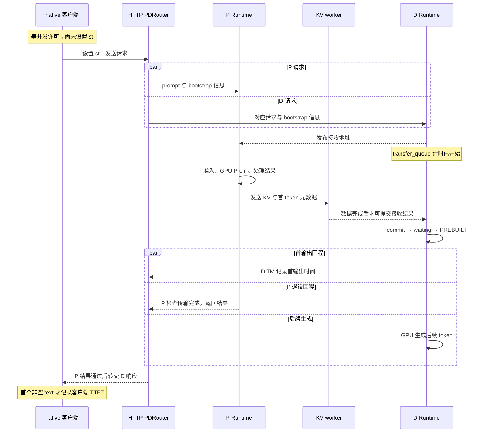

# SGLang 指标口径与性能定位

同一条 P/D 请求，会被客户端、P Runtime、D Runtime 分别计时。本篇回答：每个指标由谁采集，覆盖哪些处理与等待，何时进入统计集合？基础公式与通用压测方法见第一章，本篇重点是把指标接回 SGLang 的真实模块和调用位置。

[交互课程](https://asher-xunzhang.github.io/ai-infra-wiki/sglang/performance-engineering/) · [本领域导航](README.md)

交互默认从“总览”开始：只看客户端、P、KV 搬运、D 的关键阶段与一个指标。需要定位时切到“模块过程”，再用“源码细节”查看字段、公式和采集条件。三层共用同一条请求、教学时钟与统计端点，展开细节不会重置时间或更换当前指标；总览的阶段条包含内部处理和间隙，不表示设备连续忙碌。

## 0. 源码基线与范围

| 项目 | 内容 |
| --- | --- |
| 公开仓库 | https://github.com/sgl-project/sglang |
| 分支与 commit | 公开上游 main 快照 `279339f113b79af84f27fd3ac92d0a13bd3f4cbd` |
| 读取时间 | 2026-11-10 |
| 工作区状态 | 通过 Git 固定对象只读；检出目录有未跟踪文件，不纳入分析、不改动 |
| 主线 | HTTP PDRouter + native `/generate`；文本、单轮、非空内容流；P/D 各 TP=PP=DP=1 |
| 条件 | 开启 metrics 与请求 log_metrics；无投机、HiCache、回撤、KV offload；普通路径与两块 Chunked Prefill 分别演示 |
| 操作边界 | 源码、教学模型和浏览器验证；未启动 SGLang、执行 benchmark、测量 GPU 或 RDMA |
| 教学时钟 | 所有毫秒数是构造的合法交错；统一零点只便于关联事件，不表示各主机的 perf_counter 可以直接相减 |

先修：[请求运行时](../运行时/README.md)、[服务生命周期与请求治理](<../服务运维/SGLang 服务生命周期与请求治理学习文档.md>)。已有 [Benchmark 设计与指标口径](../source-study/11-performance-engineering/01-Benchmark设计与指标口径.md)、[Profiler 与时间线阅读](../source-study/11-performance-engineering/02-Profiler与时间线阅读.md) 和 [Torch Profiler 专题](<SGLang Torch Profiler 与 Trace 性能分析学习文档.md>) 各自保留原有基线；本次不把它们改称同一提交。

| 对象 | 人话解释 | 本文区分什么 |
| --- | --- | --- |
| native adapter | 压测客户端的协议实现 | 只知道自己收到的数据，不能直接观察 GPU |
| TokenizerManager / ReqState | 每个 Runtime 的前端及其请求记录 | P、D 各有本地创建和输出时间 |
| Scheduler / ReqTimeStats | 调度侧的请求时间记录 | 入队、准入、处理结果、退役等调用点 |
| sender metric | 传输后端提供的统计字段 | 字段可能缺失，Scheduler 有专门的回退和跳过分支 |
| observe | 把一条测量提交给统计收集器 | 时间戳存在不等于该路径一定上报 |

## 1. 先把秒表放回执行主体

### 1.1 请求流程与计时流程是两层东西

PDRouter 并发推进 P 和 D 的 HTTP 请求；D 端可以先响应，但路由器仍先检查 P 的结果。D 提前返回的响应保存在 `decode_early`。[Gateway] 这使得 D 的本地首输出时间与客户端首包时间之间，可能包含 Gateway 的放行等待。



图意：并行区表示允许重叠的活动，不承诺每次运行都有同样比例。PREBUILT 首输出使用 P 交接的 token，不是 D 又执行一次 Prefill GPU。请求数据、CPU 处理、设备工作和统计端点应分别查看。[Commit][Prebuilt]

### 1.2 三种前端计时边界

| 指标 | 采集位置 | 起点 → 终点 | P/D 条件 |
| --- | --- | --- | --- |
| 客户端 TTFT | `async_request_sglang_generate` | `st` → 首个非空 `text` | `limited_request_func` 的 semaphore 在 adapter 外面，许可等待不在内 |
| 客户端 latency | 同一 adapter | `st` → 最后一次非空流数据 | 读取数据后先更新 latency，再检查 `[DONE]`，所以流尾可计入 |
| TM TTFT | `_handle_batch_output` 打点，`collect_metrics` observe | `created_time` → `first_token_time` | TTFT observe 明确排除 PREFILL |
| TM E2E | 各端 `ReqState.time_stats` | `created_time` → `finished_time` | P、D 分别上报各自请求完成，两个区间交叠 |

源码：[客户端][许可][前端状态创建][输出打点][TM 采集]。`_init_req_state` 使用请求的 `received_time`；未提供时 `set_created_time` 才取本地当前时间。页面选择这一分支，不将创建时间固定理解为 GPU 接收或 HTTP 字节到达。

TM 的首次回程打点和客户端非空 text 检查不同。进入 `collect_metrics` 还要求 `enable_metrics && state.obj.log_metrics`；P 虽可记录 first-token 时间，TTFT histogram 分支却不 observe。这里的“无样本”不等于 0 ms，也不意味着 P 不上报 E2E 或其他计数。[采集开关]

### 1.3 页面如何用同一时钟做对照

正常构造例：客户端 st=80、D 本地 created=112、D 首输出批次=445、P HTTP 回程=450、客户端首内容=465。因此客户端 TTFT=385 ms，D TTFT=333 ms。差值 52 ms 不能直接叫纯网络耗时：两种秒表起点和终点都不同。

- 许可多等 120 ms：整个后续旅程平移；许可之后的客户端 TTFT 不变。
- P HTTP 结果晚到 120 ms：D TM 首输出不变；Gateway 放行推迟，客户端首内容变晚。本例的缓冲排出间隔也是构造值。
- D 接收提交晚轮询 80 ms：给定 KV 搬运窗口不变，D 的 transfer 阶段与后续首输出变晚。

这些是固定条件下的合法交错，不是硬件拟合。实际跨主机关联需要请求身份、Trace、时钟同步或明确的时钟换算条件。把三个本地 `perf_counter` 直接相减，无法得到可靠网络分段。

## 2. P/D 阶段指标不是互不重叠的耗时账单

### 2.1 Scheduler 的时间戳落在哪里

| 指标 / stage | 起点 → 终点 | 源码对应 |
| --- | --- | --- |
| P `prefill_bootstrap` | bootstrap queue entry → wait queue entry | P bootstrap 完成后，`set_wait_queue_entry_time` 观察区间 |
| P `queue_time` | wait queue entry → 首次 forward entry | 在 `set_forward_entry_time` 观察 |
| P `prefill_forward` | last forward entry → prefill finished | CPU 处理最终 Prefill 结果时闭合，不是设备专用计时 |
| D `decode_bootstrap` | prealloc queue entry → transfer queue entry | 分配并发布接收 metadata 后闭合 |
| D `decode_transferred` | transfer queue entry → wait queue entry | `_commit_transfer_to_req` 读取首 token / metadata、提交接收后闭合 |
| D `queue_time` / `decode_waiting` | wait queue entry → 首次 forward entry | 本例到 PREBUILT 准入，不含之前的 prealloc / transfer 等待 |
| D `fake_output` | last forward entry → prebuilt finish | 处理 PREBUILT 结果，不是执行一次新的 Prefill GPU |
| P `prefill_transfer_kv_cache` | 末块 send 后 transfer queue entry → transfer finish | 轮询成功退役时闭合 |

对应：[队列到准入][Forward 时间][Prefill 结果][D transfer 入口][D 提交][PREBUILT 时间][P transfer 完成]。

`decode_transferred` 开始时，P 仍可能正在计算。因此它可以包含等 P 计算、KV 搬运、D 轮询和 metadata / commit；不能命名为纯网卡搬运时间。P 与 D 的 stage 会重叠，不能将各项 histogram 均值简单相加来还原单请求 E2E。

`prefill_forward` 覆盖 CPU 入口到 CPU 结果处理，本例非回撤的两块 Prefill 不会逐块重置 `last_forward_entry_time`，所以它跨越两块及块间间隙。`set_retract_time`、`reset_prefill_retry_time` 有独立重置路径；本例排除这些分支。不能因为字段带 `last` 就推断它只计最后一块。[Forward 时间]

stage 的 Trace 与 histogram 也不一一等价：本版本 `prefill_prepare` 默认不是 per-stage histogram 观测项；`prefill_waiting` 的等待已由 queue_time 表达。须检查 `RequestStage.metrics_enable`，不能仅按函数或 stage 名推断上报存在。[Stage 配置]

### 2.2 P 端专用 KV latency 有回退与缺失分支

成功退役后，P 记录 completion，再读取 sender metric 并调用 `compute_and_observe_kv_transfer_metrics`。失败退出不走同样的成功采集路径。[P 成功采集]

```text
transfer_total_bytes 缺失 → 本次提前返回，不上报
后端提供 transfer_latency_s → 使用后端值
否则 → completion_time − prefill_transfer_queue_entry_time
```

源码注释明确指出回退只捕获最后块时间。[KV 指标] 注意它和 per-stage transfer 的终点也不同：per-stage 使用 transfer_finish，回退使用稍后的 completion。页面构造 355→425=70 ms 与 355→426=71 ms，目的在于标明两个调用位置，绝不是实测 1 ms 开销。

Mooncake 共用连接实现提供累计传输字节数，但这里没有专用 latency 值；NIXL 有自己填充 `transfer_latency_s` 的路径，不能把一个后端的计时条件套给所有后端。[Sender][NIXL]

两块示例里，块 1 KV 搬运 282→340 与块 2 GPU 285→340 重叠；最后块 send 后才记录 355 的 transfer queue entry。回退分母不覆盖块 1 的完整搬运，字节数却可累计全部块。由此计算的 speed 不能直接当作整请求链路的均匀带宽。

代码以 1024²、1024³ 换算字节数，字段名称写 MB / GB；页面把构造的大小明确标为 MiB，保留实际 metric 名。接口缺字段的演示只验证可选字段分支，不声称 Mooncake 正常发送必然缺字段。

## 3. 输出批次怎样变成 ITL 与 TPOT

### 3.1 同一份设备工作，可以有不同的回告节奏

`OutputStreamer.accept` 对 finished 请求允许输出；非 finished 时，`stream_interval > 1` 使用 `len(output_ids) % stream_interval == 1`。页面排除 stop-string 抑制，用输出 4 token 的例子：[输出门槛]

| 条件 | D TM 回程时刻 / 累计 token | 后续 ITL 样本 |
| --- | --- | --- |
| interval=1 | 445/1、480/2、535/3、565/4 | 35、55、30 ms |
| interval=3 | 445/1、565/4 | 40、40、40 ms |

第二行的中间两轮 GPU 仍发生。动画保留同一 GPU 轨道，仅改变回程批次和采集数组，避免把更平滑的统计误画成更均匀的设备执行。

TM 按新增 completion token 数计算 `adjusted_interval = interval / num_new_tokens`。默认 histogram 把对应 bucket 加 `num_new_tokens`、sum 加原 interval；可替换 collector 则调用 observe 多次。客户端 native adapter 在非空 text 的采样点按类似规则扩展 `output.itl`，但时钟与模块不同。[TM ITL][客户端 ITL]

### 3.2 TPOT 的结束点还可能包含流尾

普通 `calculate_metrics` 对成功且输出数大于 1 的请求计算 `(latency - ttft)/(output_len - 1)`。本例客户端首内容 465、最后内容 585、流尾 605：TPOT=(605−465)/3≈46.7 ms，而合并回告的 ITL 是三个 40 ms。流尾推进 latency，没有产生新的 token ITL。[TPOT]

只有一个输出 token 时不追加 TPOT 样本。汇总空列表的零回退字段不能解释成测得了零耗时。多个请求的 TPOT 按请求形成样本，ITL 则合并所有 token 间隔样本；两者权重也不同。

本篇限定 native adapter。不能把非空 text、usage、token 增量等条件直接推广给所有 OpenAI 协议或版本。

## 4. 聚合时保留角色、成功条件和分母

### 4.1 P、D 的完成计数不能相加当业务请求数

TokenizerManager 基础 labels 包括 `model_name` 和 `engine_type`；部分指标另有 `is_streaming`。抓取实例来源同样需要保留。P 产生首 token，D 接收并把它计入完整输出；正常输出 4 token 的 R1，本地完成计数可见 P=1、D=4，客户端仍是 4。[标签][完成计数]

同理，P 的 Runtime 请求结束并非整条业务生成结束；P/D 完成请求数不能跨角色简单相加当用户完成数。角色或实例的 P95 也不能相加、平均得到客户端 P95。已经聚合的 histogram 不保留每条请求的原始时间端点，定位单请求需另外关联 Trace 或原始记录。

### 4.2 慢请求失败会改变成功分布

`calculate_metrics` 只把 `success=True` 的延迟及输入输出加入成功统计；失败项在该汇总中的输出数为零，即使异常前已经收到过部分内容。[成功筛选]

页面用同一 600 ms 窗口，四条请求 TTFT=80、80、80、500 ms，每条成功输出 4 token：

| 结果 | 成功数 | 成功集合 P95 | 成功输出吞吐 |
| --- | --- | --- | --- |
| 全部成功 | 4 | 437 ms | 16 / 0.6 ≈ 26.7 token/s |
| R4 部分输出后传输异常 | 3 | 80 ms | 12 / 0.6 = 20 token/s |

四条只演示 NumPy 默认线性插值与筛选，不估计真实尾延迟。R4 的原始记录仍保留，CPU 汇总时才排除它；客户端失败并不证明后端已释放。全失败时应报告无成功延迟样本，不能宣称零延迟。

`benchmark_duration` 的外围计时还包括发压与收尾，可能涉及停止 profiler、获取 server_info；不能假定它严格等于第一条 HTTP 到最后一条 HTTP 的间隔。页面固定窗口并展示汇总阶段，不拟合外围成本。[吞吐][Benchmark 起点][Benchmark 终点]

## 5. 从现象寻找下一份证据

| 现象 | 下一份证据 | 避免误读 |
| --- | --- | --- |
| 客户端 TTFT 长，D TM TTFT 稳定 | 两端创建 / 首回程、Gateway P 结果与客户端内容时刻 | 把所有差值归给网络 |
| decode_transferred 长，KV worker 活动没变 | 地址发布时间、P 计算完成、D poll / commit | 把整个接收窗口当成搬运时间 |
| 分块后 KV speed 异常高 | sender 字节数覆盖范围、末块入口与 completion | 用累计字节 / 末块尾部时间推断整链路速率 |
| ITL 很平滑，输出成团 | OutputStreamer 条件、回程批次、completion 增量 | 把均摊样本当成逐 token GPU 时刻 |
| P/D 总输出比客户端多 | engine_type、实例、完成请求与 token 归属 | 首 token 跨角色重复记账 |
| P95 降低且失败增加 | 原始 outputs、success、成功输出数与 duration | 把样本退出误认为计算优化 |

与已有关联资料的分工：本篇把指标落到固定版本的请求链；Profiler 专题继续负责设备 Trace 阅读，历史 benchmark 课程保留实验设计与版本边界。未新增重复的通用对照实验篇；暂无需要另写整合正文的证据增量。

对照案例：[DeepInfer 的满接受记账与接受率折算](<../../大模型推理/分布式服务/DeepInfer 专用推理引擎与生产系统边界学习文档.md#9-读性能图前先读坐标配置和记账方式>) 是离线 step / 吞吐口径，本篇是在线流式采集；不能直接拼成性能排名。

## 6. 自测与源码阅读顺序

1. P 已采样首 token，为什么 P TTFT histogram 仍没有本次样本？
2. D transfer_queue 开始时，P GPU 是否一定已经算完？
3. 为什么普通分块的 prefill_forward 可以跨两块，而 KV latency 回退只覆盖末块尾部？
4. GPU 不变，修改 stream_interval 为什么能改变 ITL 数组？
5. 为什么 P=1、D=4 不能证明客户端收到 5 token？
6. 慢请求失败后 P95 降低，需要同时检查什么？

推荐顺序：客户端 adapter 的 st / text / latency → PDRouter 放行 → P/D ReqTimeStats 的入口与完成 → 前端 `_handle_batch_output` / `collect_metrics` → 输出门槛与 histogram 权重 → calculate_metrics 的成功集合与 duration。每一步先标模块、起止事件、observe 条件，再看数值。

页面模型与浏览器检查验证依赖、可逆时钟、完整播放、统计边界和显示；源码锚点与行为检查不替代真实模型 / GPU 性能实验。

[客户端]: https://github.com/sgl-project/sglang/blob/279339f113b79af84f27fd3ac92d0a13bd3f4cbd/python/sglang/benchmark/serving.py#L658
[许可]: https://github.com/sgl-project/sglang/blob/279339f113b79af84f27fd3ac92d0a13bd3f4cbd/python/sglang/benchmark/serving.py#L1389
[客户端 ITL]: https://github.com/sgl-project/sglang/blob/279339f113b79af84f27fd3ac92d0a13bd3f4cbd/python/sglang/benchmark/serving.py#L756
[TPOT]: https://github.com/sgl-project/sglang/blob/279339f113b79af84f27fd3ac92d0a13bd3f4cbd/python/sglang/benchmark/serving.py#L1136
[成功筛选]: https://github.com/sgl-project/sglang/blob/279339f113b79af84f27fd3ac92d0a13bd3f4cbd/python/sglang/benchmark/serving.py#L1124
[吞吐]: https://github.com/sgl-project/sglang/blob/279339f113b79af84f27fd3ac92d0a13bd3f4cbd/python/sglang/benchmark/serving.py#L1236
[Benchmark 起点]: https://github.com/sgl-project/sglang/blob/279339f113b79af84f27fd3ac92d0a13bd3f4cbd/python/sglang/benchmark/serving.py#L1499
[Benchmark 终点]: https://github.com/sgl-project/sglang/blob/279339f113b79af84f27fd3ac92d0a13bd3f4cbd/python/sglang/benchmark/serving.py#L1613
[Gateway]: https://github.com/sgl-project/sglang/blob/279339f113b79af84f27fd3ac92d0a13bd3f4cbd/sgl-model-gateway/src/routers/http/pd_router.rs#L721
[前端状态创建]: https://github.com/sgl-project/sglang/blob/279339f113b79af84f27fd3ac92d0a13bd3f4cbd/python/sglang/srt/managers/tokenizer_manager.py#L3497
[输出打点]: https://github.com/sgl-project/sglang/blob/279339f113b79af84f27fd3ac92d0a13bd3f4cbd/python/sglang/srt/managers/tokenizer_manager.py#L2509
[采集开关]: https://github.com/sgl-project/sglang/blob/279339f113b79af84f27fd3ac92d0a13bd3f4cbd/python/sglang/srt/managers/tokenizer_manager.py#L2555
[TM 采集]: https://github.com/sgl-project/sglang/blob/279339f113b79af84f27fd3ac92d0a13bd3f4cbd/python/sglang/srt/managers/tokenizer_manager.py#L2942
[标签]: https://github.com/sgl-project/sglang/blob/279339f113b79af84f27fd3ac92d0a13bd3f4cbd/python/sglang/srt/managers/tokenizer_manager.py#L733
[TM ITL]: https://github.com/sgl-project/sglang/blob/279339f113b79af84f27fd3ac92d0a13bd3f4cbd/python/sglang/srt/observability/metrics_collector.py#L1868
[完成计数]: https://github.com/sgl-project/sglang/blob/279339f113b79af84f27fd3ac92d0a13bd3f4cbd/python/sglang/srt/observability/metrics_collector.py#L1785
[Stage 配置]: https://github.com/sgl-project/sglang/blob/279339f113b79af84f27fd3ac92d0a13bd3f4cbd/python/sglang/srt/observability/req_time_stats.py#L105
[队列到准入]: https://github.com/sgl-project/sglang/blob/279339f113b79af84f27fd3ac92d0a13bd3f4cbd/python/sglang/srt/observability/req_time_stats.py#L746
[Forward 时间]: https://github.com/sgl-project/sglang/blob/279339f113b79af84f27fd3ac92d0a13bd3f4cbd/python/sglang/srt/observability/req_time_stats.py#L767
[Prefill 结果]: https://github.com/sgl-project/sglang/blob/279339f113b79af84f27fd3ac92d0a13bd3f4cbd/python/sglang/srt/observability/req_time_stats.py#L813
[P transfer 完成]: https://github.com/sgl-project/sglang/blob/279339f113b79af84f27fd3ac92d0a13bd3f4cbd/python/sglang/srt/observability/req_time_stats.py#L1004
[KV 指标]: https://github.com/sgl-project/sglang/blob/279339f113b79af84f27fd3ac92d0a13bd3f4cbd/python/sglang/srt/observability/req_time_stats.py#L913
[PREBUILT 时间]: https://github.com/sgl-project/sglang/blob/279339f113b79af84f27fd3ac92d0a13bd3f4cbd/python/sglang/srt/observability/req_time_stats.py#L1047
[P 成功采集]: https://github.com/sgl-project/sglang/blob/279339f113b79af84f27fd3ac92d0a13bd3f4cbd/python/sglang/srt/disaggregation/prefill.py#L1045
[D transfer 入口]: https://github.com/sgl-project/sglang/blob/279339f113b79af84f27fd3ac92d0a13bd3f4cbd/python/sglang/srt/disaggregation/decode.py#L1609
[D 提交]: https://github.com/sgl-project/sglang/blob/279339f113b79af84f27fd3ac92d0a13bd3f4cbd/python/sglang/srt/disaggregation/decode.py#L2329
[Commit]: https://github.com/sgl-project/sglang/blob/279339f113b79af84f27fd3ac92d0a13bd3f4cbd/python/sglang/srt/disaggregation/decode.py#L2329
[Prebuilt]: https://github.com/sgl-project/sglang/blob/279339f113b79af84f27fd3ac92d0a13bd3f4cbd/python/sglang/srt/managers/scheduler_components/batch_result_processor.py#L116
[输出门槛]: https://github.com/sgl-project/sglang/blob/279339f113b79af84f27fd3ac92d0a13bd3f4cbd/python/sglang/srt/managers/scheduler_components/output_streamer.py#L418
[Sender]: https://github.com/sgl-project/sglang/blob/279339f113b79af84f27fd3ac92d0a13bd3f4cbd/python/sglang/srt/disaggregation/common/conn.py#L1485
[NIXL]: https://github.com/sgl-project/sglang/blob/279339f113b79af84f27fd3ac92d0a13bd3f4cbd/python/sglang/srt/disaggregation/nixl/conn.py#L3115
