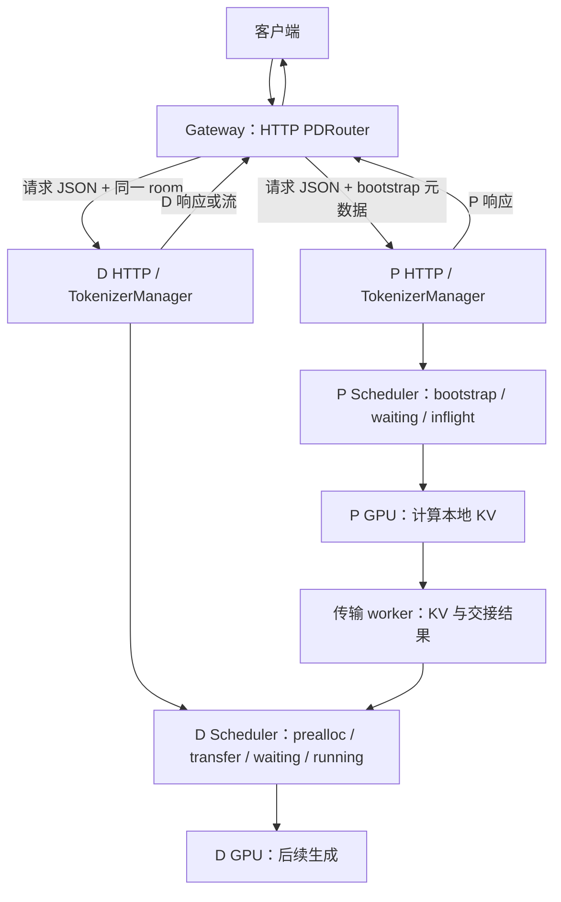
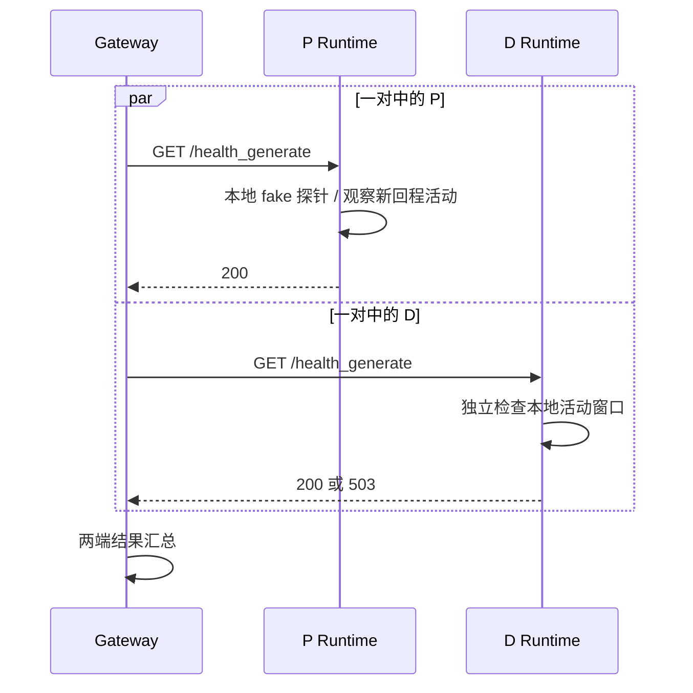
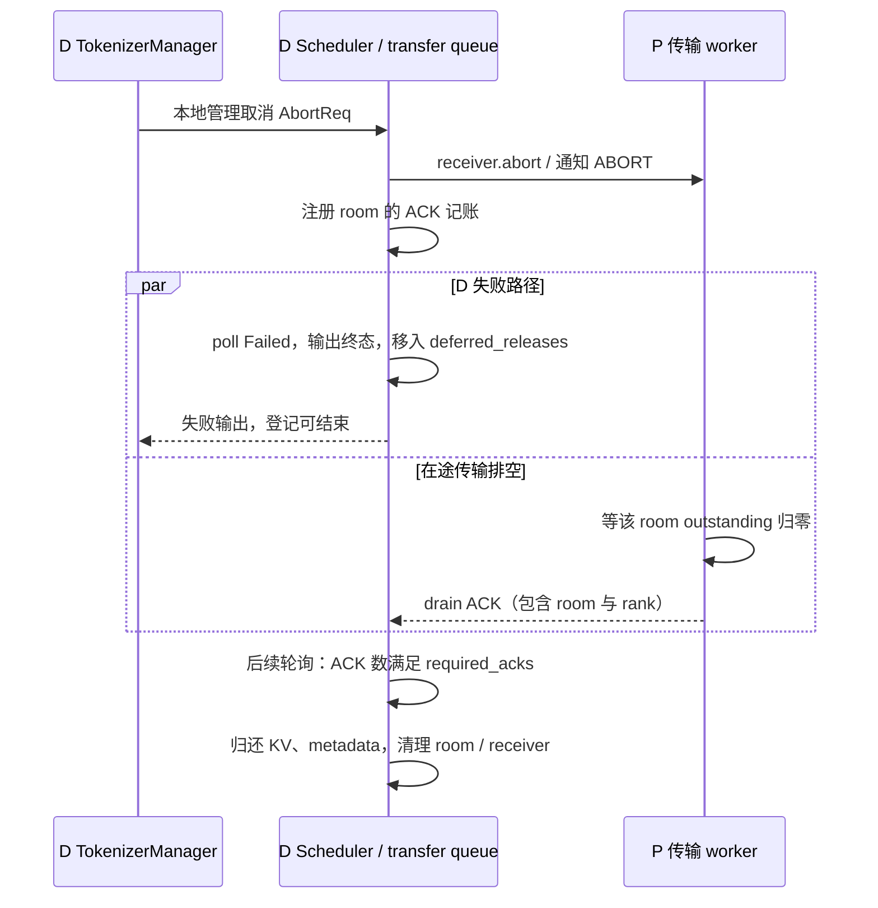

# SGLang 服务生命周期与请求治理学习文档

本文沿 P/D 服务链回答：两端探活通过意味着什么、Gateway 怎样成对派发、连接结束后谁继续处理取消、资源何时可归还，以及一个 Runtime 怎样独立退出。配套 [Pages 交互课程](https://asher-xunzhang.github.io/ai-infra-wiki/sglang/serving-operations/) 用主图与执行轨道共享时钟；第一章介绍路由和取消的基础概念，本课追踪固定版本的真实实现。

## 0. 阅读基线与范围

| 项目 | 内容 |
| --- | --- |
| 类型 | 源码分析型学习资料 |
| 源码仓库 | https://github.com/sgl-project/sglang |
| 分支 | 公开上游 main 固定快照，不声明为最新 main |
| commit | `279339f113b79af84f27fd3ac92d0a13bd3f4cbd` |
| 读取时间 | 2026-11-10；沿用原固定提交，补核 P/D 路径 |
| 工作区 | 只读已有 Git 对象；检出分支不同，原有改动与未跟踪文件保留 |
| 主线 | HTTP PDRouter + Python P/D Runtime；普通文本、各端 TP=PP=DP=1 |
| 条件 | 无投机、HiCache、HiSparse 或 Decode KV offload；传输取消场景选 Mooncake 且相关 deferred-release 开关启用 |
| 操作边界 | 源码阅读与教学页面验证；未启动模型、发送真实推理请求或验证 GPU / RDMA 行为 |
| 教学时间 | `u` 是讲解单位；活动区间是符合依赖的一种交错，不代表耗时、吞吐或所有运行轨迹 |

已有[服务治理源码专题](../source-study/10-serving-operations/03-健康检查超时限流与优雅退出.md)保留自己的固定基线，不能把导航关系当作同一版本。请求内部状态详见[Req 状态与队列流转](../运行时/SGLang%20Req%20状态与队列流转学习文档.md)，传输与安全回收详见[通信机制](../并行方法/SGLang%20通信与传输机制学习文档.md)，P/D 准入和 PP 共识见[分离部署导航](../分离部署/README.md)。本课只在这些机制影响服务响应、取消和退出时引用它们。

### 术语与责任

| 对象 | 本课关注的责任 |
| --- | --- |
| HTTP PDRouter | 分角色选一对 worker，注入 bootstrap 信息，并发派发及处理 HTTP 结果 |
| TokenizerManager（TM） | 本端 `rid_to_state` 登记、回程、断连检测与取消派发 |
| Scheduler | 按请求当前队列、batch 引用处理取消；运行中先记 `to_finish` |
| receiver / sender | 传输的通知、状态轮询与退役；不是 HTTP 连接本身 |
| room | 关联一次跨端交接及取消 ACK；本例用 42 作示意 |
| drain ACK | P rank 确认该 room 在途传输排空的控制消息，不携带 KV |

## 1. 先建立 P/D 服务链地图

图意：两个 Runtime 各自有 Req、前端登记、调度引用和资源。HTTP 携带请求或响应；KV 走独立传输面。图表达职责边界，不声称进程必然位于不同主机。

本课区分四种证据：**健康接口成功、业务响应产生、后端请求退出、资源可重用**。它们由不同条件决定。时间轨道的实框是活动、虚框是等待、空白是本例未安排工作；不能把空白也读成阻塞。每条消息从活动开始就有完整连线，脉冲持续到该交接结束；脉冲数量不是包数。

## 2. 启动与探活：两端独立，检查范围有限

### Runtime warmup 不是实际跨端请求

`_execute_server_warmup` 先等 `/model_info` 可访问。P/D 分支调用 `_send_disaggregation_warmup_requests`，向本端 `/generate` 发 fake bootstrap 请求；DP>1 时用 `asyncio.gather` 按本端 DP rank 并发，全部 HTTP 成功后置 Up。[warmup][warmup]、[P/D warmup][warmup-pd]。

P 和 D 各自初始化，P 置 Up 不必等 D 完成。fake bootstrap 的成功不能证明真实 P→D KV 传输已经验证。页面默认 DP=1，避免画出未配置的多 rank 工作。

### Gateway 探测选中的一对，Runtime 看本地活动

Gateway `/health_generate` 先选一对 P/D，再以 `tokio::join!` 并发 GET 两端的 `/health_generate`；等待两端返回，全部成功才回 200，否则 503。[Gateway 探活][pair-health]。它不检查全部副本。

Runtime 健康入口先检查退出标记与 Starting。生成探测记录 `tic`、启动探针，并观察 `last_receive_tstamp > tic`；普通请求回程也可能满足条件。P/D 探针使用 fake bootstrap，结束后取消探针任务并清理对应登记。[Runtime 探活][health]。

图意：P 已通过时 D 可能仍在等活动；一端有新回程不代替另一端。两端 200 仍不能证明业务 R1 获得执行机会或真实 KV 链路正确。

若关闭 `/health` 的生成检查，且前置状态门通过，该接口可直接 200；`/health_generate` 不随之改成同一静态路径。页面把这一条件标成直接访问 Runtime，不混入 Gateway 探活轨迹。

## 3. 成对派发：HTTP 并发，响应处理有先后

### 请求 JSON 怎样变化

`select_pd_pair` 分角色获取并筛选候选，各自按策略选择。缺少任何一个角色都会在派发前报错。[选对][pair]。Round-robin 的循环只作用于可用候选，相关健康、熔断过滤见[策略][route]和[候选过滤][eligible]；并非所有部署都使用轮转。

`inject_bootstrap_into_value` 将选中 P 的 host、port 和新 room 注入请求 JSON。本例单请求、非 DP-aware worker，P/D HTTP 请求关联相同 room；这里传的是交接元数据，不是 KV tensor。[注入元数据][inject]。

### 两个 future 如何推进

`execute_dual_dispatch_internal` 建立 P/D 两个 `send` future，在同一个 handler 的 `tokio::select!` 中并发 poll。该段没有把 D 派发推迟到 P 完整结束之后，也没有用 detached spawn。[双派发][dual]。

- P 结果到达：跳出 poll 循环，先判断 P 是否失败。
- D 结果先到：存入 `decode_early`，继续等待 P；不立即越过 P 的检查。
- P 成功：取暂存的 D 结果，或继续 await D。
- P 失败：按 P 的实际状态记账，返回 P 错误并丢弃 pending D future；不把连带取消当成 D 自身故障计入其熔断器。P 4xx 保留客户端错误含义，P 5xx / 传输失败走 502。

正常路径中，D 先准备接收空间并提供元数据，P 计算后交接 KV。D 满足接收条件后可以继续设备工作，同时 P 轮询传输完成并本地退役；D 不必等 P 的 HTTP 响应抵达 Gateway。[P 退役][p-retire]、[D 接收][transfer]。轨道选择一种合法交错，不能用等长格子假定实际 overlap 程度。

D 先报错的场景是显式注入条件：D 已接收 KV，但执行前返回 503，早于 P 的 HTTP 响应。本例非流式，Gateway 在确认 P 成功后按 D 错误路径返回 503；没有把“D 提前回错”画成“D 未收到 KV 就成功生成”。

### 普通队列规则不能直接移植到 P/D

| 条件 | 固定实现 | 本课边界 |
| --- | --- | --- |
| 普通模式新请求 | `_abort_on_queued_limit` 后加入 waiting_queue | 关闭优先级时，`len(waiting_queue)+1 > max_queued_requests` 默认拒绝新请求 |
| Prefill 新请求 | 加入 bootstrap_queue | 不是在此入口套用普通 waiting 上限 |
| Decode 新请求 | 加入 prealloc_queue | 其容量、接收空间及后续准入由 P/D 机制管理 |
| waiting timeout | `_poll_timeout_aborts` 扫描 waiting_queue | 不统一覆盖 bootstrap、prealloc 或 transfer |
| running timeout | 依据 batch 的 forward_entry_time | 不等于客户端、Gateway 与传输层共享一个总时限 |

见[入队分支][pd-queue]、[队列上限][queue]、[超时轮询][timeout]。上表不表示 P/D 没有容量约束。普通 waiting 的容量为 2 时 R1/R2 可等待、R3 可被拒绝，这类一般容量例子交给调度课；本节主要看各实现入口的差别。

## 4. 失败与取消：跟随当前持有者

### P 失败，D 仍在 prealloc

页面选择 P HTTP 500、D 尚未分配 KV 的例子。Gateway 先返回 502 并丢弃 D pending future；D Runtime 在后续非后台、非流式等待检查中发现断连，再派发 AbortReq。[断连检查][disconnect]、[取消派发][abort]。

Scheduler 对 prealloc 中的请求调用 receiver.abort；后续轮询 Failed 设置 abort，`pop_preallocated` 再输出终态、清理 receiver 和相关列表引用。[Scheduler 取消][dequeue]、[prealloc 退役][prealloc-retire]。前端从后端回程结束登记，不能画成连接一断对象立即消失。该例未分配 KV，所以没有虚构释放操作；P HTTP 500 也不能代替 P 内部资源已经清理的证据。

### 流式客户端断连，D GPU 可能还在运行

Gateway 的流转发任务选择 `tracked.next()` 或 `tx.closed()`；已就绪 chunk 的优先分支可能先处理。退出转发并丢弃上游流，后续 Runtime 的 StreamingResponse 后台 abort task 先 `sleep(2)`，仍有登记才发送取消。[流转发][stream]、[后台取消][abort-task]。这里的 2 秒是源码常数，动画 `u` 不等于秒。

运行中的 Req 先设置 `to_finish=FINISH_ABORT`，后续结果处理再提交终态与资源收尾。[Scheduler 取消][dequeue]、[结果收尾][finish]。动画中的已提交 GPU 活动可以与断连、后台检查、CPU 标记重叠，不画 HTTP 取消抢占 kernel。本课关闭 KV offload 等独立分支；启用时释放还需它们自己的完成条件。

### D waiting timeout：队列等待也可能占有 KV

本例 D 已成功接收 KV 并进入 waiting_queue。等待时限启用、入队时间为正，且 `entry_time < now-timeout` 时，轮询产生携带 503 的 AbortReq；恰等于期限还不满足这个严格比较。[超时轮询][timeout]。

后端从 waiting_queue 移除，向前端回告，再走 Decode 的 KV 释放路径；不能套用“普通未执行等待请求尚未分配 KV”的解释。[后端取消][dequeue]。本例响应头尚未发出，非流式前端可返回 HTTP 503；已发响应头的流式错误还涉及响应体与连接状态。

### D 接收中取消：本地前端可以先结束，KV 继续留置

图意：这是 D 本地取消与资源回收的视角；Gateway 仍按 P 的结果决定业务响应，不因为 D 本地前端结束就宣布客户端已经收到最终结果。

只有满足相关 deferred-release 开关和 `abort_notified` 等条件才走留置分支。`_defer_release` 快照 `required_acks=len(bootstrap_infos)`；`is_abort_release_safe` 统计通知集合中各 P rank 的 ACK。本例一个 P rank，所以 1/1 放行；多 rank 不能任取一个 ACK。[留置与归还][deferred]、[排空 ACK][ack]。

`resolve_deferred_releases` 另有 hold timeout 释放分支，超时策略不等于收到完整 drain 证明。页面选择 ACK 完整到达的路径，明确标出前端已结束但 KV / metadata 仍不可复用的窗口。不是每个内部暂存列表都受 `/abort_request` 覆盖，源码对部分等待列表有明确限制；本图只承诺展示具名队列。

## 5. 退出：P 本地排空，不是 P/D 全局屏障

SIGTERM handler 设置本端 TM 的 `gracefully_exit`，健康入口因此返回 503。该变量不保证所有代理、直连调用方或已建立连接都停止新投递。[信号处理][signal]。

正常 `sigterm_watchdog` 等本端 `rid_to_state` 为空，再停止子进程 watchdog、派发 ShutdownReq，并等待 Scheduler 进程退出。[退出监视][drain]。Scheduler 设置自己的退出标记，事件循环返回，进程函数 finally 清理本地资源与分布式环境。[ShutdownReq][shutdown]、[进程 finally][process]。

页面只向 P 发 SIGTERM，显式给定部署侧停止向 P1 新投递；D 已持有 KV 的请求可继续生成。P 退出不读取 D 的 rid_to_state，也不要求等 D 的输出完成。两个异常分支保留未完成状态：

- 空表检查前又有直连 R2 登记：继续等待本地排空，时间轴结束不自动触发 Shutdown。
- 已派发 Shutdown，但等待期限后 Scheduler 仍在：记录 stragglers 并进入强制终止路径；不画成用户态清理已成功。

UnHealthy 或 force shutdown 可以绕过正常排空，未在“正常退出”轨道内混用。本文没有实际发送退出信号。

## 6. 现象与源码阅读路线

| 现象 | 先分清 | 读哪里 |
| --- | --- | --- |
| 两端探活 200，但业务挂住 | 本地活动与实际 KV 交接 | Gateway health_generate → Runtime health_generate → P/D 队列 |
| D 已回错，客户端还等待 | decode_early 与 P 结果门 | execute_dual_dispatch_internal |
| P 失败后 D 还占着请求 | 连接关闭、断连检查、具名队列取消 | TM _stream_one_response → Scheduler abort_request |
| D 前端结束但 KV 未归还 | transfer 退役与 deferred hold | pop_transferred → _defer_release → resolve_deferred_releases |
| SIGTERM 后未退出 | 新流量、本地登记、进程退出各自的条件 | sigterm_handler → sigterm_watchdog → Scheduler finally |

继续阅读[服务运维导航](README.md)与[性能分析](../性能工程/README.md)。先固定请求、阶段与条件，再用指标判断等待位置；HTTP 200、图中进度条和教学时间均不是性能验收。

## 7. 固定源码入口

以下链接均固定到本课 commit；旧 source-study 资料保留自己的版本边界。

- [python/sglang/srt/entrypoints/http_server.py · L2161][warmup-pd]
- [sgl-model-gateway/src/routers/http/pd_router.rs · L1466][pair-health]
- [sgl-model-gateway/src/routers/http/pd_router.rs · L978][pair]
- [sgl-model-gateway/src/routers/http/pd_router.rs · L242][inject]
- [sgl-model-gateway/src/routers/http/pd_router.rs · L652][dual]
- [python/sglang/srt/disaggregation/prefill.py · L972][p-retire]
- [python/sglang/srt/disaggregation/decode.py · L2364][transfer]
- [python/sglang/srt/managers/scheduler.py · L3233][pd-queue]
- [python/sglang/srt/disaggregation/decode.py · L1184][prealloc-retire]
- [sgl-model-gateway/src/routers/http/pd_router.rs · L1110][stream]
- [python/sglang/srt/managers/tokenizer_manager.py · L2202][abort-task]
- [python/sglang/srt/managers/scheduler_components/batch_result_processor.py · L1310][finish]
- [python/sglang/srt/disaggregation/decode.py · L2501][deferred]
- [python/sglang/srt/disaggregation/common/conn.py · L669][ack]

[warmup]: https://github.com/sgl-project/sglang/blob/279339f113b79af84f27fd3ac92d0a13bd3f4cbd/python/sglang/srt/entrypoints/http_server.py#L2203
[health]: https://github.com/sgl-project/sglang/blob/279339f113b79af84f27fd3ac92d0a13bd3f4cbd/python/sglang/srt/entrypoints/http_server.py#L664
[route]: https://github.com/sgl-project/sglang/blob/279339f113b79af84f27fd3ac92d0a13bd3f4cbd/sgl-model-gateway/src/policies/round_robin.rs#L31
[eligible]: https://github.com/sgl-project/sglang/blob/279339f113b79af84f27fd3ac92d0a13bd3f4cbd/sgl-model-gateway/src/policies/mod.rs#L136
[queue]: https://github.com/sgl-project/sglang/blob/279339f113b79af84f27fd3ac92d0a13bd3f4cbd/python/sglang/srt/managers/scheduler.py#L3298
[timeout]: https://github.com/sgl-project/sglang/blob/279339f113b79af84f27fd3ac92d0a13bd3f4cbd/python/sglang/srt/managers/scheduler.py#L3344
[disconnect]: https://github.com/sgl-project/sglang/blob/279339f113b79af84f27fd3ac92d0a13bd3f4cbd/python/sglang/srt/managers/tokenizer_manager.py#L1755
[abort]: https://github.com/sgl-project/sglang/blob/279339f113b79af84f27fd3ac92d0a13bd3f4cbd/python/sglang/srt/managers/tokenizer_manager.py#L2024
[dequeue]: https://github.com/sgl-project/sglang/blob/279339f113b79af84f27fd3ac92d0a13bd3f4cbd/python/sglang/srt/managers/scheduler.py#L5257
[echo]: https://github.com/sgl-project/sglang/blob/279339f113b79af84f27fd3ac92d0a13bd3f4cbd/python/sglang/srt/managers/tokenizer_manager.py#L3281
[signal]: https://github.com/sgl-project/sglang/blob/279339f113b79af84f27fd3ac92d0a13bd3f4cbd/python/sglang/srt/managers/tokenizer_manager.py#L3749
[drain]: https://github.com/sgl-project/sglang/blob/279339f113b79af84f27fd3ac92d0a13bd3f4cbd/python/sglang/srt/managers/tokenizer_manager.py#L3212
[shutdown]: https://github.com/sgl-project/sglang/blob/279339f113b79af84f27fd3ac92d0a13bd3f4cbd/python/sglang/srt/managers/scheduler.py#L5693
[release]: https://github.com/sgl-project/sglang/blob/279339f113b79af84f27fd3ac92d0a13bd3f4cbd/python/sglang/srt/managers/scheduler.py#L1842
[process]: https://github.com/sgl-project/sglang/blob/279339f113b79af84f27fd3ac92d0a13bd3f4cbd/python/sglang/srt/managers/scheduler.py#L5830

[warmup-pd]: https://github.com/sgl-project/sglang/blob/279339f113b79af84f27fd3ac92d0a13bd3f4cbd/python/sglang/srt/entrypoints/http_server.py#L2161
[pair-health]: https://github.com/sgl-project/sglang/blob/279339f113b79af84f27fd3ac92d0a13bd3f4cbd/sgl-model-gateway/src/routers/http/pd_router.rs#L1466
[pair]: https://github.com/sgl-project/sglang/blob/279339f113b79af84f27fd3ac92d0a13bd3f4cbd/sgl-model-gateway/src/routers/http/pd_router.rs#L978
[inject]: https://github.com/sgl-project/sglang/blob/279339f113b79af84f27fd3ac92d0a13bd3f4cbd/sgl-model-gateway/src/routers/http/pd_router.rs#L242
[dual]: https://github.com/sgl-project/sglang/blob/279339f113b79af84f27fd3ac92d0a13bd3f4cbd/sgl-model-gateway/src/routers/http/pd_router.rs#L652
[p-retire]: https://github.com/sgl-project/sglang/blob/279339f113b79af84f27fd3ac92d0a13bd3f4cbd/python/sglang/srt/disaggregation/prefill.py#L972
[transfer]: https://github.com/sgl-project/sglang/blob/279339f113b79af84f27fd3ac92d0a13bd3f4cbd/python/sglang/srt/disaggregation/decode.py#L2364
[pd-queue]: https://github.com/sgl-project/sglang/blob/279339f113b79af84f27fd3ac92d0a13bd3f4cbd/python/sglang/srt/managers/scheduler.py#L3233
[prealloc-retire]: https://github.com/sgl-project/sglang/blob/279339f113b79af84f27fd3ac92d0a13bd3f4cbd/python/sglang/srt/disaggregation/decode.py#L1184
[stream]: https://github.com/sgl-project/sglang/blob/279339f113b79af84f27fd3ac92d0a13bd3f4cbd/sgl-model-gateway/src/routers/http/pd_router.rs#L1110
[abort-task]: https://github.com/sgl-project/sglang/blob/279339f113b79af84f27fd3ac92d0a13bd3f4cbd/python/sglang/srt/managers/tokenizer_manager.py#L2202
[finish]: https://github.com/sgl-project/sglang/blob/279339f113b79af84f27fd3ac92d0a13bd3f4cbd/python/sglang/srt/managers/scheduler_components/batch_result_processor.py#L1310
[deferred]: https://github.com/sgl-project/sglang/blob/279339f113b79af84f27fd3ac92d0a13bd3f4cbd/python/sglang/srt/disaggregation/decode.py#L2501
[ack]: https://github.com/sgl-project/sglang/blob/279339f113b79af84f27fd3ac92d0a13bd3f4cbd/python/sglang/srt/disaggregation/common/conn.py#L669
