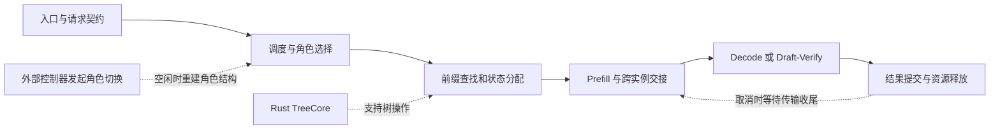
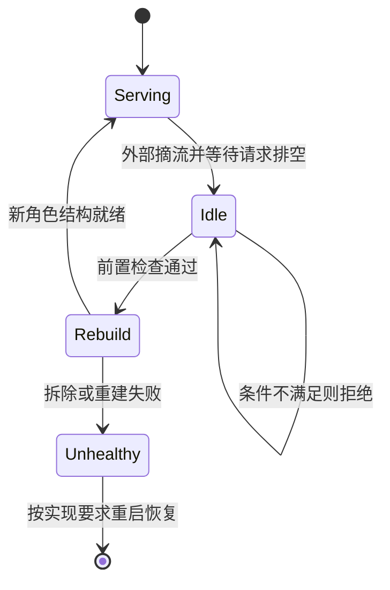

# SGLang v0.5.21 动态角色、缓存内核与升级边界学习文档

这次版本最值得学习的变化，是服务角色、缓存实现和生成状态怎样协同演进。理解“一个实例可以换角色”时，还要追问：谁决定换，什么时候能换，旧请求和缓存如何收尾。

本文属于**第三方资料整理型学习资料**，以发布解读为入口，对照官方 Release、相关 PR，并静态抽查固定版本的角色切换文件；没有启动服务、复现性能或验证硬件组合。

## 0. 阅读基线与范围

| 项目 | 内容 |
| --- | --- |
| 原文标题 | SGLang v0.5.21 重磅发布：779 个 PR，PD 动态角色切换、Rust 前缀缓存、新一代模型全面适配 |
| 原文链接 | [公众号原文](https://mp.weixin.qq.com/s/SBJs8YNHl8kS3zzseC8v3Q) |
| 作者 | Raymondmax |
| 原文发布时间 | 2026-10-07 15:40:10，Asia/Shanghai |
| 读取时间 | 2026-10-14 |
| 官方版本 | [v0.5.21 Release](https://github.com/sgl-project/sglang/releases/tag/v0.5.21)，发布于 2026-10-02 09:09:04，Asia/Shanghai |
| 源码复核基线 | 公开上游 [sgl-project/sglang](https://github.com/sgl-project/sglang)，tag `v0.5.21`；其 commit 为 `e00930c5489053f26d86b179cee0d087f846acbb`，不将滚动 `main` 当作该版本 |
| 工作区与操作边界 | 通过公开固定提交读取单个源码文件，无外部源码检出或本地修改；学习仓库在隔离工作区编辑 |
| 整理范围 | 角色切换、Rust TreeCore、统一缓存、投机组合、API 与升级契约 |
| 不展开 | 779 个 PR 的逐项审计、各硬件镜像可用性、模型精度与生产性能复现 |
| 配图 | 原文正文没有图片；下面的 Mermaid 为整理者机制图 |

先修：[运行时](<../运行时/README.md>)、[KV 缓存](<../KV缓存/README.md>)、[分离部署](<../分离部署/README.md>)。与 [v0.5.20](<SGLang v0.5.20 缓存调度与 Serving 协同学习文档.md>) 对照时，各自保留版本边界。

| 术语 | 人话解释 | 本文关心什么 |
| --- | --- | --- |
| P / D | 处理输入 / 持续生成的服务角色 | 角色改变不等于权重重载 |
| TreeCore | 前缀树的底层实现 | Rust 实现不等于整个缓存策略或调度器改写 |
| UnifiedRadixCache | 统一组织不同类型缓存状态 | 不意味着不同模型的 KV 可以互用 |
| Deferred release | 取消后延后回收接收页 | 取消请求与写入停止是不同事件 |
| Goodput | 满足正确性与延迟要求的有效吞吐 | 不能只看某个局部算子加速 |

## 1. 把发布清单连成一条请求链

**图意解读：** 这是阅读地图，不是一个新增中央控制模块。API 改动发生在入口，TreeCore 作用在树操作，角色切换作用在实例执行模式，投机生成和取消释放作用在状态生命周期。优化其中一段，不能自动消除其他段的排队和容量限制。

## 2. 动态角色切换：保留权重，重建角色结构

### 人话版

把一个“读长输入的工位”换成“持续输出的工位”，不一定要搬走整套设备。但必须先让正在处理的工件离开，关闭旧交接通道，再装好新通道。此处的设备是模型权重与基础 KV 池，通道是角色相关的队列、发送/接收器等结构。

[PR #28403](https://github.com/sgl-project/sglang/pull/28403) 描述了 `POST /pd_role_switch` 和 `--enable-pd-role-switch`。它提供执行角色切换的能力；**何时切、切多少台、怎样摘流和恢复路由，仍需要外部控制策略**。公众号“集群可以自动调度算力”应理解为可在此能力上构建的系统，而非打开版本即获得完整自动伸缩器。

### 固定源码中能确认的门槛

| 行为 | 固定提交锚点 | 对读者的含义 |
| --- | --- | --- |
| 检查开关、角色、健康状态、重入、后端能力及 staging 配置 | [`role_switch.py::_reject_reason`](https://github.com/sgl-project/sglang/blob/e00930c5489053f26d86b179cee0d087f846acbb/python/sglang/srt/disaggregation/role_switch.py#L159) | 支持 P/D 不代表传输后端必然支持换角色 |
| 非空闲实例拒绝切换 | [`handle_pd_role_switch`](https://github.com/sgl-project/sglang/blob/e00930c5489053f26d86b179cee0d087f846acbb/python/sglang/srt/disaggregation/role_switch.py#L43) | 调用前必须排空请求；此文件不替外部系统完成摘流 |
| 拆除旧结构并释放前缀缓存 | [`teardown_disaggregation`](https://github.com/sgl-project/sglang/blob/e00930c5489053f26d86b179cee0d087f846acbb/python/sglang/srt/disaggregation/role_switch.py#L229)、`_release_prefix_cache_for_role_switch` | 权重保留不等于热前缀命中率保留 |
| 重建失败标记 unhealthy；成功后重新分发事件循环 | `handle_pd_role_switch`、`run_event_loop_supervisor` | 不能把所有失败都当作可自动回退到旧角色 |

**图意解读：** 状态图将外部操作和文件内行为放在同一阅读视图中；“外部摘流”是完整编排所需步骤，不是声称 API 已实现自动摘流。以一台 P 换成 D 为例，即使没有重载权重，也要计入排空时间、缓存冷启动，以及可能的 Decode graph 捕获成本。

## 3. Rust 缓存内核与统一内存：实现、策略和数据要分开

官方说明确认 Rust TreeCore 成为默认；不支持的配置自动回退 Python，也可通过 `SGLANG_UNIFIED_RADIX_TREE_CORE_BACKEND=python` 强制选择 Python。这里改的是树的底层实现，不是把所有 Python 调度、GPU KV 分配和 L3 存储操作统一搬入 Rust。[实现入口 PR #39627](https://github.com/sgl-project/sglang/pull/39627)

可以把缓存分成三个层面理解：

| 层面 | 要回答的问题 | 不能混淆的对象 |
| --- | --- | --- |
| 前缀索引 | 这段前缀有没有可复用状态？ | 树节点与 GPU 数据页 |
| 生命周期与策略 | 谁引用、何时驱逐、是否卸载？ | Rust 数据结构实现与 LRU 策略 |
| 实际数据位置 | 状态在显存、主存还是远端？ | HiCache 分层与 PD 交接 |

原文还涉及 UnifiedRadixCache、SWA/Mamba 旧实现迁移、LMCache 后端等。学习重点不是背支持清单，而是理解统一接口需要保留模型专属的状态、回滚和逐层传输语义。可继续阅读 [Unified Radix Cache](<../KV缓存/SGLang Unified Radix Cache 学习文档.md>)，其固定版本与本文不同。

## 4. 投机、并行与接口：组合是独立的契约

Release 列出了 PP 与 EAGLE/MTP 组合、DSpark 模型接入、通信正确性修复。这里的“支持”需要落到具体模型、算法、硬件和参数组合，不能推导出所有 PP、PD、DFlash、混合注意力组合都通过验证。进一步阅读 [PD 与投机解码的状态和容量](<../../大模型推理/高级生成/PD 与投机解码的状态交接、回滚及容量学习文档.md>)。

业务入口也有分工变化：`/v1/decisions` 面向判别与分类，`/v1/score` 面向候选打分。它们的请求契约、评分含义与常规文本生成不同，不能把 HTTP 成功或某个 score 值直接解释成经过校准的概率。本次仅确认发布说明中的功能方向，不提供未经运行验证的调用配方。

### 升级时真正变化的行为

| 契约 | v0.5.21 发布说明中的变化 | 验证对象 |
| --- | --- | --- |
| 请求提供模板 | `/v1/chat/completions`、`/v1/tokenize` 的 `chat_template_kwargs` 内含 `chat_template` 时，默认拒绝；需 `--trust-request-chat-template` | 区分模板本身与其他未受影响的 kwargs |
| 自定义 logits 处理 | 必须返回完整 shape，不能依赖 `(1, vocab)` 广播 | 自定义 processor 的 batch 维 |
| RL 权重更新 | tensor/distributed 更新需包在 `begin_weight_update()` 与 `end_weight_update()` 之间 | target/draft 选择与会话收尾 |
| MoE fused finalize | FlashInfer 路径默认关闭，发布说明给出恢复变量 | 精度与延迟的取舍属于特定 kernel 路径 |
| PD 取消释放 | Mooncake/NIXL 默认延迟释放接收 KV 页，等待各 Prefill rank 确认；发布说明列 30 秒超时 | 取消、传输确认、超时和页复用的顺序 |

对应 PR：[请求模板 #28135](https://github.com/sgl-project/sglang/pull/28135)、[logits shape #39234](https://github.com/sgl-project/sglang/pull/39234)、[权重会话 #40777](https://github.com/sgl-project/sglang/pull/40777)、[取消释放 #41023](https://github.com/sgl-project/sglang/pull/41023)。

来源：[Release 的 Breaking Changes & Upgrade Notes](https://github.com/sgl-project/sglang/releases/tag/v0.5.21)。这些是升级契约，不是对任意分支的即时断言；尤其不能仅凭“发了取消”证明 DMA 已停止，也不建议把恢复立即释放当作普通调优手段。

## 5. 性能数字怎样读才不串场

以下只记录**官方报告**，没有复现；不按这些数字估算用户集群收益。

| 数字 | 已核对的条件 | 不应推广为 |
| --- | --- | --- |
| 779 PR、227 位贡献者 | 该次 Release 的统计 | 性能或正确性的证明 |
| 10.9× 前缀吞吐 | Kimi Linear、8×B200、并发 8；cached-prefix DCP 传输按 pack 容量约束，[#40376](https://github.com/sgl-project/sglang/pull/40376) | 任意 PD 请求的端到端吞吐 |
| P99 ITL 降 43.9% | DeepSeek-V4-Pro FP4、4×B300、并发 32、agentic trace；Tail-Optimized LRU 为 opt-in，[#34012](https://github.com/sgl-project/sglang/pull/34012) | 所有 Agent 工作负载的默认收益 |
| 1.66–2.56× | LFM2-VL、DSpark、batch 1，[#40651](https://github.com/sgl-project/sglang/pull/40651) | Kimi K3 或高并发统一加速比 |
| 输出吞吐 +37.7% | Dynamo TCP push benchmark、默认 `batch_notify_size`，[#39486](https://github.com/sgl-project/sglang/pull/39486) | 普通 HTTP 服务吞吐 |

原文另列 DeepSeek-V4.1 长输入首 token、Kimi K3 Prefill 收益；官方确有相应条目，但本次不补造未在本文逐项核对的工作负载条件。查 [Release](https://github.com/sgl-project/sglang/releases/tag/v0.5.21) 中 #40352、#40045 可继续追踪。

## 6. 自测、排障与下一步

| 现象 | 先查的边界 |
| --- | --- |
| 角色切换被拒绝 | 开关、后端 `supports_role_switch`、是否空闲、staging 配置 |
| 切换后首批请求变慢 | 前缀释放、graph 捕获和新路由的队列变化 |
| 接口升级后返回 4xx | 模板键、参数结构，先于 GPU 排查 |
| 投机开启后中途 OOM | 常驻池与 Verify 峰值，不能只看启动成功 |
| 取消后显存没有立即归还 | 是否处于传输确认或超时等待，不立即认定泄漏 |

能回答“为什么能换角色不等于已有自动调度器”“Rust TreeCore 管的是哪一层”“性能数字的分母是什么”，就掌握了本次版本阅读的主线。

下一步：[版本学习导航](<README.md>) → 按实际问题进入 [分离部署](<../分离部署/README.md>) 或 [性能工程](<../性能工程/README.md>)。原文、Release 与固定源码链接分别代表二手概括、官方声明与静态实现，均不替代运行证据。
