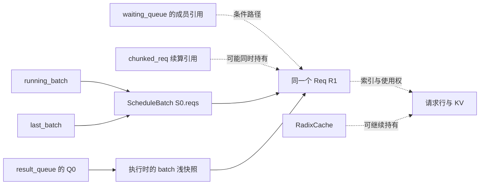
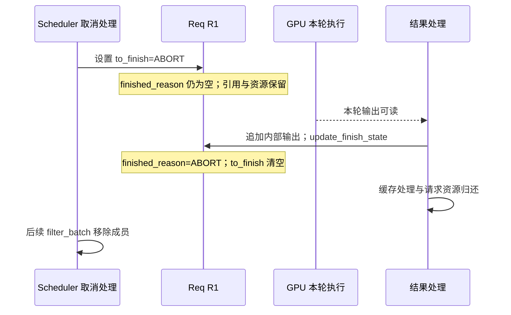

# SGLang Req 状态与队列流转学习文档

本文是源码分析型学习资料，配合 [Req 状态与队列流转交互课程](../../pages/sglang/request-state/index.html) 阅读。先理解 [普通请求运行时](<SGLang 普通请求运行时与资源生命周期学习文档.md>) 的进程交接，再读 [调度循环与批次执行旅程](<SGLang 调度循环与批次执行旅程学习文档.md>)。这里把观察点放回同一个 Req：它由谁持有、为什么等待、什么时候改变状态、什么时候归还资源。

## 0. 阅读基线与范围

| 项目 | 内容 |
| --- | --- |
| 源码仓库 | [sgl-project/sglang](https://github.com/sgl-project/sglang)；源码路径相对 `python/sglang/srt/` |
| 公开基线分支 | `main` 的固定提交；读取 Git 对象，不使用当前工作树文件代替基线 |
| commit | `279339f113b79af84f27fd3ac92d0a13bd3f4cbd` |
| 读取时间 | 2026-11-09 |
| 源码工作区 | 检出目录有未跟踪资料；本次未修改、清理或切换外部源码工作区 |
| 操作边界 | 静态源码核对与网页教学模型检查；未运行 SGLang、GPU、通信或性能实验 |
| 主线 | 普通 token 输入、单实例、TP=PP=DP=1、CUDA、普通 RadixCache；Normal 与 Overlap 分场景 |
| 示例条件 | 无前缀命中，page_size=1；无 HiCache、PD、投机、Beam、多模态、混合状态、mixed chunk；回撤场景明确引入第二条请求 |
| 时间含义 | 同一教学时钟，u 为讲解单位。活动长度不代表真实耗时；只表达合法的先后依赖和可重叠窗口 |

现有 [《连续批处理与队列状态》](../source-study/03-scheduling/02-连续批处理与队列状态.md) 与 [《请求对象与生命周期全景》](../source-study/architecture/03-请求对象与生命周期全景.md) 已有深入分析，但采用各自固定基线。本篇重新核对上述提交，以可逆动画串起容器引用、资源与异步结果，不覆盖旧资料的版本说明。不同版本文档之间的链接表示阅读关系，不表示实现完全一致。

### 术语速查

| 名称 | 在本课中的含义 |
| --- | --- |
| R1 | 一个 Scheduler 进程中的同一个 Req，不是跨进程共享的 Python 对象 |
| S0 / S1 | 教学编号的 ScheduleBatch 对象；可能被多个 Scheduler 变量引用 |
| B0 / B1 / B2 | 执行轮次；同一个 S0 可以被更新后用于不同轮次 |
| Q0 / Q1 | `result_queue` 中的 batch 浅快照与结果项；不是新建 Req |
| waiting_queue | 等待调度准入的 Req 列表，不能只凭名称认定严格 FIFO |
| chunked_req | 尚有输入待算的单个 Req 引用，不是列表 |
| 请求行 | ReqToTokenPool 中属于该请求的索引行；记录位置到 KV 地址的关系 |
| 缓存保护 | 活跃请求对缓存前缀的保护；解锁后仍需实际驱逐才成为 allocator 可用空间 |

## 1. 同时看状态、引用和资源

### 人话版

“请求已完成”回答的是输出生命周期。“它还在旧 batch 里”回答的是对象引用。“缓存还有它的 KV”回答的是资源归属。这三句话可以同时成立。

源码没有用一个 Req 枚举完整表达本课所有教学阶段。应分别检查请求字段、容器成员、执行完成条件和资源。

| 维度 | 关键对象或字段 | 观察问题 |
| --- | --- | --- |
| 请求自身 | `output_ids`、`finished_reason`、`to_finish`、`is_retracted` | 已提交哪些 token？待取消还是已结束？是否等待恢复？ |
| 调度集合 | `waiting_queue`、`running_batch.reqs` | 等待准入还是具备后续 Decode 资格？本轮是否实际选中？ |
| 执行引用 | 本轮局部 `batch`、`last_batch`、`chunked_req`、快照 `.reqs` | 谁仍可访问同一个 Req？哪份成员视图对应哪轮执行？ |
| 结果处理 | `result_queue`、消费函数的局部 batch/result、`copy_done` | 已提交、已取出、可读、已处理分别到哪一步？ |
| 资源 | `req.kv.req_pool_idx`、KV 分配与缓存保护 | 请求还有使用权吗？缓存仍持有吗？是否已可重新分配？ |

**图意解读：** 这是可能的引用关系索引，并非所有边都同时存在。动画按场景点亮真实成员关系。S0 被多个变量引用时不复制 S0；快照复制成员列表，不深拷贝其中的 Req。[初始化](https://github.com/sgl-project/sglang/blob/279339f113b79af84f27fd3ac92d0a13bd3f4cbd/python/sglang/srt/managers/scheduler.py#L1273)、[ScheduleBatch.copy](https://github.com/sgl-project/sglang/blob/279339f113b79af84f27fd3ac92d0a13bd3f4cbd/python/sglang/srt/managers/schedule_batch.py#L3719)。

## 2. 正常路径：离开 waiting，随后怎样进入 Decode？

### 控制与数据变化

1. 普通模式 `_add_request_to_queue` 将 Req 追加到 waiting_queue。P/D 模式使用其他入口，不混入本例。
2. PrefillAdder 产生 can_run_list；Scheduler 仅移除被选中的等待成员，建立 ScheduleBatch，调用 prepare_for_extend 分配请求行与 KV 地址。
3. 设备处理输入并生成首 token；CPU 结果处理等待可读条件，追加 output_ids，更新完成状态。未结束的前缀可以进入缓存，但请求保护还在。
4. 本轮结束后，last_batch 指向本轮 batch。下一轮 `get_next_batch_to_run` 先过滤上一 Extend batch，再将可继续成员并入 running_batch。
5. running 为空时，源码直接执行 `running_batch = last_batch`；不为空时则 `merge_batch(last_batch)`。这里的不同变量不保证不同 Python 对象。
6. Decode 准备的是上一输出 token 对应的新输入位置。本轮新采样 token 不等于刚写入 KV 的输入 token。

源码入口：[模式分流](https://github.com/sgl-project/sglang/blob/279339f113b79af84f27fd3ac92d0a13bd3f4cbd/python/sglang/srt/managers/scheduler.py#L3233)、[等待集合过滤](https://github.com/sgl-project/sglang/blob/279339f113b79af84f27fd3ac92d0a13bd3f4cbd/python/sglang/srt/managers/scheduler.py#L4021)、[过滤与合并](https://github.com/sgl-project/sglang/blob/279339f113b79af84f27fd3ac92d0a13bd3f4cbd/python/sglang/srt/managers/scheduler.py#L3653)。

### 结束与资源归属

Decode 结果处理先追加输出，再检查停止条件；完成分支进入 release_kv_cache。缓存插入、前缀解锁、请求行归还与后续 batch 过滤是不同操作。动画为这些顺序操作保留观察帧，并不表示它们必然跨越多个 event loop。

普通 RadixCache 可以保留已算 KV。无重复前缀、page_size=1 的示例中，请求退出后 KV 仍由缓存持有，只有驱逐后才重新进入分配器可用集合。不能用“请求行已归还”推出“显存已全部可分配”。[结果收尾](https://github.com/sgl-project/sglang/blob/279339f113b79af84f27fd3ac92d0a13bd3f4cbd/python/sglang/srt/managers/scheduler_components/batch_result_processor.py#L1310)、[资源释放](https://github.com/sgl-project/sglang/blob/279339f113b79af84f27fd3ac92d0a13bd3f4cbd/python/sglang/srt/mem_cache/common.py#L254)、[缓存保留与解锁](https://github.com/sgl-project/sglang/blob/279339f113b79af84f27fd3ac92d0a13bd3f4cbd/python/sglang/srt/mem_cache/radix_cache.py#L479)。

## 3. 分块：同一个 Req 怎样跨越多个 batch？

本例 6 个输入按 2 + 2 + 2 分块，不混入 Decode。

| 观察点 | waiting | chunked_req | batch 与输出 |
| --- | --- | --- | --- |
| 第一块选好 | R1 已移除 | R1 | S0 引用 R1，输出为空 |
| 第一块结果处理 | 空 | R1 | 中间块不提交有效首 token |
| 下一轮 stash / filter | 空 | R1 | 缓存已算前缀；旧 S0 排除 R1 |
| 续算第二块 | 空 | R1 | 新 S1 引用同一个 R1 |
| 最后一块选好 | 空 | None | 新 S2 引用 R1；最后一块此时尚未算完 |
| 最后结果处理 | 空 | None | 追加首 token，之后才具备普通 Decode 接续条件 |

`add_chunked_req` 返回 Req 表示还有剩余输入，返回 None 表示本次已经能容纳剩余部分。因此不能把指针清空画成“最后一块计算已结束”。同样，旧 batch 移除 R1 只是移除引用，KV 与请求行需要继续服务续算。

源码：[stash 与排除](https://github.com/sgl-project/sglang/blob/279339f113b79af84f27fd3ac92d0a13bd3f4cbd/python/sglang/srt/managers/scheduler.py#L3627)、[继续准入](https://github.com/sgl-project/sglang/blob/279339f113b79af84f27fd3ac92d0a13bd3f4cbd/python/sglang/srt/managers/schedule_policy.py#L950)、[中间块结果](https://github.com/sgl-project/sglang/blob/279339f113b79af84f27fd3ac92d0a13bd3f4cbd/python/sglang/srt/managers/scheduler_components/batch_result_processor.py#L414)。

## 4. 回撤：资源可以交还，文本进度继续保留

本例 R1 已有 `[t1,t2]`，与 R2 同在运行集合。下一步 KV 不足，源码选择 R1 回撤。至少保留其他可运行请求的条件要明确，不能用单请求示例暗示任何 OOM 都会无限重排队。

`release_req` 先调用 `release_kv_cache(is_insert=False)`，不把需要立刻归还的私有尾部新插入树；随后尝试驱逐已经可回收的缓存，再 `reset_for_retract`。reset 要求请求行已经释放，并重置匹配、KV 与执行进度字段，设置 is_retracted。普通 token 输入的 output_ids 保留；input_embeds 路径存在重启输出等不同处理。

`retract_decode` 将回撤成员从当前 batch 过滤，Scheduler 再调用 `_add_request_to_queue(req, is_retracted=True)`。重新准入时 `init_next_round_input` 用原输入与已生成输出构造完整输入并重新匹配缓存；动画选择前缀已被驱逐、需要重算的例子。前缀仍命中时不应画成全部重算。

关键区别：**Retract 是暂停并恢复请求；Abort 是终止请求。** 源码还返回 reqs_to_abort；例如最后剩余请求仍无法满足容量等失败出口不能归为可恢复回撤。本课将这些限制说明在正文，不捏造成功恢复。

源码：[容量检查和回队](https://github.com/sgl-project/sglang/blob/279339f113b79af84f27fd3ac92d0a13bd3f4cbd/python/sglang/srt/managers/scheduler.py#L4141)、[回撤与失败出口](https://github.com/sgl-project/sglang/blob/279339f113b79af84f27fd3ac92d0a13bd3f4cbd/python/sglang/srt/managers/schedule_batch.py#L3214)、[release_req](https://github.com/sgl-project/sglang/blob/279339f113b79af84f27fd3ac92d0a13bd3f4cbd/python/sglang/srt/managers/schedule_batch.py#L2209)、[reset_for_retract](https://github.com/sgl-project/sglang/blob/279339f113b79af84f27fd3ac92d0a13bd3f4cbd/python/sglang/srt/managers/schedule_batch.py#L1931)。

## 5. 取消：先确定请求正被谁持有

### 尚在 waiting

本例是普通模式、从未选批的请求，无计算 KV。abort_request 从 waiting_queue 直接 pop，完成缓存侧请求清理并向 TokenizerManager 回告。它不必经过运行结果处理，因此不强行把 Req.finished_reason 画成已写入 ABORT。前端状态清理与 Scheduler 本地列表删除仍是两个职责。[等待取消](https://github.com/sgl-project/sglang/blob/279339f113b79af84f27fd3ac92d0a13bd3f4cbd/python/sglang/srt/managers/scheduler.py#L5267)。

### 已在 Decode 集合

collect_inflight_reqs 收集 running_batch、last_batch 中的请求；重复引用由集合去重。取消首先设置 `to_finish = FINISH_ABORT()`，保留 finished_reason 为空。Normal 示例随后仍走一次 Decode 结果路径：追加内部 token，update_finish_state 采用待结束原因，清空 to_finish，再处理资源。

**图意解读：** 这是选定 Normal 路径的因果示例，不保证所有后端或取消到达时机都“再算恰好一个 token”。内部 token 追加也不等于向用户交付成功生成结果。中间块取消另由 `_pending_chunked_abort_req` 与 `process_pending_chunked_abort` 协调，不直接套用这里的 Decode 示例。

源码：[运行中取消](https://github.com/sgl-project/sglang/blob/279339f113b79af84f27fd3ac92d0a13bd3f4cbd/python/sglang/srt/managers/scheduler.py#L5395)、[待结束标记说明](https://github.com/sgl-project/sglang/blob/279339f113b79af84f27fd3ac92d0a13bd3f4cbd/python/sglang/srt/managers/schedule_batch.py#L1117)、[提交终态](https://github.com/sgl-project/sglang/blob/279339f113b79af84f27fd3ac92d0a13bd3f4cbd/python/sglang/srt/managers/schedule_batch.py#L1889)。

## 6. Overlap：取出结果，不代表结果已处理完

### 明确三个身份

- S0 是可原地更新的 ScheduleBatch；准备下一轮可能改变其成员视图与输入元数据。
- B0/B1/B2 标记执行轮次，不自动等于三个独立 Python batch 对象。
- Q0/Q1/Q2 保存 batch.copy() 与结果对象。copy 对 reqs 做列表浅拷贝，列表内仍是同一个 Req。

event_loop_overlap 提交当前批后追加结果项，再取出前一项并调用 process_batch_result。实际 `popleft()` 在处理函数之前，函数内部才可能同步等待 copy_done。因此动画将“队列持有 Q0”转成“CPU 消费函数持有 Q0”，等待期间不错误地把它留在队首。

同一时钟下的三条轨道分别表示 Scheduler CPU、GPU forward stream、结果 copy stream：

1. CPU 可在 B0 计算时规划并提交 B1；B1 的设备执行依然等待 B0 输出和同一流上的顺序。
2. CPU 等旧结果或更新 output_ids 时，已提交的下一批 GPU 工作可以继续。
3. WAR 事件约束共享缓冲的后续写入，不能把 CPU 提前规划理解成共享内存可以随意覆盖。
4. CPU 尚未读取 B1 的 EOS 时，B2 可能已提交。逻辑完成后仍需排空先前提交的结果；Decode 结果处理跳过 finished / retracted 请求，不再追加额外有效输出。

本动画选择 B2 设备计算先结束、其结果拷贝稍后完成的合法交错，再显示资源收尾与剩余结果排空。不是测量，也不把“所有后端都在这个时点释放”作为结论。

源码：[Overlap 循环](https://github.com/sgl-project/sglang/blob/279339f113b79af84f27fd3ac92d0a13bd3f4cbd/python/sglang/srt/managers/scheduler.py#L1942)、[WAR](https://github.com/sgl-project/sglang/blob/279339f113b79af84f27fd3ac92d0a13bd3f4cbd/python/sglang/srt/managers/scheduler.py#L1893)、[等待 copy_done 与跳过完成请求](https://github.com/sgl-project/sglang/blob/279339f113b79af84f27fd3ac92d0a13bd3f4cbd/python/sglang/srt/managers/scheduler_components/batch_result_processor.py#L920)。设计背景参考 [SGLang 团队 v0.4 说明](https://www.lmsys.org/blog/2024-12-04-sglang-v0-4/)；本文不采用其中的性能数字，也不将历史代码当作本课实现。

## 7. 模式队列索引与排障入口

| 现象 / 对象 | 应检查的条件 | 继续阅读 |
| --- | --- | --- |
| waiting 不减少 | 候选排序与本轮准入预算 | [调度准入与容量回撤](<SGLang 调度准入与容量回撤学习文档.md>) |
| waiting 已空但没有首 token | 是否由 chunked_req 续算，是否还有输入未处理 | 本文第 3 节 |
| result_queue 已空但 CPU 仍等待 | 消费函数是否持有已取出的快照，copy_done 是否可读 | 本文第 6 节 |
| finished 已设置但仍有旧引用 | 后续 batch filter 与剩余结果排空是否完成 | 本文第 2、6 节 |
| 请求结束但 allocator 可用量未立即增加 | KV 是否留在缓存，保护是否解除、是否实际驱逐 | [KV 映射与共享回收](<../KV缓存/SGLang KV 映射与共享回收学习文档.md>) |
| grammar_queue 等待 | 异步编译是否结束、失败如何转入处理路径 | [模型状态与高级生成](<../高级生成/SGLang 模型状态与高级生成机制学习文档.md>) |
| Prefill bootstrap / inflight | 握手、本地 metadata、发送终态、PP 共识与本地复查 | [PD 数据流交互课程](../../pages/sglang/pd-dataflow/index.html) |
| Decode prealloc / transfer | 资源预分配、接收匹配、回载与后续选批条件 | [PD 准入交互课程](../../pages/sglang/inference-overview/deployment.html) |

这些模式不是一条请求的必经大队列链；同名 rid 在跨进程场景也不代表共享同一个 Python Req。常规进程内对象关系与 P/D 网络数据传输需要分别阅读。

## 8. 交互表达与旧资料衔接

本专题位于 Pages 第三章、第二层、模块 03，紧接完整调度循环，先建立请求视角，再进入 batch 输入准备、选批细节和资源预算。原请求运行时保留跨进程主线；原调度课保留策略与预算；P/D 与高级生成保留特定模式内部机制，新增相关入口而不重复其整套动画。

交互图采用单一 render(time) 模型：请求字段与成员变化在对应操作完成时提交，引用线可连续建立或撤回，KV 写入与输出提交可在中途暂停，执行活动区间独立于讲解步骤。回拖重新从初始状态推导，不在旧状态上反向打补丁。

五类机制均保留共同轨道：Normal 用于说明顺序依赖；分块显示每轮设备完成与 CPU 续算；回撤说明 R2 可继续；取消对照局部移除与结果路径收尾；Overlap 则明确 CPU、GPU 与回传的重叠。这里的轨道不是为了增加装饰，而是解释“请求状态改变时，谁还在执行”。

旧源码课程提供更大的多请求账本与过滤/合并细节；本文只在固定基线下整合请求视角。进一步重复创建“队列大全”正文没有明显增量，条件模式通过本篇索引衔接现有专题。
