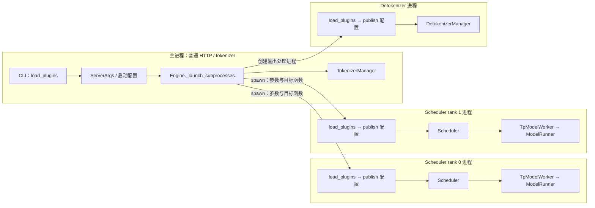
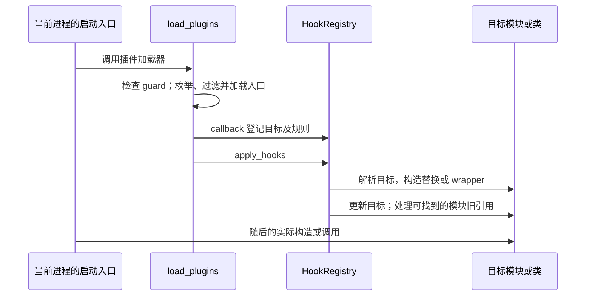

# SGLang 启动、平台选择与插件生效顺序学习文档

SGLang 也需要在启动时选择服务、硬件平台和实际计算实现，但这些选择发生在不同层。`sglang serve` 选择运行哪类服务，SRT 平台描述设备能力，general plugins 可以登记并应用 hooks；Scheduler 进程随后创建 Worker、Runner 和模型。

本文是**源码分析型学习资料**。沿普通文本推理的启动链，追踪插件怎样从包元数据走到当前进程的对象，再连接到实际执行。重点是进程、导入和配置时机，不重新讲解全部请求调度、模型 Forward 或算子实现。

## 0. 固定源码与阅读范围

| 项目 | 内容 |
| --- | --- |
| 公开源码 | [sgl-project/sglang](https://github.com/sgl-project/sglang) |
| 分支与 commit | 官方 `main`，`b1970bc473cfff1731c068e7d23e9e61b794b0c0` |
| 读取日期 | 2026-11-19 |
| 工作区状态 | 按固定提交下载相关文件只读核对，未建立可运行检出或修改外部源码 |
| 主线 | SRT、普通 Python HTTP 文本服务、单节点、单 tokenizer/detokenizer、TP=2、PP=1、DP=1；教学拓扑，未实际启动 |
| 平台对照 | 先解释通用解析与 hook，再单独读内置 NPU 初始化和 OOT 方法调用；不把两个平台拼成一次运行 |
| 不展开 | Diffusion 执行、Ray、Rust server、多节点、PD、外部平台包的完整移植、模型精度与性能验证 |
| 操作边界 | 静态源码分析、文档与链接检查；未导入 SGLang、安装插件、运行模型或进行 GPU 实验 |

先修：[从 CLI 到服务进程启动](<../source-study/01-getting-started/03-从CLI到服务进程启动.md>)、[执行分层与硬件机制](<SGLang 执行分层与硬件机制学习文档.md>)。库内[硬件后端插件课程](<../source-study/12-extensions-and-capstone/04-硬件后端插件与生态边界.md>)使用 `72d5c5bb…` 历史提交；本篇另固定新版本，不把两者的内置平台列表与实现细节合并。

| 术语 | 人话解释 | 作用边界 |
| --- | --- | --- |
| serve backend | 接管命令参数并运行某类服务的实现 | 可能有自己的进程与请求流程 |
| SRTPlatform | 文本运行时查询设备、默认配置与部分组件实现的对象 | 不等于每个模型层都只通过它分发 |
| general plugin | 注册函数，通常用副作用登记 hook | 安装包中有入口，不等于当前进程已应用 |
| HookRegistry | 保存目标及 before/after/around/replace 规则的进程内注册表 | 目标解析、修改与实际调用是不同阶段 |
| OOT | 外部平台接入身份 | 类在仓外不自动意味着其枚举或全部工厂正确 |
| readiness | 某个启动参与者完成约定初始化 | 不是模型精度与长期服务能力证明 |

## 1. 三类入口先分清

| 入口组 | 提供什么 | 本篇怎么读 |
| --- | --- | --- |
| `sglang.serve_backends` | `llm`、`diffusion` 或仓外服务实现 | 本篇只沿选中 LLM 后的普通 SRT 路径 |
| `sglang.srt.platforms` | 激活函数返回的 SRTPlatform 类路径 | 解析平台身份和设备能力 |
| `sglang.srt.plugins` | 注册并应用 general hooks 的回调 | 在实际调用加载器的进程内生效 |

同一个“backend”名字，可以指服务实现、Attention 或 Kernel 来源。更换服务 backend，可能接管整条服务流程；更换 Attention backend，只是替换模型执行的一部分。[CLI][S1] [插件加载器][S2] [平台解析][S3]

本篇只讨论 SRT。官方同一份插件文档也介绍 Diffusion；其中 `sglang.multimodal_gen.*`、worker bootstrap、`ServerArgsPayload` 和所选平台包的严格失败处理属于另一套路径。不能看见同页写着“worker 初始化”就把这些保证归给 SRT。[固定文档][S12]

## 2. 插件分别在哪些进程处理



**图意解读：** 外框表示进程，框内表示对象和初始化步骤。模型 Worker 与 Runner 在对应 Scheduler 进程内，不能再机械增加两组 GPU Worker 进程。箭头表示启动依赖，不表示设备执行轨道；Tokenizer 和 Detokenizer 的请求数据通路未画出。[启动器][S4] [Scheduler 入口][S5] [Worker][S6] [Detokenizer][S7]

`Engine._launch_subprocesses()` 是启动方法名，不要求普通 HTTP 路径另有一个叫 Engine 的进程。其他服务模式应重新按源码数进程。

### 主进程的几个加载位置

| 入口 | 加载相对时机 | 为什么要放在这里 |
| --- | --- | --- |
| `cli/serve.py::serve()` | 正常启动时，在运行选中的服务前加载 | 扩展可在后续参数准备和服务装配前登记；帮助分支另走路径 |
| `launch_server.py` 的脚本入口 | `prepare_server_args()` 之前 | 兼容旧入口，不要求经过统一服务发现 |
| 离线 `Engine.__init__()` | 用 kwargs 创建 ServerArgs 之前 | 参数构造本身可能是 hook 的目标 |
| `Engine._launch_subprocesses()` | `resolve_once`、环境准备之后，参数检查之前 | 防御性加载；本进程已处理过时由 guard 返回 |

这些调用不是重复安装插件。需要分别判断哪个入口被使用，以及调用发生时 ServerArgs 是否已经存在；后来的 hook 不会自动重建先前对象。[S1] [S4] [旧脚本入口][S13]

## 3. 平台解析、设备默认值与 backend 初始化是不同动作

### 平台是第一次访问时解析的

`current_platform` 使用模块 `__getattr__` 延迟创建，并在当前进程缓存。显式 `SGLANG_PLATFORM` 匹配的是平台 Entry Point 名称：解析器只导入所选回调，名称不存在、回调失败或返回 None 会报错；类还必须是 SRTPlatform 子类。[S3]

未显式选择时，代码执行可发现的外部平台回调：零个激活结果才进入内置回退，一个采用，多个报歧义。在本篇固定版本中，内置回退顺序是：

```text
显式启用的 CPU engine → SAIL → CUDA → NPU → ROCm
    → XPU → MUSA → MPS → MLU → 基础 SRTPlatform
```

这是该函数的选择顺序，不是性能或推荐顺序。外部平台已经激活时，不再按这条内置回退重选。相比历史课程，NPU/MUSA/MPS/MLU 等入口已经出现在本次解析器中；旧版本下的缺失不能直接当作当前结论。[S3]

**例子：** 存在名为 `demo` 的平台插件，可以由 `SGLANG_PLATFORM=demo` 选择；不能仅因内置支持 CUDA，就假定环境里一定注册了名为 `cuda` 的 Entry Point。两类名字的来源不同。

### 选中平台不等于已经初始化计算体系

内置 NPU 平台提供设备方法与默认 Attention backend `ascend`。ModelRunner 模块在导入阶段另外判断 NPU，并调用 `init_npu_backend()`；否则在 OOT 条件下调用 `current_platform.init_backend()`。因此“平台实例存在”“给配置默认值”“初始化具体计算后端”有各自调用者。[NPU 平台][S9] [Runner 模块][S8]

NPU 初始化函数有一次性调用包装，尝试导入 `sgl_kernel_npu`，导入 `torch_npu` 并设置相关行为。所读代码中，缺少 `sgl_kernel_npu` 的 ImportError 只会记录 warning；不能把这个函数的名字理解成它统一验证了全部 NPU 算子。[NPU 初始化][S10]

本文记录的是此处源码副作用，不建议把这些修改复制到其他设备或其他运行时。其是否完成、是否重复执行，还要结合当前进程中的模块导入状态。

## 4. Scheduler 子进程：加载插件后才构造执行对象

本篇普通启动链在 `_set_envs_and_config()` 中设置 multiprocessing 的启动方法为 spawn。父进程将 ServerArgs、PortArgs、GPU/rank 等参数交给 Scheduler 子进程；Python 的对象修改和插件 guard 不会作为共享的活对象传过去。[S4]

`run_scheduler_process()` 的关键顺序是：

```text
load_plugins()
  → publish(server_args, role="scheduler", ranks=...)
  → 配置日志、进程身份等运行环境
  → Scheduler(server_args, port_args)
      → init_tp_model_worker()
      → TpModelWorker（本篇不选 MLX）
      → _init_model_runner()
  → 向父进程发送初始化信息
  → run_event_loop()
```

其中 `TpModelWorker._init_model_runner()` 在方法内部导入 ModelRunner，再创建实例。因此，正常链路能把插件处理放在该实例创建之前；但某个插件的目标解析或用户的额外 import，仍可能更早导入模块。[S5] [S6]

这里还有一个配置时机差异：Scheduler 入口的 `load_plugins()` 在该入口的 `publish()` 之前执行。插件回调不能仅因自己运行在 Scheduler 子进程，就假设本 rank 的运行时配置已经由这段入口发布；需要配置的工作应放在能取得相应配置的边界。

Detokenizer 入口也调用 `load_plugins()`，然后发布 detokenizer 角色配置，再创建 manager。不过入口参数 `detokenizer_manager_class` 已有默认值，HookRegistry 的模块属性传播不等于重写所有函数默认参数。能否替换该实例，应核对实际传入的工厂、类或目标，而不是只看到一个同名 hook 就认定成功。[S7]

## 5. general plugin 怎样变成实际 hook



**图意解读：** 这是一个进程内的顺序。目标解析本身可以触发 import，因此“应用 hook”也可能加载依赖。另一个 spawn 子进程需要建立自己的状态；登记、应用、调用成功是三个不同的完成条件。[加载器][S2] [Registry][S11]

### 过滤规则会影响哪些包被导入

`SGLANG_PLUGINS` 按入口名称过滤。显式选择平台时，general loader 还会按 distribution 排除提供未选中平台的包，避免连带导入其他设备依赖。这种过滤发生在 `ep.load()` 之前；它不验证被保留插件的执行正确性。[S2]

### 类替换与方法 hook 有自己的顺序

所读 HookRegistry 先处理 class REPLACE 目标，再处理其余目标，使方法级 hook 可以解析到替换后的类。同一个目标的 REPLACE 先于其他 wrapper 应用；重复 REPLACE 会记录覆盖警告。应用成功的目标进入 `_patched`，后续处理会跳过它。[S11]

当前实现还扫描 `sys.modules` 中的模块属性，将仍直接指向旧对象的引用更新为新对象。这可以处理一些 `from module import name` 的旧绑定，但没有遍历全部对象字段、容器、闭包、默认参数或重建已创建实例。因此不能把“支持旧引用传播”读成“任意晚加载都没有影响”。[S11]

### 加载函数返回，不等于所有 hook 都成功

在本篇 SRT 源码中，入口加载、callback 执行以及逐目标 hook 应用都有记录异常并继续的路径。`_plugins_loaded` 在执行 general callbacks 前设为 true，后续正常调用可能直接返回；它不是“所有插件均成功”的结果位。[S2] [S11]

这与同仓 Diffusion 的所选平台包失败合同不同。本文没有把 issue、规划或另一运行时的文档保证当作 SRT 现有实现。对必需适配，应追踪目标是否应用、实际对象是什么，以及后续模型调用是否经过它。

## 6. 从 Runner 接到真正的硬件路径

本篇新版本的 ModelRunner 将 Attention 装配交给 `model_runner_components/attention_backend_setup.py`。配置先解析 Prefill/Decode 后端字符串，再构造相应 backend；纯 SSM 模型等还有自己的分支。平台、模型类型和执行模式共同影响装配，不是只有一个平台总开关。[S8] [Attention 装配][S14]

| 层次 | 此时已经决定什么 | 还不能推导什么 |
| --- | --- | --- |
| 服务选择 | 进入普通 SRT 主线 | 使用了某个厂商 Kernel |
| 平台解析 | 当前平台对象与设备方法 | 每个算子都通过同一个平台接口 |
| general hooks 应用 | 某些目标对象或模块已被处理 | 先前对象、默认参数和设备资源已经重建 |
| Worker/Runner 创建 | 选定本 rank 的执行对象与配置 | 所有模型输入和后端组合都合法 |
| Backend 构造 | 明确路径的实现与 metadata 组织 | 设备计算数值正确 |
| 模型实际调用 | 进入某条可观察执行路径 | 精度、性能及资源寿命已完成验证 |

更深入的模型调用、KV pool、Graph 与算子选择，继续读[执行分层](<SGLang 执行分层与硬件机制学习文档.md>)和[Kernel 注册课程](<../source-study/05-model-execution/06-Kernel注册选择与实现阅读.md>)；它们保留各自固定版本，不能用同名 backend 把不同实现拼成一条统一链。

## 7. 用现象反查证据

| 现象 | 优先检查 |
| --- | --- |
| 父进程的 hook 生效，Scheduler 中没效果 | 子进程是否处理入口、是否被名称或 distribution 过滤、是否有加载异常 |
| 平台名选对，导入阶段仍报错 | activation 与 init_backend 的区别、首次平台访问和目标模块导入位置 |
| callback 已执行但没有改到对象 | HookRegistry 的目标、失败日志、已应用集合和实际引用位置 |
| 替换类名后仍构造旧类 | 默认参数、保存的工厂或已有实例是否持有旧引用 |
| rank 日志里配置不符合预期 | hook 与本 rank publish 的先后、参数何时解析和对象何时创建 |
| 收到 ready 后某种输入失败 | 实际 Backend、dtype/shape、KV 布局和模型特定约束；ready 不是全面功能验收 |

这些是静态代码给出的排查方向，本文没有运行故障复现。教学例子也不提供特定厂商的安装参数或生产支持承诺。

## 8. 关联复核与对照阅读

[启动课程](<../source-study/01-getting-started/03-从CLI到服务进程启动.md>)负责父子进程和 ready；[硬件插件课程](<../source-study/12-extensions-and-capstone/04-硬件后端插件与生态边界.md>)负责平台、工厂和算子生态；[执行分层](<SGLang 执行分层与硬件机制学习文档.md>)负责本轮模型工作。本篇将它们连接成“启动 → 当前进程注册 → 对象创建 → 实际执行”的顺序，补充新基线的平台分支与 hook 边界，不覆盖旧课固定源码结论。

与 [vLLM 多进程插件与补丁顺序](<../../vllm/运行时/vLLM 多进程启动中的插件注册与补丁生效顺序学习文档.md>)对照时，只比较同一问题：谁加载、谁配置、谁持有对象、何时可以声明某阶段完成。SGLang 的 Scheduler/Worker 同进程链、HookRegistry 与 vLLM 的 EngineCore/WorkerWrapper/HCU 导入协调器，各自有独立合同。

自测：为什么服务 backend、平台和 Attention backend 不能互换？为什么主进程已应用的 hook 不会自动成为 spawn 子进程的活状态？为什么模块旧引用传播仍不能修复所有晚替换？SRT 与 Diffusion 的失败语义为什么需要分别查证？

[S1]: https://github.com/sgl-project/sglang/blob/b1970bc473cfff1731c068e7d23e9e61b794b0c0/python/sglang/cli/serve.py#L188
[S2]: https://github.com/sgl-project/sglang/blob/b1970bc473cfff1731c068e7d23e9e61b794b0c0/python/sglang/srt/plugins/__init__.py#L35
[S3]: https://github.com/sgl-project/sglang/blob/b1970bc473cfff1731c068e7d23e9e61b794b0c0/python/sglang/srt/platforms/__init__.py#L76
[S4]: https://github.com/sgl-project/sglang/blob/b1970bc473cfff1731c068e7d23e9e61b794b0c0/python/sglang/srt/entrypoints/engine.py#L1199
[S5]: https://github.com/sgl-project/sglang/blob/b1970bc473cfff1731c068e7d23e9e61b794b0c0/python/sglang/srt/managers/scheduler.py#L7110
[S6]: https://github.com/sgl-project/sglang/blob/b1970bc473cfff1731c068e7d23e9e61b794b0c0/python/sglang/srt/managers/tp_worker.py#L487
[S7]: https://github.com/sgl-project/sglang/blob/b1970bc473cfff1731c068e7d23e9e61b794b0c0/python/sglang/srt/managers/detokenizer_manager.py#L486
[S8]: https://github.com/sgl-project/sglang/blob/b1970bc473cfff1731c068e7d23e9e61b794b0c0/python/sglang/srt/model_executor/model_runner.py#L268
[S9]: https://github.com/sgl-project/sglang/blob/b1970bc473cfff1731c068e7d23e9e61b794b0c0/python/sglang/srt/platforms/npu.py#L71
[S10]: https://github.com/sgl-project/sglang/blob/b1970bc473cfff1731c068e7d23e9e61b794b0c0/python/sglang/srt/hardware_backend/npu/utils.py#L231
[S11]: https://github.com/sgl-project/sglang/blob/b1970bc473cfff1731c068e7d23e9e61b794b0c0/python/sglang/srt/plugins/hook_registry.py#L146
[S12]: https://github.com/sgl-project/sglang/blob/b1970bc473cfff1731c068e7d23e9e61b794b0c0/docs/docs/hardware-platforms/plugin.mdx#L106
[S13]: https://github.com/sgl-project/sglang/blob/b1970bc473cfff1731c068e7d23e9e61b794b0c0/python/sglang/launch_server.py#L60
[S14]: https://github.com/sgl-project/sglang/blob/b1970bc473cfff1731c068e7d23e9e61b794b0c0/python/sglang/srt/model_executor/model_runner_components/attention_backend_setup.py#L81
