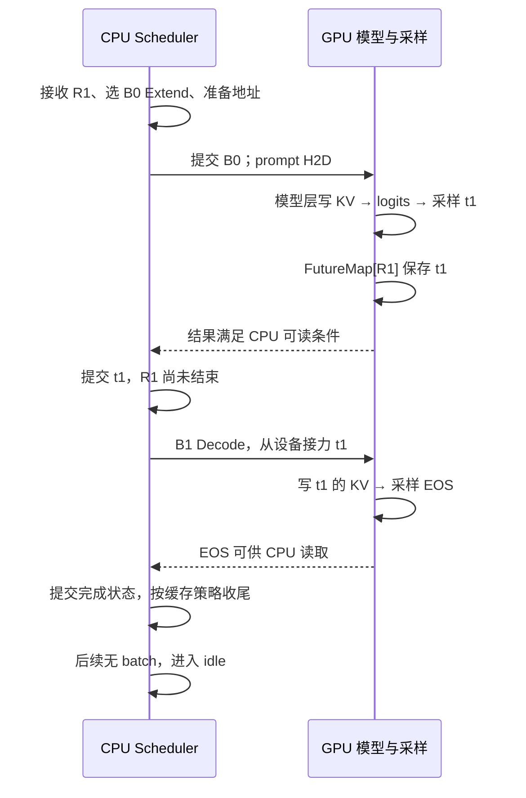
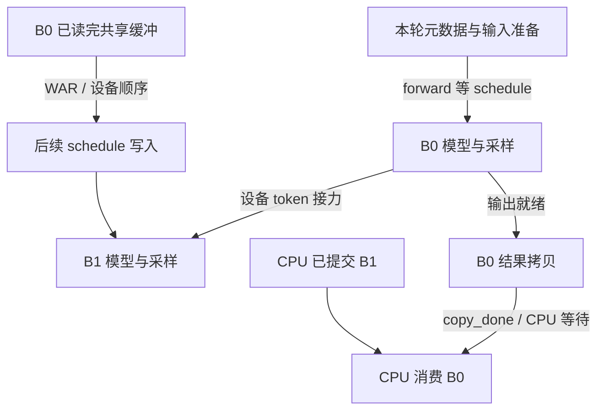
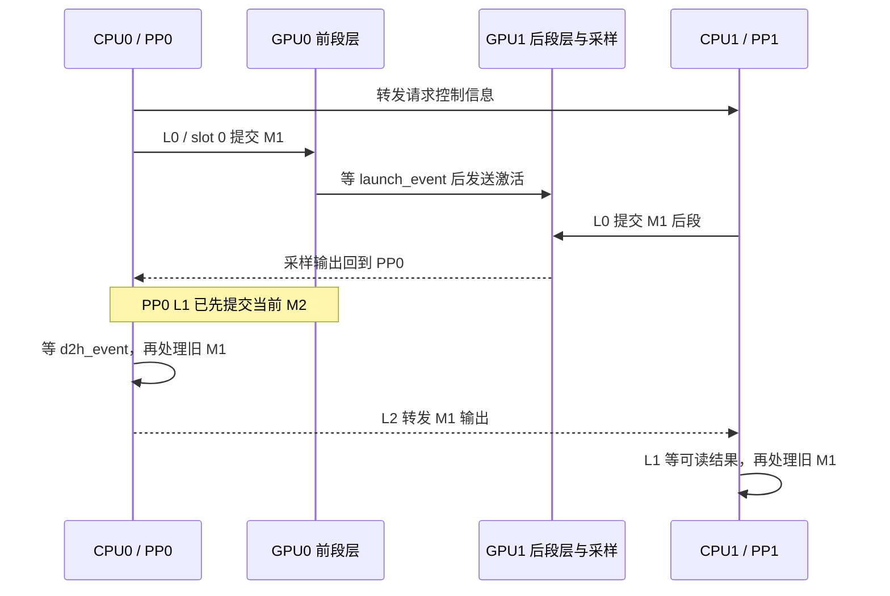

# SGLang 调度循环与批次执行旅程

一轮调度既可能提交当前批，也可能处理旧批的结果；一个 PP microbatch 又可能跨过多个 stage 和本地轮次。本文先建立完整执行旅程，再把 CPU 控制流、GPU 数据流与状态提交分开。它是源码分析型学习资料，配合[交互课程](https://asher-xunzhang.github.io/ai-infra-wiki/sglang/loop-journey/)逐步阅读。

## 0. 阅读基线与范围

| 项目 | 内容 |
| --- | --- |
| 源码仓库 | [sgl-project/sglang](https://github.com/sgl-project/sglang) |
| 分支 / commit | 公开上游 main 快照 `279339f113b79af84f27fd3ac92d0a13bd3f4cbd` |
| 读取时间 | 2026-11-09 |
| 工作区状态 | 只读固定 Git 对象；检出目录有 14 个未跟踪项，未纳入源码结论，也未修改 |
| 普通与 Overlap 场景 | CUDA、PP=1、TP=1、普通文本生成、无投机、无约束语法与延迟采样、无 PD / HiCache |
| PP 场景 | CUDA、PP=2、TP=1、`pp_async_batch_depth=0`、无 PD / HiCache；同机两 GPU 是教学设定 |
| 操作边界 | 源码复核、CPU 调用顺序检查和浏览器教学模型；未运行推理引擎、模型、GPU、网络或性能实验 |

图中的 R1、B0、M1、token、轮次编号和合法交错由整理者构造。事件列不是时间单位；不同模式的工作量与设备数不同，不比较速度。单实例可以跨多个 rank，不能把“非 PP”定义成“单 GPU”；本课特意用 TP=1 缩小场景。

**术语速查**

| 对象 | 人话解释 | 生命周期 |
| --- | --- | --- |
| Req / R1 | 用户的一次生成请求 | 从接纳到完成，可以跨多轮计算 |
| ScheduleBatch / B0、B1 | 本轮执行的成员与元数据 | 随选批、输入范围和成员变化而更新 |
| Microbatch / M1、M2 | 一份穿过 PP 各段模型的执行工作 | 各 stage 持有本地对象，图中身份保持一致 |
| Slot 0、1 | PP 环形数组的可复用位置 | 保存 `mbs`、`last_mbs`、`running_mbs` 等状态；不是物理 KV 页 |
| Loop / L | 调度循环的一次本地推进 | 非 PP 为一次 while 迭代；PP 图中为内层 for 的一次槽位迭代 |
| Stream / event | GPU 排队轨道与完成标记 | 约束设备读写、计算与拷贝顺序，不等同于 CPU 阻塞 |
| FutureMap | 在设备上接力下一轮输入 token 等信息 | 由前一轮写入，后续执行消费；普通非 Overlap 也使用 |

先修：[普通请求运行时](<SGLang 普通请求运行时与资源生命周期学习文档.md>)、[推理全景](<SGLang 推理全景学习指南.md>)。下一步：[执行分层](<SGLang 执行分层与硬件机制学习文档.md>) → [KV 内存管理](<../KV缓存/SGLang KV 映射与共享回收学习文档.md>) → [调度准入与回撤](<SGLang 调度准入与容量回撤学习文档.md>)。

## 1. 先走通普通循环

人话版：先决定这一轮算什么，把工作交给设备，拿到可读结果后更新请求，再进入下一轮。R1 的 prompt 有三个位置，首个输出是 t1，下一轮得到 EOS。

图意：箭头表达提交与结果依赖，不表示每个 CUDA API 都阻塞 CPU。`event_loop_normal` 的控制顺序是 `ingest_requests → get_next_batch_to_run → run_batch → process_batch_result → last_batch`。[normal]

1. CPU 提前组织长度、请求索引与 KV 写入位置。已有地址不代表 GPU 已写出 KV。
2. `resolve_forward_inputs` 对 Prefill 从 pinned CPU staging 搬入输入；普通 Decode 从 `future_map.output_tokens_buf` 按请求索引取上一轮输出。[resolve]
3. `run_batch` 普通生成分支调用 Worker，再经 `_relay_forward_payload` 保存采样 token；因此 FutureMap 并不是 Overlap 专属。[run][relay]
4. GPU 采样值与 CPU `output_ids` 是两份不同状态。CPU 读取结果后才执行完成判断、输出与资源处理；普通路径的结果物化不能跳过可读性依赖。[result]
5. 采出的 EOS 本身还没有作为下一轮输入被本轮写成 KV。本轮新 KV 对应本轮输入。

R1 完成不意味着整池显存立刻归零。缓存策略可能保留前缀；请求引用、共享状态、物理资源和在途设备工作各有自己的释放条件。

## 2. Overlap：三个依赖方向

SGLang 团队的 [v0.4 作者文章（2024-12-04）](https://www.lmsys.org/blog/2024-12-04-sglang-v0-4/)介绍用 CPU 调度与 GPU 执行重叠，减少调度开销暴露，并用 future tokens 和同步约束解决依赖。本课借鉴其 CPU/GPU 分行的图示表达；历史文章的性能数字和旧代码不作为本课固定提交的结果。

### 2.1 提前准备不等于提前读到答案

图意：B0 输出写入 FutureMap 后，B1 可在 GPU 中读取；B0 的 CPU 副本可走另一条分支。CPU 无需先收到 token 再原样传回设备，但读结果、共享缓冲覆写和下一轮模型输入仍有真实前提。

| 依赖 | 生产者 → 消费者 | 约束在哪里 |
| --- | --- | --- |
| Read after write | 输入与元数据准备 → forward | `forward_stream.wait_stream(schedule_stream)` |
| Write after read / WAR | 前一 forward 的共享读 → 后续 schedule 写 | `_apply_war_barrier` 使用精细事件或保守 forward stream 依赖 |
| 结果可读 | forward 输出 → copy → CPU 结果处理 | copy stream 等 forward；CPU 在 `copy_done.synchronize()` 等待 |
| 下一 token | 本轮采样接力 → 下轮 Decode 输入 | 同一 forward stream 中写入先于读取 |

`wait_event / wait_stream` 约束设备队列；`event.synchronize()` 让调用线程等事件。两者都不能直接改称全设备同步。[run][war][result]

### 2.2 一轮同时涉及哪两批

`event_loop_overlap` 的普通分支先准备、提交 B1，给 `result_queue` 保存 `(batch.copy(), result)`，再弹出旧 B0 处理。`batch.copy()` 用于保留对应元数据视图，不应理解为把整个 GPU 数据深拷贝一遍。[overlap]

CPU 处理 B0 与 GPU 执行 B1 具备重叠条件。图不保证两者一定同时起止，也不把相关 GPU forward 画成无依赖并行。是否真正隐藏开销，需要测量实际负载。

连续 Prefill、语法同步或投机等路径可以先消费旧结果；`launch_batch_sample_if_needed` 还可处理依赖上一轮状态的延迟采样。当前最小场景不展开这些路径，不能把一个例子说成所有配置的唯一顺序。

### 2.3 EOS 后，为什么还要排空

1. B1 在设备上产生 EOS，但 CPU 尚未消费它时，R1 仍可能进入已经提交的 B2。
2. CPU 处理 B1，提交 EOS、标记 R1 完成。有效回答到此为止；已提交的 B2 不会因此“从未发生”。
3. 下一轮选批过滤完成请求，可能没有新 batch；`last_batch` 仍非空，所以继续弹出 B2 结果处理。
4. Decode 结果处理先满足 `copy_done`，再跳过 Overlap 下已完成或已回撤的请求，不追加额外有效输出。资源处理仍遵守在途依赖、保活与分配器规则。[result]
5. 后续当前 batch 和 last_batch 都为空，才进入 `on_idle`。[overlap]

交互中的“暂缓 copy_done”让 CPU 停在结果可读门槛；B1 已提交的事实保留。解除依赖只恢复事件推进，不代表改写设备耗时。

## 3. 普通 PP：一批完整旅程与各级本地轮次

人话版：PP0 只算前段模型，PP1 算后段和输出头；前段激活向后传，末级采样结果还要回环，让各级更新自己的请求状态。一个 stage 做过模型计算，不意味着该 stage 的 CPU 已经处理采样输出。

教学条件为 PP=2、TP=1、CUDA、depth=0、无 PD 与 HiCache。R1、R2 各自剩最后一次 Decode，分别装进 M1、M2；这是为展示排空设置的小例子，不声称真实 microbatch 只有一条请求。

### 3.1 跟踪 M1

图意：激活、采样输出和请求信息是三类载荷；KV 留在所属模型层所在 GPU。源码使用按 `proxy` / `output` 区分的消息交接；同机只是本例放置，不根据 PP 名称推断固定物理链路。[pp][launch][output]

### 3.2 看 PP0 的 L1

`pp_loop_size = pp_size + pp_async_batch_depth`，所以本例两个槽。当前 `mb_id=1`，要处理的旧槽 `next_mb_id=(1+1)%2=0`。[slots]

| PP0 L1 顺序 | 对象 | 作用与依赖 |
| --- | --- | --- |
| 接收与转发请求、选择当前批 | M2 / slot 1 | 准备本级输入与地址 |
| 提交当前批 | M2 | forward stream 等 schedule stream，执行前段模型 |
| 接收、预处理旧输出 | M1 / slot 0 | copy stream 准备本级结果 |
| `d2h_event.synchronize()` 后处理 | M1 | CPU 更新旧 R1，保存 `last_mbs[0]` |
| 等当前 launch_event 后发送 proxy | M2 | 当前激活才向 GPU1 交接 |

这里解释了一个可预测现象：M1 输出迟到，可能让 CPU 等在旧结果路径，从而推迟 M2 的激活前传；即使 GPU0 已经在计算 M2，也不能跳过循环中必要的先行行为。depth>0 时输出预处理可先于当前 launch，不能把这张 depth=0 表外推到所有配置。[pp]

### 3.3 输出为什么还要绕一圈

PP 末级发送采样输出给首级，非末级在后续轮次把之前保存的 `pp_outputs` 继续转给下一级。[output]

本例合法事件序列：

1. PP0 L0 提交并发送 M1 激活；PP1 L0 计算 M1、发送输出。
2. PP0 L1 先提交 M2，然后接收处理旧 M1，最后发送 M2 激活。
3. PP1 L1 计算并发送 M2 输出，再等待旧 M1 输出回环。
4. PP0 L2 轮到 slot 0，过滤完成 R1，当前没有新批；仍转发 M1，接收并处理 M2。
5. PP1 L1 得到 M1 后完成本地结果处理；它的 L1 可以晚于 PP0 L2 才结束。
6. PP0 L3 转发 M2；PP1 L2 当前无新批，但接收并处理旧 M2。
7. 后续轮转过滤完成成员，两个 slot 可供下一代 batch 使用；没有当前批时继续完成必要输出收尾，而不是立刻宣布空闲。

固定基线对 `pp_size>1` 关闭普通 `event_loop_overlap`。[gate] 这不取消 PP 自己跨设备和 CPU/GPU 的重叠窗口。普通 PP 本课到此为止；[综合 PP Event Loop 案例](../分离部署/PD%20Prefill%20PP%20loop%20步骤详解.md)继续加入 PD Prefill、HiCache、KV 交接与共识，保留它自己的固定基线和场景。

## 4. 怎样读同一时钟的执行轨道

各场景内使用一只教学时钟 u，CPU、GPU 执行流、元数据流和结果准备的横向位置对齐。上一步 / 下一步同时定位事件讲解和游标，不另设自动播放器。所有时长是教学假设，不代表实测。

- 普通循环：CPU 处理 B0 后才准备 B1，结果等待与 GPU 执行分别可见。
- Overlap：CPU 提交 B1 可以早于 B0 采样完成；设备上 B1 读取 t1 仍排在 B0 写入之后。CPU 处理旧 B0 时，B1 的模型条带可以仍在进行。
- PP：复用并行课相同基线的执行轨道模型，观察 GPU0 的 M2 与 GPU1 的 M1，以及 PP0 处理旧 M1 与 GPU0 执行当前 M2 的重叠窗口。结果准备条带表示 CPU 侧准备与等待，不是模型计算。
- 点选条带显示活动全名与直接前提；箭头从生产者完成边界连接消费者入口。相同独占轨道不允许非法重叠。
- 暂缓依赖时，游标停在等待入口。后续轮廓仅保留原教学排程供参照，完成时刻未知，不能因预设演示到头就宣布完成。

假设时长只用于看清一组合法交错，不展示吞吐或加速倍数。完整逐事件记录、对象路线与状态账本按需展开，其他机制的讲解默认收起。

轨道默认按执行批次 / microbatch 着色，也可切换为本地 Loop 或活动类型；切换保留当前步骤和等待状态。按批次看时，同一批工作的控制、计算、交接和结果处理保持同色，等待仍用虚线并写明等待对象。按 Loop 看时，异步活动归属于组织它的本地轮次，不按实际完成时刻重新归组。例如 Overlap 的 B0 结果拷贝由 L0 的 `run_batch` 安排，L1 等待并消费它。[run]

PP 的 `PP0 · L1` 与 `PP1 · L1` 是不同的本地轮次，分别着色。跨 stage 消息使用发送轮次的颜色，点选可查看发送与接收轮次；“看一轮”同时保留相关收发消息。例如 M1 的输出由 PP1 L0 发出，在 PP0 L1 接收处理。这样能分开“一批跨过多轮”和“一轮同时照管新旧批次”。

## 5. 排障与预测地图

| 看到的现象 | 先区分什么 | 回到哪里 |
| --- | --- | --- |
| CPU 下一批元数据已准备，GPU 还没开始 | 准备完成、提交完成、前驱数据就绪不同 | `run_batch` 的 forward stream 依赖 |
| 下一批已提交，CPU 卡在旧结果 | 旧结果 copy_done 与下一批设备执行不同 | 结果处理器、copy stream |
| 已经 EOS，还有一次设备工作 | 已提交的 Overshoot 与有效输出不同 | Overlap result_queue 排空与 finished 过滤 |
| PP 当前计算与 CPU 处理的批次对不上 | 当前 mb_id 与 next_mb_id 是不同槽 | `event_loop_pp` |
| PP 末级算完，仍没完成本地请求 | 采样完成与结果回环、本地提交不同 | output 发送 / 接收、d2h_event |
| batch 结束，KV 没完全释放 | 请求所有权、缓存保留和在途使用不同 | KV 生命周期与分配器 |

## 6. 源码索引与关联复核

| 行为 | 固定源码入口 |
| --- | --- |
| 普通控制闭环 | [scheduler.py::event_loop_normal][normal] |
| 当前批与旧结果分离、排空 | [scheduler.py::event_loop_overlap][overlap] |
| 共享缓冲先读后写 | [scheduler.py::_apply_war_barrier][war] |
| 输入和执行流、copy stream | [scheduler.py::run_batch][run] |
| H2D / FutureMap 读取 | [overlap_utils.py::resolve_forward_inputs][resolve] |
| 设备输出接力 | [scheduler.py::_relay_forward_payload][relay] |
| copy_done 与已完成请求过滤 | [batch_result_processor.py::process_batch_result_decode][result] |
| PP 本地轮次顺序 | [scheduler_pp_mixin.py::event_loop_pp][pp] |
| PP 环形槽数组 | [scheduler_pp_mixin.py::init_pp_loop_state][slots] |
| 输出回环 | [scheduler_pp_mixin.py::_pp_send_output_to_next_stage][output] |
| PP 设备流依赖与事件记录 | [scheduler_pp_mixin.py::_pp_launch_batch][launch] |
| PP 与普通 Overlap 开关 | [overrides.py::_pipeline_parallel_overlap_disable][gate] |

已复核相关旧资料：[调度主循环](../source-study/03-scheduling/01-NormalEventLoop与调度主循环.md)、[Overlap 的 CPU/GPU 依赖](../source-study/03-scheduling/05-Overlap中的CPU与GPU依赖.md)、[调度器架构与时间模型](../source-study/architecture/04-调度器架构与时间模型.md)、[调度器生命周期与 Overlap](<SGLang 调度器请求生命周期与重叠调度学习文档.md>)、[执行分层](<SGLang 执行分层与硬件机制学习文档.md>)、[并行模式](<../并行方法/SGLang 并行分工与执行拓扑学习文档.md>)和 [PD PP loop 复核记录](../分离部署/PD%20Prefill%20PP%20loop%20源码复核记录.md)。

整合增量是把“输入组织、一次执行、跨轮结果、各级本地循环”放入可追踪的统一教学场景；不是替换旧课的深层对象或预算分析。历史源码课程的 `72d5…` 与其他综述的固定版本保留；本文行为逐项在 `279339…` 重新确认，不把不同基线拼成同一实现。旧课程保留独立用途并增加互达入口，无需再产出重复综合稿。

[normal]: https://github.com/sgl-project/sglang/blob/279339f113b79af84f27fd3ac92d0a13bd3f4cbd/python/sglang/srt/managers/scheduler.py#L1907
[overlap]: https://github.com/sgl-project/sglang/blob/279339f113b79af84f27fd3ac92d0a13bd3f4cbd/python/sglang/srt/managers/scheduler.py#L1942
[war]: https://github.com/sgl-project/sglang/blob/279339f113b79af84f27fd3ac92d0a13bd3f4cbd/python/sglang/srt/managers/scheduler.py#L1893
[run]: https://github.com/sgl-project/sglang/blob/279339f113b79af84f27fd3ac92d0a13bd3f4cbd/python/sglang/srt/managers/scheduler.py#L4285
[resolve]: https://github.com/sgl-project/sglang/blob/279339f113b79af84f27fd3ac92d0a13bd3f4cbd/python/sglang/srt/managers/overlap_utils.py#L87
[relay]: https://github.com/sgl-project/sglang/blob/279339f113b79af84f27fd3ac92d0a13bd3f4cbd/python/sglang/srt/managers/scheduler.py#L4543
[result]: https://github.com/sgl-project/sglang/blob/279339f113b79af84f27fd3ac92d0a13bd3f4cbd/python/sglang/srt/managers/scheduler_components/batch_result_processor.py#L920
[pp]: https://github.com/sgl-project/sglang/blob/279339f113b79af84f27fd3ac92d0a13bd3f4cbd/python/sglang/srt/managers/scheduler_pp_mixin.py#L63
[slots]: https://github.com/sgl-project/sglang/blob/279339f113b79af84f27fd3ac92d0a13bd3f4cbd/python/sglang/srt/managers/scheduler_pp_mixin.py#L553
[output]: https://github.com/sgl-project/sglang/blob/279339f113b79af84f27fd3ac92d0a13bd3f4cbd/python/sglang/srt/managers/scheduler_pp_mixin.py#L983
[launch]: https://github.com/sgl-project/sglang/blob/279339f113b79af84f27fd3ac92d0a13bd3f4cbd/python/sglang/srt/managers/scheduler_pp_mixin.py#L1221
[gate]: https://github.com/sgl-project/sglang/blob/279339f113b79af84f27fd3ac92d0a13bd3f4cbd/python/sglang/srt/arg_groups/overrides.py#L1662
