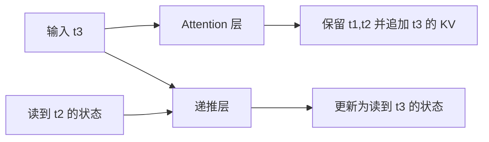

# SGLang 模型状态与高级生成机制学习文档

本文沿历史状态、候选验证和规则进度三条线，解释生成 token 时哪些对象会变化。配套 [Pages 交互课程](https://asher-xunzhang.github.io/ai-infra-wiki/sglang/advanced-generation/) 可在同一教学时钟下观察 GPU 验证、CPU 账本、规则编译和候选树的临时试走。先修为 [KV 与生成过程](<../运行时/SGLang 推理全景学习指南.md>)、[请求运行时](<../运行时/README.md>)和[并行分工](<../并行方法/README.md>)。

## 0. 阅读基线与范围

| 项目 | 内容 |
| --- | --- |
| 文档类型 | 源码分析型学习资料 |
| 源码仓库 | https://github.com/sgl-project/sglang |
| 分支 | 公开上游 main 固定快照，不声明为最新 main |
| commit | `279339f113b79af84f27fd3ac92d0a13bd3f4cbd` |
| 读取时间 | 2026-09-23；实现与执行轨道复核 2026-11-09 |
| 工作区状态 | 从本地已有 Git 对象只读分析；检出分支与分析快照不同，原有未跟踪文件保留 |
| 操作边界 | 只读固定 Git 对象；用 CPU 记录桩执行部分真实主机函数；未启动服务、下载权重、运行 SGLang 或 GPU kernel |
| 主线 | EAGLE V2 验证与状态结算；XGrammar 编译准入；投机树 mask 与真实 matcher 提交；模型历史状态作为补充 |
| 教学边界 | 小词表、数值递推、候选字母、固定分歧位置都是教学假设，不是模型结果或性能数据 |

已有源码课程继续保留各自版本，本文不将历史实现改称同一版本。这里的“提交”指有效输出、KV 与相关状态生效的过程，不暗示存在统一处理一切的 `commit()` 函数。

| 名称 | 要区分的对象 |
| --- | --- |
| token 历史 | 按位置保留的 K/V，或 MLA 的 latent 等表示 |
| 活动状态 | 递推层当前的 conv / temporal 等状态，可被下一步覆盖 |
| 草稿候选 | 尚待目标模型验证的 token，不是正式输出 |
| 验证行 | 给定合法前缀后计算的一行预测；并行计算仍受因果关系约束 |
| bonus | 本轮额外补出的 token；拒绝时纠正分歧，全接受时多前进一步 |
| matcher | 某请求已经走到的规则位置；不同请求不能共享这份进度 |

## 1. 模型结构决定历史以什么形式保存

### 按 token 增加记录，或更新活动状态

普通 Attention 池按 `loc` 将本轮 K/V 写入对应位置；在本课无窗口裁剪、无压缩的对照中，前缀变长就增加有效历史位置。[K/V 写入][kv]。

递推层则持有 conv 与 temporal 等状态。当前状态承载已经处理过的前缀；不能把一个状态槽简单解释为某一个 token 的 K/V。[MambaPool.State][state]。

图意：这是两类层的状态更新对照，不表示任意模型都同时包含它们。Qwen3.5 的 decoder layer 类型映射包含 Attention 与 linear_attention 两种类型；混合结构按层选择，既有 token 缓存又有递推状态。[层类型映射][hybrid]。

### 用四个输入观察回退

仅为观察覆盖与恢复，采用教学式 `s_new = 0.5 × s_old + x`，初始 s=0，依次输入 `[2,3,1,4]`，状态为 `[2,4,3,5.5]`。这不是 GDN、KDA 或 Mamba 的计算公式，也不声称其状态是一个标量。

在 t2 保存检查点 s=4。处理完 t4 后，若要回到 t2：Attention 的有效前缀回到两个位置；递推活动状态必须恢复到对应检查点，或按实现重放到该前缀。只删掉 token 标签而继续使用 s=5.5 会混入被撤销的后缀。

源码中的 `copy_from` 会复制 conv / temporal 状态，并对 ReplaySSM checkpoint 具有额外约束；不能随便复制一个未 flush 的活动槽。[状态复制][copy]。投机后的状态提交还包含接受位置 scatter、ReplaySSM 或 fused-accept 等不同路径；本页不把全部实现画成同一种恢复操作。[投机状态提交][stateCommit]。

**边界：** 固定形状的活动状态不等于整个模型内存恒定。层数、并发请求、checkpoint、候选中间状态和混合 Attention 缓存都可能增加空间；示意槽位只表达保存方式，不表示真实字节比例。

### MLA 与稀疏读取是另外的选择轴

MLA 池仍有 token 位置维度，存储维度包含 latent 与位置相关部分，而不是把所有历史合成一个递推状态。[MLA 池][mla]。稀疏注意力则涉及本轮读哪些历史位置；“本轮没有读取”不自动等于“已经从存储删除”。更完整的模型比较见[MLA、稀疏注意力与混合状态模型](<../source-study/09-model-specialization/04-MLA稀疏注意力与混合状态模型.md>)，保留该文独立源码基线。

## 2. EAGLE V2：设备接受结果怎样成为下一轮输入和正式输出？

### 本课的实现目标

第一章已经说明草稿提出、目标验证、拒绝后的纠正。本课不再重复基础算法动画，而是沿 `EagleDraftInput → EagleVerifyInput → GenerationBatchResult → Req` 追踪三个不同提交边界：

| 边界 | 变化的对象 | 还不能由此推断什么 |
| --- | --- | --- |
| Verify 接受路径 | `accept_index / accept_lens / new_seq_lens`、目标 KV 与 hidden | CPU 输出已追加、预留空间已释放 |
| Draft Extend | 下一轮 bonus、草稿 hidden 与 topk 等输入 | 当前 CPU Req 已完成结算 |
| CPU 结果处理 | `kv_committed_len`、`output_ids`、结束状态 | 所有预留槽都属于有效前缀 |

交互主线固定 CUDA、PP=TP=1、普通 Attention 目标、EAGLE V2、greedy、`page_size=1`，开启 Scheduler Overlap，关闭 plan stream、grammar、EOS、额外 penalty / bias 和自适应。普通单链和 `topk=2` 非连续树路径分别展示。时间是讲解安排，不是运行记录；具体拓扑、其他 worker 和特殊模型分支不能直接套用。

### 先把验证行、输出和 KV 对齐

已有输出末尾 r，其目标 KV 尚未计算。单链候选为 a、b、c、d，验证输入为 `[r,a,b,c,d]`。本例接受 a、b，在 c 处分歧，`eagle_sample` 返回 `accept_lens=3`：2 个正确草稿加 1 个补出 token z。[验证总控][verify]、[验证采样][accept]。

| 结果 | 本例内容 | 原因 |
| --- | --- | --- |
| 新输出 | a、b、z | z 是接受边界的目标预测 |
| 新的有效目标 KV | r、a、b | root 是本轮实际输入；z 尚未作为目标输入 |
| 下一轮 root | z | 其自身目标 KV 将在后续前向中计算 |
| 未接受的验证位置 | c、d | 不属于有效前缀，不等于物理槽已 free |

树例的平坦节点为 `[r,a,x,b,y]`，有效路径为 `accept_index=[0,1,3]`。`_finalize_accept_tree_path` 将节点 3 对应的 KV、predict、hidden 挪到连续前部。单链 `topk=1` 不调用这个树压紧分支；不能把它画成每次都发生的搬运。[树路径整理][compact]。

分配器用 `max(已分配长度, 对齐后的已提交长度 + reserve)` 保留解码窗口。图中五个槽只是本轮窗口的截取；拒绝候选不会在这里自动减少 `kv_allocated_len`。[分配长度][allocation]。混合模型另有递推状态提交，见前面的状态差异，不将其假装成普通 Attention 的同一个 KV 操作。

### 同一时钟：下一轮设备工作与本轮 CPU 收尾

~~~mermaid
sequenceDiagram
    participant H as Scheduler CPU
    participant F as GPU forward stream
    participant C as GPU copy stream
    H->>F: 提交 Draft、Verify
    F->>F: 选路径、整理状态、发布长度
    F->>F: Draft Extend 刷新下一轮种子
    par 前轮结果回传
        F-->>C: 前轮 forward 已完成
        C-->>H: next_token_ids、accept_lens；copy_done
        H->>H: 结算 KV 长度、追加输出
    and 下一轮设备工作
        F->>F: 使用刷新后的种子执行下一轮 Draft
    end
~~~

图意：两条 CUDA 流属于同一 GPU。`on_publish(new_seq_lens)` 在 Verify 后、Draft Extend 前；发布长度不是发布全部后继草稿状态。Scheduler 的结果 D2H 等前轮 forward，但下一轮 forward stream 不必等当前轮 CPU 输出收尾。它仍依赖前轮的设备状态，不能把同一请求的 Draft、Verify、Draft Extend 画成互不依赖。[worker 顺序][worker]、[Draft Extend][extend]、[Overlap loop][loop]。

`_resolve_spec_v2_tokens` 在结果已可读后按每请求 stride 切出 `accept_lens` 指定的有效部分，结算 `kv_committed_len`。`process_batch_result_decode` 再追加 `output_ids` 并检查结束。本例不触发结束；不能把 GPU 接受长度当成所有终止条件下的最终可输出长度。[结果解析][resolve]、[输出处理][output]。

## 3. XGrammar：编译准入、设备 mask 与每请求状态

### 请求先等什么，缓存复用什么？

`GrammarManager.process_req_with_grammar` 用规则类型和文本构造 key。`BaseGrammarBackend.get_cached_or_future_value` 的缓存 miss 通过线程池返回 Future；请求留在 `grammar_queue`。Scheduler 轮询获取有效结果后，才具备正常进入 waiting queue 的条件。编译失败触发 abort，不进入本图的正常采样。[请求入口][manager]、[缓存与编译][compile]、[就绪处理][ready]。

| 对象 | 所在位置与生命周期 | R1、R2 的关系 |
| --- | --- | --- |
| Future | CPU，编译完成前的异步结果 | 各请求的待准入句柄 |
| ctx | CPU，已编译规则上下文 | 缓存命中时复用 |
| matcher / accepted_tokens | CPU，每请求匹配进度 | 每次 copy 创建新 matcher，不继承别人的前缀 |
| vocab bitmask | CPU 构造，非阻塞送 GPU | 每轮、每请求 batch 行的允许集合 |
| logits / sampled token | GPU 计算，结果回 CPU | 模型在该行合法项中选择 |

`XGrammarGrammar.copy()` 共享 ctx，重新构造 GrammarMatcher。[规则复制][grammarCopy]。动画只展开 R1 一次采样：R1 接受 y 后，R2 仍是空前缀；同一规则的编译复用和状态隔离可以同时成立。

### 普通生成的主机与设备依赖

本视角关闭 Scheduler Overlap。CPU 在前向主机调用返回后，通过 `ModelRunner._preprocess_logits → SamplingBatchInfo.update_regex_vocab_mask` 填写压缩位掩码，调用 `move_vocab_mask(..., non_blocking=True)`；随后应用 mask、Sampler 采样、CPU 接收结果并推进 R1 matcher。[模型接口][runner]、[batch mask][samplingInfo]、[mask 应用][mask]、[正式 accept][advance]。

**关闭 Scheduler Overlap 不等于 CUDA 调用都同步。** CPU 填 mask 可与 GPU 前向交叠；同一设备流中的 mask 搬运、应用和采样仍排在前向之后。首次编译的线程也可与另一条已准入请求 B0 的设备工作并行。R1、R2 是否恰好组在同一 batch 由 Scheduler 决定；图里 R2 的 GPU 计算未展开，不代表 R2 必须等 R1 完成。

教学词表 y / es / no / ! / EOS 和人工 logits 只用来标出哪些数据被搬运、修改和提交，不代表真实 tokenizer，也不再重复第一章的完整 yes/no 状态机。语法合法不保证内容事实正确。

## 4. EAGLE + Grammar：临时试走和正式推进怎样协同？

### 为什么本轮 Verify 要补上一轮的规则进度？

有 Overlap 时，GPU 可以已经得到上一轮结果，而 CPU matcher 尚未消费它。当前候选树的 root 又正是上一轮输出末尾。若不先补齐 matcher，本轮 mask 就会基于过期前缀生成。

固定实现先由 `GrammarTree.from_device` 启动树元数据 D2H，再提交 target forward。随后 `build_grammar_vocab_mask` 依次执行 grammar barrier、解析 CPU 树副本、DFS 生成 mask、mask H2D。[树与 barrier][treeMask]。

~~~mermaid
flowchart LR
    P[上一轮 copy_done] --> B[CPU barrier：补齐正式 FSM]
    D[本轮树元数据 D2H] --> T[CPU 树可读]
    B --> DFS[CPU DFS 试走与回退]
    T --> DFS
    D --> V[本轮 GPU Target Verify]
    DFS --> M[GPU mask 搬运与应用]
    V --> M
    M --> S[验证采样与状态整理]
    S --> E[Draft Extend]
    E --> C[本轮结果 D2H]
    C --> A[正式推进 FSM 并结算输出]
~~~

图意：Target Verify 不等 CPU DFS 才启动；CPU barrier / DFS 可与它重叠。若上一轮 copy_done 迟到，CPU barrier 会等；若 CPU mask 比 target 更晚，设备暂时没有可提交的后续采样，不虚构“等待 kernel”。采样同时依赖 target logits 和本轮 mask。

### 候选树怎样走，怎样回到原状态？

动画以已输出 root `{` 为起点，两个分支为 `"ok" → :` 和 `"err" → !`。root 已在上一轮被 accept；遍历不再接受它一次。

`traverse_tree` 对非 root 节点先查父节点的 mask。合法节点临时 `accept_token`，填写该节点的下一 token mask，递归孩子后 `rollback(1)`，然后从共同父状态访问兄弟。`!` 不符合 `"err"` 后只能接冒号的规则，直接跳过；未写 mask 行保持初始化值，不把它伪画成全零，合法采样路径也不会进入该节点。[真实 DFS][tree]。

| 动作 | matcher 暂时前缀 | 留下的产物 |
| --- | --- | --- |
| root 填行 | `{` | 行 0 允许两个 key |
| accept "ok"，再 accept : | `{"ok":` | 行 1 允许冒号，行 3 允许 true |
| rollback :，rollback "ok" | `{` | 已写的 mask 行保留 |
| accept "err"，拒绝 ! | `{"err"` | 行 2 允许冒号，行 4 未生成 |
| rollback "err" | `{` | matcher 回到真实前缀，候选未正式提交 |

### 正式结果只推进一次，结束时只保留合法前缀

本轮结果回 CPU 后，`advance_grammar_fsm` 才顺序接受已验证输出，缓存 `grammar_retained_tokens`，并设置 `grammar_advanced`。它可以由下一轮 Verify 的 barrier 提前调用，也可由结果处理器调用；同一结果再次进入时直接返回，不重复推进。[正式推进][formal]。

`_accept_grammar_tokens` 在 matcher 终止时停止，只返回保留前缀；结果解析器用这段前缀结算 CPU KV 长度和输出，不把终止后的过量后缀发给用户。非法 token 会触发 abort。[保留前缀][retain]。这与 GPU 验证接受长度不是同一层截断；本页主动画未触发终止，CPU 函数检查另覆盖终止截断和重复调用。

本例只覆盖 CUDA EAGLE V2 的 grammar overlap。NGRAM 等 host-draft 路径、随机采样、额外 logit bias 和特殊模型状态有不同条件。相关旧课程 [投机中的 Overlap、KV 与组合约束](<../source-study/08-advanced-generation/06-投机中的OverlapKV与组合约束.md>) 保留自己的固定提交，不与本文合并成同一版本结论。

## 5. 按模型特性继续

- [MoE 专家分工交互](https://asher-xunzhang.github.io/ai-infra-wiki/sglang/parallelism/)：把 token 路由与 Attention 历史保存分开理解。
- [量化格式与计算路径](<../source-study/09-model-specialization/02-量化格式与计算路径.md>)：区分权重、激活、KV 格式及实际计算路径。
- [MultiLoRA 加载、调度与隔离](<../source-study/09-model-specialization/03-MultiLoRA加载调度与隔离.md>)：区分共享基座和请求选择的适配器。
- [图像、视频、音频处理链路](<../source-study/09-model-specialization/05-图像视频音频输入的处理链路.md>)：从输入处理、特征与 token 对齐进入模型执行。

以上是独立阅读分支，不表示每个模型都能同时启用所有特性。

## 6. 自测与源码定位

先预测再操作：接受索引为 [0,1,3] 时，哪个 KV 要移动？GPU 长度已经增长时，CPU 账本能否仍是旧值？为什么拒绝草稿不等于立即 free？缓存命中为什么还要 new matcher？遍历第二条分支前必须回到哪个前缀？上一轮 copy_done 迟到会阻塞 CPU 哪一步，而本轮 GPU 此时能做什么？

下面固定链接分别对应各行为，便于从图回到源码。

- [set_kv_buffer · `mem_cache/memory_pool.py` L2526][kv]
- [MambaPool · `mem_cache/memory_pool.py` L382][state]
- [copy_from · `mem_cache/memory_pool.py` L1020][copy]
- [Qwen3_5ForCausalLM · `models/qwen3_5.py` L1550][hybrid]
- [update_mamba_state_after_mtp_verify · `layers/attention/hybrid_linear_attn_backend.py` L1340][stateCommit]
- [draft · `speculative/eagle_worker_v2.py` L596][draft]
- [build_eagle_verify_input · `speculative/eagle_worker_common.py` L316][build]
- [run_eagle_verify · `speculative/eagle_worker_common.py` L461][verify]
- [eagle_sample · `speculative/eagle_utils.py` L724][accept]
- [fill_vocab_mask · `constrained/xgrammar_backend.py` L118][grammar]
- [apply_vocab_mask · `constrained/xgrammar_backend.py` L125][mask]
- [accept_token · `constrained/xgrammar_backend.py` L92][advance]
- [copy · `constrained/xgrammar_backend.py` L144][grammarCopy]
- [forward · `layers/sampler.py` L139][sample]

[kv]: https://github.com/sgl-project/sglang/blob/279339f113b79af84f27fd3ac92d0a13bd3f4cbd/python/sglang/srt/mem_cache/memory_pool.py#L2526
[state]: https://github.com/sgl-project/sglang/blob/279339f113b79af84f27fd3ac92d0a13bd3f4cbd/python/sglang/srt/mem_cache/memory_pool.py#L382
[copy]: https://github.com/sgl-project/sglang/blob/279339f113b79af84f27fd3ac92d0a13bd3f4cbd/python/sglang/srt/mem_cache/memory_pool.py#L1020
[hybrid]: https://github.com/sgl-project/sglang/blob/279339f113b79af84f27fd3ac92d0a13bd3f4cbd/python/sglang/srt/models/qwen3_5.py#L1550
[stateCommit]: https://github.com/sgl-project/sglang/blob/279339f113b79af84f27fd3ac92d0a13bd3f4cbd/python/sglang/srt/layers/attention/hybrid_linear_attn_backend.py#L1340
[draft]: https://github.com/sgl-project/sglang/blob/279339f113b79af84f27fd3ac92d0a13bd3f4cbd/python/sglang/srt/speculative/eagle_worker_v2.py#L596
[build]: https://github.com/sgl-project/sglang/blob/279339f113b79af84f27fd3ac92d0a13bd3f4cbd/python/sglang/srt/speculative/eagle_worker_common.py#L316
[verify]: https://github.com/sgl-project/sglang/blob/279339f113b79af84f27fd3ac92d0a13bd3f4cbd/python/sglang/srt/speculative/eagle_worker_common.py#L461
[accept]: https://github.com/sgl-project/sglang/blob/279339f113b79af84f27fd3ac92d0a13bd3f4cbd/python/sglang/srt/speculative/eagle_utils.py#L724
[grammar]: https://github.com/sgl-project/sglang/blob/279339f113b79af84f27fd3ac92d0a13bd3f4cbd/python/sglang/srt/constrained/xgrammar_backend.py#L118
[mask]: https://github.com/sgl-project/sglang/blob/279339f113b79af84f27fd3ac92d0a13bd3f4cbd/python/sglang/srt/constrained/xgrammar_backend.py#L125
[advance]: https://github.com/sgl-project/sglang/blob/279339f113b79af84f27fd3ac92d0a13bd3f4cbd/python/sglang/srt/constrained/xgrammar_backend.py#L92
[grammarCopy]: https://github.com/sgl-project/sglang/blob/279339f113b79af84f27fd3ac92d0a13bd3f4cbd/python/sglang/srt/constrained/xgrammar_backend.py#L144
[sample]: https://github.com/sgl-project/sglang/blob/279339f113b79af84f27fd3ac92d0a13bd3f4cbd/python/sglang/srt/layers/sampler.py#L139
[mla]: https://github.com/sgl-project/sglang/blob/279339f113b79af84f27fd3ac92d0a13bd3f4cbd/python/sglang/srt/mem_cache/memory_pool.py#L4328
[greedy]: https://github.com/sgl-project/sglang/blob/279339f113b79af84f27fd3ac92d0a13bd3f4cbd/python/sglang/kernels/aot/csrc/speculative/eagle_utils.cu#L272

[compact]: https://github.com/sgl-project/sglang/blob/279339f113b79af84f27fd3ac92d0a13bd3f4cbd/python/sglang/srt/speculative/eagle_worker_common.py#L406
[allocation]: https://github.com/sgl-project/sglang/blob/279339f113b79af84f27fd3ac92d0a13bd3f4cbd/python/sglang/srt/mem_cache/allocation_sizing.py#L62
[worker]: https://github.com/sgl-project/sglang/blob/279339f113b79af84f27fd3ac92d0a13bd3f4cbd/python/sglang/srt/speculative/eagle_worker_v2.py#L1272
[extend]: https://github.com/sgl-project/sglang/blob/279339f113b79af84f27fd3ac92d0a13bd3f4cbd/python/sglang/srt/speculative/eagle_worker_v2.py#L1013
[loop]: https://github.com/sgl-project/sglang/blob/279339f113b79af84f27fd3ac92d0a13bd3f4cbd/python/sglang/srt/managers/scheduler.py#L1942
[resolve]: https://github.com/sgl-project/sglang/blob/279339f113b79af84f27fd3ac92d0a13bd3f4cbd/python/sglang/srt/managers/scheduler_components/batch_result_processor.py#L744
[output]: https://github.com/sgl-project/sglang/blob/279339f113b79af84f27fd3ac92d0a13bd3f4cbd/python/sglang/srt/managers/scheduler_components/batch_result_processor.py#L920
[manager]: https://github.com/sgl-project/sglang/blob/279339f113b79af84f27fd3ac92d0a13bd3f4cbd/python/sglang/srt/constrained/grammar_manager.py#L145
[compile]: https://github.com/sgl-project/sglang/blob/279339f113b79af84f27fd3ac92d0a13bd3f4cbd/python/sglang/srt/constrained/base_grammar_backend.py#L283
[ready]: https://github.com/sgl-project/sglang/blob/279339f113b79af84f27fd3ac92d0a13bd3f4cbd/python/sglang/srt/constrained/grammar_manager.py#L203
[runner]: https://github.com/sgl-project/sglang/blob/279339f113b79af84f27fd3ac92d0a13bd3f4cbd/python/sglang/srt/model_executor/model_runner.py#L1882
[samplingInfo]: https://github.com/sgl-project/sglang/blob/279339f113b79af84f27fd3ac92d0a13bd3f4cbd/python/sglang/srt/sampling/sampling_batch_info.py#L263
[treeMask]: https://github.com/sgl-project/sglang/blob/279339f113b79af84f27fd3ac92d0a13bd3f4cbd/python/sglang/srt/speculative/spec_utils.py#L649
[tree]: https://github.com/sgl-project/sglang/blob/279339f113b79af84f27fd3ac92d0a13bd3f4cbd/python/sglang/srt/speculative/spec_utils.py#L473
[formal]: https://github.com/sgl-project/sglang/blob/279339f113b79af84f27fd3ac92d0a13bd3f4cbd/python/sglang/srt/managers/scheduler_components/batch_result_processor.py#L851
[retain]: https://github.com/sgl-project/sglang/blob/279339f113b79af84f27fd3ac92d0a13bd3f4cbd/python/sglang/srt/managers/scheduler_components/batch_result_processor.py#L820
