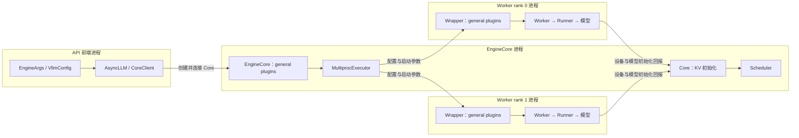
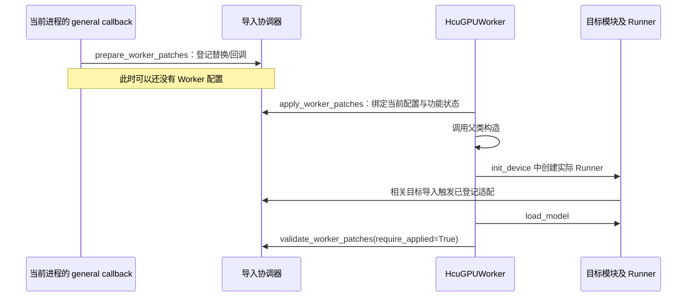

# vLLM 多进程启动中的插件注册与补丁生效顺序学习文档

一个插件可以在 Python 环境中存在，也可以在前端完成注册，却仍然没有接管 Worker 中的实际执行。排查这类问题，需要把“在哪个进程加载”“何时选中实现”和“哪个对象已经持有旧引用”放在同一条启动链上看。

本文是**源码分析型学习资料**，承接[硬件插件与执行适配入门](<vLLM 硬件插件、平台选择与执行适配学习文档.md>)和[进程架构分析](<../../大模型推理/推理基础/SGLang 与 vLLM V1 架构差异源码学习文档.md>)，沿固定源码追踪前端、EngineCore、GPU Worker 的装配，再用 HCU 插件说明补丁如何从登记走到生效。没有运行 vLLM、安装插件、启动模型或使用 GPU。

## 0. 固定基线与范围

| 项目 | 内容 |
| --- | --- |
| 官方源码 | [vllm-project/vllm](https://github.com/vllm-project/vllm)，`main` 历史提交 `58ad1f3b8973b23943107b51230d594050b42ec3` |
| HCU 源码 | [HYGON-AI/vllm-plugin-das](https://github.com/HYGON-AI/vllm-plugin-das)，`v0.28.1-dev`，提交 `d032941f771998ce697f5611ac40fb8e0bc1a0c1` |
| 为什么选择这组来源 | HCU 的 `version.py` 将上述官方提交记录为 `__vllm_upstream_sha__`，另记录厂商集成提交与目标发布线；不是任取两仓最新版本拼在一起 [H1] |
| 读取日期 | 2026-11-19 |
| 工作区状态 | 按固定提交下载有关文件，只读核对；未建立可运行源码检出或修改外部仓库 |
| 主线 | 普通 Python 文本服务、单节点、一个 API 前端、DP=1、PP=1、TP=2、multiprocessing executor；这是教学拓扑，未实际启动 |
| HCU 案例边界 | 官方源码解释公共调用合同，HCU 源码解释接入点；厂商还记录了 OpenDAS 集成来源，本文不证明官方 wheel 可直接替代该运行环境 |
| 不展开 | Ray、多个 API server、弹性 EP、PD、所有模型与算子兼容性、Ascend 内部补丁、精度或性能验证 |

本篇的官方提交不同于入门笔记所用的 `33fa579e…`。入口路径、默认值和内部对象均按本篇版本阅读，不跨版本拼接调用链。

| 术语 | 人话解释 |
| --- | --- |
| discover / load | 从包元数据找到入口 / 导入入口所指向的 Python 对象 |
| execute callback | 调用已加载的注册函数，它可能登记模型、算子或补丁 |
| arm / bind / apply | 先登记适配关系 / 绑定本 Worker 的配置 / 在目标可用时实际修改对象或模块 |
| fork / spawn | 继承父进程的一份内存快照 / 使用新解释器重新建立 Python 状态 |
| process-local guard | 某个进程中记录“入口已处理”的标志，不是跨进程的统一完成证明 |

## 1. 先画清楚三个进程位置



**图意解读：** 外框表示本篇选定的进程位置。EngineCore 内的 Scheduler 不在每个 GPU Worker 中重复创建；Worker 各自持有模型分片及执行资源。图中的两条 Worker 分支不规定初始化耗时和先后，也没有把控制通道画成 KV 数据传输。[API 客户端][V1] [Core 启动][V4] [多进程 Worker][V6]

单卡使用不同 Executor、离线 API 使用进程内 Core 等情况会改变这张图。看到 `Worker` 类名，不能直接套用此处的进程数。

## 2. 前端：在参数初始化中准备扩展

本篇服务入口由 `entrypoints/launchers/api_server/entry.py` 构造 engine config，随后创建 AsyncLLM。旧 `entrypoints/openai/api_server.py` 在这个版本中主要是兼容转出入口，不能只沿旧文件名寻找全部实现。[V1]

`EngineArgs.__post_init__()` 调用 `load_general_plugins()`；它为后续模型与扩展装配提供注册入口。生成 `VllmConfig` 时，平台相关逻辑还会调用 `current_platform.check_and_update_config(self)`。这两个动作作用不同：前者执行 general 回调，后者让已选 Platform 根据配置调整硬件相关实现和限制。[参数初始化][V2] [平台配置调用][V3]

Platform 本身仍是进程内惰性解析对象。某个 import 就可能提前访问它，因此不能把“general plugins → Platform”当成所有路径都严格遵守的全局顺序。可以可靠定位的是：哪些调用发生在创建 EngineCore/Worker 之前，哪些回调在本进程实际执行过。[V10]

**例子：** 插件注册了一个模型类，前端随后才识别其架构，这不等于两个 GPU Worker 已经导入该模型。前端完成的是自己的注册与配置阶段，Worker 的启动边界还在后面。

## 3. EngineCore：先加载扩展，再创建 Executor 和 Scheduler

`CoreClient` 的多进程路径通过 Core 启动管理器建立 `EngineCoreProc`。进入 `EngineCore.__init__()` 后，代码先调用 `load_general_plugins()`，然后创建 `executor_class(vllm_config)`，后续才完成 KV 初始化和 Scheduler 创建。[进程创建][V4] [Core 构造][V5]

这说明 general plugins 不只与模型计算有关，也可以影响 Core 中的调度或框架行为。反过来，Core 中的注册状态并不是一份通过 RPC 自动广播给所有 Worker 的注册表；后者还有自己的初始化入口。

代码中的调用点要与 callback 的实际执行次数分开。这里调用加载器，是建立初始化边界；是否再次执行回调，要继续检查进程来源与加载器的 guard。

## 4. Worker：先建立扩展，再解析 Worker 类

沿 `WorkerProc.__init__()`，本篇版本的关键顺序是：

```text
WorkerWrapperBase
  → init_worker(all_kwargs)
      → 取得本 rank 的 vllm_config
      → load_general_plugins()
      → 按 worker_cls 字符串解析类
      → 处理可选 worker_extension_cls
      → 在 current-config 上下文中构造 Worker
  → init_device()
  → load_model()
  → 后续通信、KV 与编译/预热阶段
```

这是初始化顺序摘要，不是完整方法体。尤其要分清 `WorkerWrapperBase`、真正的 Worker 和 Runner 是三个对象：Wrapper 负责通用环境与 RPC 交接，Worker 负责设备生命周期，Runner 组织模型执行。[Wrapper][V7] [WorkerProc][V6]

`worker_cls` 在此要求是可导入的限定名称字符串；代码还可以通过 `worker_extension_cls` 扩展类的方法。这是 Worker 扩展机制，不等于一个新平台，也不保证其成员与原 Worker 不冲突。[V7]

### fork 与 spawn 会改变什么

`get_mp_context()` 根据 `VLLM_WORKER_MULTIPROC_METHOD` 选择上下文，并在特定条件下强制改为 spawn。源码说明默认方法是 fork，因此不能把所有 vLLM 子进程都画成新解释器。[V8]

| 进程来源 | 与插件有关的状态 | 对调用点的正确理解 |
| --- | --- | --- |
| spawn | 重新导入模块，重新建立模块全局量 | 子进程需要自己的注册和初始化；还要考虑目标函数执行前的导入 |
| fork | 继承父进程模块、已替换引用及 guard 的内存快照 | 再次调用加载器可能直接返回，不保证 callback 再执行一次 |
| 后续显式 Worker 初始化 | 接收本 Worker 的配置与 rank/device 身份 | 仍要按本 Worker 的配置完成需要的绑定，不能只依赖父进程快照 |

本篇不实际切换启动方法，也不测试这两种方式下的设备行为。这里解释的是为什么“每个进程都有加载调用点”和“每个 callback 每进程必定重新执行一次”不是同一句话。

## 5. HCU 案例：准备、绑定、生效各有时点

HCU 的 general 回调会先准备平台补丁，再调用 `prepare_worker_patches()`，随后注册模型或导入算子。`prepare_worker_patches()` 可以在尚无 Worker config 时登记精确模块替换和回调；它不把进程角色改成 Worker。[入口][H2] [准备函数][H4]

真正构造 `HcuGPUWorker` 时，代码先设置 Worker 角色、调用 `apply_worker_patches(vllm_config)`，再进入上游父类构造。后者会按反序列化后的配置读取 HCU sidecar、核对其往返一致性、绑定功能状态，并启用相应的导入回调。[H3] [H4]



**图意解读：** 图突出职责依赖；目标模块不只会在创建 Runner 时导入，某些注册或父类操作也可能触发导入。因此“先准备回调”很重要，但图不承诺所有补丁集中在某一行同时完成。验证补丁状态也不等于已经验证设备上的数值结果。[H2] [H3] [H4]

| 状态 | 能说明什么 | 还差哪一步 |
| --- | --- | --- |
| prepared / armed | 替换或回调已经登记 | 当前配置是否允许该功能，目标是否已导入 |
| config-bound | 本 Worker 的功能状态已经绑定 | 相应目标是否已经走到并完成适配 |
| applied | 协调器记录目标处理成功 | 实际模型调用是否使用该实现 |
| executed | 模型调用实际经过目标实现 | 输出精度、资源生命周期与性能是否符合要求 |

`HcuGPUWorker.init_device()` 创建实际 Runner；`load_model()` 在父类模型加载后调用 `validate_worker_patches(require_applied=True)`。这让检查可以覆盖“模型已经加载，但某条应启用的补丁链没有走通”的情况。其覆盖范围仍由源码中选定的功能和必需目标决定，不能推广为全面认证。[H3] [H4]

## 6. 为什么有时宁可拒绝过晚替换

HCU 的 cold replacement 注册使用 `late_policy="fail"`。当模块和引用已经以旧方式建立，事后替换整个模块未必能修复所有使用者，因此这类路径会拒绝不符合时机的接入，而不是假定换掉 `sys.modules` 就完成修复。[H4] [导入协调器][H5]

Python 中的 `from module import name`、实例字段、函数默认参数、闭包和已经创建的对象，可能分别持有引用。具体补丁可以针对其中某些引用传播，但没有一个仅修改模块属性的动作能自动重建全部既有状态。

另一个容易误读的细节是上游 `plugins_loaded`：加载器在执行回调前就设为 true。这个标志适合防止重复进入，不是“所有插件成功”的结果位；general callback 执行阶段的异常也没有由这段加载器统一吞掉。HCU 自身还记录初始化失败，以免后续调用把部分初始化误当成功。[V9] [H2]

## 7. 按症状找到具体边界

| 现象 | 先核对 | 有用的证据 |
| --- | --- | --- |
| 前端知道模型，Worker 却找不到实现 | Worker 中的入口是否加载、注册目标是否相同 | 进程 PID、入口名称、异常及实际模型类 |
| 日志写过加载插件，实际仍用上游 Worker | `worker_cls` 的最终配置及解析结果 | Worker 类限定名称、Platform 配置修改位置 |
| 某功能只在 fork 或 spawn 下失败 | guard、环境、配置 sidecar 与导入顺序 | 启动方法、本 rank 配置、适配状态 |
| 提示目标模块替换过晚 | 谁最先导入该模块、是否已持有旧对象 | import 栈、模块名、cold replacement 记录 |
| 模型已加载，补丁验证失败 | 功能是否启用、必需目标是否出现并处理 | prepared / bound / applied 状态和源配置 |
| 所有注册都成功但输出异常 | 已经进入执行与数据合同层 | 实际 Runner、Kernel、KV 布局、数值对照 |

这些是源码支持的定位问题，本文没有复现表中的故障。

## 8. 与旧资料的关系及下一步

[进程架构分析](<../../大模型推理/推理基础/SGLang 与 vLLM V1 架构差异源码学习文档.md>)继续负责请求、进程与通信地图；[硬件适配入门](<vLLM 硬件插件、平台选择与执行适配学习文档.md>)继续负责平台、后端与数据契约。本篇新增的是跨进程、配置和导入时机的因果链，没有替换两篇原有版本结论。

对照阅读 [SGLang 启动、平台选择与插件生效顺序](<../../sglang/运行时/SGLang 启动、平台选择与插件生效顺序学习文档.md>)时，比较相同问题：插件在哪个进程处理、何时创建执行对象、什么状态允许继续。不要把 vLLM 的 WorkerWrapper 或 HCU 的导入协调器当成 SGLang 的通用机制。

自测：为什么 Worker 中再次调用加载器不保证 callback 再执行？为什么 prepare 早于配置绑定？为什么模型加载成功仍不足以证明补丁链已生效？如何区分一个对象被替换和其设备计算正确？

[V1]: https://github.com/vllm-project/vllm/blob/58ad1f3b8973b23943107b51230d594050b42ec3/vllm/entrypoints/launchers/api_server/entry.py#L67
[V2]: https://github.com/vllm-project/vllm/blob/58ad1f3b8973b23943107b51230d594050b42ec3/vllm/engine/arg_utils.py#L777
[V3]: https://github.com/vllm-project/vllm/blob/58ad1f3b8973b23943107b51230d594050b42ec3/vllm/config/vllm.py#L1658
[V4]: https://github.com/vllm-project/vllm/blob/58ad1f3b8973b23943107b51230d594050b42ec3/vllm/v1/engine/utils.py#L150
[V5]: https://github.com/vllm-project/vllm/blob/58ad1f3b8973b23943107b51230d594050b42ec3/vllm/v1/engine/core.py#L108
[V6]: https://github.com/vllm-project/vllm/blob/58ad1f3b8973b23943107b51230d594050b42ec3/vllm/v1/executor/multiproc_executor.py#L640
[V7]: https://github.com/vllm-project/vllm/blob/58ad1f3b8973b23943107b51230d594050b42ec3/vllm/v1/worker/worker_base.py#L254
[V8]: https://github.com/vllm-project/vllm/blob/58ad1f3b8973b23943107b51230d594050b42ec3/vllm/utils/system_utils.py#L168
[V9]: https://github.com/vllm-project/vllm/blob/58ad1f3b8973b23943107b51230d594050b42ec3/vllm/plugins/__init__.py#L77
[V10]: https://github.com/vllm-project/vllm/blob/58ad1f3b8973b23943107b51230d594050b42ec3/vllm/platforms/__init__.py#L296
[H1]: https://github.com/HYGON-AI/vllm-plugin-das/blob/d032941f771998ce697f5611ac40fb8e0bc1a0c1/vllm_hcu/version.py#L15
[H2]: https://github.com/HYGON-AI/vllm-plugin-das/blob/d032941f771998ce697f5611ac40fb8e0bc1a0c1/vllm_hcu/__init__.py#L57
[H3]: https://github.com/HYGON-AI/vllm-plugin-das/blob/d032941f771998ce697f5611ac40fb8e0bc1a0c1/vllm_hcu/v1/worker.py#L97
[H4]: https://github.com/HYGON-AI/vllm-plugin-das/blob/d032941f771998ce697f5611ac40fb8e0bc1a0c1/vllm_hcu/patch/worker/__init__.py#L742
[H5]: https://github.com/HYGON-AI/vllm-plugin-das/blob/d032941f771998ce697f5611ac40fb8e0bc1a0c1/vllm_hcu/patch/import_coordinator.py#L152
