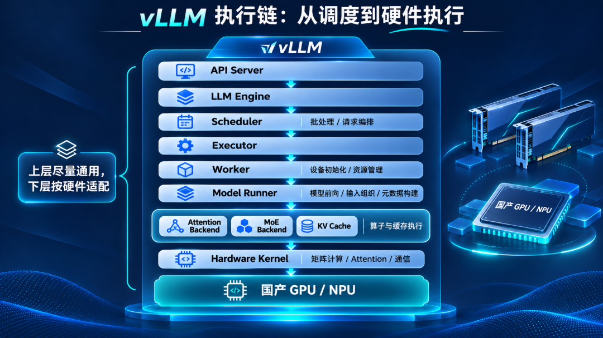
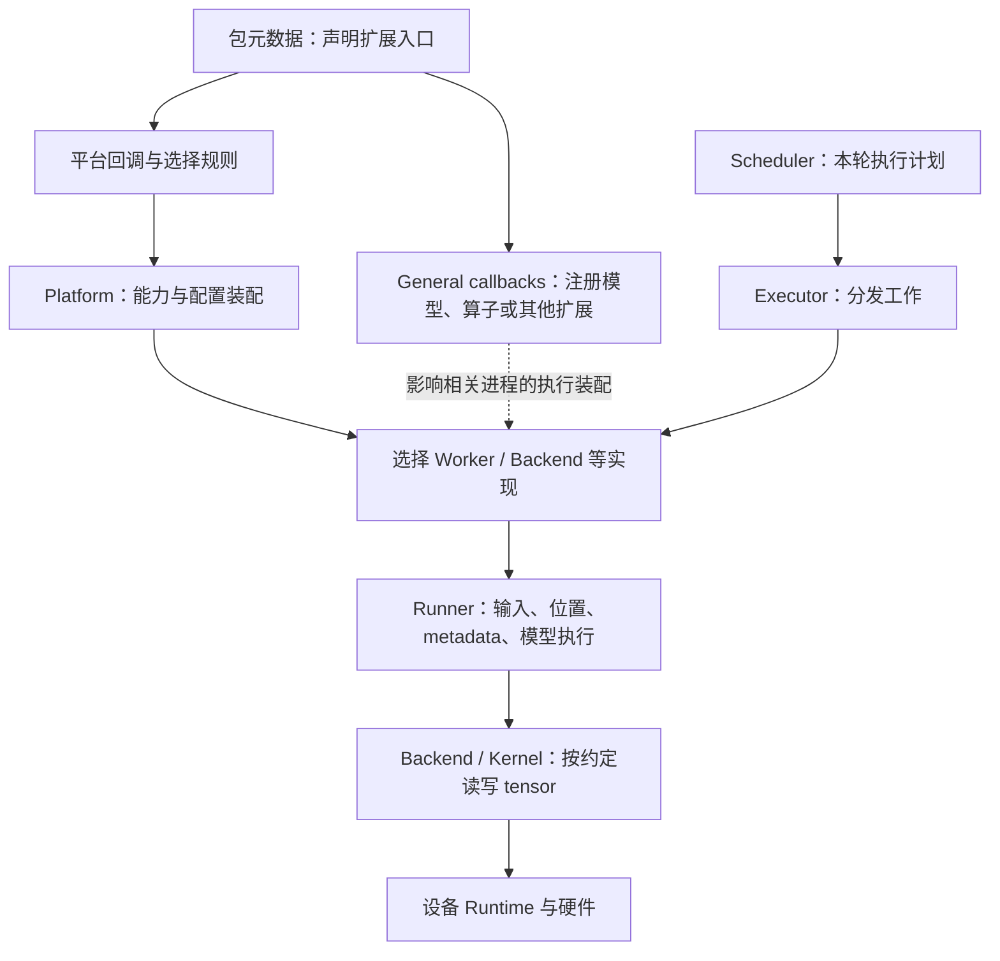
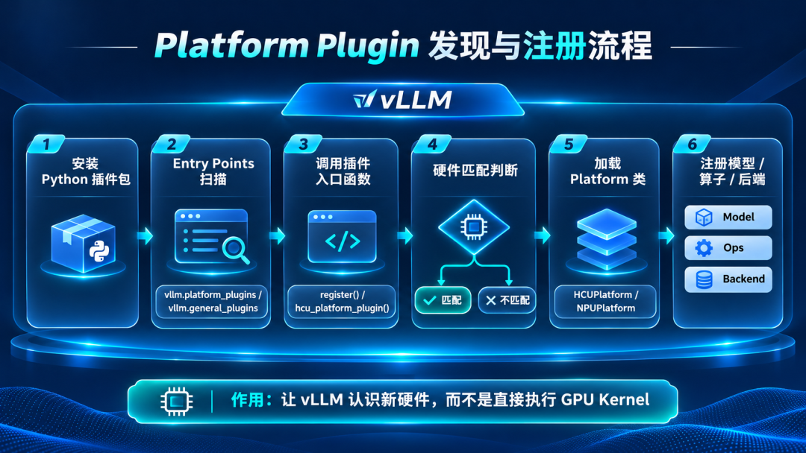
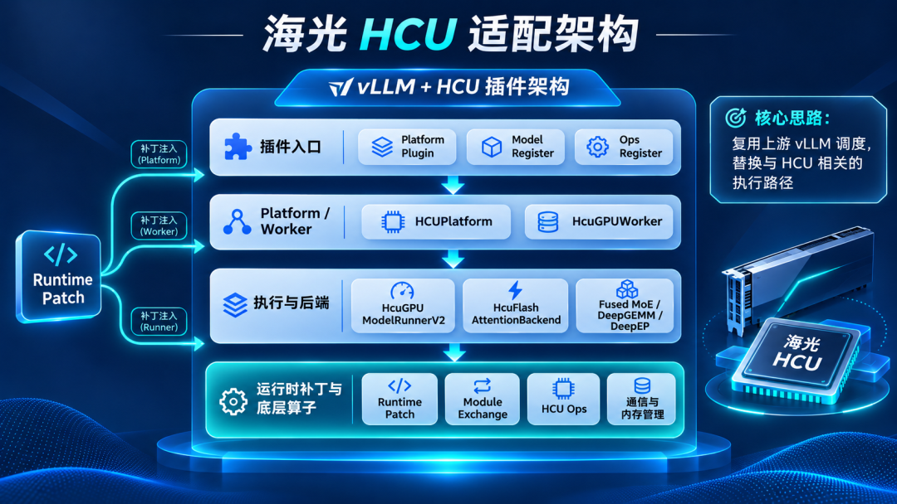
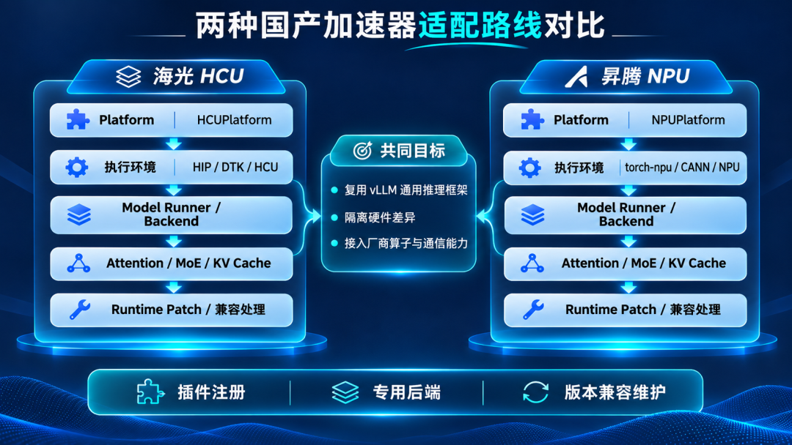

# vLLM 硬件插件、平台选择与执行适配学习文档

在一张新设备上跑通 PyTorch 矩阵乘法，只说明基础张量计算可用。vLLM 还要选对执行平台、创建 Worker、组织模型输入，并让 Attention、KV Cache、MoE 和通信走到匹配的实现。硬件插件连接的就是这些环节。

本文是**第三方资料整理型学习资料**，整理文章《vLLM 如何识别并运行在国产 GPU 上？》，并有限复核公开源码。先讲插件怎样被发现，再沿一轮模型执行认识各层责任，最后用海光 HCU 与昇腾 NPU 说明两条接入路线。本文没有安装插件、导入其运行代码，也没有进行设备、模型或性能实验。

## 0. 阅读基线与范围

| 项目 | 内容 |
| --- | --- |
| 原文标题 | vLLM 如何识别并运行在国产 GPU 上？ |
| 原文链接 | [公众号文章][article] |
| 作者 / 公众号 | 张量叙事 |
| 发布时间 | 页面 `ct` 时间戳：2026-11-19 09:49:30，Asia/Shanghai |
| 读取时间 | 2026-11-19 |
| 资料类型 | 技术文章；结合官方插件文档与公开源码作有限复核 |
| 整理范围 | 插件发现、Platform 选择、Worker/Runner、Attention/KV 契约、Runtime Patch、HCU 与 Ascend 的接入差异 |
| 不展开 | 各厂商完整模型支持矩阵、内核实现、安装部署步骤及性能比较 |
| 配图 | 原文 5 图均已查看，保留 4 张技术图，省略与正文重复的题图；[来源与哈希](../../images/vllm-hardware-plugins/SOURCES.md) |

源码复核使用以下**相互独立的快照，不是一组已经验证兼容的部署版本**。所列分支是取证入口，结论以固定提交为准。

| 公开仓库 | 分支语境 | 固定 commit | 本次核对 |
| --- | --- | --- | --- |
| [vllm-project/vllm](https://github.com/vllm-project/vllm) | `main` | `33fa579edcf4f90d76c62e82db6ec6c9aefd73f5` | 插件加载、平台决议、Platform 接口与插件文档 |
| [HYGON-AI/vllm-plugin-das](https://github.com/HYGON-AI/vllm-plugin-das) | `v0.28.1-dev` | `d032941f771998ce697f5611ac40fb8e0bc1a0c1` | 包入口、版本门禁、HCU Platform、Worker、Runner、Attention 与补丁注册 |
| [vllm-project/vllm-ascend](https://github.com/vllm-project/vllm-ascend) | `main` | `49f8682bd6783734d11f0378d6c1be261a19d411` | 包入口、NPUPlatform、general plugin 与全局补丁入口 |

三组文件均于 2026-11-19 按提交下载后只读检查，没有建立可运行源码检出或修改外部仓库。HCU 的 [version.py][h-version] 记录其目标发布线为 `0.28.1`；[兼容性检查][h-compat] 比较 PEP 440 epoch 与 release tuple，允许相应构建后缀不同。通过这一检查，不等于二进制依赖、设备功能及任意上游提交已经兼容。

先修：[vLLM 引擎工作流](<vLLM 从连续批处理到 PagedAttention 的引擎工作流学习文档.md>)。需要先定位进程关系时，读 [SGLang 与 vLLM V1 架构差异](<../../大模型推理/推理基础/SGLang 与 vLLM V1 架构差异源码学习文档.md>)；那篇主图限定 CUDA 与特定执行器，不是本文两种硬件插件的进程图。

| 术语 | 人话解释 | 不要混为一谈 |
| --- | --- | --- |
| Entry Point | Python 包对外声明的扩展入口 | 包已经安装，不等于入口已成功执行 |
| Platform | 描述设备能力、选择执行实现并调整配置的接口 | 平台类被选中，不等于设备能完成推理 |
| Worker | 管理设备与模型执行生命周期的对象 | 对象职责不直接决定进程数量 |
| Model Runner | 把本轮计划组织成模型可执行输入，管理前向与相关状态 | 不只是调用一次 `model(input_ids)` |
| Attention Backend | 对接能力检查、metadata、KV 布局和实际计算 | Backend 类、Kernel 与缓存管理器各有职责 |
| Runtime Patch | 在运行时调整函数、模块或初始化行为 | 不修改安装目录文件，仍可能依赖上游内部接口 |
| HCU / NPU | 本文两个案例的平台称呼 | 不表示采用同一套驱动、算子或通信库 |

## 1. 先拆开启动装配与每轮执行

### 一次启动先决定“用谁”

Python 包元数据让 vLLM 找到扩展入口；平台注册回调返回平台类路径，vLLM 再按选择规则确定当前 Platform。随后，平台相关配置可以指定 Worker、Attention Backend 等实现。模型注册和算子注册则可能从另一组 general plugin 入口完成。

这些动作主要发生在导入、配置和初始化阶段，不会在每个 token 上重新扫描所有插件。多进程启动时，每个相关进程仍需建立自己的运行状态；不能把前端进程已加载插件，理解成所有 Worker 都自动继承了相同 Python 对象。[上游插件加载][v-plugins]

跨进程的完整调用与导入顺序见 [多进程启动中的插件注册与补丁生效](<vLLM 多进程启动中的插件注册与补丁生效顺序学习文档.md>)。该篇另以 HCU 记录的官方集成提交为主线，区分 fork 继承的快照、spawn 的重新初始化，以及 Worker 配置绑定；不与本文三组独立快照合并成一个部署组合。

### 沿启动路线检查四个位置

一个 HCU 插件已经安装，却没有影响模型执行时，先不要反复重装。按下面的路线检查：前端有没有发现并允许入口，EngineCore 是否建立了自己的扩展状态，Worker 最后构造了哪个类，以及 HCU 补丁是否已经按该 Worker 的配置生效。

| 位置 | 本步在做什么 | 这一步成功后还缺什么 |
| --- | --- | --- |
| 包元数据与前端 | 发现入口、执行注册、形成配置 | Core 与 Worker 还要建立各自的运行状态 |
| EngineCore | 加载 general plugins，再创建 Executor 等对象 | 执行任务仍需派发给正确 Worker |
| WorkerWrapper | 取得本 rank 配置、加载扩展、解析 Worker 类 | Worker 还要初始化设备、加载模型并创建 Runner |
| HCU Worker | 绑定本 Worker 配置并应用对应补丁，再进入父类初始化 | 设备、模型和具体计算路径仍需实际验证 |

这是 HCU 目标提交 `58ad1f3b` 的调用路线摘要；后面的平台选择表仍属于 `33fa579e`。两个版本共同说明“安装、注册、选中、实际使用”是不同步骤，但不能交换它们的代码分支。[固定版本附录](<vLLM 多进程启动中的插件注册与补丁生效顺序学习文档.md>)保留完整调用链、fork/spawn 和 HCU 导入协调器。

### 每轮计算再决定“算什么、怎么算”



[查看原尺寸](../../images/vllm-hardware-plugins/02-execution-stack.png)；窄屏可放大阅读。

**图意解读：** 上半部分接收请求、制定工作计划，下半部分组织输入和执行设备计算。Scheduler 决定请求与 token 预算，Executor 负责分发执行任务，Worker/Runner 承接设备生命周期和模型执行。图是逻辑职责地图，不是一条逐 token 的严格调用栈，也不保证每个方框都单独占一个进程。KV Cache 横跨逻辑管理和物理读写，不能全归为最底层算子。



**图意解读：** 这是整理者按职责重画的关系图。上方是实现选择与注册，下方是本轮执行；虚线表示装配影响，没有规定两类回调的全局先后。控制关系不代表 GPU 时间线，模型还可能调用不经过同一个 Attention Backend 的其他算子。

## 2. 插件从哪里来，Platform 怎样被选中

### 两组入口，两个职责

| Entry Point Group | 回调通常做什么 | 本文案例 |
| --- | --- | --- |
| `vllm.platform_plugins` | 返回平台类路径，参与平台选择 | HCU 的 `hcu`；Ascend 的 `ascend` |
| `vllm.general_plugins` | 执行注册或初始化扩展 | HCU 的模型与算子注册；Ascend 的 Connector、模型等注册 |

上游还有其他插件组，本表只列文章主线。模型、算子和 Backend 也不必各自对应一个同名的 Entry Point Group。[上游定义][v-plugins] [HCU 包声明][h-setup] [Ascend 包声明][a-setup]



[查看原尺寸](../../images/vllm-hardware-plugins/01-plugin-discovery.png)。

**图意解读与补充：** 图把安装、入口扫描、平台注册和模型/算子注册排成了便于理解的步骤，但第 6 格不表示所有 general plugin 都必须等到 Platform 类加载后才执行。两类入口的调用位置与当前进程有关；“硬件匹配判断”也不是每个第三方回调都实现了完整设备探测。

一个教学用平台回调可以在不匹配时返回 `None`，匹配时返回 `"my_plugin.platform.MyPlatform"`。但本次读到的 Ascend `register()` 直接返回 NPUPlatform 路径；HCU 入口还承担兼容性检查、平台补丁注册及初始化错误记录。**返回类路径说明它提出了平台候选，不足以证明设备已被枚举、初始化或验证。** [HCU 入口][h-init] [Ascend 入口][a-init]

### 不是“扫描到第一个就用第一个”

在本次上游固定提交中，`resolve_current_platform_cls_qualname()` 的关键规则是：

| 条件 | 所读代码的行为 |
| --- | --- |
| 显式 `VLLM_TARGET_DEVICE=cpu` | 优先走 CPU 选择，不再按普通加速器探测流程处理 |
| 两个及以上外部平台回调报告激活 | 报平台冲突 |
| 恰好一个外部平台激活 | 选择这个外部平台 |
| 没有外部平台，多个内置平台激活 | 报内置平台冲突 |
| 没有外部平台，恰好一个内置平台激活 | 选择该内置平台 |
| 没有候选激活 | 使用 `UnspecifiedPlatform` |

这里的“外部”指通过插件入口提供的平台。当前 Platform 使用延迟初始化，并在进程内缓存；探测阶段会捕获部分异常，选定回调还可能再次被调用。因此插件既要处理重复调用，也不能依赖“异常总会在第一次探测时直接终止启动”。这些规则只属于所列上游提交，不证明 HCU 的目标发布线逐项相同。[平台决议源码][v-platform]

### 发现、允许加载和成功执行还差几步

本次上游的 `load_plugins_by_group()` 按 `VLLM_PLUGINS` 过滤入口名称。HCU 的平台入口叫 `hcu`，模型和算子入口分别叫 `hcu_model`、`hcu_ops`；只允许其中一个名称，不等于允许整包的三个入口。此处说明过滤粒度，不建议照抄为特定环境配置。[加载器][v-plugins] [包声明][h-setup]

只想查看当前 Python 环境声明了哪些入口，可以使用标准库；这段代码不导入插件实现：

```python
from importlib.metadata import entry_points

for group in ("vllm.platform_plugins", "vllm.general_plugins"):
    print(f"[{group}]")
    for ep in entry_points().select(group=group):
        print(ep.name, "->", ep.value)
```

它只回答“装了什么”。要回答“实际用了什么”，还要看入口加载结果、当前 Platform、Worker/Runner 身份及模型执行日志。本文没有在本机执行这段环境探针。

## 3. Worker 管环境，Runner 组织模型执行

人话版：Scheduler 决定这轮给哪些请求安排多少工作；Worker 准备能执行这些工作的设备环境；Runner 把计划翻译成模型所需的输入与状态。底层 Kernel 再完成具体数学计算。

| 责任 | 典型内容 | 硬件适配为什么会触及这里 |
| --- | --- | --- |
| Worker | 设置设备、分布式初始化、显存准备、加载与执行生命周期 | 设备 API、通信与内存行为不同 |
| Runner | 组织 token、position、持久 batch、Attention metadata、执行图与输出处理 | 后端需要不同输入、缓存视图或图执行方式 |
| Backend / Kernel | 能力检查、算子调用、K/V 写入和读取 | 支持的 dtype、head size、分页与物理布局不同 |

这是跨实现的责任划分。具体输入准备、采样与状态更新放在哪个方法，仍须看对应版本，不把图中的方框当作不可变的接口分界。[Platform 接口][v-interface] [HCU Worker][h-worker] [HCU Runner][h-runner]

例如，一张设备已经能跑 BF16 GEMM，但 Attention Kernel 只接受另一种 KV 布局。模型权重可能已经加载成功，第一次注意力计算却仍然失败。此时继续调整请求排队规则未必有帮助，应先核对 Runner 生成的 metadata、缓存 view 与 Kernel 约定。

## 4. 海光 HCU：用插件接入，用运行时适配连接内部路径

### 三个入口分别接通哪一部分



[查看原尺寸](../../images/vllm-hardware-plugins/03-hcu-runtime.png)。

**图意解读：** 上方是平台、模型与算子注册，下方是 Worker/Runner、Backend 和设备能力。左侧补丁箭头表示这些执行路径受到运行时适配影响，不代表存在三个独立的补丁进程，也不能据此推断所有补丁已经生效。算子主体与模块替换、注册逻辑各有位置。

| 函数 | 固定源码中的主要动作 |
| --- | --- |
| `hcu_platform_plugin()` | 检查 vLLM 版本，准备平台补丁，返回 `HCUPlatform` 路径；记录初始化失败状态 |
| `hcu_platform_register_model()` | 准备相应补丁注册，再注册模型实现 |
| `hcu_platform_register_ops()` | 准备相应补丁注册，再导入并注册自定义算子 |

general 回调还通过进程内注册记录处理重复执行和失败状态。它们没有合并成一个“万能硬件识别函数”。[入口实现][h-init]

### 为什么代码里仍写着 `cuda`

本次 HCUPlatform 声明 `device_name="hip"`、`device_type="cuda"`、`dispatch_key="CUDA"`，平台枚举使用 ROCM；架构查询则读取 `torch.cuda.get_device_properties(...).gcnArchName`。这是该软件栈沿用的设备接口和分发标识，不能只看 Python 字符串就认定底层是 NVIDIA GPU 或 CUDA Runtime。[HCU 平台][h-platform]

同样，配置里的通信后端名称不能代替对实际加载通信库的检查。本文只记录接口字段，没有验证任何通信库或硬件互通能力。

### 补丁为什么要早于父类初始化

`HcuGPUWorker.__init__()` 先设置进程角色、调用 `apply_worker_patches(vllm_config)`，再调用上游 Worker 的构造函数。这样，父类随后导入 Runner 或算子时，相应回调和替换关系已经准备好。[Worker 构造][h-worker]

Python 中，`from module import func` 会把当时的对象绑定到本地名字。等其他模块持有了旧引用，再修改 `module.func`，并不保证所有已有引用随之改变。这是理解提前注册补丁的一个例子，不是对全部补丁实现的概括。

| 模块 | 本次读到的作用 |
| --- | --- |
| `patch/module_exchange.py` | 声明准确的上游模块名与 HCU 实现映射，按需注册替换 |
| `patch/import_coordinator.py` | 协调精确模块名的导入回调与整模块替换 |
| `patch/runtime_state.py` | 记录进程角色及补丁运行状态，提供重复调用与失败处理的基础 |
| `patch/platform/`、`patch/worker/` | 在不同初始化边界组织需要的适配 |

“注册了替换关系”“目标模块已经被导入”“对应补丁实际生效”是三种状态。运行时替换减少了直接改写安装目录源码的需要，却仍然依赖模块路径、函数签名与初始化时机。[映射][h-exchange] [导入协调][h-import] [状态记录][h-state]

### Runner 选择要读分支，不能只看文件名

常规 V2 分支创建 `HcuGPUModelRunnerV2`，并输出实际 Runner 类名。但本次 `_create_model_runner()` 还存在一个有限例外：关闭 V2，且模型为 `kimi_k3`、DP=1、Prefill CP=1 时，代码创建**上游维护的 `GPUModelRunner`** 供参考路径使用；其他非 V2 情况抛错。[创建逻辑][h-worker]

这与“目录里保留了 `hcu_model_runner.py`，所以一定会自动回退到它”完全不同。该提交的 README 对常规使用写的是要求 V2、没有旧 HCU Runner 回退；本文同时记录 Worker 源码中的窄条件例外，不把它扩写为所有模型可用的通用 V1 回退，也没有验证该路径能运行。[README 运行说明][h-readme]

## 5. Attention Backend 还要对齐 KV 的物理契约

原文列出的 HCU FlashAttention Backend 不只返回一个 Kernel。它还提供实现类、metadata builder、缓存形状与 stride 顺序，并按路径检查数据类型、head size 和 block size。[Backend 源码][h-attn]

以这一个 Backend 为例，其逻辑 KV 形状是：

```text
(num_blocks, 2, block_size, num_kv_heads, head_size)
             ↑
             K / V
```

`get_kv_cache_stride_order()` 又区分 NHD 与 HND。只看单个 block 内的一组 K 或 V，`N` 表示 token 位置、`H` 表示 head、`D` 表示 head 内维度：

```text
NHD：Token → Head → Dim
HND：Head → Token → Dim
```

**教学算例：** 忽略其他轴与对齐，假设 N=4、H=2、D=3，直接按连续布局存储。位置 `(token=1, head=0, dim=0)` 在 NHD 中的元素偏移是 `(1×2+0)×3=6`，在 HND 中是 `(0×4+1)×3=3`。逻辑上是同一个 K/V 元素，物理寻址却不同；实际 tensor view 需要通过正确 stride 把二者对应起来。

因此，接口对齐至少要回答四个具体问题：本轮 token 写到哪个 slot，block table 指向哪些页，页面内部怎样寻址，Kernel 按什么 dtype/量化编码解释数据。本文形状只属于所读 HCU FlashAttention Backend，不能覆盖 MLA、递推状态或所有其他后端。

**与旧资料的关系：** [KV 生命周期文档](<../KV缓存/vLLM V1 KV Cache 管理全生命周期源码学习文档.md>)解释谁分配、引用、复用和释放逻辑块；本节补充某个后端怎样解释这些块中的字节。拥有物理 tensor 不等于拥有请求的分配策略，缓存内容相同也不证明不同后端可以直接交换原始字节。后端间转换和传输还需独立证据。

MoE 也有类似契约：Router/TopK、Dispatch、专家计算与 Combine 必须对齐输入输出、精度及通信约定。这里沿原文说明适配范围，没有逐项审计所有 HCU MoE Kernel，不能把目录或实现类存在当成完整支持证明。

## 6. 昇腾 NPU：相同扩展入口，不同执行体系



[查看原尺寸](../../images/vllm-hardware-plugins/04-hcu-ascend-comparison.png)。

**图意解读：** 两侧都尝试复用上层引擎，通过专用模块接入设备执行和算子能力；这不要求它们统一底层 Runtime。图底部的 Runtime Patch 是横跨初始化与执行装配的适配手段，不能按纵向顺序理解成每次算完 Attention 再执行一轮补丁。

所读 `NPUPlatform` 使用 `device_type="npu"`、`dispatch_key="PrivateUse1"`、`ray_device_key="NPU"` 与 `ASCEND_RT_VISIBLE_DEVICES`。它走的是独立 NPU 设备及扩展体系，不能照搬 HCU 的 HIP 路径。[Ascend 平台字段][a-platform]

Ascend 的 `register()` 返回平台类路径；general plugin 则包括 Connector、模型加载器、服务 profiling 与模型注册。其中 Connector、loader、profiling 入口会调用 `_ensure_global_patch()`，在进程内准备影响 EngineCore 等模块的全局适配。**这不表示每一个 general 回调都无条件执行同一组补丁。** [包声明][a-setup] [入口实现][a-init]

| 观察点 | HCU 固定快照 | Ascend 固定快照 |
| --- | --- | --- |
| 平台类 | `HCUPlatform` | `NPUPlatform` |
| 设备接口标识 | HIP 路径中的 `cuda` / CUDA dispatch 标识 | `npu` / `PrivateUse1` |
| 执行适配 | HCU Worker、Runner、Attention 及算子实现 | NPU Worker/Runner 配置、专用后端及算子体系 |
| 注册与补丁 | 平台、模型、算子入口，导入协调与补丁状态 | 平台与多种 general 入口，相关入口准备全局补丁 |
| 不能从中得出的结论 | 不能证明与任意 ROCm 构建兼容 | 不能证明与任意 torch-npu/CANN 组合兼容 |

表中比较的是接入责任，不是性能或维护成本排名。插件可以复用哪些上游逻辑，取决于实际接口、模型和构建组合；两边的固定提交也不构成同一套横评环境。

## 7. 从“装上了”到“真的跑对了”，分别看什么证据

| 要回答的问题 | 可查看的证据 | 这一层还不能证明什么 |
| --- | --- | --- |
| Python 环境有没有插件入口 | 包元数据、Entry Point 名称与目标 | 回调成功、硬件可用 |
| 平台有没有选对 | 平台激活日志、实际 Platform 类、版本检查结果 | Worker 已在目标设备上执行 |
| 执行路径有没有接通 | 实际 Worker/Runner 类、权重与 KV 初始化日志 | 全部模型层都用了预期 Kernel |
| 缓存与算子契约是否一致 | 每类层的 Backend、dtype、head size、block size、shape/stride 与 metadata | 长上下文、多卡与所有量化组合正确 |
| 模型行为是否正确 | 固定权重、tokenizer、输入、采样条件下的数值或任务评估 | 服务吞吐与稳定性 |
| 服务是否达到目标 | 约定负载下的延迟分位数、成功输出、错误率与持续运行记录 | 其他硬件、版本或负载也有相同结果 |

例如 HCU 的 `vllm-hcu-doctor` 默认模式还会检查当前进程的平台补丁注册状态；`--no-arm --json` 只做相应元数据和源码检查，不注册平台补丁。两种结果都不替代真实设备执行验证。本文只读其 README 中的说明，没有运行该工具。[诊断说明][h-readme]

升级时要追踪的也不只是 vLLM 版本号。插件代码、PyTorch、厂商 Runtime、算子库、通信实现与模型配置共同决定路径能否成立。固定版本组合之后，再按故障所在边界查证，通常比从上层 Scheduler 开始无差别修改更容易定位问题。

## 8. 相关旧资料复核与阅读路线

| 资料 | 已有内容与本文增量 | 本次同步 |
| --- | --- | --- |
| [vLLM 引擎工作流](<vLLM 从连续批处理到 PagedAttention 的引擎工作流学习文档.md>) | 已讲请求、调度与分页缓存；本文增加启动时的硬件实现装配 | 通过运行时导航衔接，不改其 V0 历史和概念示例 |
| [SGLang 与 vLLM V1 架构差异](<../../大模型推理/推理基础/SGLang 与 vLLM V1 架构差异源码学习文档.md>) | 已拆开 Executor、Worker 与进程；本文研究非 CUDA 插件 | 增加范围外的阅读入口，不改 CUDA 教学主图 |
| [vLLM V1 KV 生命周期](<../KV缓存/vLLM V1 KV Cache 管理全生命周期源码学习文档.md>) | 已讲块分配、slot mapping 与物理 view；本文提供 HCU shape/stride 的具体例子 | 在物理分配章节增加关联，保留原固定提交 |
| [vLLM V1 KV Connector](<../分离部署/vLLM V1 KV Connector 架构与实现地图源码学习文档.md>) | 已区分 Scheduler 任务与 Worker 搬运；本文的硬件注册不证明跨平台传输可用 | 未发现需要改写的事实，不扩写异构互通结论 |

第一次读可以按“第 1–3 节整体地图 → 第 4 节具体装配 → 第 5 节数据契约”推进；需要对照另一种设备体系时再读第 6 节。自测应能解释：为什么列出 Entry Points 还不能证明平台激活，为什么 `torch.cuda` 不足以识别底层硬件，为什么 Runtime Patch 需要考虑进程与导入顺序，以及为什么同样大小的 KV 页也可能无法由另一种 Kernel 正确读取。

参考：原文及其[官方插件机制入口](https://docs.vllm.ai/en/latest/design/plugin_system/)。在线文档会变化，本文具体分支行为优先对应下列固定源码。

<a id="plugin-version-comparison"></a>
## 补充：两份上游快照能共用哪些解释

2026-11-23 按公开固定提交重新读取两版的 `plugins/__init__.py`、`platforms/__init__.py`、`v1/engine/core.py` 和 `v1/worker/worker_base.py`，只比较源码文件，没有导入 vLLM 或插件。

| 检查点 | `33fa579e` | `58ad1f3b` | 本文怎样处理 |
| --- | --- | --- | --- |
| `load_general_plugins` | 检查进程内 guard，再加载并执行回调 | 同一函数的 AST 相同 | 共用加载器解释；不承诺跨进程回调次数 |
| EngineCore 初始化 | general plugins 在 Executor 构造之前 | 相同的相对顺序 | 共用 Core 的职责说明 |
| Worker 类解析前 | 调用 `register_triton_kernel_overrides()` | 所读 `init_worker` 中没有这一步 | 该插入点只归到 `33fa579e`，不回填 HCU 目标版本 |
| Platform 探测异常 | 区分内置与外部插件的日志级别 | 统一走所读 debug 记录分支 | 保留版本说明，不统一异常处理细节 |
| Worker 多模态缓存初始化 | 使用该版本的接收缓存辅助函数 | 显式处理 shared worker lock，再初始化对应缓存 | 留在各自实现，不拼成一条通用分支 |

依据：[33fa 插件加载器](https://github.com/vllm-project/vllm/blob/33fa579edcf4f90d76c62e82db6ec6c9aefd73f5/vllm/plugins/__init__.py)、[58ad 插件加载器](https://github.com/vllm-project/vllm/blob/58ad1f3b8973b23943107b51230d594050b42ec3/vllm/plugins/__init__.py)、[33fa WorkerWrapper](https://github.com/vllm-project/vllm/blob/33fa579edcf4f90d76c62e82db6ec6c9aefd73f5/vllm/v1/worker/worker_base.py)、[58ad WorkerWrapper](https://github.com/vllm-project/vllm/blob/58ad1f3b8973b23943107b51230d594050b42ec3/vllm/v1/worker/worker_base.py)、[33fa 平台选择](https://github.com/vllm-project/vllm/blob/33fa579edcf4f90d76c62e82db6ec6c9aefd73f5/vllm/platforms/__init__.py)、[58ad 平台选择](https://github.com/vllm-project/vllm/blob/58ad1f3b8973b23943107b51230d594050b42ec3/vllm/platforms/__init__.py)。Core 的对应入口见两版 `vllm/v1/engine/core.py::EngineCore.__init__`。

因此保留一篇机制主文和一份固定版本附录。初读只走本篇启动路线；需要排查 HCU 的类替换与进程内状态时，再查附录，避免重复读两轮总览。

[article]: https://mp.weixin.qq.com/s/CsX8BdUvlVh_Y1DqZcuW_A
[v-plugins]: https://github.com/vllm-project/vllm/blob/33fa579edcf4f90d76c62e82db6ec6c9aefd73f5/vllm/plugins/__init__.py#L33
[v-platform]: https://github.com/vllm-project/vllm/blob/33fa579edcf4f90d76c62e82db6ec6c9aefd73f5/vllm/platforms/__init__.py#L240
[v-interface]: https://github.com/vllm-project/vllm/blob/33fa579edcf4f90d76c62e82db6ec6c9aefd73f5/vllm/platforms/interface.py#L400
[h-setup]: https://github.com/HYGON-AI/vllm-plugin-das/blob/d032941f771998ce697f5611ac40fb8e0bc1a0c1/setup.py#L214
[h-init]: https://github.com/HYGON-AI/vllm-plugin-das/blob/d032941f771998ce697f5611ac40fb8e0bc1a0c1/vllm_hcu/__init__.py#L81
[h-version]: https://github.com/HYGON-AI/vllm-plugin-das/blob/d032941f771998ce697f5611ac40fb8e0bc1a0c1/vllm_hcu/version.py#L15
[h-compat]: https://github.com/HYGON-AI/vllm-plugin-das/blob/d032941f771998ce697f5611ac40fb8e0bc1a0c1/vllm_hcu/compatibility.py#L123
[h-platform]: https://github.com/HYGON-AI/vllm-plugin-das/blob/d032941f771998ce697f5611ac40fb8e0bc1a0c1/vllm_hcu/platforms/hcu.py#L231
[h-worker]: https://github.com/HYGON-AI/vllm-plugin-das/blob/d032941f771998ce697f5611ac40fb8e0bc1a0c1/vllm_hcu/v1/worker.py#L45
[h-runner]: https://github.com/HYGON-AI/vllm-plugin-das/blob/d032941f771998ce697f5611ac40fb8e0bc1a0c1/vllm_hcu/v1/hcu_model_runner_v2.py#L202
[h-attn]: https://github.com/HYGON-AI/vllm-plugin-das/blob/d032941f771998ce697f5611ac40fb8e0bc1a0c1/vllm_hcu/v1/attention/backends/flash_attn.py#L278
[h-readme]: https://github.com/HYGON-AI/vllm-plugin-das/blob/d032941f771998ce697f5611ac40fb8e0bc1a0c1/README.zh-CN.md#L92
[h-exchange]: https://github.com/HYGON-AI/vllm-plugin-das/blob/d032941f771998ce697f5611ac40fb8e0bc1a0c1/vllm_hcu/patch/module_exchange.py#L31
[h-import]: https://github.com/HYGON-AI/vllm-plugin-das/blob/d032941f771998ce697f5611ac40fb8e0bc1a0c1/vllm_hcu/patch/import_coordinator.py#L152
[h-state]: https://github.com/HYGON-AI/vllm-plugin-das/blob/d032941f771998ce697f5611ac40fb8e0bc1a0c1/vllm_hcu/patch/runtime_state.py#L355
[a-setup]: https://github.com/vllm-project/vllm-ascend/blob/49f8682bd6783734d11f0378d6c1be261a19d411/setup.py#L506
[a-init]: https://github.com/vllm-project/vllm-ascend/blob/49f8682bd6783734d11f0378d6c1be261a19d411/vllm_ascend/__init__.py#L60
[a-platform]: https://github.com/vllm-project/vllm-ascend/blob/49f8682bd6783734d11f0378d6c1be261a19d411/vllm_ascend/platform.py#L106
