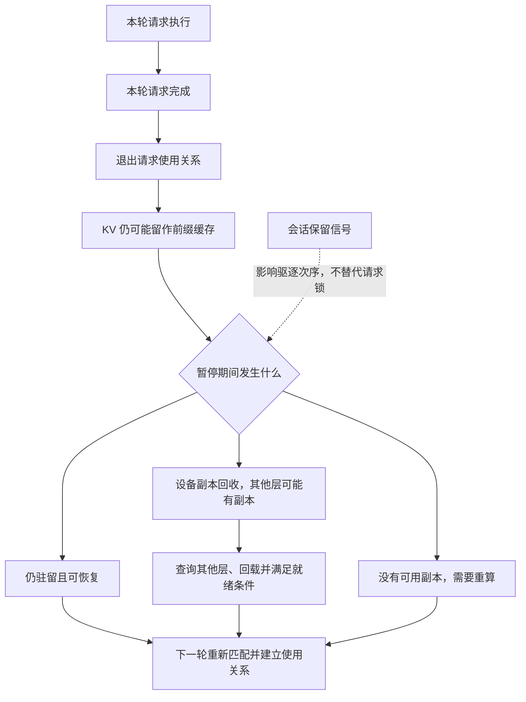
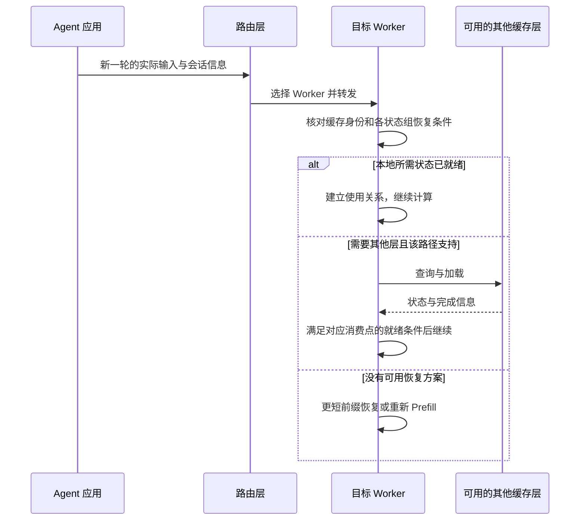

# Agent 暂停与恢复时的 KV 保留与状态所有权学习文档

Agent 发出工具调用后，模型请求可能已经结束，会话却还要继续。下一轮能否复用历史，取决于几件独立的事：状态是否仍在、是否对应同一计算、需要的状态组是否齐全、数据能否及时回到设备，以及有没有人在继续读写它。

本文是**源码分析型的跨引擎学习资料**。以公开上游固定提交核对请求引用、SGLang 会话软引用、缓存恢复入口和 KV Hint 协议，再把 RFC 中的保留意图放到这些边界上理解。没有启动模型、运行上游单测或验证跨版本部署组合。

[本领域路线](README.md) · [先修：前缀缓存恢复条件](<前缀缓存命中后的恢复条件与状态所有权对比学习文档.md>) · [配套：前缀亲和调度与缓存感知路由](<../分布式服务/前缀亲和调度与缓存感知路由源码学习文档.md>)

## 0. 固定源码与证据边界

| 项目 | SGLang | vLLM |
| --- | --- | --- |
| 公开上游 | [sgl-project/sglang](https://github.com/sgl-project/sglang) | [vllm-project/vllm](https://github.com/vllm-project/vllm) |
| 分支 | `main` 的固定快照 | `main` 的固定快照，研究 V1 |
| commit | `074aeaf67499d06cc61300971fae90bcf4297670` | `13329cca5ca75daa9cbb83446e695cdd97cae427` |
| 读取日期 | 2026-11-16 | 2026-11-16 |
| 工作区状态 | 按 commit 下载所需文件只读核对，未建立或修改上游检出 | 按 commit 下载所需文件只读核对，未建立或修改上游检出 |
| 操作范围 | Unified 会话引用、组件驱逐、恢复入口、请求携带的 Hint | BlockPool 释放、请求及 EngineCore Hint 字段、协议结构 |

两个快照各自成立，不表示它们组成了经过验证的共同部署。Wiki 原有未提交内容保留。本文引用的 [SGLang #27574][r-sg]、[vLLM #51428][r-vl] 和 [vLLM #37003][r-retain] 是读取当天的提案页面，可能继续编辑；其中的设计、POC 报告和待办不改称固定源码已实现的全部能力。

阅读入口是小力龙虾的[《Sglang 和vllm深度比较：从kv cache展开到推理框架》][article]。已结合全文及 8 张配图复核，采用其中的 Agent 暂停与恢复问题，不沿用性能排名、未经核对的图中参数，或把 Pin 等同于 HBM 常驻的定义。正文机制图均为依据下列源码重建的教学图。

### 术语速查

| 术语 | 人话解释 | 本文必须区分的边界 |
| --- | --- | --- |
| Request | 一次模型执行请求 | 工具等待期间未必仍有活动 Request |
| Session | 多轮交互的组织身份 | 不自动等于完整历史、隔离键或物理 KV 地址 |
| 请求锁 / block 引用 | 当前使用者持有的资源关系 | 影响正在使用的数据何时能回收 |
| Session reference | 某会话仍希望复用这段状态的软信号 | 不等于活动请求锁，不保证永不驱逐 |
| Residency | 数据在哪个存储层 | 不说明状态是否匹配或 GPU 是否已经可读 |
| Retain / Pin | RFC 中两种不同的缓存意图 | 软优先级与有界保护不是一回事 |
| KV Hint envelope | 随请求携带的版本化动作容器 | 有协议结构不等于每种动作已有执行器 |

## 1. 先分开三条生命周期

**人话版：** 请求用完数据、会话暂时停顿、缓存最终被覆盖，是三个不同事件。像借阅者归还书籍后，图书馆仍可把书放在书架上；“下一位读者可能需要”又不同于“现在有人正在读”。

**图意解读：** 图中的三个出口是可能结果，不承诺请求完成后一定写到 L3，也不要求下一轮必须回到同一 Worker。是否使用其他副本还受路由、布局、缓存身份和恢复策略限制。

### vLLM：归零引用后，缓存身份仍可能存在

固定源码的 `BlockPool.free_blocks` 递减引用；归零块进入 free queue。带 hash 的普通缓存块通常放在较后的位置，但 `evict_first=True` 等分支可以改变次序。这个函数没有因为引用归零就统一清除所有缓存 hash。[V1]

`get_new_blocks` 从 free queue 取位置，启用缓存时再执行旧缓存身份的驱逐；`touch` 则可把命中块从 free queue 移出并增加引用。[V2]

因此要分别记录：请求引用归零、仍可被 APC 命中、成为可覆盖容量、缓存身份被移除。它们不能压成一个“free”。这里讨论的是逻辑块池，不表示 GPU 张量马上归还给设备驱动。

### SGLang：请求关系与会话引用分开维护

Unified 缓存请求时会更新请求的保护范围和锁。在本篇读取的正常完成分支中，开启 session radix cache 且不是 `FINISH_ABORT` 时，才进一步向 `session_refs` 登记组件叶子。[S1]

这说明会话引用有自己的注册条件；不能把任意取消、异常或所有缓存后端都概括为相同收尾路径。

## 2. SGLang 的会话软引用实际保存什么

### 2.1 注册与关闭

`UnifiedSessionRefTracker.register_session_ref` 检查开关、会话身份、关闭状态和 generation；StreamingSession 另走自己的状态续用路径，不在这里注册。通过检查后，各组件解析并登记自己可复用的叶子。[S2]

`release_radix_session` 记录关闭状态、移除当前 generation，再让组件释放会话覆盖引用。组件的 `release_session` 减少覆盖计数并删除会话叶子记录；这个接口没有无条件销毁相同内容的全部 KV。[S3]

**例子：** 会话 A、B 使用同一段前缀。A 关闭，意味着撤下 A 的保留信号；B 的引用和其他活动请求的保护关系仍需独立处理。即使没有会话引用，这段内容也可能按普通缓存规则继续保留。

### 2.2 软引用怎样影响驱逐

| 组件 | 引用所覆盖的内容 | 不能据此承诺什么 |
| --- | --- | --- |
| FULL | 可复用叶子向祖先的路径 | 路径永久锁在设备上 |
| SWA | 对应尾部窗口及对齐需要的范围 | 整段历史窗口都一直存在 |
| MAMBA | 可复用叶子的 recurrent 状态 | 每个 token 位置都有检查点 |

这些覆盖范围来自组件实现及同一固定提交的官方说明。[S4][S5] FULL 的会话驱逐排序包含“是否有引用、引用数、原有策略”等量；SWA/MAMBA 的遍历也区分有无会话引用。它们是压力下的保留偏好，不是取消所有驱逐。[S4][S6]

组件之间还有级联规则。删除一个组件的 payload、删除整个树节点、解除活动请求锁，是不同操作，不能只看一个 `session_ref` 数值决定全部资源生命周期。

### 2.3 三种 Session 机制不要混用

| 机制 | 负责什么 | 下一轮仍要确认什么 |
| --- | --- | --- |
| 服务端历史管理 | 按会话组织、追加或替换历史输入 | 最终输入及缓存身份 |
| StreamingSession / slot | 持有可续用的请求状态记录 | 追加契约、slot 是否有效、状态所有权 |
| 顶层 session reference | 为可复用内容登记软保留信号 | 本轮完整 prompt、实际缓存及恢复结果 |

同一提交的官方 session radix 文档明确：顶层 `session_id` 只标记引用，不替客户端拼出对话历史；关闭只解除引用，不立即删除 KV。[S5] 更完整的历史拼接、slot 和命名空间分析见[源码课程的三种会话机制](<../../sglang/source-study/04-kv-cache/03-命中条件与缓存隔离.md#8-会话三种机制不是一个-session_id-就能概括>)；该课程保留自己的固定版本。

## 3. 保留在哪里，与能否恢复分开判断

**人话版：** 把资料放进仓库，只说明有一个副本；下一轮是否能及时用上，还要检查地址、版本和搬运完成条件。

**图意解读：** Router 的缓存估计不是 Worker 的锁，也不是传输完成事件。图把共同判断顺序画出来；真实实现可以将部分 I/O 与计算重叠，不要求全请求所有层先一次性搬完。

固定 SGLang `match_prefix` 先尝试会话续用；无结果时进入树匹配，再运行组件 finalizer，适用时进入 external linker。它不是只根据一个 session ID 或树深度就直接执行模型。[S7]

恢复应至少检查五项：计算身份、各必要状态的共同边界、保护和可写性、容量与消费点就绪、旧使用者退役。具体的页、部分尾块、窗口和检查点例子见[恢复条件与状态所有权](<前缀缓存命中后的恢复条件与状态所有权对比学习文档.md>)。HiCache 的详细事件链见[上传回载源码文档](<../../sglang/KV缓存/HiCache 下 SGLang L1、L2、L3 与上传回载源码学习文档.md>)；不把这些文章的版本合并成本篇版本。

## 4. Retain、Pin 与已存在的 Hint 协议

### 4.1 先区分语义层

| 意图 | RFC 描述的目的 | 与物理驻留的关系 |
| --- | --- | --- |
| Retain | 按相对价值调整驱逐优先级，可附时间范围 | 必要时仍可被驱逐 |
| Pin | 在有界时间和资源约束内保护目标 | 不必永久常驻 HBM，可以在较冷层实现 |
| Prefetch | 在未来使用前准备更热层的副本 | 需要传输与可见性条件 |
| Demote | 先建立较冷层的有效副本，再允许热层回收 | 发布副本与本地回收是两个动作 |
| Share | 让其他 Worker 获得可用状态 | 不一定删除原 Worker 的副本 |

本表是两个 RFC 的概念对照，不是可直接发送的统一 API。[r-sg][r-vl] SGLang RFC 报告的具体 Pin POC 映射到 Mooncake L3 的 TTL lease，设备和 Host 副本仍可正常驱逐。它不支持“Pin 一定把 KV 钉在 HBM”的解释。

### 4.2 源码已经有协议，动作成熟度仍须分别确认

| 固定源码中已确认的部分 | 证据 | 不能扩大的结论 |
| --- | --- | --- |
| SGLang 已定义 `KvHintAction` / `KvHintsEnvelope`，入口可做结构转换与校验 | `managers/kv_hints.py`、`io_struct.py` | 容器可解码不等于所有版本和 payload 都被具体执行器接受 |
| SGLang 请求可把 typed envelope 传到 Scheduler 创建的 Req | `scheduler.py`、`schedule_batch.py` | Req 保存了字段不等于已执行 Pin/Share/Prefetch |
| vLLM 已定义同名动作与 envelope 结构 | `v1/kv_hints/protocol.py` | 有协议类型不等于五类动作完整落地 |
| vLLM EngineCoreRequest / Request 已有 `kv_hints` 字段 | `v1/engine/__init__.py`、`v1/request.py` | 不能因此推断所有 API 入口、Connector 和动作组合均支持 |

源码锚点：[S8][S9][S10][V3][V4][V5]。SGLang 协议注释还明确，未实现的 action 可由消费者忽略，具体动作由实现组件验证 payload。

当前固定源码已包含协议和请求承载，不能概括为“只有 RFC，源码没有接入”。本次尚未为所有 action 建立“入口 → 执行器 → 完成反馈 → 资源退役”的完整证据链，因此不将 RFC 的 POC 结果写成固定快照下全部动作的生产能力。`#27574` 页面因 inactivity 自动关闭，也不是功能合并完成的证明。

### 4.3 两个控制者各自负责什么

Orchestrator 可能知道工具等待预计多久、哪些分支值得保留；引擎负责把意图解析到当前有效状态，控制分配、锁、传输完成和可见性；外部存储还有自己的对象与租约生命周期。具体 Hint 可被限制、延后或拒绝。[r-sg][r-vl]

这比“某一方把全部 Agent 语义放在树里、另一方全部放在控制面”更符合上述证据。SGLang 同样接收外部意图，vLLM 同样管理引擎内的块与引用。

## 5. 用一段工具等待走完整条链

以下是教学情景，不是实测 trace。假设上一轮已经产生稳定、可缓存的前缀，Agent 随后等待工具 30 秒：

1. **本轮结束。** 活动请求退出使用关系；哪些部分转成缓存，由实际收尾分支决定。
2. **保留信号。** 开启 SGLang session radix cache 且注册条件满足时，相关组件获得会话引用。这个动作本身不承诺 L3 已经写入。
3. **暂停中的压力。** 无引用内容通常更先被考虑回收；容量仍不足时，会话引用内容也可能被驱逐。若另有有效副本，设备回收不等于全部历史消失。
4. **工具返回。** 客户端提供本轮所需的实际输入；Router 选 Worker，Worker 再确认真正可用的状态和恢复方案。
5. **会话结束。** 解除保留引用；仍被其他请求、会话或在途操作使用的状态遵守各自退役条件。

如果希望预先保护 L3 或提前回载，必须另查对应实现的 action、后端、资源上限和反馈；不能只在请求里增加一个 Hint 名称就假设已经生效。

## 6. 排障地图与源码阅读路线

| 现象 | 先查什么 | 不应直接得出的结论 |
| --- | --- | --- |
| 工具返回后重新 Prefill | 是否注册引用、是否被驱逐、Worker 是否变化、恢复条件是否满足 | Session 开关一定失效 |
| 关闭会话后显存没有下降 | 解除的是引用、allocator 容量还是设备分配 | KV 泄漏 |
| 另一个 Worker 有缓存，本 Worker 仍重算 | 路由、可共享层、传输实现、状态身份 | 有外部存储就必然跨 Worker 命中 |
| 请求携带 Hint 但行为没变化 | 入口是否传递、action/version 是否有消费者、是否有实际反馈 | 协议字段存在就表示执行成功 |
| Mamba/SWA 只恢复较短范围 | 检查点、窗口、组件共同边界与驻留 | 树索引一定丢了 token |

建议先读 `[V1]` 的 free 与 `[S2]` 的会话注册，再读 `[S4]` 的驱逐排序和 `[S7]` 的恢复入口，最后读协议结构与 RFC。这样可以先确定已经存在的资源契约，再讨论希望附加的策略。

自测：请求结束、解除 session reference、设备副本回收、L3 lease 过期，分别由谁决定？一个有效的 Hint envelope 为什么仍不能证明下一轮已经获得可用 KV？

## 7. 与已有资料的关系

本文补的是“工具暂停期间，保留信号与资源所有权怎样接起来”。[Unified Radix Cache](<../../sglang/KV缓存/SGLang Unified Radix Cache 学习文档.md>)继续解释组件与树；[vLLM KV 全生命周期](<../../vllm/KV缓存/vLLM V1 KV Cache 管理全生命周期源码学习文档.md>)继续解释块池；[配套路由文档](<../分布式服务/前缀亲和调度与缓存感知路由源码学习文档.md>)解释选点。各自的来源、固定版本及未验证部分保持独立。

## 8. 固定源码与资料索引

| 标记 | 行为与入口 |
| --- | --- |
| S1 | [Unified 请求收尾与会话叶子登记][S1] |
| S2 / S3 | [会话引用注册][S2]、[关闭与 generation][S3] |
| S4 / S5 / S6 | [FULL 会话驱逐排序][S4]、[同提交官方 Session 说明][S5]、[组件解除引用][S6] |
| S7 | [匹配、组件 finalizer 与 linker][S7] |
| S8 / S9 / S10 | [Hint 结构][S8]、[输入归一化][S9]、[Scheduler 向 Req 传递][S10] |
| V1 / V2 | [块引用释放][V1]、[块重用与驱逐][V2] |
| V3 / V4 / V5 | [Hint 结构][V3]、[EngineCore 请求字段][V4]、[Request 字段][V5] |

[article]: https://zhuanlan.zhihu.com/p/2082926853241696898
[r-sg]: https://github.com/sgl-project/sglang/issues/27574
[r-vl]: https://github.com/vllm-project/vllm/issues/51428
[r-retain]: https://github.com/vllm-project/vllm/issues/37003
[S1]: https://github.com/sgl-project/sglang/blob/074aeaf67499d06cc61300971fae90bcf4297670/python/sglang/srt/mem_cache/unified_radix_cache.py#L1738
[S2]: https://github.com/sgl-project/sglang/blob/074aeaf67499d06cc61300971fae90bcf4297670/python/sglang/srt/mem_cache/unified_cache/session_ref_tracker.py#L56
[S3]: https://github.com/sgl-project/sglang/blob/074aeaf67499d06cc61300971fae90bcf4297670/python/sglang/srt/mem_cache/unified_cache/session_ref_tracker.py#L83
[S4]: https://github.com/sgl-project/sglang/blob/074aeaf67499d06cc61300971fae90bcf4297670/python/sglang/srt/mem_cache/unified_cache/components/full.py#L207
[S5]: https://github.com/sgl-project/sglang/blob/074aeaf67499d06cc61300971fae90bcf4297670/docs/docs/advanced_features/session_radix_cache.mdx
[S6]: https://github.com/sgl-project/sglang/blob/074aeaf67499d06cc61300971fae90bcf4297670/python/sglang/srt/mem_cache/unified_cache/components/base.py#L373
[S7]: https://github.com/sgl-project/sglang/blob/074aeaf67499d06cc61300971fae90bcf4297670/python/sglang/srt/mem_cache/unified_radix_cache.py#L694
[S8]: https://github.com/sgl-project/sglang/blob/074aeaf67499d06cc61300971fae90bcf4297670/python/sglang/srt/managers/kv_hints.py#L16
[S9]: https://github.com/sgl-project/sglang/blob/074aeaf67499d06cc61300971fae90bcf4297670/python/sglang/srt/managers/io_struct.py#L996
[S10]: https://github.com/sgl-project/sglang/blob/074aeaf67499d06cc61300971fae90bcf4297670/python/sglang/srt/managers/scheduler.py#L3381
[V1]: https://github.com/vllm-project/vllm/blob/13329cca5ca75daa9cbb83446e695cdd97cae427/vllm/v1/core/block_pool.py#L798
[V2]: https://github.com/vllm-project/vllm/blob/13329cca5ca75daa9cbb83446e695cdd97cae427/vllm/v1/core/block_pool.py#L681
[V3]: https://github.com/vllm-project/vllm/blob/13329cca5ca75daa9cbb83446e695cdd97cae427/vllm/v1/kv_hints/protocol.py#L9
[V4]: https://github.com/vllm-project/vllm/blob/13329cca5ca75daa9cbb83446e695cdd97cae427/vllm/v1/engine/__init__.py#L222
[V5]: https://github.com/vllm-project/vllm/blob/13329cca5ca75daa9cbb83446e695cdd97cae427/vllm/v1/request.py#L85
