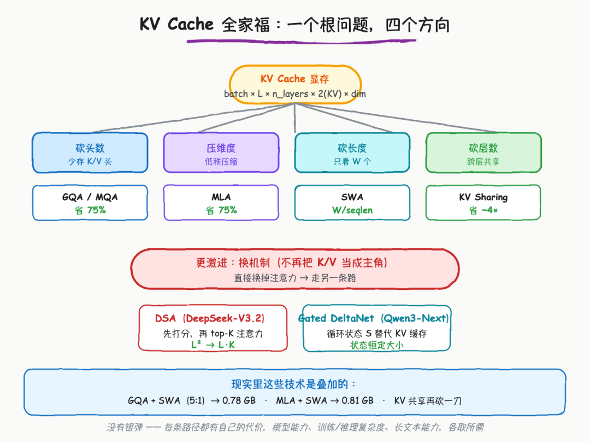
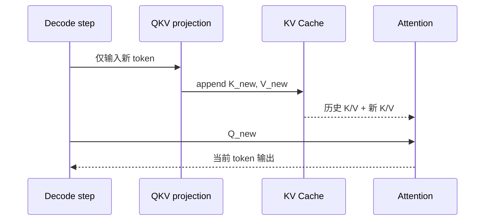
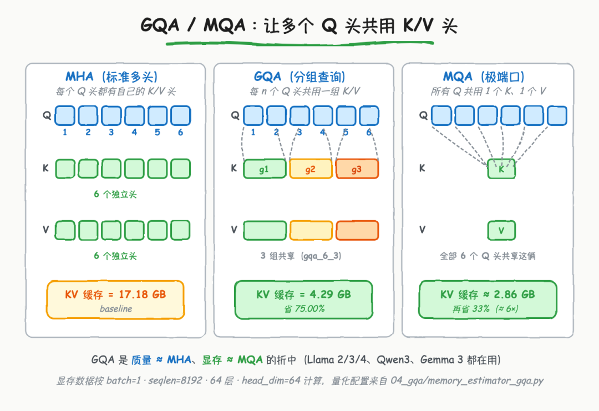
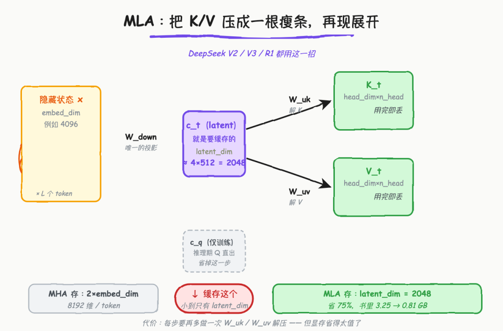
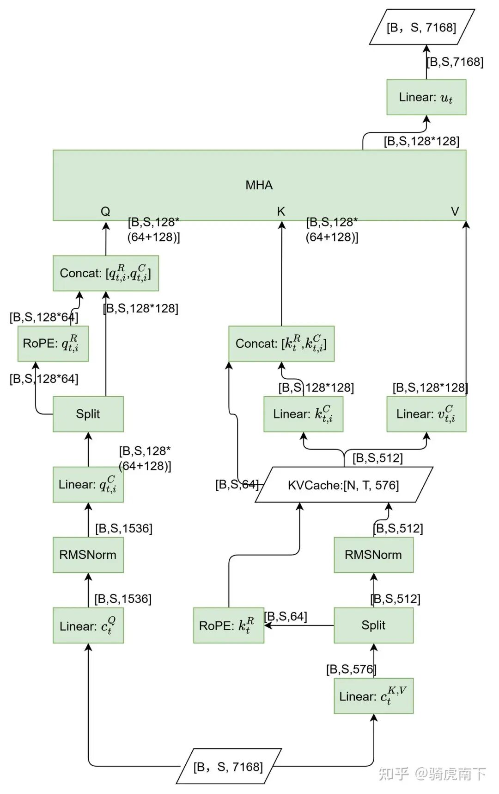
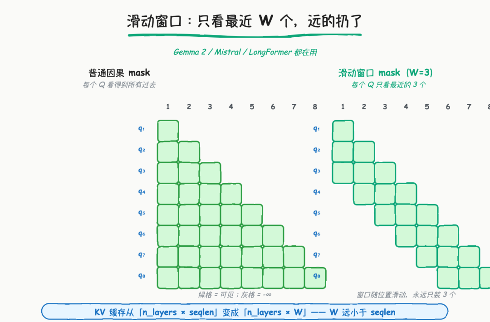
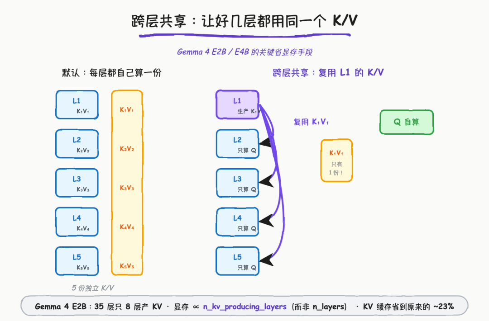
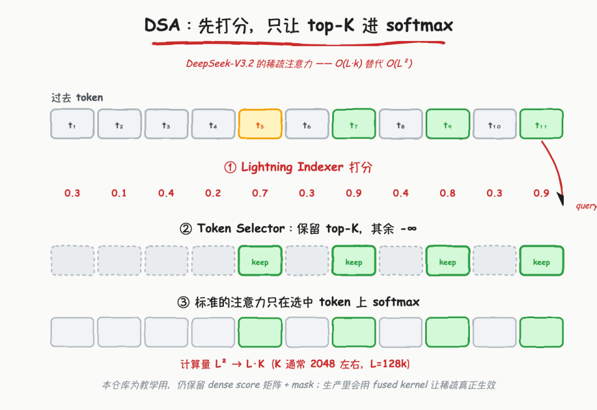
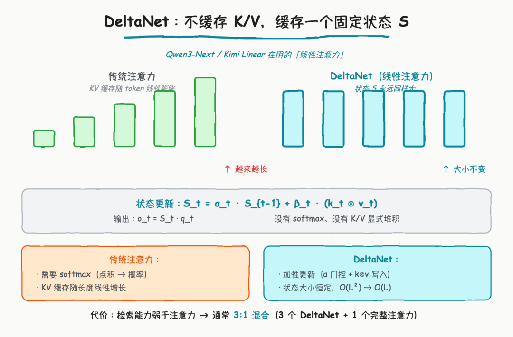
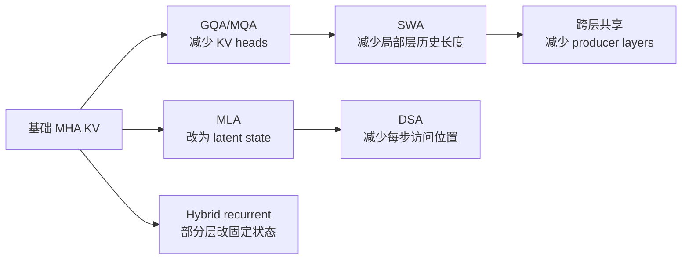

# KV Cache 容量优化技术地图学习文档

本文面向第一次系统比较 KV Cache 容量优化路线的同学。重点不是背六个缩写，而是先找出 KV 容量公式中的维度，再判断每种技术究竟砍了头数、表示维度、历史长度、产 KV 层数，还是直接改变了 Attention 机制。

本文是第三方资料整理型学习资料，不是各模型论文的完整复现或生产 kernel 实现说明。

## 0. 阅读基线与范围

| 项目 | 内容 |
| --- | --- |
| 原文标题 | 《KV Cache 全攻略》 |
| 原文链接 | <https://mp.weixin.qq.com/s/v6YYxCf_N4Q6c7qfD_lZDw> |
| 作者/机构 | 光仔玩AI |
| 发布时间 | 2026-08-18 |
| 读取时间 | 2026-08-25 |
| 资料类型 | 原理图解与教学代码 |
| 整理范围 | 基础 KV Cache、GQA/MQA、MLA、SWA、跨层 KV 共享、DSA、Gated DeltaNet |
| 不展开内容 | PagedAttention 分配、KV 量化、具体模型训练配方、生产 fused kernel |
| 验证边界 | 只基于原文和其引用论文做机制整理；原文代码是教学简化版，本文未运行；模型名称、数字与质量结论不作跨模型外推 |

**2026-11-02 补充来源：** [《大模型加速优化：Attention架构演进》](https://mp.weixin.qq.com/s/fJglfOaTUreYXjcIOdLH3A)，程序员Owen，公众号“AI修炼技术派”，发表于 2026-10-30 08:30:00（Asia/Shanghai，按页面时间戳换算）。完整阅读正文及 17 张技术图后，在第 3、4、7 节补充“缓存容量与主注意力计算不能按同一比例估算”的解释；CSA/HCA 的长度边界补在[架构对比文档](<../模型架构/混合注意力、索引压缩与残差流架构对比学习文档.md>)。原图带“知乎 @骑虎南下”水印，图像归属与页面署名分开记录，见[图源及核验基线](../../images/attention-cost-model/SOURCES.md)。补充部分只读取公开配置与参考实现，没有运行模型或复现性能；不把图中的错误形状照搬为实现事实。

### 一个重要校正

原文用“KV Cache 让推理从 O(n²) 变成 O(n)”帮助建立直觉。更精确地说：KV Cache 消除了历史 token 的 K/V 投影重算，使这部分累计工作从随生成长度二次增长降为线性；但标准自回归 Attention 的新 query 仍要读取已有 K/V，单步 Attention 随历史长度增长，生成整段序列的 Attention 工作通常仍是 O(n²)。

所以 KV Cache 是“避免重复投影”，不是把标准全注意力整体变成线性复杂度。后文 DSA、SWA、DeltaNet 才进一步改变“每步看多少历史”的计算结构。

### 术语速查

| 术语 | 人话解释 | 主要缩减维度 |
| --- | --- | --- |
| MHA | 每个 Query head 都有独立 K/V head | 基线 |
| GQA/MQA | 多个或全部 Q heads 共用较少 K/V heads | `n_kv_heads` |
| MLA | 缓存低维 latent，而不是完整多头 K/V 表示 | 每 token 状态宽度 |
| SWA | 每层只保留最近窗口中的 KV | 有效历史长度 |
| Cross-layer KV Sharing | 多层共享少数 producer layer 的 K/V | 产 KV 层数 |
| DSA | 先选 Top-K 历史位置，再做稀疏 Attention | 每步参与计算的位置数 |
| Gated DeltaNet | 用固定大小 recurrent state 代替显式全历史 KV | 改变模型机制 |

## 1. 先看公式：你到底在砍哪一个维度

忽略 page 对齐、padding 和额外 metadata 时，标准 KV Cache 的近似容量为：

```text
bytes
≈ batch
× live_tokens
× n_layers
× n_kv_heads
× head_dim
× 2              # K 和 V
× bytes_per_elem
```



**图意解读：** 原图把技术分成砍头数、表示维度、历史长度、产 KV 层数，以及改变机制两组。它很适合做路线地图，但图中的节省比例来自特定示例参数，不能视为所有模型的固定比例；DSA 主要降低注意力计算和活跃访问量，DeltaNet 则是架构替换，不应与无损缓存压缩混为一谈。

### 技术定位表

| 路线 | 直接改变 | 是否需要训练时采用 | 主要代价 |
| --- | --- | --- | --- |
| GQA/MQA | K/V head 数 | 通常需要 | 共享过强可能损失质量 |
| MLA | 缓存表示 | 需要模型架构支持 | 额外投影、RoPE 与 kernel 设计更复杂 |
| SWA | 每层可见历史 | 需要模型架构支持 | 窗口外信息只能经全局层或状态间接传递 |
| 跨层共享 | 产 K/V 的层数 | 需要 | 层表达能力与路由更受约束 |
| DSA | 每个 query 实际访问位置 | 需要 Indexer/Selector | Top-K 正确性与选择开销 |
| DeltaNet | Attention 状态机 | 需要 | 精确检索能力弱于完整 Attention，常与全注意力混合 |
| KV 量化 | 每个元素字节数 | 可作为推理优化 | 量化误差与 kernel 支持 |
| PagedAttention | 物理分配方式 | 不改变模型 | 不直接减少理论 KV 元素数 |

## 2. KV Cache 的基本收益和真实代价

### 人话版

自回归 Decode 每步只新增一个 token。历史 token 的 K/V 一旦算好，在同一请求的后续步骤中不会变化，因此应保存并复用。



收益是历史 K/V 投影不再重算；代价是缓存随 live tokens、并发和层数线性增长。`torch.cat` 形式的教学实现会反复分配和复制，在生产引擎中通常使用预分配 page/block pool 与位置表，不能把教学代码直接当成 serving 实现。

### 生命周期边界

KV Cache 不只是一块 tensor，还要回答：

- 请求进入时分配哪些 slots；
- Prefill 写多少，Decode 每步追加多少；
- 请求被抢占时保留、转移还是释放；
- 请求结束后是否进入 prefix cache；
- 多租户、LoRA 和多模态输入如何进入缓存身份。

这也是“容量技术”和“缓存管理技术”必须分开的原因：GQA 决定每个 token 需要多少 K/V，PagedAttention 决定这些 K/V 如何分配，Prefix Cache 决定不同请求能否共享。

## 3. GQA/MQA：减少 K/V 头数



**图意解读：** MHA 为每个 Q head 配独立 K/V，GQA 让一组 Q heads 共享一个 K/V head，MQA 让所有 Q heads 共享一套 K/V。图中的 17.18 GB、4.29 GB、2.86 GB 是原文示例配置下的估算，实际值取决于层数、序列长度、KV dtype 和 head 维度。

### 机制拆解

如果 Query heads 为 64，KV heads 从 64 降到 8，理论 KV 头维度缩小 8 倍：

```text
MHA: 64 Q heads -> 64 K heads + 64 V heads
GQA: 64 Q heads ->  8 K heads +  8 V heads
MQA: 64 Q heads ->  1 K head  +  1 V head
```

Attention 计算时会按组把 K/V 视图提供给多个 Q heads。生产 kernel 通常不会先物理复制成 64 份；教学代码里的 `repeat_interleave` 只用于表达语义。

### 适用边界

- 它直接减少 KV 容量和读取带宽，是当前最常见路线之一。
- `n_heads` 必须能按模型定义映射到 `n_kv_heads`。
- 从 MHA 检查点直接改成 GQA 不是无损推理开关，通常涉及训练或结构转换。
- MQA 共享最激进，容量最好，但质量与 kernel 行为必须按模型验证。

### 共享 KV 头，为什么主注意力 FLOPs 没有同比下降

**人话版：** 八个人可以共用一本资料，但八个人仍要分别提问、计算自己的答案。减少 KV 头数主要减少保存和读取的资料份数，Q 的工作不会因此自动合并。

把补充文章的公式写得更一般：只计 `QKᵀ` 打分和 `softmax(QKᵀ)·V` 加权求和，乘与加各算 1 FLOP。B 为请求数，Hq 为 Q 头数，dk/dv 为两次乘法各自的通道维度；P 是**每个请求本次所有 query 的有效 query–key 配对数**。

```text
F_core ≈ 2 × B × Hq × P × (dk + dv)

单步普通 Decode：P = T
S 个 query 都可看 T 个位置的矩形计算：P = S × T
无已缓存前缀的因果 Prefill：有效配对数 P = S × (S + 1) / 2
```

这是逻辑算术账目。实际 kernel 可能按 tile 做额外计算；它也不包含投影、位置编码、softmax、索引、通信或 FFN。不能把矩形 `S×T` 无条件当成因果 Prefill 的实际 FLOPs。

**可复算例子：** 固定 B=1、Hq=64、dk=dv=128、T=8192，比较一个假想的 64 KV 头 MHA 和 8 KV 头 GQA。按 BF16、每层每 token 的 K/V 数值计算，缓存从 `2×64×128×2=32768 B` 降为 `4096 B`；但二者的这两次注意力乘法仍约为 `268435456 FLOPs`。KV 投影和读取成本可以变化，因此这也不表示两者实际耗时相同。

**Qwen3 图的校正：** [Qwen3-32B 配置](https://huggingface.co/Qwen/Qwen3-32B/blob/9216db5781bf21249d130ec9da846c4624c16137/config.json)确为 Hq=64、Hkv=8、head_dim=128、hidden_size=5120。[`Qwen3Attention`](https://github.com/huggingface/transformers/blob/5f4ecf2d9f867a1255131d2461d75793c0cf1db2/src/transformers/models/qwen3/modeling_qwen3.py#L170)只给 Q、K 加 head-wise RMSNorm，V 支路没有这一步；RoPE 后 K 仍是 8 个头。输出先合并 `64×128=8192` 通道再投影到 5120，不应把原图的“每头 80 维”当成 Attention 的 value 维度。GQA 本身也不要求所有模型都使用 QK Norm。

## 4. MLA：缓存低维 latent



**图意解读：** 原图用“先压成 latent、使用时再展开”解释 MLA。这个图是教学抽象：真实 DeepSeek MLA 还涉及 decoupled RoPE、矩阵吸收和专用 kernel，优化实现不一定显式重建一份完整多头 K/V 再做 Attention。

### 人话版

GQA 是“少存几套头”，MLA 是“换一种更紧凑的状态表示”。每个 token 保存低维 latent，Attention 路径再通过投影或矩阵吸收使用它。

```text
hidden state
   -> down projection
compact KV latent  <- 缓存这个
   -> model-specific projections / absorbed weights
attention result
```

### 为什么不能只看 latent 维度

MLA 的真实成本还包括：

- 与位置编码相关的额外状态；
- latent 到 key/value 使用路径的投影；
- Prefill 和 Decode 不同 kernel；
- TP/CP 下的分片与通信；
- 模型训练时是否围绕该瓶颈设计。

所以“latent_dim 是原维度 1/4”不自动等于端到端显存、带宽和延迟都精确缩小 4 倍。

### MLA 的 576 维缓存，不等于两个乘法都用 576 维



**图意解读：** 图中间保存的是 512 维内容 latent 加 64 维 RoPE key；右上方又展开成各头的 K、V。它帮助区分“长期保存什么”和“计算时展开成什么”。V3/R1 示例的展开后 Q/K 为 `128+64=192` 维，V 为 128 维；缓存中的 576 个数也不是两份各 576 维的 K/V。图很长，读者只需跟住下面这张维度表，无需在窄屏辨认全部算子。

| 计算路径 | 打分维度 dk | 加权求和维度 dv | 还需计入的工作 |
| --- | --- | --- | --- |
| 展开 K/V 的 MHA 形式 | 192 | 128 | K/V 升维与其他投影 |
| 矩阵吸收后的 latent MQA 形式 | `512+64=576` | 512 | Q 映射到 latent 空间、读出后的 value 投影等 |

表中的“MQA”描述共享缓存的计算形式，不表示 V3/R1 架构退化成普通 MQA。代入上一节公式时必须分别使用 dk、dv；补充文章把两项都写成同一个 QHD，只适用于两者相等的特例，不能直接作为 MLA 的精确计算式。两条路径的矩阵乘法位置与中间尺寸不同，数学等价也不等于运行代价相同。

依据：[V3.2 报告附录 A](https://arxiv.org/html/2512.02556v1#A1)给出 MLA 的两种形式；固定版本[参考实现的 `MLA.forward`](https://huggingface.co/deepseek-ai/DeepSeek-V3.2/blob/a7e62ac04ecb2c0a54d736dc46601c5606cf10a6/inference/model.py#L555)可追踪缓存写入、展开与吸收分支。本节只核对维度与操作位置，未测量哪条路径更快。

## 5. SWA：减少每层保留的历史长度



**图意解读：** 左侧因果 Attention 的可见区域随序列增长，右侧每个 query 只看最近 `W` 个 token。若所有层都只使用 SWA，窗口外信息不能被直接检索；因此很多模型采用 SWA 与全局 Attention 的交错结构。

### 机制拆解

如果一层只需要最近 `W` 个 token，其该层活跃 KV 规模从：

```text
O(sequence_length)
```

变成：

```text
O(window_size)
```

当 `sequence_length >> window_size` 时，容量和 Attention 工作量都显著下降。但这里有两个不同问题：

1. 模型语义上，旧 token 是否真的不再需要；
2. 引擎实现上，旧 slot 是否能回收、是否还要保留树节点或外层 checkpoint。

Hybrid model 可能同时有 FULL、SWA 和 recurrent state，它们的可复用边界并不一致。相关系统设计见 [SGLang Unified Radix Cache 学习文档](../../sglang/KV%E7%BC%93%E5%AD%98/SGLang%20Unified%20Radix%20Cache%20%E5%AD%A6%E4%B9%A0%E6%96%87%E6%A1%A3.md)。

## 6. 跨层 KV 共享：减少产 KV 的层数



**图意解读：** 原图用一个 producer layer 和多个 consumer layers 展示跨层共享。真实模型可能按 layer group 分配多个 producer，而不是所有层全共享一套 K/V；图中的模型与比例属于原文示例，需以目标模型配置为准。

### 机制拆解

传统每层都产生独立 K/V：

```text
layer 0 -> KV0
layer 1 -> KV1
layer 2 -> KV2
...
```

跨层共享改为：

```text
producer layer -> shared KV
consumer layers -> 自己算 Q，复用该组 shared KV
```

容量近似与 `n_kv_producing_layers` 成正比，而不是与全部 `n_layers` 成正比。它比 GQA 更深入地改变模型容量分配，不能靠运行时 flag 给已有普通 Transformer 无损开启。

**具体算例（2026-10-29 补充）：** [DeepSeek V4.1 Flash 的 CED、CSA2 与缓存分工](<../模型架构/DeepSeek V4.1 Flash 的 CED、CSA2 与缓存分工学习文档.md>)按独立的官方报告 v1，拆出“三组压缩率 2 + 一组压缩率 1”的全局记录，再分别计算 main KV 与 indexer K 的载荷和 scale，得到 890 B/token。该例把跨层共享、序列压缩与量化组合起来，也解释为什么只复用 Top-K 不会减少全部历史 KV；它不是本篇普通 MHA 公式的直接代入，也不是总显存口径。

## 7. DSA：先选位置，再做稀疏 Attention



**图意解读：** Indexer 为历史位置打分，Selector 保留 Top-K，再在选中位置上执行 Attention。该图主要表达计算稀疏化，不表示未选 KV 一定从所有存储层永久删除；缓存容量、GPU 驻留量和单步访问量是三个不同指标。

### 为什么它不是普通“KV 压缩”

对具有 L 个 query 的序列，DSA 将**选中位置上的主 Attention**从全历史交互约束为每个 query 至多 K 项，常用 `L×K` 表示其规模；这不是整个 Attention 模块的复杂度。以 V3.2 的 K=2048 为例，短前缀还要取可见位置数与 K 的较小值。Indexer 打分、Top-K 和投影仍需单独计算；未来 query 仍可能选到旧位置，不能据此把完整历史缓存缩成 2048 项。

**2026-11-02 核验：** V3.2 的 [`Indexer`](https://huggingface.co/deepseek-ai/DeepSeek-V3.2/blob/a7e62ac04ecb2c0a54d736dc46601c5606cf10a6/inference/model.py#L435)另存 128 维 indexer key 及量化 scale，用于选位置，不是另一套供主 Attention 加权求和的 K/V。增加这份索引状态，不等于不同模型部署中的总字节数必然变大，仍需固定 dtype、布局和分片。该官方 Python 参考实现的 `MLA.forward` 使用全范围 `einsum` 后叠加稀疏 mask 来表达语义；**mask 只保留 K 项，不证明代码实际只做 K 项乘法**。生产 sparse kernel 的执行量需另核验，本次没有运行它。

需要分别问：

- 完整历史 KV 是否仍存在？
- GPU 上只驻留 Top-K 还是有更大的热点池？
- Indexer 的打分状态保存在何处？
- Top-K 选择开销是否吞掉稀疏收益？
- Prefill 和 Decode 是否使用同一稀疏路径？

## 8. Gated DeltaNet：用固定状态替代显式全历史 KV



**图意解读：** 左侧全注意力保存随序列增长的 KV，右侧线性/recurrent 路径维护固定大小状态。它表达“状态不随上下文长度线性增长”的核心，但真实 Gated DeltaNet 的更新、归一化、卷积和门控比图中公式更复杂。

### 人话版

DeltaNet 不再显式保存每个历史 token 的 K/V，而是把历史压入固定大小状态 `S_t`：

```text
S_t = gated_update(S_{t-1}, k_t, v_t)
o_t = read(S_t, q_t)
```

这从根上改变了状态规模，但也改变了信息检索方式。完整 Attention 可以直接对任意历史位置做内容寻址；固定状态必须把历史不断压缩，精确检索能力可能下降。因此现代混合模型常让 recurrent/linear layers 承担长程状态，再用周期性的 full attention layers 做精确检索兜底。

## 9. 怎么组合，而不是怎么选唯一赢家

这些技术作用于不同维度，经常可以叠加：



组合时要同时检查：

| 维度 | 问题 |
| --- | --- |
| 模型质量 | 训练是否显式适配共享、窗口或 recurrent 路径 |
| 容量 | 理论元素数、page 对齐和运行时预留分别是多少 |
| 带宽 | Decode 每步实际从 HBM/Host 读多少状态 |
| 计算 | Attention、Indexer、投影和恢复分别耗时多少 |
| 生命周期 | Prefix Cache、抢占、PD 和外部 KV 是否理解这些状态 |
| Kernel | 目标 GPU 是否有对应高效实现 |

## 10. 小白排障地图

| 现象 | 优先检查 |
| --- | --- |
| 开了 KV Cache 仍随长度变慢 | Attention 仍需读取增长的历史，不是历史 K/V 投影又重算 |
| 理论节省 8 倍，实际显存只降一部分 | 权重、激活、graph、page padding 和其他 pool 仍占显存 |
| GQA 教学代码显存反而变大 | 是否用 `repeat_interleave` 物理复制 K/V，而不是 kernel 视图 |
| SWA 质量明显下降 | 全局层比例、窗口大小、训练设置是否匹配 |
| DSA Top-K kernel 很快但端到端不快 | Indexer、数据搬运、稀疏 KV 驻留和其他层占比 |
| DeltaNet 长文档精确检索差 | 固定状态压缩的能力边界、full attention 兜底比例 |

## 11. 一句话总结

KV Cache 容量优化没有一颗银弹：GQA/MQA 砍头数，MLA 压表示，SWA 砍历史长度，跨层共享砍产 KV 层数，DSA 砍每步访问位置，DeltaNet 则替换状态机制；只有先明确自己受容量、带宽、计算还是质量约束，才能读懂它们为什么常被组合使用。

**关联复核（2026-11-02）：** 同时检查 Transformer 基础、混合注意力比较、V4.1 缓存分工和 SGLang MLA/稀疏模型课程。前两类原有的容量/选择边界可保留，本次补足具体算式与 CSA/HCA 长度条件；V4.1 继续采用独立的 CED/CSA2 基线，不把 V4 的压缩率覆盖过去。现有两篇已能承载本次增量，没有证据支持另建性能排行或重复的六种架构综述，未新增整合选题。

## 12. 参考与延伸

- 原文：<https://mp.weixin.qq.com/s/v6YYxCf_N4Q6c7qfD_lZDw>
- GQA：<https://arxiv.org/abs/2305.13245>
- DeepSeek-V2 / MLA：<https://arxiv.org/abs/2405.04434>
- Gated DeltaNet：<https://arxiv.org/abs/2412.06464>
- [LLM 推理系统心智模型与 SGLang、vLLM 选型边界学习文档](../%E6%8E%A8%E7%90%86%E5%9F%BA%E7%A1%80/LLM%20%E6%8E%A8%E7%90%86%E7%B3%BB%E7%BB%9F%E5%BF%83%E6%99%BA%E6%A8%A1%E5%9E%8B%E4%B8%8E%20SGLang%E3%80%81vLLM%20%E9%80%89%E5%9E%8B%E8%BE%B9%E7%95%8C%E5%AD%A6%E4%B9%A0%E6%96%87%E6%A1%A3.md)
- [vLLM V1 KV Cache 管理全生命周期源码学习文档](../../vllm/KV%E7%BC%93%E5%AD%98/vLLM%20V1%20KV%20Cache%20%E7%AE%A1%E7%90%86%E5%85%A8%E7%94%9F%E5%91%BD%E5%91%A8%E6%9C%9F%E6%BA%90%E7%A0%81%E5%AD%A6%E4%B9%A0%E6%96%87%E6%A1%A3.md)

- [Attention 架构演进补充来源](https://mp.weixin.qq.com/s/fJglfOaTUreYXjcIOdLH3A)、[图源与固定核验基线](../../images/attention-cost-model/SOURCES.md)。
