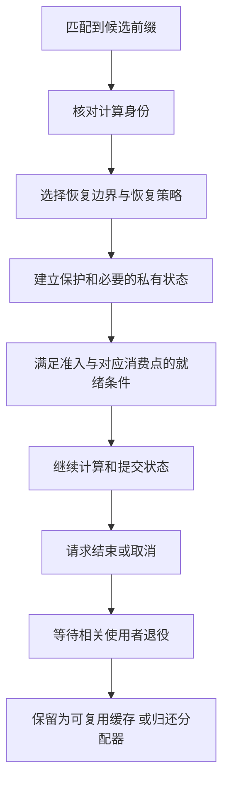
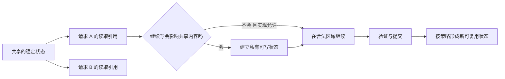

# 前缀缓存命中后的恢复条件与状态所有权对比学习文档

缓存系统回答“找到了前缀”，并不表示模型马上就能继续计算。还要确认：找到的是谁的状态、它停在哪个位置、缺少哪些配套状态、设备什么时候能读，以及请求是否有权继续修改它。

本文把 SGLang 普通分页与 HiCache、vLLM 的部分尾块、KDA 检查点和 DeepInfer SWA 有界重放放到同一组问题中比较。重点是恢复与所有权条件，不是给框架排性能名次。

本文属于**第三方资料整理型学习资料中的跨来源整合分析**，附有限固定源码复核。共同判断框架、集合表达和排障表均为整理者归纳；没有运行模型、注入故障或验证数值等价。

## 0. 阅读基线与证据范围

| 资料与来源 | 本文采用的证据 | 边界 |
| --- | --- | --- |
| [SGLang KV 映射与共享回收](<../../sglang/KV缓存/SGLang KV 映射与共享回收学习文档.md>) | 普通分页匹配、请求映射、共享页回收 | 官方 `main` 快照 `279339f113b79af84f27fd3ac92d0a13bd3f4cbd`；本次直接复核 `RadixKey` |
| [HiCache 前缀命中源码](<../../sglang/KV缓存/HiCache 前缀命中源码学习文档.md>) | 设备 / Host / L3 命中和回载就绪 | 官方源码快照 `72d5c5bb73cadd7ffbf5114e5f81e29d36b6c61a`；本次复读仓内源码文档，不重审全部 I/O 路径 |
| [vLLM KV 全生命周期](<../../vllm/KV缓存/vLLM V1 KV Cache 管理全生命周期源码学习文档.md>) | 部分尾块、匹配粒度、引用及 COW | 官方 `main` 快照 `f727951d3f0dbeb9acdb8a2f7ebfecaeb67090b3`；本次直接复核远程固定 `block_pool.py` 与 `single_type_kv_cache_manager.py` |
| [KDA 检查点与投机回滚](<../模型架构/KDA Cache 检查点、前缀复用与投机回滚学习文档.md>) | 离散恢复位置、工作状态、ReplaySSM 边界 | 仓内文章基于 franky1011《图解KDA Cache》及 vLLM、SGLang、ReplaySSM 作者资料；本次未新增 KDA 源码或数值实验 |
| [DeepInfer 引擎与生产边界](<../分布式服务/DeepInfer 专用推理引擎与生产系统边界学习文档.md>) | Block KV、stored/dropped state、SWA 近似重放 | 官方 `main` 快照 `553741557a57df44a46fb3ab72b6aafeaf945337`；直接核对 `StateBlock` 与部署问答 |

公开上游：[sgl-project/sglang](https://github.com/sgl-project/sglang)、[vllm-project/vllm](https://github.com/vllm-project/vllm)、[deepseek-ai/DeepInfer](https://github.com/deepseek-ai/DeepInfer)。读取日期：**2026-10-27**。

工作区与操作：SGLang 通过固定 Git 对象读取，检出工作区存在未跟踪资料，未纳入分析也未修改；DeepInfer 检出干净；vLLM 只读取固定远程文件，未建立源码检出。各版本独立成立，不合并成一个“最新实现”。本文中的精确恢复指恢复所需的正确状态，不承诺跨硬件、精度或 batch 的逐位一致。

先修：[Prefill 与 Decode](<../推理基础/LLM Prefill 与 Decode 阶段源码学习文档.md>)、[KV Cache 容量地图](<KV Cache 容量优化技术地图学习文档.md>)。本文没有新增外部原图；机制图均由整理者用 Mermaid 绘制，原材料的技术图保留在对应来源文章中。

### 术语速查

| 术语 | 人话解释 | 不能直接等同于 |
| --- | --- | --- |
| 计算身份 | 哪个模型、输入及相关计算上下文产生的状态 | 文本看起来相同 |
| 匹配长度 | 索引能够找到多长的候选前缀 | 所有状态都能恢复到该位置 |
| 恢复边界 | 可以让需要的状态共同继续计算的位置 | 某一个状态记录的最大长度 |
| 活动状态 | 请求接下来会读取、更新的状态 | 可以原地修改的共享快照 |
| 可用事件 | 指定范围的数据或依赖已经完成 | 所有 GPU、网络和请求操作都完成 |
| 近似重放 | 按明确策略舍弃部分依赖后重建状态 | 精确恢复或实现间数值等价 |

## 1. 五个问题构成恢复条件，不是一条统一 API

### 人话版

把缓存想成别人留下的计算现场。找到地址只是第一步：还要确认这份现场对应你的计算、停在你需要的位置、东西没有缺、复制已经完成，以及你能否继续改动它。

| 判断 | 必须回答的问题 | 常见误读 |
| --- | --- | --- |
| 身份 | 模型与请求相关的计算上下文是否匹配？ | 只比 token ID 就够了 |
| 恢复 | 各类必要状态能否支持同一个继续位置？采用哪种恢复语义？ | 命中长度就是可跳过长度 |
| 保护与所有权 | 状态是否被保护？继续写是否需要私有副本？ | 命中返回地址就可以原地写 |
| 就绪与准入 | 容量是否足够，所需字节和元数据是否在消费前就绪？ | 远端对象存在就等于 GPU 可读 |
| 退役 | 哪些引用、设备读写和传输已经结束？ | 请求逻辑结束就能立刻重用地址 |

**整理者归纳：** 这些判断之间有依赖，但各引擎可以交错执行。保护可能在 I/O 前建立，回载也可能逐层与 forward 重叠；不能把下面的图当作必须全量串行执行的协议。



**图意解读：** “就绪”是相对消费点的判断，不要求整个请求的所有层都在 forward 前一次搬完；“退役”针对仍使用资源的工作，不是收到一条结束消息就完成。

## 2. 先区分四个长度和三种粒度

### 四个长度

| 量 | 表达什么 | 为什么可能不同 |
| --- | --- | --- |
| 公共 token 前缀长度 | 两条输入在计算身份允许时共享多长前缀 | 不说明对应状态是否保存 |
| 索引匹配长度 | 树或哈希表找到哪些候选记录 | 受到页、hash、请求输出需求等限制 |
| 可恢复边界 | 所需状态能共同从哪里继续 | 检查点缺失、窗口覆盖和状态组约束会缩短它 |
| 实际免算长度 | 最终省掉了多少模型计算 | 回载失败、状态重放和特定层截断会改变实际工作 |

对于分层或混合状态，最后一项甚至不适合只用一个全模型 token 数表示。DeepInfer 在复用 Block KV 的同时仍可能重放 SWA；“又计算了一段”不能反推这段的所有 KV 都重新生成。

### 三种粒度

物理分配粒度决定一次给多少空间；匹配粒度决定索引能指到哪些位置；调度粒度决定一轮执行多少计算。它们可以不同。更细的 hash 能找到已登记的细粒度记录，却不能凭空恢复从未保存的 recurrent 状态。

**SGLang 源码事实：** 普通 `RadixKey.page_aligned` 和 `match` 按 `page_size` 处理边界，比较还检查 `extra_key`、`cache_salt` 等条件。[固定源码][sg-radix]

**教学例子：** 普通页大小为 4，两个请求前 6 个 token 相同，在无其他限制且缓存可用的前提下，只能复用完整的前 4 个。树节点能分裂，不等于该配置能在每一个 token 位置复用。

[HiCache 源码文档][hicache-local] 另说明，请求匹配上限可能先被输出或 logprob 需求限制。该基线普通例子中，输入 16、上限先取 15，再按页大小 4 对齐，得到 12。这个结果不证明缓存被驱逐。

**vLLM 源码事实：** 本文固定版提供 `cache_partial_block`，在现有物理块内登记部分前缀的索引，不在此函数中分配或复制新 KV 块。它仍要求合法的 hash 粒度与组内块大小关系；不是任意 Manager 都能命中任意 token。`FullAttentionManager.find_longest_cache_hit` 另处理细粒度查询条件。[块登记][vl-block]、[Manager 查询][vl-manager]

因此“树一定比哈希命中更细”“vLLM 永远只命中完整物理块”都不能作为跨版本比较的前提。

## 3. 不同状态形态，决定不同的恢复动作

| 状态形态 | 保存了什么 | 可用的恢复思路 | 不能省略的条件 |
| --- | --- | --- | --- |
| 普通历史 KV | 各历史位置的 K/V 或 latent | 复用满足身份、布局和粒度条件的前缀 | 地址映射、引用、实际数据就绪 |
| 部分尾块 | 物理块内某个已稳定前缀及其索引 | 找到细粒度前缀，必要时为续写建立私有尾部 | 不能让续写破坏其他请求仍引用的内容 |
| KDA / recurrent 状态 | 处理到某一位置的递推结果及配套状态 | 恢复已有检查点，再计算缺口 | 当前状态不能通过修改长度变回过去 |
| SWA 状态 | 边界附近的窗口状态 | 恢复对应快照；特定模型可采用有界近似重放 | 重放策略、窗口范围和数值边界必须明确 |
| 跨层共享 KV 与附属状态 | 部分层共享历史，其他状态仍各自存在 | 共享部分复用，附属部分按模型语义准备 | 共享一个对象不等于所有层状态都齐备 |

这张表比较的是恢复问题，不暗示这些机制互斥。一个模型可以同时使用历史 KV、滑窗、压缩累积状态和投机临时状态。

### KDA：回到过去需要真正的旧状态

[仓内 KDA 文档][kda-local] 用“公共前缀 5,000、只有 4,096 检查点”解释恢复缺口：请求必须从检查点继续算 904 个公共 token，再处理新后缀。不能把已处理长度改成 5,000 就跳过这段计算。

ReplaySSM 的局部递推重放依赖保留的输入等条件，与从较早检查点重新运行完整模型前缀不是一件事；它也不能自动推广到任何递推模型或引擎。

### SWA：丢失窗口后的重放可能有明确近似

[DeepInfer 部署问答][di-qa] 描述的有界重放，只允许重放区间内的有限历史参与对应 SWA 计算，得到的是近似状态。对比时必须同时写明“省掉哪些依赖”和“按什么语义接受结果”，不能只写“窗口重建成功”。

这里存在三种不同的验证目标：

- 保存与加载是否恢复正确的状态和元数据；
- `mask` 与 `compact` 是否实现同一截断语义；
- 截断语义相对完整计算是否具有可接受的质量影响。

前两项中的实现一致性，都不能单独证明第三项。本文未进行任何数值或质量实验。

## 4. 混合状态要找共同边界，不能只取长度最小值

### 先讨论直接恢复

设请求与缓存计算身份已匹配，允许复用的输入上限为 L；每个必要状态组 g 能直接恢复的位置组成集合 B_g。可以用下面的**教学表达**说明条件：

```text
直接恢复候选 = 不超过 L 的各 B_g 共同位置
选择位置 = 候选中的某个合法位置，或回到冷启动
```

实际系统还受输出需求、布局、容量和策略影响，不保证总是选择最大的候选，也不要求真的创建集合对象。

**教学例子：** A 组只保留位置 `{0, 4096, 8192}`，B 组保留 `{0, 4096, 6144}`，L 为 8,192。两个最大值的最小值是 6,144，但 A 没有这个状态；共同恢复位置只能选 4,096 或冷启动。若 A 是可支持所有所需中间边界的历史 KV，则结论可以不同。

### 再引入恢复动作

当系统允许重算、局部递推重放或近似重放时，应该比较“起点 + 恢复动作 + 目标状态”的方案，而不只是比较两个整数。

| 方案 | 必要证据 | 代价维度 |
| --- | --- | --- |
| 直接加载快照 | 身份、状态组、位置和布局一致 | 查找、传输、安装与保护 |
| 从较早检查点补算 | 起点可恢复，后续输入可得 | 缺口的模型计算与临时容量 |
| 基于保留输入做局部重放 | 该算法明确支持，并保留了所需输入 | 局部递推、输入缓冲和提交开销 |
| 模型允许的近似有界重放 | 明确数值语义和启用条件 | 固定后缀计算、质量影响与验证成本 |
| 放弃本次复用 | 资源或完整性条件不满足 | 冷 Prefill 或更短前缀重算 |

**整理者归纳：** 精确恢复集合与允许近似方案的集合不能混成一个“命中率”。系统选择了可接受的近似方案，也不能回头宣称已找到完全相同的历史快照。

## 5. 所有权：读共享前缀与续写状态是两种权限

### 人话版

可以借阅一本共享笔记，不表示可以把下一页直接写进所有人正在看的原件。复用时先建立使用关系；发生分叉、续写或回滚时，再判断哪些部分必须私有。

| 对象 | 常见共享方式 | 下一步更新时的问题 |
| --- | --- | --- |
| 已稳定历史页 | 多个请求引用相同物理数据 | 共享区域仍被读取，不能被驱逐或错误覆盖 |
| 部分尾块 | 引用一个块内的有效前缀 | 尾部续写可能需要 COW；不能只看块 ID 相同 |
| KDA 检查点 | 共享已保存快照 | 活动递推必须获得可写状态，避免污染其他分支 |
| 投机临时状态 | 为候选计算准备 | 只提交被接受部分，拒绝部分不能变成可复用历史 |

COW 是否触发、复制范围和何时提交由具体实现决定，不能把这张表当作所有引擎的同一策略。[vLLM 生命周期文档][vl-local]、[KDA 状态所有权说明][kda-local] 分别给出其证据范围。



**图意解读：** 这是所有权教学图，不要求每次 Decode 都复制整个 KV；共享历史页和私有尾部可以同时存在。是否公开新缓存由稳定性和缓存策略决定，不能把“已分配”当“已提交”。

## 6. 存储命中、传输完成和设备可读不能混用

[HiCache 文档][hicache-local] 区分设备索引、Host 命中、L3 查询、预取结果纳入、重新匹配与逐层回载。能查询到对象，只说明某个层次报告存在；距离 forward 真正消费，可能还有接收、布局转换、安装和事件依赖。

| 观察到的事件 | 可以支持的判断 | 仍需检查 |
| --- | --- | --- |
| 索引查询命中 | 找到候选记录 | 身份、状态完整性、记录是否仍有效 |
| 外部读取完成 | 对应 I/O 返回 | 数据放在哪里、错误是否处理、是否进入本地索引 |
| H2D 已提交 | 传输已排入设备工作 | 消费流是否等待了正确事件 |
| 某层 ready | 该事件覆盖的层可按协议消费 | 后续层和其他状态组是否有各自约束 |
| 引用释放 | 一个使用者不再持有资源 | 其他请求、设备工作或 DMA 是否仍使用它 |

**整理者归纳：** “完成”必须带宾语：哪次操作、哪段状态、哪个消费者。RDMA CQ、CUDA event、缓存节点保护和业务请求结束属于不同层，不能互相代替。

例如 L3 报告命中 8k、Host 接收 8k，但 GPU 当前只安装了前几层，若系统支持逐层回载，就应让对应层在自己的就绪条件后执行；不能要求所有层预先完成，也不能让尚未就绪的层提前读取。这里说明依赖原则，不声称任意 backend 都支持这种重叠。

## 7. DeepInfer 案例：传给下一阶段的状态多于长期保存的状态

固定 [`StateBlock` 注释与布局][di-state] 将状态分为 stored 与 dropped 两段：PE→CE 传输需要两部分，跨请求保存只取需要保留的前段。dropped region 里仍有运行时要用的 consumer SWA 和压缩状态。

同时，[生产部署问答][di-qa] 把 Block KV 放在独立 3FS，把 SWA 留在产出机主机内存，并维护位置目录。这些生产外围服务并未随离线引擎完整开放。

由此可以得到三条有依据的边界：

1. **运行时必要集合不等于长期保存集合。** 不落盘的状态，仍可能必须参与当前 P→D 交接。
2. **相同对齐不等于共同可用。** Block KV 与 SWA 都采用相关 128-token 边界，并不能防止其中一份失效。
3. **命中缺口可以按对象区分。** 缺 SWA 时重放相应后缀，不代表已命中的 Block KV 必须全部重算。

**教学例子：** 输入长度 2,048，采用官方描述的 `L−134` 命中上限，Block KV 命中到对齐位置 1,792；对应 SWA 不存在，按所述策略回退到 1,664，重放 `[1664,1792)`，然后继续后缀。这是文档策略算例，不是公开服务的实测 trace；短输入和无命中的边界不由这个例子覆盖。

128 是相关窗口/对齐/重放语境，134 包含所述回退余量，README 推荐的 `KEEP_TOKENS=140` 是引擎配置。三个数字不能互换，生产机制描述也不能直接变成启动参数。

## 8. 一份能落到证据的诊断清单

| 现象 | 优先检查 | 有效证据 | 不足以得出的结论 |
| --- | --- | --- | --- |
| 文本相同却不命中 | token、模型相关上下文、salt、匹配上限 | 实际键、配置及合法边界 | 缓存实现一定出错 |
| 命中长前缀却继续计算 | 哪类状态缺失、是否重放、哪些层免算 | 按状态组记录恢复位置和执行范围 | 所有 KV 都失效 |
| 远端命中但 TTFT 变差 | I/O、排队、Host/GPU 容量与安装等待 | 同一请求的阶段时间线 | 命中率高就必然更快 |
| 并发分叉后输出异常 | 共享快照是否被原地改写 | 引用、COW、提交与回滚记录 | 网络一定损坏数据 |
| 取消后偶发异常 | 逻辑结束与设备/DMA 使用是否错位 | 退役事件及最后使用者 | 收到取消就能重用槽位 |
| 同名指标前后不同 | 统计的是候选、恢复还是免算量 | 分子、分母、层级和样本筛选 | 不同引擎命中率可直接横比 |

这些是建议检查点，不是已完成的实验。真正验证应固定模型、版本、精度、请求和恢复策略；数值正确性、性能与容错分别记录。

## 9. 阅读路线与自测

推荐顺序：先读第 1–3 节区分对象和粒度；用第 4–5 节解释恢复与分叉；最后用第 6–8 节追踪数据就绪和故障。

自测时应能回答：

- 两个组各自“命中 8k、6k”，为什么不能总是恢复到 6k？
- partial-tail 索引能否创造块内没有保存过的 recurrent 状态？
- 缺 SWA 后做近似重放，为什么不能叫“找回了原快照”？
- 请求结束、缓存可驱逐、分配器可重用和系统显存下降，分别是什么时刻？

继续阅读 [缓存 Salt 全链路键空间](<KV Cache Salt 全链路键空间学习文档.md>)、[PD 与投机状态一致性](<../高级生成/PD 与投机解码的状态交接、回滚及容量学习文档.md>)，以及 [重叠调度依赖对比](<../调度方法/SGLang Overlap 与 DeepInfer ZOS 的依赖和状态提交对比学习文档.md>)。前两篇已覆盖专门问题，本文不替代其源码与来源边界。

## 10. 固定源码与资料入口

| 行为 | 源码 / 资料锚点 |
| --- | --- |
| 页对齐、键兼容与匹配 | [SGLang `RadixKey.page_aligned`、`match`][sg-radix] |
| 部分前缀登记 | [vLLM `BlockPool.cache_partial_block`][vl-block] |
| 细粒度查找的适用条件 | [vLLM `FullAttentionManager.find_longest_cache_hit`][vl-manager] |
| 恢复、引用与 COW 的完整上下文 | [vLLM KV 全生命周期][vl-local] |
| 设备 / Host / L3 命中和就绪 | [HiCache 固定源码学习文档][hicache-local] |
| 检查点与活动状态 | [KDA 检查点与投机回滚][kda-local] |
| 传输与保存集合的区别 | [DeepInfer `StateBlock`][di-state] |
| SWA 近似重放及生产存储 | [DeepInfer 部署问答][di-qa] |

[sg-radix]: https://github.com/sgl-project/sglang/blob/279339f113b79af84f27fd3ac92d0a13bd3f4cbd/python/sglang/srt/mem_cache/radix_cache.py#L147
[vl-block]: https://github.com/vllm-project/vllm/blob/f727951d3f0dbeb9acdb8a2f7ebfecaeb67090b3/vllm/v1/core/block_pool.py#L445
[vl-manager]: https://github.com/vllm-project/vllm/blob/f727951d3f0dbeb9acdb8a2f7ebfecaeb67090b3/vllm/v1/core/single_type_kv_cache_manager.py#L682
[di-state]: https://github.com/deepseek-ai/DeepInfer/blob/553741557a57df44a46fb3ab72b6aafeaf945337/deepinfer/worker/cache_engine.py#L221
[di-qa]: https://github.com/deepseek-ai/DeepInfer/blob/553741557a57df44a46fb3ab72b6aafeaf945337/doc/inference_deployment_qa.md#kv-cache-hits-and-recomputation
[hicache-local]: <../../sglang/KV缓存/HiCache 前缀命中源码学习文档.md>
[vl-local]: <../../vllm/KV缓存/vLLM V1 KV Cache 管理全生命周期源码学习文档.md>
[kda-local]: <../模型架构/KDA Cache 检查点、前缀复用与投机回滚学习文档.md>
