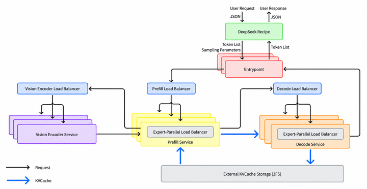
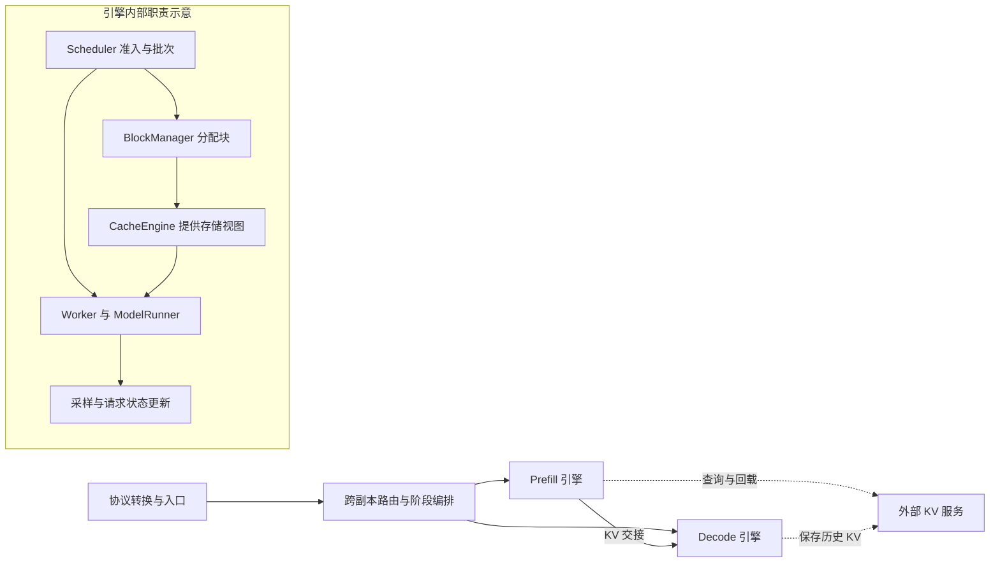
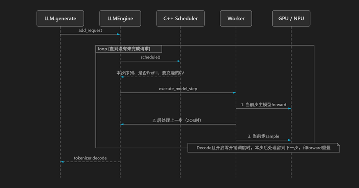
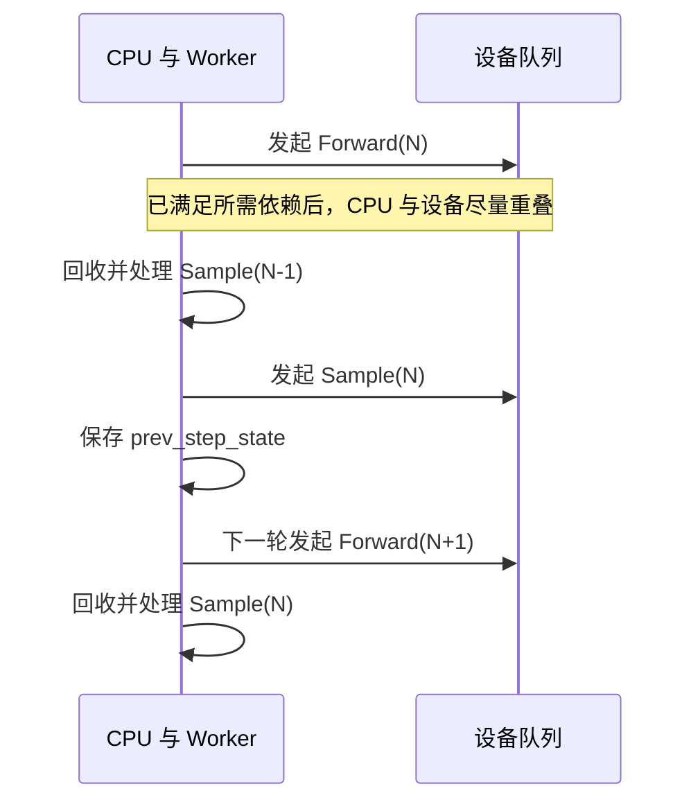
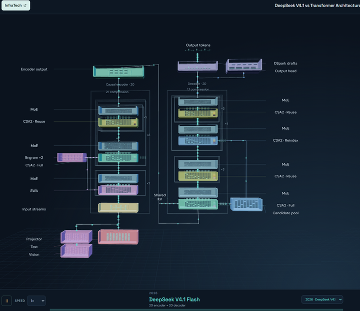
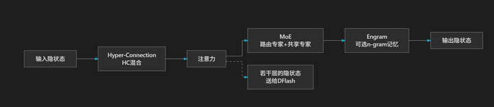
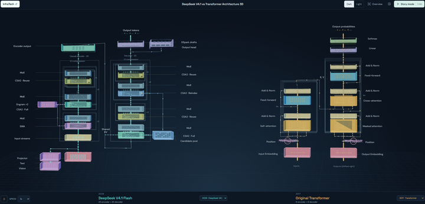
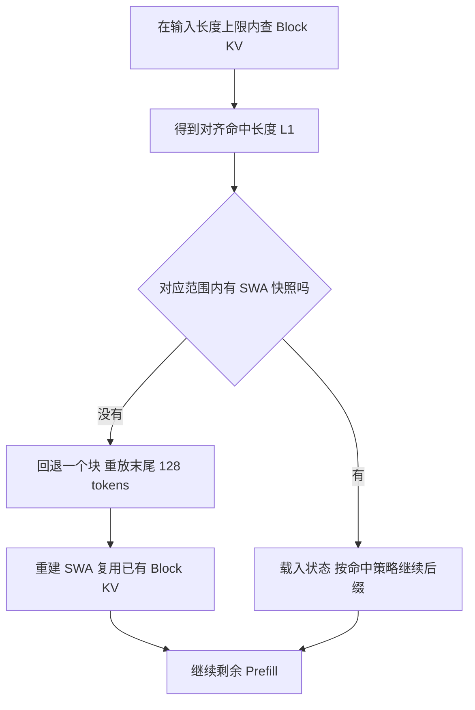
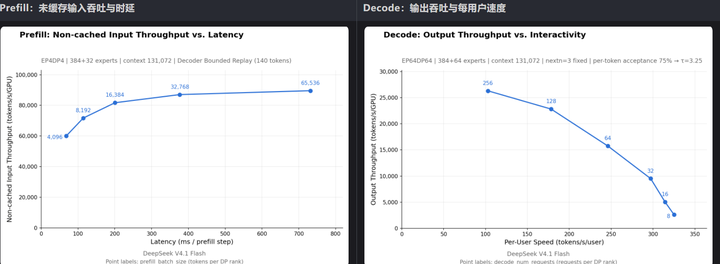
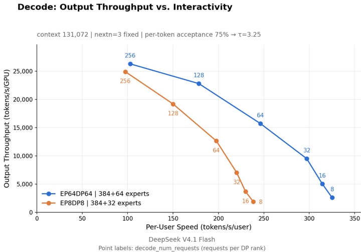

# DeepInfer 专用推理引擎与生产系统边界学习文档

本文面向已经了解 Prefill、Decode 和 KV Cache，但第一次读 DeepInfer 的同学。主要问题是：**一个围绕特定模型优化的推理引擎，怎样通过调度、并行、缓存和投机协同工作；它离完整生产服务还差哪些组件？**

本文属于第三方资料整理型学习资料，以《DeepInfer框架分析笔记》为入口，并对关键结论做固定提交的官方文档与源码复核。没有构建引擎、运行模型或复现性能。文章中的生产经验、源码可确认行为、本文的教学归纳分开标记。

## 0. 阅读基线与范围

| 项目 | 内容 |
| --- | --- |
| 原文标题 | DeepInfer框架分析笔记 |
| 原文链接 | [原文](https://mp.weixin.qq.com/s/-f6g4J3FMqR59YN2E-Ofrg) |
| 作者 / 公众号 | kaiyuan / InfraTech |
| 发布时间 | 2026-10-26 19:30，Asia/Shanghai；由页面 `ct=1793014200` 转换 |
| 读取时间 | 2026-10-27 |
| 资料类型 | 第三方框架分析文章，含官方图转载和作者示意图 |
| 整理范围 | 引擎与集群边界、请求主线、ZOS、DP/EP/EPLB、DSpark、Block KV 与 SWA、YoCo、性能图读法 |
| 不展开内容 | 完整算子实现、模型训练原理、生产组件接入开发、硬件采购与成本估算 |
| 验证边界 | 已提取完整正文并逐张阅读 7 张技术图；关键实现只读复核；生产数据仍为官方报告，未独立测量 |

**补充源码基线**

| 项目 | 内容 |
| --- | --- |
| 公开仓库 | [deepseek-ai/DeepInfer](https://github.com/deepseek-ai/DeepInfer) |
| 分支 / commit | `main` / `553741557a57df44a46fb3ab72b6aafeaf945337` |
| 读取时间 | 2026-10-27 |
| 工作区状态 | 读取时 `git status --short` 为空，没有本地修改或未跟踪文件 |
| 操作边界 | 只读 README、部署问答和下文所列源码；未修改外部源码仓库；固定快照不代表实时上游 HEAD |

先修入口：[推理基础](../推理基础/README.md) → [引擎与集群推理层分工](<推理引擎与集群推理层分工学习文档.md>)。图片下载地址、尺寸、哈希和来源层级见 [图片来源记录](../../images/deepinfer-engine/SOURCES.md)。关注引导动图和二维码不收录。

### 术语速查

| 术语 | 人话解释 | 本文关注的边界 |
| --- | --- | --- |
| VE / P / D | 视觉编码、读取输入上下文、逐步生成输出 | 是不同服务阶段，不是同一组 GPU 必须顺序承担的任务 |
| Engine / Worker | 请求调度控制层 / 执行模型的一侧 | 单个引擎可以跨多卡，不等于一张卡或整个集群 |
| DP / CP / EP | 分请求、分上下文、分专家 | 切分对象不同，不能把所有并行理解为切模型层 |
| EPLB | 调整专家副本位置，让热点专家不压住少数卡 | 引擎内部专家负载均衡，不是入口请求路由 |
| ZOS | 让 CPU 调度与设备执行重叠 | 隐藏部分开销，不是没有调度工作或同步 |
| DSpark / DFlash | 置信度驱动的投机验证机制 / 产生草稿的模型 | 草稿是候选，必须通过验证才成为输出 |
| Block KV / StateBlock | 分页的历史 KV / 每条序列的定长状态槽 | 分配方式、保存范围和恢复方法不同 |
| SWA / YoCo consumer | 滑动窗口注意力 / 复用上游状态的后段层 | 有界重放和共享 KV 有各自的数值与生命周期边界 |
| TTFT / TBT | 首 token 等待时间 / 输出 token 间隔 | 引擎单步耗时只覆盖端到端时延的一部分 |

## 1. 先看生产系统，再圈出开源引擎

### 人话版

把引擎理解成“能接到任务、组织多卡计算、产出 token 的工厂”。生产系统还要回答：用户协议如何变成模型输入、请求发去哪一组设备、历史缓存在哪里、P/D 如何交接，以及副本怎样扩缩容。



**图意解读：** 黑色箭头表达请求路径，蓝色箭头表达 KV 路径。Recipe 做协议和 token 序列转换；Entrypoint 协调请求；三个阶段的 Load Balancer 选择服务资源；Prefill 和 Decode 内还有 Expert-Parallel Load Balancer；外部存储负责长时间保留 Block KV。黄色、橙色服务框里的引擎能力已大量公开，整张生产拓扑不能仅靠启动离线例子得到。

[固定 README][readme] 明确把 KV cache system、VE/P/D 分离部署、P/D 数据并行副本间的负载均衡列为本次发布未包含的完整服务组件。Recipe 是另外的项目；这不能写成 Recipe 永远“未开源”。引擎保留 `PROMPT`、`COMPLETION` 和缓存保存 hook，也不等于外部存储与编排实现已经包含其中。



**整理者归纳：** 上图把生产边界和引擎内部职责分层展示，未画出每条真实 RPC。BlockManager 管块的分配与回收；CacheEngine 提供实际 tensor 布局与访问视图；二者都不因此拥有全局路由策略。

例如，一条图文请求需要先得到视觉特征、选择 Prefill 实例、查找历史状态、传 KV 给 Decode，再输出文本。离线 `LLM.generate()` 可以覆盖模型生成流程，却没有替你建立这条跨服务生命周期。[官方部署说明][qa] 是生产设计的描述，不是可直接复现的部署脚本。

## 2. 用一条请求读懂目录和调用链

### 模块—机制地图

| 要回答的问题 | 固定源码入口 | 作用 |
| --- | --- | --- |
| 文本怎样进入引擎 | [`entrypoints/llm.py`][llm]：`LLM.generate`、`_add_request`、`_run_engine` | 处理文本或 token IDs，入队并循环推进引擎 |
| 一轮怎样协调 | [`engine/llm_engine.py`][engine]：`LLMEngine.step` | 调度、执行、状态处理及与外部系统交互的 hook |
| 谁决定哪些请求运行 | [`scheduler.hpp`][scheduler]：`Scheduler` | 等待/运行队列、预算、抢占和状态转换 |
| 谁分配 KV 块 | [`block_manager.hpp`][blocks] | 管理可分配的 block，和实际 tensor 存储分工 |
| 谁把一步交给设备 | [`worker.py`][worker]：`Worker.execute_model_step` | 串起 forward、采样和前后步后处理 |
| 缓存实体放在哪里 | [`cache_engine.py`][cache]：`StateBlock`、`KVCacheManager`、`CacheEngine` | 构造分页 KV 与定长状态的布局及视图 |
| 模型层如何连接 | [`deepseek.py`][model]、[`decoder_layer.py`][layer] | 主干、共享状态、HC、Attention、MoE 与 DFlash 特征 |
| 专家怎样重新放置 | [`eplb/policy.py`][eplb] | 根据负载选择专家副本与放置方案 |
| 变长验证预算如何计算 | [`mtp_varlen.hpp`][varlen]、[`zos.cpp`][zos] | CPU 预算与设备侧输入准备配合 |
| 格式约束如何参与生成 | [`structure_output/`][so] | 编译 grammar、维护 matcher、约束合法 token |



**图意解读：** 请求先经 `LLM` 进入引擎，C++ Scheduler 选出当前批次，Worker 执行设备计算。图里“后处理上一步”很关键：当前步计算和上一批结果返回不必处在同一串行阶段。GPU/NPU 列表达执行设备，不代表所有后端实现细节完全一样。

一次离线生成可以按以下顺序理解：

1. `LLM.generate(prompts=...)` 可以接收文本，也可以通过 `prompt_token_ids` 接收 token IDs；文本会在 `_add_request` 中分词。
2. `LLMEngine` 保存请求，Scheduler 决定本轮是 Prefill 还是 Decode、纳入哪些序列、需要多少块。
3. Worker 调用 ModelRunner 计算，再执行采样与结果处理。
4. 循环结束还要 `flush_inflight_reqs()`，收回 ZOS 延迟处理的结果，不能只看队列是否为空。

**原文纠偏：** 文末说“本仓库的 LLM 接收的是已经分好的 token”过于绝对。这个约束适用于底层 `LLMEngine.add_request` 接口；上层 `LLM.generate` 保留了文本入口。[源码可直接核对][llm]。

### 三种引擎角色是能力边界

| 类型 | 承担计算 | 默认 ZOS | 需要记住的限制 |
| --- | --- | --- | --- |
| `NORMAL` | Prefill + Decode | 开 | 离线生成的常见模式，两阶段争用同一组资源 |
| `PROMPT` | Prefill | 关 | 只是 Prefill 引擎角色，不自动完成跨服务交接 |
| `COMPLETION` | Decode | 开 | 没有 Prefill 重算通道；调度器要求 `stop_preempted_request=true` |

依据：[EngineType][types] 与 [Scheduler 构造检查][scheduler]。参数存在不等于任意模式组合都合法。

## 3. ZOS：错开结果处理，减少设备空等

### 人话版

普通流程像做完一份饭、记账、再准备下一份。ZOS 让下一份已经开始做时，CPU 再整理上一份的账。计算依赖仍然存在，只是结果回收和下一步准备尽量不阻塞设备。

[Worker 的实际顺序][worker] 是：

| 当前第 N 步 | 行为 | 说明 |
| --- | --- | --- |
| 1 | Forward(N) | 发起当前主模型计算 |
| 2 | Post-process(N−1) | 处理 `prev_step_state` 中上一轮的采样结果 |
| 3 | Sample(N) | 必要时先校正变长验证导致的序列长度元数据 |
| 4 | 保存或处理当前状态 | Prefill 或非 ZOS 当场处理；ZOS Decode 留给下一步 |

**原文纠偏：** 文字中的“处理后一步留下的采样结果”应读作“处理上一步”。原文时序图与源码在这一点上一致。`_post_process_step` 中仍会等待相关事件，所以“Zero Overhead”表达的是重叠优化目标，不能保证任意 workload 都没有 GPU 空隙。



**图意解读：** 这是单步方法顺序的教学简图，不是 CUDA trace；图没有把设备 kernel、事件等待和多 rank 集合通信全部展开。若请求不再产生新 step，flush 负责收尾。

排障时，先区分设备计算慢、CPU 元数据准备慢、跨 rank 等待和结果回收同步，再讨论 ZOS 是否有效。仅看开关开启或 GPU 利用率平均值，不能证明流水线已经填满。

## 4. 模型结构怎样决定运行状态



**图意解读：** 图把前段与后段模型、共享 KV、MoE、Engram 和 DSpark 草稿放在一起，适合辨认“哪些机制在同一模型中协作”。这是 InfraTech 的三维教学截图，层组和连线是视觉摘要，不是引擎服务进程图。小字可点击原图查看，准确接口应回到固定源码。



**图意解读与纠偏：** 这张图表达 HC、Attention、MoE、Engram 和 DFlash 的关联，但不能将横向排列直接当成准确执行顺序。固定 [`DeepseekDecoderLayer.forward`][layer] 把 Engram 作为 `hc_post_intervention` 交给 `attn_norm_forward`，不是简单“MoE 之后统一追加 Engram”；DFlash 输入特征也有指定的提取位置。

把模型特性翻译成引擎问题：

| 模型机制 | 对引擎提出的问题 |
| --- | --- |
| 滑窗注意力 | 保存窗口状态、处理滚动覆盖与投机回退 |
| 压缩 KV 与 indexer | 主 KV、索引 K 的格式和块布局必须匹配模型 |
| 跨层 KV 复用 / YoCo | 区分 producer 和 consumer，确定哪些状态复用、哪些需要重放 |
| MoE | 请求分到不同 DP rank 后，专家 token 仍可能聚到热点 rank |
| HC / Engram | 中间状态和 hook 位置不能简化为普通残差层串联 |
| DFlash | 草稿特征、验证长度、缓存与采样状态要同步推进 |

### YoCo 里的 encoder / decoder 不等同于经典翻译模型



**图意解读：** 右侧经典 Encoder–Decoder 通过 cross-attention 使用 encoder 输出；左侧 V4.1 强调因果计算、跨层共享和后段状态恢复。相似的“前半/后半”形状不能推出相同的 Prefill/Decode 语义。

按[官方部署问答][qa]，V4.1 的后段 block KV 可由最后 encoder 层的隐状态投影得到，后段 SWA 仍需准备。启用有界重放时，只让有限后缀经过相关后段计算；这不表示 Decode 每步可以跳过整个前段，也不表示所有后段状态可以直接从共享 KV 推出来。

## 5. DP、EP 与 EPLB：请求均匀不代表专家均匀

### 人话版

DP 像把不同顾客分到不同窗口，EP 像把不同菜品交给专门厨师。即便每个窗口顾客一样多，大家都点同一道菜时，某位厨师仍然最忙。EPLB 给热点专家增加副本并调整放置，针对的是后一种拥堵。

[官方生产说明][qa] 报告 Prefill 使用 EP2–8 / DP2–8，Decode 使用 EP64–128 / DP64–128，当时不启用 TP、CP。与此同时，公开引擎支持 balanced CP。**“框架有能力”和“所报告部署采用该能力”是两件事。**

宽 EP 使每个 rank 承担的专家权重工作发生变化，可能降低 Decode 每步专家部分的访存压力，但也要求通信域和专家负载均衡相配合。不能把“EP 越大越快”推广到任意跨机网络、模型和并发。

[EPLB 策略源码][eplb] 根据历史负载进行副本和放置决策。教学上应区分三种控制权：入口负载均衡决定请求进哪个服务副本，Scheduler 决定本轮谁运行，EPLB 决定专家副本如何分布。请求数均匀并不保证这三层都均衡。

## 6. DSpark：少验证低收益草稿，而不是免除验证

### 机制拆解

DFlash 产生候选 token，Confidence Head 估计接受概率，DSpark 根据预计收益分配验证预算。后面的候选能否有用依赖前缀被接受，不能从多条请求中任取几个离散高分 token 当输出。

与 ZOS 组合时，CPU 开始调度下一步，还拿不到当前步完整置信度。因此 CPU 先确定总预算，设备侧再按新置信度计算每条请求的实际验证长度，随后校正 CPU 元数据。这里涉及 [`mtp_varlen.hpp`][varlen]、[`zos.cpp`][zos] 和 [Worker 的长度校正与采样顺序][worker]。

**教学例子，不是性能数据：** 两条请求各提出 5 个候选；若 A 的后两项预计几乎不被接受，而 B 的候选更可靠，有限验证预算可倾向 B 的连续前缀。收益来自避免低回报计算，最终接受仍由目标模型验证决定。

### 官方估算能说明什么

[部署问答][qa] 基于 EP64/DP64 benchmark 数据估算：每 rank 并发 60 时，固定 5 与变长方案的平均验证长度为 5 与 3.58，平均接受长度为 3.30 与 3.21，估算吞吐为 13,730 与 14,466 tok/s/rank，约 +5.4%。并发 16 时估算反而为 −1.5%。

这些是官方给定工作点下的估算，未由本文复现，也不是任何输入上的稳定提升。它们说明应同时记录验证长度、接受长度、设备 step 耗时和并发；只看接受率或少算了多少 token，都不足以推断吞吐。

## 7. Block KV、SWA 与有界重放

### 先把存储对象拆开

| 状态 | 运行时位置与管理 | 官方生产保存方式 | 失效后的处理边界 |
| --- | --- | --- | --- |
| Block KV：主 KV + indexer K | HBM 分页块，块管理与 tensor 视图分工 | 独立 3FS 集群 | 共享历史前缀；保存和路由由外部服务组织 |
| 需要跨请求保留的 SWA | 每序列定长 `StateBlock` 的 stored region | 产出机主机内存，入口目录记录位置 | 远端可拉取；缺失可采用有界重放 |
| YoCo consumer SWA、压缩状态 | `StateBlock` 的 dropped region | 不进入跨请求保存部分 | 仍是运行时必要状态；按对应机制恢复或推进 |

依据：[CacheEngine / StateBlock 源码][cache] 和[官方 KV 存储说明][qa]。`stored` / `state_size_to_disk` 是布局与接口命名；**不能据此认定 SWA 已经写到 SSD 或 3FS**。官方部署明确将它留在主机内存。

P→D 传输和长期保存也不同：`StateBlock` 注释说明 PE→CE 需要传输两段，而长期保存只取 stored 部分。没有持久化的状态，依旧可能必须参与当前请求的交接。

### 为什么命中分页 KV 还要检查 SWA

Block KV 可以在共享存储里保留很久；与它对应的 SWA 则可能因主机退出、内存淘汰、目录缺失或传输失败而不可用。两个对象按同样的 128-token 边界组织，不表示它们具有相同的可用性。

[部署问答][qa] 给出的命中策略是：在 YoCo 上限约束内先查 Block KV 得到对齐长度 `L1`，再在 `[L1−128, L1]` 查可配套 SWA；找不到时，把有效命中长度退一块，重放这 128 个 token 来重建 SWA，已命中的 Block KV 不重复生成或覆盖。



**图意解读：** 这是官方生产策略的简化图，外部查找和拉取服务未随引擎一起发布；图省略短输入和空命中的边界处理，不能直接当成实现伪代码。

**教学例子：** 输入长度为 2,048，按文档的 `L−134` 上限，最大可查询前缀为 1,914；假设 Block KV 命中到对齐位置 1,792，且对应 SWA 缺失，则回退到 1,664，重放 `[1664,1792)`，再继续后缀。这里的数字只是演示命中规则，没有运行请求。

### 128、134、140 分别指什么

| 数字 | 在所列基线中的语境 |
| --- | --- |
| 128 | 逻辑 SWA 窗口 / 保存对齐粒度，以及官方描述的有界重放区间 |
| 134 | 128 加 6 个投机回退余量；官方 SWA 保存槽和最大命中约束使用它 |
| 140 | README 对 V4.1 推荐的 `DEEPINFER_YOCO_PREFILL_KEEP_TOKENS` 配置值 |

不能把三个数字统一写成“窗口长度”。运行配置必须满足源码对滑窗和最大回退长度的检查，不能将部署说明中的 128 直接填成引擎截断参数。[README][readme] 推荐 `compact + 140`，与生产说明描述近似机制时使用 128 并不处于同一表达层级。

### 近似恢复和数值等价要分开

官方明确称 bounded replay 得到的是 **approximate SWA KV cache**。从位置 `s` 开始重放时，位置 `i` 只看 `max(s, i−127)` 到 `i`，省略了重放区间之前的依赖。

因此原文的“重建”“补齐”不能读成与完整上下文计算逐位等价。官方还指出，后段精确恢复会涉及末尾 2,560 token 穿过 20 层；有界重放用固定后缀降低这项成本。**有界的是重放长度及其随上下文增长的扩张，不宜把它解释为执行耗时与实际经过的层数完全无关。**

`mask` 保留 query 而限制可见范围，`compact` 进一步减少实际 query；同一截断语义下两种实现的数值一致性，不等于截断计算与 `off` 全量计算完全一致。参考 [YoCo 示例与验证入口][yoco_examples]；本文未运行这些测试。

## 8. 采样、结构化输出与多模态放回同一生命周期

这些功能不只是入口参数；它们都有随请求推进的状态。

- **结构化输出：** [`structure_output/`][so] 将 regex、JSON Schema 或 EBNF 编译成 grammar，运行时 matcher 推进并生成合法 token mask。编译结果、投机接受/回退和 token 提交必须保持一致；格式约束成功不保证生成内容的事实正确。
- **确定性：** [README][readme] 要求 NVIDIA 平台、`DEEPINFER_BATCH_INVARIANT=1`、`DEEPINFER_ENABLE_MTP_VARLEN=0`，并固定 `SamplingParams.seq_seed`。只给随机种子不能替代其余条件。
- **多模态：** 离线模型路径可以包含视觉计算；生产 E/P/D 则把阶段拆成服务。文章讨论的视觉负载均衡属于后者，不等于离线类自带全集群视觉调度。

排障时先定位失败属于输入准备、grammar 编译、采样、模型执行还是服务交接，不把所有错误都归为“模型没算对”。进一步阅读：[高级生成与状态一致性](../高级生成/README.md)、[多模态 Encode 分离与 EPD](<多模态 Encode 分离与 EPD 状态交接学习文档.md>)。

## 9. 读性能图前，先读坐标、配置和记账方式



**图意解读：** 左图横轴是单次 Prefill step 时延、纵轴是未缓存输入 token 吞吐，点上数字是每个 DP rank 的 Prefill chunk 大小。右图横轴是每用户输出速度、纵轴是每 GPU 输出吞吐，点上数字是每个 DP rank 的请求数。增加并发可提高吞吐，同时降低单用户速度；Prefill step 时延不能直接当完整 TTFT。

图内条件包括：context=131,072；Prefill 为 EP4/DP4、384+32 experts、后段重放保留 140 token；Decode 为 EP64/DP64、384+64 experts、固定 `nextn=3`、逐 token 接受率 75%，折算 `τ=3.25`。上游 README 指明 Prefill 用 4 张 SM100、Decode 用 64 张 SM100，分别处于一个 scale-up 域内。



**图意解读：** 在所示配置中，EP64 曲线整体提供了更好的吞吐与交互速度组合。但两组还同时使用不同冗余专家数量：EP64 为 384+64，EP8 为 384+32。因此图支持“这两套配置的比较”，不能严格分离 EP、专家复制和通信条件各自的贡献，也不是与其他框架的公平横评。

### 满接受记账与接受率折算

[benchmark.py 的 `measure_decode`][bench] 输出 `avg_SPS`，并按每请求每步 `1+nextn` 个 token 计算满接受口径：

```text
满接受吞吐 = avg_SPS × 每个 DP rank 的请求数 × (1 + nextn) / CP
```

[plot_pareto.py][plot] 的固定长度曲线用：

```text
τ = 1 + nextn × draft_acceptance
每用户速度 = avg_SPS × τ
每 GPU 吞吐 = avg_SPS × 每个 DP rank 的请求数 × τ / CP
```

**教学算例：** 若 `avg_SPS=100`、每 rank 请求数 60、`nextn=3`、`CP=1`，满接受记账为 24,000 tokens/s/GPU；采用图中的 75% 接受率假设后，`τ=3.25`，折算为 19,500 tokens/s/GPU。不是直接把 24,000 乘 0.75，因为每步额外的主模型 token 不按草稿接受率缩放。

这组作图公式明确拒绝 `mtp_varlen=1` 数据：变长路径的 step 节奏已经受接受情况影响，不能再次机械乘相同的 `τ`。因此第 6 节变长验证估算表，与这里固定长度曲线不能混成一项实验。

### 哪些数字暂时不能复现

文章转述的日 token 规模、每 GPU 小时收入、3FS 容量和多日缓存保留，来自官方生产说明。它们不是开源 benchmark 的输出；收入也不是利润或 GPU 成本。本笔记不据此推导部署回报。

构建与复现入口仍是固定 [README][readme]、[benchmark.py][bench] 和 [sweep 目录][sweep]。所列基线要求 Linux、Python 3.12、GCC ≥ 13，NVIDIA 使用 CUDA 13、Ascend 使用 CANN 9.2；支持硬件为 SM100 与 Ascend 950。没有这些运行条件时，可以读源码，但不能声称复现了图中曲线。

## 10. 原文观点、复核结论与下一步

| 原文表述或易混点 | 本文处理 |
| --- | --- |
| 未开放组件“大概率因为解耦工作量较大” | 属于作者猜测；未找到可据此确定未开放原因的官方依据 |
| 可能由 vLLM 0.4–0.6 演化 | 官方承认 vLLM 来源和 SGLang、TensorRT-LLM 启发；具体 vLLM 版本未核实 |
| “学习型仓库”与通用/专用框架谁更难 | 保留为作者评价维度，不作为官方定位或可量化结论 |
| ZOS 处理“后一步” | 按 Worker 修正为处理上一步 |
| LLM 只接收 token IDs | 区分上层 `LLM.generate` 和底层 `LLMEngine.add_request` |
| 层图中的 Engram 放在 MoE 后 | 保留原图，并说明它不是精确源码执行顺序 |
| SWA 缺失后“重建” | 明确 bounded replay 为近似恢复；与精确恢复、实现间等价测试区分 |
| Decode benchmark 就是真实输出吞吐 | 区分满接受计数、固定长度接受率折算和变长验证路径 |
| 有缓存 hook 就有完整缓存服务 | 固定源码中的保存 hook 不构成生产 3FS 服务或路由编排 |

### 从现象回到责任边界

| 现象 | 先检查什么 | 不能直接推出什么 |
| --- | --- | --- |
| 已命中长前缀，仍有少量 Prefill | SWA 是否缺失、命中上限、后缀重放 | 不能仅凭重算判断 Block KV 命中失效 |
| 每个 rank 请求数接近，仍有慢 rank | 专家 token 分布、EPLB、通信和上下文长度 | 不能只调入口请求数均衡 |
| 打开 ZOS 仍有设备空隙 | CPU 准备、同步、集合通信、实际 batch 大小 | 不能由开关名保证“零开销” |
| 吞吐远低于图中值 | nextn、接受率口径、CP、并发、上下文、硬件域 | 不能先认定内核退化 |
| 离线可运行，在线 E/P/D 未连通 | 路由、状态交接、外部缓存和协议层 | 不能把离线成功当完整部署验收 |

### 推荐源码阅读顺序

先用 [README][readme] 与 [部署问答][qa] 画边界，再沿 [LLM][llm] → [LLMEngine][engine] → [Worker][worker] 走一条请求；随后读 [Scheduler][scheduler] 和 [CacheEngine][cache] 对齐对象生命周期。最后按兴趣深入 [EPLB][eplb]、[DSpark 预算][varlen]、[模型层][layer] 或 [benchmark 口径][bench]。

自测：能否解释“引擎支持 P/D 角色”为何不等于完整分离服务？能否说清 Block KV 命中但 SWA 缺失时复用什么、重放什么？能否从图例判断固定投机长度、并发和接受率？

下一步可对照 [SGLang 请求运行时](../../sglang/运行时/README.md) 与 [vLLM 运行时](../../vllm/运行时/README.md)，比较各自的对象和边界；不同固定版本的实现不能合并成一个引擎的行为说明。

跨资料整合：[缓存恢复条件与状态所有权](<../KV缓存/前缀缓存命中后的恢复条件与状态所有权对比学习文档.md>) 对照分页 KV、KDA 和 SWA；[SGLang Overlap 与 DeepInfer ZOS](<../调度方法/SGLang Overlap 与 DeepInfer ZOS 的依赖和状态提交对比学习文档.md>) 对照设备输入、结果提交和资源存活。两篇均为固定证据范围内的机制分析，不提供跨引擎性能排名。

[readme]: https://github.com/deepseek-ai/DeepInfer/blob/553741557a57df44a46fb3ab72b6aafeaf945337/README.md
[qa]: https://github.com/deepseek-ai/DeepInfer/blob/553741557a57df44a46fb3ab72b6aafeaf945337/doc/inference_deployment_qa.md
[llm]: https://github.com/deepseek-ai/DeepInfer/blob/553741557a57df44a46fb3ab72b6aafeaf945337/deepinfer/entrypoints/llm.py
[engine]: https://github.com/deepseek-ai/DeepInfer/blob/553741557a57df44a46fb3ab72b6aafeaf945337/deepinfer/engine/llm_engine.py
[scheduler]: https://github.com/deepseek-ai/DeepInfer/blob/553741557a57df44a46fb3ab72b6aafeaf945337/csrc/engine/scheduler.hpp
[blocks]: https://github.com/deepseek-ai/DeepInfer/blob/553741557a57df44a46fb3ab72b6aafeaf945337/csrc/engine/block_manager.hpp
[worker]: https://github.com/deepseek-ai/DeepInfer/blob/553741557a57df44a46fb3ab72b6aafeaf945337/deepinfer/worker/worker.py
[cache]: https://github.com/deepseek-ai/DeepInfer/blob/553741557a57df44a46fb3ab72b6aafeaf945337/deepinfer/worker/cache_engine.py
[model]: https://github.com/deepseek-ai/DeepInfer/blob/553741557a57df44a46fb3ab72b6aafeaf945337/deepinfer/model_executor/models/deepseek.py
[layer]: https://github.com/deepseek-ai/DeepInfer/blob/553741557a57df44a46fb3ab72b6aafeaf945337/deepinfer/model_executor/models/decoder_layer.py
[eplb]: https://github.com/deepseek-ai/DeepInfer/blob/553741557a57df44a46fb3ab72b6aafeaf945337/deepinfer/model_executor/eplb/policy.py
[varlen]: https://github.com/deepseek-ai/DeepInfer/blob/553741557a57df44a46fb3ab72b6aafeaf945337/csrc/engine/mtp_varlen.hpp
[zos]: https://github.com/deepseek-ai/DeepInfer/blob/553741557a57df44a46fb3ab72b6aafeaf945337/csrc/engine/zos.cpp
[types]: https://github.com/deepseek-ai/DeepInfer/blob/553741557a57df44a46fb3ab72b6aafeaf945337/deepinfer/engine/engine_type.py
[so]: https://github.com/deepseek-ai/DeepInfer/tree/553741557a57df44a46fb3ab72b6aafeaf945337/deepinfer/structure_output
[yoco_examples]: https://github.com/deepseek-ai/DeepInfer/tree/553741557a57df44a46fb3ab72b6aafeaf945337/examples/yoco
[bench]: https://github.com/deepseek-ai/DeepInfer/blob/553741557a57df44a46fb3ab72b6aafeaf945337/examples/benchmark.py
[plot]: https://github.com/deepseek-ai/DeepInfer/blob/553741557a57df44a46fb3ab72b6aafeaf945337/examples/sweep/plot_pareto.py
[sweep]: https://github.com/deepseek-ai/DeepInfer/tree/553741557a57df44a46fb3ab72b6aafeaf945337/examples/sweep
