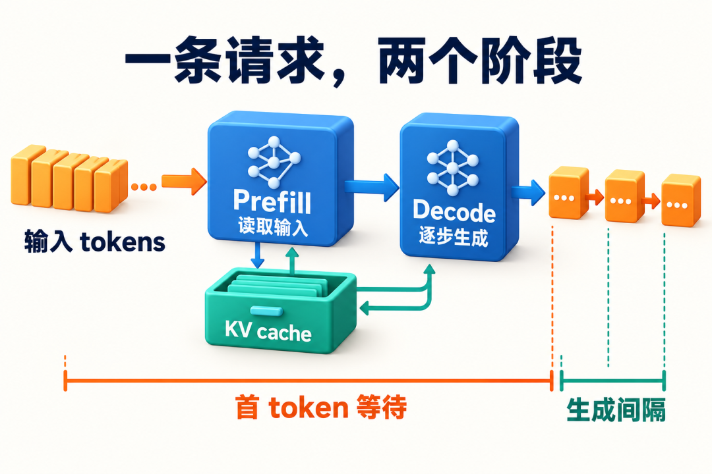
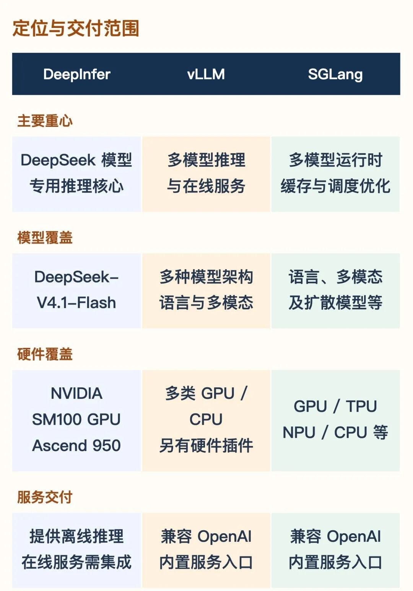
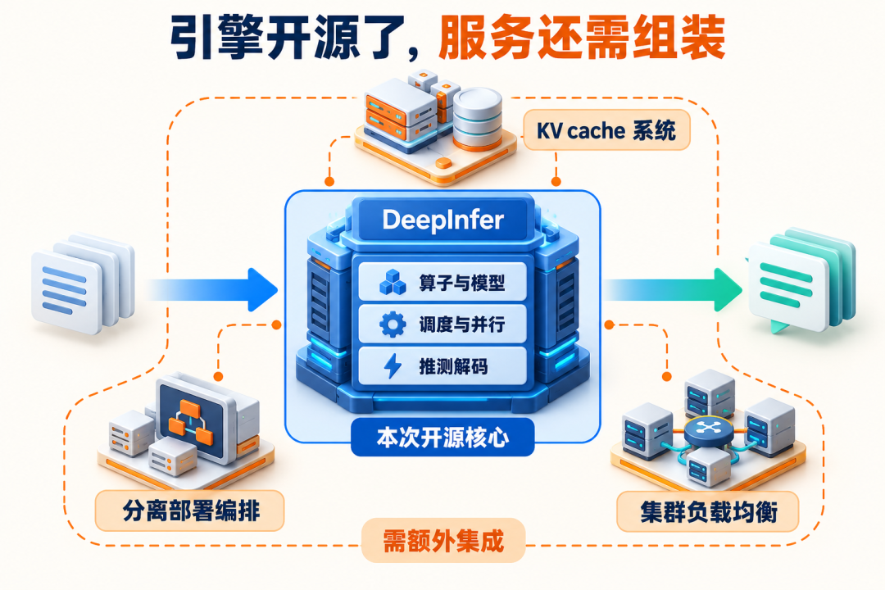
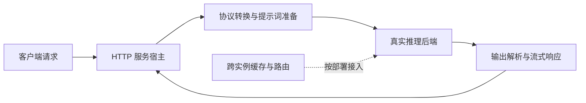
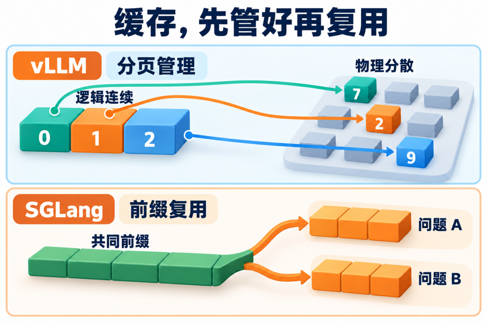
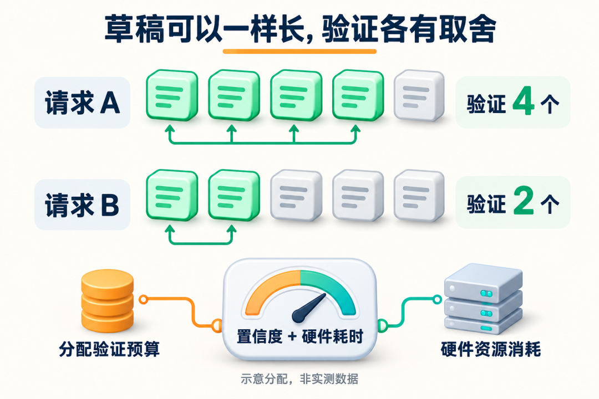
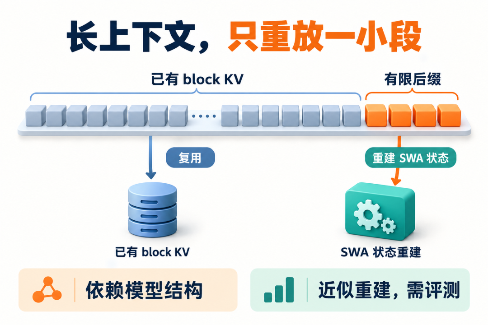
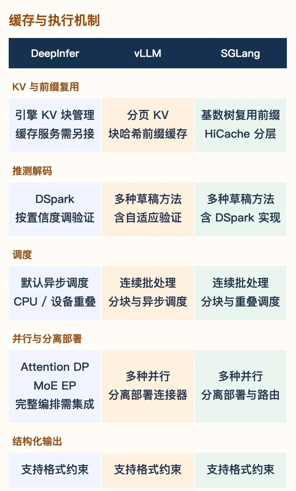

# DeepInfer、vLLM 与 SGLang 的交付范围与机制比较学习文档

比较推理框架时，先确认自己拿到的是模型执行核心、可启动的 API 服务，还是已经组织好跨实例缓存与路由的完整系统，再比较具体机制。

本文是**第三方资料整理型学习资料**：围绕 AI灰鲸的比较文章保留原图、解释易混边界，并用官方资料做有限复核。它是比较入口；详细状态机沿用仓内已有专题，不重复展开。本文没有运行三套引擎，也没有跨引擎性能或数值等价实验。

## 0. 来源、基线与阅读范围

| 项目 | 内容 |
| --- | --- |
| 原文标题 | DeepInfer 和 vLLM、SGLang 的对比 |
| 原文链接 | https://mp.weixin.qq.com/s/t9lemS4pN4UfIBjCFAcj1w |
| 作者 / 公众号 | AI灰鲸 |
| 发布时间 | 2026-10-25 08:09:49（Asia/Shanghai，页面时间戳换算） |
| 读取时间 | 2026-10-27 |
| 整理范围 | 服务交付、缓存分层、DP/EP、验证预算、SWA 重建及确定性条件 |
| 不展开 | 全量模型/硬件兼容矩阵、完整生产部署教程、统一性能排名 |
| 图片 | 全部 8 张技术图表，原样保存；文件及原始地址见 [图源清单](../../images/inference-engine-comparison/SOURCES.md) |

本次复核的证据分开记录：

| 来源 | 版本或读取边界 | 本次核对内容 |
| --- | --- | --- |
| [DeepInfer README][di-readme]、[生产问答][di-qa] | 官方 `main` 快照 `553741557a57df44a46fb3ab72b6aafeaf945337`；本地检出干净，只读 | 交付范围、配置条件、部署规模、DSpark 估算及近似重放 |
| [SGLang DSpark planner][sg-planner] | 官方 `main` 快照 `72d5c5bb73cadd7ffbf5114e5f81e29d36b6c61a`；从固定 Git 对象读取，检出目录已有未跟踪资料，未采用也未修改 | `DSparkVerifyPlanner` 确实存在；非 static 模式对 confidence head 的检查。未追完算法和全部执行路径 |
| [vLLM Adaptive Verification][vl-av] | 官方 `latest` 文档，读取于 2026-10-27；未固定对应运行时提交 | 接受率估计来源、开关、成本模型与组合限制；不能回填到其他文章的旧 commit |
| [SGLang HiCache 设计][sg-hicache] | 官方在线文档，读取于 2026-10-27 | L1/L2 私有范围与 L3 跨实例共享条件 |
| [deepseek-recipe README][recipe]、[server-py 示例][recipe-server] | 官方 `main` 快照 `935817c66f5d6e64838f419692545f06787e485f`；只读取固定远程文档，未运行示例 | 协议库、HTTP 示例与真实模型后端的边界 |

原文信息、官方文档声明和整理者判断在正文分别标注。不同来源不是同一时点的统一版本；尤其不能把在线 `latest` 文档视为本文已经验证的部署组合。

**后续固定源码复核（2026-10-27）：** [动态验证预算专项](<../高级生成/动态投机验证预算：DeepInfer、SGLang 与 vLLM 的取舍学习文档.md>) 已将 vLLM 相关路径固定到 `05a303fdc8681f0dd586a8ac22103f3b4a8bf4ad`，并与上表 SGLang、DeepInfer 基线对照。该专项补充成本、布局与提交证据，不把本篇原先的在线文档概述改称全量源码或部署验证。

先修：[推理系统心智模型](<../推理基础/LLM 推理系统心智模型与 SGLang、vLLM 选型边界学习文档.md>)。已经掌握 Prefill/Decode 的读者，可以从第 2 节开始。

| 术语 | 人话解释 | 本文要拆开的边界 |
| --- | --- | --- |
| engine / serving | 执行模型 / 把执行能力提供为持续服务 | 能离线生成不等于服务链完整 |
| PagedAttention / APC | 分页寻址 / 前缀结果复用 | 物理组织与复用策略不是同一问题 |
| DP / EP / EPLB | 分请求 / 分专家 / 调整专家负载 | 请求路由与专家放置的控制权不同 |
| verify budget | 本轮给候选验证分多少计算 | 验证长度不等于实际接受长度 |
| bounded replay | 只重放有界后缀重建特定状态 | 本文模型采用近似语义 |
| batch invariant | 改变同批请求组成时保持结果一致 | 与固定随机种子是不同条件 |

## 1. 同一条请求，可以观察到不同层次的瓶颈

**图意解读：** 橙色输入交给 Prefill，绿色对象表示可继续使用的历史状态，Decode 持续读写状态并产生输出。它是计算示意；图中把输出画在 Decode 右边，不表示首 token 必须经过单独一次 Decode。Prefill 的结果通常已经可供首 token 采样。客户端 TTFT 还包含排队、协议处理和传输，图中也没有按真实耗时画比例。

**整理者教学例子：** 一份合同被重复问两个不同问题，共同前缀可能节省第二次 Prefill，但第二个答案仍需要生成。若首字快、后续慢，应继续检查 Decode 批量、通信、状态访问和调度，而不能只提高前缀命中率。

计算与观测的完整区分见 [Prefill/Decode 主线](<../推理基础/LLM Prefill 与 Decode 阶段源码学习文档.md>)、[客户端指标口径](<../../sglang/性能工程/SGLang 指标口径与性能定位学习文档.md>)。

## 2. 先比较交付层，再比较功能名称

**图意解读：** 这是一张作者整理的定位表。它有助于区别专用模型执行核心和通用服务入口，但没有列出版本、模型与硬件的全部组合条件。某列列出一种设备，不代表该列所有模型、投机算法和并行组合都能在该设备上运行。竖表在窄屏可打开原图查看，下面保留更容易比较的文字入口。

| 比较问题 | 可以确认的范围 | 下一步需要什么证据 |
| --- | --- | --- |
| DeepInfer 发布了什么？ | 固定 README 声明交付离线核心；列出 V4.1-Flash、SM100 与 Ascend 950 | 目标硬件和模型的构建、运行与服务集成记录 |
| 有服务入口意味着什么？ | 原文把 vLLM、SGLang 的在线接口列为交付能力；仓内对应 [vLLM 运行时](../../vllm/运行时/README.md) 和 [SGLang 服务运维](../../sglang/服务运维/README.md) 分别讨论其边界 | 协议字段、流式行为、取消、模型适配和多副本运维仍需按版本验证 |
| 支持并行意味着什么？ | 引擎有跨设备执行能力 | 不自动包含集群选点、缓存目录、扩缩容与故障恢复 |
| 支持结构化输出意味着什么？ | 约束生成格式的能力 | 格式合法与内容真实性应分别检查 |

### 引擎内部 KV 与外部缓存服务

**图意解读：** 中间是执行核心，虚线圈出外部缓存、分离编排和多副本负载均衡。图的控制边界比机箱图标更重要：引擎拥有本次执行的 tensor 与块管理，不等于它拥有跨请求的全局缓存目录和服务路由。这里的“还需集成”不能改写成“DeepInfer 没有 KV”。

固定 [DeepInfer README][di-readme] 把完整缓存系统、VE/P/D 分离部署及 P/D 数据并行副本负载均衡列为发布范围外的集成项，也说明大部分必要的引擎功能已有实现。源码对象与生产分工详见 [DeepInfer 专题](<DeepInfer 专用推理引擎与生产系统边界学习文档.md>)。

### deepseek-recipe 有 HTTP 示例，但默认没有真实推理

[固定 README][recipe] 将协议转换、提示词和输出解析作为库能力，推理与工具执行由调用方提供；同一仓库确实有 HTTP 示例。[server-py][recipe-server] 是 FastAPI 加 mock inference，通过自定义回调接后端。因此“库不包办 HTTP”与“仓库有 HTTP 示例”可以同时成立；启动示例也不代表 DeepInfer 或完整线上系统已接通。

**图意解读：** 这是整理者的职责图，不是现成部署拓扑。recipe 组件可协助 C/E；HTTP 宿主、实际引擎及外围状态服务仍有独立接口。不能用解析层返回了一段文本证明设备执行已成功。

## 3. 分页、前缀索引和分层缓存分别回答什么

**图意解读：** 上半图的 `0/1/2 → 7/2/9` 表达逻辑块到物理块的映射；下半图表达两个请求共享稳定前缀。两幅图属于不同抽象层，不能读成“vLLM 只有分页、SGLang 才有复用”。SGLang 也管理物理 KV，vLLM 也实现前缀缓存。

| 层次 | 核心问题 | 仓内进一步依据 |
| --- | --- | --- |
| 物理分配 | 逻辑 token 在哪个槽位，何时可复用地址？ | [vLLM KV 全生命周期](<../../vllm/KV缓存/vLLM V1 KV Cache 管理全生命周期源码学习文档.md>) |
| 前缀匹配 | 计算身份是否一致，能找到哪个合法位置？ | [SGLang KV 映射与共享回收](<../../sglang/KV缓存/SGLang KV 映射与共享回收学习文档.md>) |
| 恢复条件 | 必要状态是否齐全，是否要重放或建立可写副本？ | [缓存恢复与所有权对比](<../KV缓存/前缀缓存命中后的恢复条件与状态所有权对比学习文档.md>) |
| 存储范围 | 副本属于谁，别的实例怎样取得？ | [HiCache 上传与回载](<../../sglang/KV缓存/HiCache 下 SGLang L1、L2、L3 与上传回载源码学习文档.md>) |

上述仓内固定源码资料已经说明：普通分页 Radix 的匹配受页大小限制，vLLM 特定 Manager 可支持满足条件的部分尾块。树结构与链式哈希不直接决定“任意 token / 永远整物理块”这样的通用结论。

**官方设计复核：** [HiCache 设计][sg-hicache] 明确 L1/L2 属于单个实例。跨实例复用依赖 L3，且共享范围取决于后端、命名空间及配置；本地文件后端不会仅因为叫作 L3 就成为共享存储。增大本实例 Host pool 与把多机内存合成公共池是两件事。

## 4. Attention DP 与 MoE EP 是层内分工，不是新增两套机器

**图意解读：** 上方按请求组织 Attention，下方按专家路由 token，再把结果送回对应请求。图在上下各画 GPU，是为了展示同组设备在不同层的职责，并非证明存在两套物理设备池；也不能把它当 Attention–FFN 分离部署图。专家路由解决计算去向，EPLB 处理专家副本放置，外部入口负载均衡则分配服务请求。

[DeepInfer 生产问答][di-qa] 给出特定部署建议：Prefill EP2–8/DP2–8，Decode EP64–128/DP64–128；1P+1D 可部署，其高效部署规模例子为 64 张 Prefill 卡加 64 张 Decode 卡。这些不是离线引擎的最低卡数，也不能用来规定所有模型的部署规模。

同一 README 列出 balanced CP，而生产问答说明其所述线上配置暂未采用 TP/CP。**能力存在、配置启用、某个规模下收益成立，需要三份不同的证据。** 更完整的并行解释见 [DeepInfer DP/EP 专题](<DeepInfer 专用推理引擎与生产系统边界学习文档.md#5-dpep-与-eplb请求均匀不代表专家均匀>)。

## 5. 动态验证不是 DeepInfer 独占的能力标签

**图意解读：** A 验证 4 个、B 验证 2 个是构造示意，不是性能结果。绿色候选代表送去验证的连续前缀，不表示它们都将被接受；灰色候选也不能绕过验证成为输出。预算取决于预计收益与执行成本，最终提交仍以验证结果为准。

| 证据入口 | 本次可确认什么 | 不能直接合并的条件 |
| --- | --- | --- |
| [DeepInfer 配置与问答][di-qa] | 置信度参与变长验证，CPU/GPU 的跨轮配合详见已有专题 | 其模型、硬件成本曲线和异步执行条件 |
| [vLLM Adaptive Verification 文档][vl-av] | 接受率估计可来自 confidence head 或在线估计器；按成本选择验证预算，默认关闭 | 文档要求兼容可变设备长度的 backend、完整 CUDA Graph；列出 LoRA、PP 等限制。此处不绑定旧版 vLLM commit |
| [SGLang 固定 planner][sg-planner] | 存在专用 planner；所读非 static 路径检查 confidence head | 类名存在不证明每个 checkpoint、并行组合或默认启动参数都采用该路径 |

**官方数字边界：** DeepInfer 的 +5.4% 是 EP64/DP64、每 rank 并发 60 时，变长与固定 5 个候选验证的吞吐估算；并发 16 对应 −1.5%。完整口径见 [已有 DSpark 章节](<DeepInfer 专用推理引擎与生产系统边界学习文档.md#6-dspark少验证低收益草稿而不是免除验证>)。它既不是三引擎横评，也不是“少验证就更快”的保证。

本文只核实原文“其他引擎也有相关路线”的表述。进一步的 [三方固定源码对比](<../高级生成/动态投机验证预算：DeepInfer、SGLang 与 vLLM 的取舍学习文档.md>) 已分别追踪接受率估计、预算选择、GPU 实际长度和提交入口；仍未进行同模型、同硬件的运行或性能实验。

## 6. 状态重建与可重复输出：必须说明一致性的对象

**图意解读：** 左边复用 Block KV，右边重建 SWA；图底部的“依赖模型结构”和“近似重建”是必要条件。橙色块数量不是配置值。特定层后缀工作被缩短，也不能读成整个请求只需计算这些 token。

| 说法 | 应核对的对象与边界 |
| --- | --- |
| SWA 状态重建 | [部署问答][di-qa] 明确描述近似语义，不等于找回原始快照 |
| mask 与 compact 等价 | 比较两种截断实现，不据此证明截断与完整上下文等价；见 [已有重放分析](<DeepInfer 专用推理引擎与生产系统边界学习文档.md#7-block-kvswa-与有界重放>) |
| 固定随机种子 | 只涉及可重复性的部分条件，不自动约束 batch 改变引起的数值路径差异 |
| 确定性采样配置 | 固定 [README][di-readme] 要求 NVIDIA、开启 `DEEPINFER_BATCH_INVARIANT=1`、关闭 `DEEPINFER_ENABLE_MTP_VARLEN`，并固定 `SamplingParams.seq_seed` |

**整理者归纳：** 如果一项吞吐配置使用可变长验证，而另一项确定性配置关闭它，就不能把两者拼成“同时达到该速度和该复现保证”的实验。本次仅核对配置声明，没有测量精度、质量或确定性。

## 7. 功能表应用来提出问题，不能直接生成排名

**图意解读：** 表中缓存、投机、调度、并行与结构化输出是不同维度。“支持”没有告诉读者默认是否启用、与什么组合兼容或收益是多少；例如前缀复用、动态验证与批次不变性仍有各自条件。这张图保留为原文的导航摘要，不作为部署兼容证明。

按业务问题选择下一份证据，比先选一个框架名字更有用：

| 遇到的问题 | 下一步核对 | 本文不提供的结论 |
| --- | --- | --- |
| 离线能跑，API 没返回真实答案 | 宿主到模型回调、流式解析、取消和输出归属 | mock 示例成功不能证明推理链成功 |
| 相同文档仍重复 Prefill | token 身份、合法边界、缓存所在实例与恢复条件 | 语义相似不能保证前缀复用 |
| 增加 Host 内存，其他副本仍不命中 | 数据是否进入共享 L3、后端配置是否一致 | Host pool 变大不等于共享范围变大 |
| 减少验证数后吞吐反降 | 有效接受长度、总 step 成本、并发和校正等待 | 功能开关不能替代同条件测量 |
| 相同 seed 输出仍不同 | batch、精度路径、投机开关和平台条件 | 单个 seed 不能覆盖全部确定性条件 |

## 8. 阅读路线与关联复核

先读本文第 2–3 节区分交付与缓存层次，再按需要进入 [DeepInfer 完整机制笔记](<DeepInfer 专用推理引擎与生产系统边界学习文档.md>)、[缓存恢复条件](<../KV缓存/前缀缓存命中后的恢复条件与状态所有权对比学习文档.md>)、[Overlap 与 ZOS](<../调度方法/SGLang Overlap 与 DeepInfer ZOS 的依赖和状态提交对比学习文档.md>)。不把它们排成必须从头读完的课程。

本次关联复核补充了通用心智模型中 APC 粒度的版本边界、HiCache 文档的共享范围说明，以及 DeepInfer 文档中动态验证的跨引擎入口。原有确定性条件、SWA 近似恢复和性能数字口径已经准确，保留原证据，没有改写为新的实验结论。

自测：为什么分页与前缀树可以共存？为什么启动 recipe 示例不能证明 DeepInfer 在线可用？为什么“支持动态验证”和“支持确定性”还不足以证明两者能同时启用？

## 9. 官方资料与固定源码入口

- [DeepInfer README][di-readme]、[生产部署问答][di-qa]：发布范围及特定系统条件。
- [SGLang DSpark planner][sg-planner]：有限源码复核入口，不代表完整算法审计。
- [vLLM Adaptive Verification][vl-av]、[SGLang HiCache 设计][sg-hicache]：在线文档，版本边界见第 0 节。
- [deepseek-recipe][recipe]、[HTTP mock 示例][recipe-server]：协议、宿主与推理后端的职责边界。

[di-readme]: https://github.com/deepseek-ai/DeepInfer/blob/553741557a57df44a46fb3ab72b6aafeaf945337/README.md
[di-qa]: https://github.com/deepseek-ai/DeepInfer/blob/553741557a57df44a46fb3ab72b6aafeaf945337/doc/inference_deployment_qa.md
[sg-planner]: https://github.com/sgl-project/sglang/blob/72d5c5bb73cadd7ffbf5114e5f81e29d36b6c61a/python/sglang/srt/speculative/dspark_components/dspark_planner.py#L70
[vl-av]: https://docs.vllm.ai/en/latest/features/speculative_decoding/adaptive_verification/
[sg-hicache]: https://docs.sglang.io/docs/advanced_features/hicache_design
[recipe]: https://github.com/deepseek-ai/deepseek-recipe/blob/935817c66f5d6e64838f419692545f06787e485f/README.md
[recipe-server]: https://github.com/deepseek-ai/deepseek-recipe/blob/935817c66f5d6e64838f419692545f06787e485f/server-py/README.md
