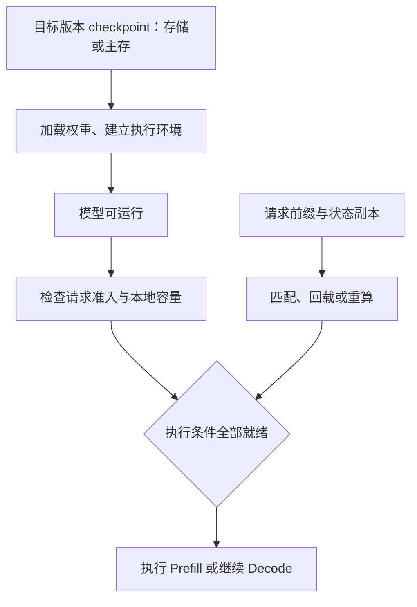
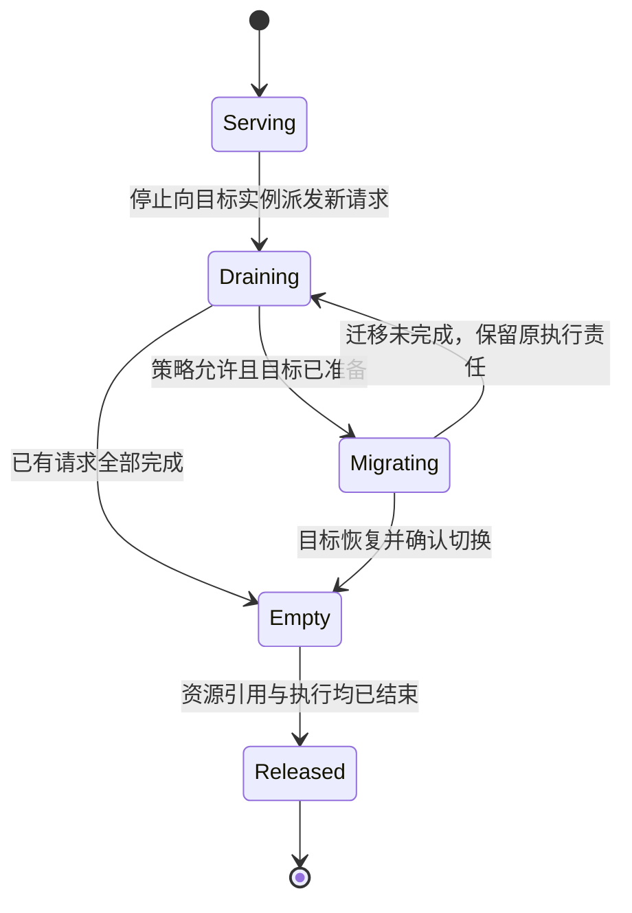

# LLM 弹性扩缩容、模型驻留与冷启动学习文档

流量上升时增加一个副本，为什么队列还会继续增长？因为申请到资源、模型能运行、请求状态能恢复和真正开始承载流量之间，还有一段准备过程。多模型场景还会遇到另一个问题：资源看似充足，却没有合适的权重、Adapter 或互联拓扑。

本文是**第三方资料整理型学习文档**。从推理调度综述的控制平面分类出发，用 ServerlessLLM、Llumnix 和 DynamoLLM 的一手论文，解释资源扩缩容、模型驻留与请求状态的不同成本。没有部署这些系统，也没有把论文方案接入仓内引擎。

[集群服务路线](README.md) · [先修：引擎与集群分工](<推理引擎与集群推理层分工学习文档.md>) · [总览：分层调度与 SLO](<../调度方法/LLM 推理调度的分层决策与 SLO 取舍学习文档.md>)

## 0. 阅读基线与范围

| 来源 | 作者/机构与版本 | 本次使用的内容 |
| --- | --- | --- |
| [《大模型推理调度综述分享》][article] | 一起推理吧，2026-11-11 | 资料入口；已读完整正文与三张技术图 |
| [LLM Inference Scheduling: A Survey of Techniques, Frameworks, and Trade-offs][survey] | Morgan Lindsay Heisler 等，华为及高校共同工作；作者资料库 v1.0、2025 年；固定提交 `3cd4e7c81e49e1f2ab197e6b5e02028ef8d72eac` | §5.1 扩缩容、§5.2 模型管理和 §9 研究问题；图与版本说明集中在配套总览 |
| [ServerlessLLM: Low-Latency Serverless Inference for Large Language Models][serverless] | Yao Fu 等，University of Edinburgh、NTU Singapore；OSDI 2024 正式论文 | §4 分层加载、§5 迁移、§6 启动时间感知选点 |
| [Llumnix: Dynamic Scheduling for Large Language Model Serving][llumnix] | Biao Sun 等，Alibaba Group；OSDI 2024 正式论文 | §4.1–4.3，运行中请求重调度、多阶段 KV 迁移及协调 |
| [DynamoLLM: Designing LLM Inference Clusters for Performance and Energy Efficiency][dynamollm] | Jovan Stojkovic 等；arXiv `2408.00741v1`，2024-08-01 | §III-C 重配置开销、§IV 分层控制与降低开销 |
| 读取时间 | 2026-11-23 | 一手论文的机制核对；未逐项重做实验表和开源实现审计 |

本文区分三种证据：论文描述的机制、仓内资料保留的独立源码基线，以及整理者构造的示意与算例。论文的历史模型、硬件、网络和流量条件不能合并成今天的部署能力或统一性能排名。

### 术语速查

| 术语 | 人话解释 |
| --- | --- |
| Horizontal scaling | 增减完整副本或某个服务阶段的副本 |
| Vertical scaling | 改变单个实例可用资源，如 GPU 数、可用计算份额 |
| Residency | 数据或模型当前驻留在哪一层、哪个节点 |
| Time To Ready | 从触发准备到满足可接流量条件的时间；边界须按部署定义 |
| Cold start | 请求需要的模型执行环境尚未准备好，必须先初始化或加载 |
| Prefetch / preload | 在使用前提前搬运或加载；会占用内存、带宽和计算资源 |
| Reconfiguration | 修改并行划分、资源池、实例数或其他运行配置 |
| Live migration | 请求运行中转移执行位置；迁移内容和停顿语义取决于具体方案 |
| Drain | 停止接纳新请求，并完成或迁走已有请求后再回收实例 |

## 1. 先分清三种“已经有了”

### 人话版

机器里存着模型文件、GPU 上已经加载权重、某条请求已经有可恢复的 KV，是三种不同的就绪程度。它们的身份、生命周期和管理者都不同。

| 已有对象 | 能节省什么 | 仍需要确认什么 |
| --- | --- | --- |
| SSD/DRAM 中的 checkpoint | 远端下载或部分读取成本 | 是否完成反序列化、GPU 加载与运行时初始化 |
| GPU 上的目标模型/Adapter | 模型加载或切换成本 | 是否有请求容量，模型版本/精度/Adapter 是否匹配 |
| 当前请求可用的 KV 或其他状态 | 已完成前缀的计算 | 状态身份、位置、完整性、可见性和引用是否满足恢复要求 |

因此，模型驻留感知选点、前缀缓存感知选点和普通负载均衡可以共享信号，但不能用同一个“命中率”替代。



**图意解读（整理者归纳）：** 模型准备与状态准备可以采用不同实现，并可能部分重叠；图只表达最终执行需要的条件，不要求所有系统先完整加载全部数据才开始任何工作。

## 2. 扩缩容改变什么，什么时候才真正有效

### 2.1 横向与纵向扩容

| 动作 | 主要变化 | 需要计入的准备成本 |
| --- | --- | --- |
| 新增完整模型副本 | 可并行处理更多独立请求 | 权重、运行时、通信初始化、健康检查与路由生效 |
| 新增 Prefill 或 Decode 副本 | 改变某个阶段的服务能力 | P/D 配比、目标状态交接与数据路径 |
| 调整 TP 等并行规模 | 改变单实例的计算与通信分工 | 权重重分片、KV 布局、通信组及运行状态适配 |
| 调整 GPU 内计算份额 | 改变实例在设备内获得的计算资源 | 具体硬件与运行时支持、干扰和隔离条件 |

综述将最后两类放在纵向弹性视角下讨论，但这不表示普通引擎都支持运行中动态修改。重启是常见实现成本，不能写成所有纵向调整的必然规则；相反，论文中能做的在线重配置也不能推导成任意框架参数都可热改。

### 2.2 资源总量足够，也可能装不下一个合法实例

假设某配置必须使用一个满足显存与互联要求的四卡组。四张分散空闲卡的总显存即使足够，也可能不满足它要求的拓扑；一张卡的剩余显存也不一定装得下本 rank 的权重和 KV 预算。

这是整理者构造的资源碎片例子，强调可部署单元的约束。TP 跨节点并非原则上不可能，是否允许取决于目标配置、网络与性能条件。

### 2.3 Ready 要沿实际依赖检查


**图意解读（整理者归纳）：** 镜像读取、权重加载、通信注册、图捕获等可能重叠，并且不是每种部署都有全部步骤。Time To Ready 要依据关键路径测量，不能简单把各步骤耗时相加。Pod Running、HTTP 健康通过与 P/D 状态传输可用也需要各自定义。

## 3. 冷启动滞后怎样影响扩容决策

### 3.1 为什么只看请求数和 GPU 利用率不够

同样每秒十条请求，短问答与长文档输入对 Prefill 的压力不同；同样的输入量，短输出与长输出对 Decode、活跃 KV 和驻留时间的影响也不同。高 GPU 利用率还可能同时伴随严重尾延迟。

| 观察对象 | 值得区分的信号 |
| --- | --- |
| Prefill | 待处理输入 tokens、长度分布、排队、剩余首 token 预算 |
| Decode | 活跃序列、输出增长、KV 容量、逐 token 间隔 |
| 新副本准备 | 权重所在层级、加载队列、初始化进度与预计 Ready 时间 |
| 集群动作 | 迁移/加载所占带宽、拓扑限制、正在进行的重配置 |

表是整理者的观测框架，不是某篇论文给出的通用扩容公式。按阶段观察，也不等于 P/D 必须分离部署。

### 3.2 一个准备窗口内的积压算例

**教学假设：** 在 20 秒准备窗口内，到达率稳定为 12 requests/s，旧资源对这组固定负载的服务率为 8 requests/s，初始无积压且没有拒绝。则新副本就绪前新增积压约为：

```text
(12 - 8) × 20 = 80 requests
```

新资源就绪后，若总服务率为 16 requests/s，同时仍有 12 requests/s 的新流量，消化这 80 条积压还约需 `80 / (16 - 12) = 20 s`。就绪后总服务率若只升到 12，便无法清掉已形成的积压。

这是常速流体近似，用来说明准备延迟；真实 LLM 服务率随长度、batch、缓存与阶段干扰变化，不能拿这个式子直接预测某集群 P99。它也不包含请求取消、超时与重试带来的流量变化。

### 3.3 三类决策方式的共同限制

阈值策略容易解释，但看到队列增长后才行动可能太迟；预测策略把准备工作前移，但预测错误会占用资源；强化学习把连续动作和反馈纳入策略，但仍受训练覆盖、状态延迟与动作可行性约束。综述列举这三类方法，并没有证明哪一类在所有负载上更好。

冷却窗口与迟滞可以减少反复扩缩容，却也可能延缓响应。判断策略时要同时记录队列、SLO、动作延迟和执行期间的干扰，不能只检查最终副本数。

## 4. 模型驻留：加载、保留与淘汰必须一起考虑

### 4.1 驻留感知派发不能只看“模型已经加载”

如果 A 已有模型但队列很长，B 加载稍慢却能更早执行，请求仍可能适合 B。ServerlessLLM 的核心之一就是按存储局部性和预计启动时间选服务器，而不是只查一个 GPU 权重命中布尔值。[S，§6]

### 4.2 预加载省掉未来等待，也消耗当前资源

预加载会使用存储与网络带宽、CPU 内存或 HBM；如果挤走活跃 KV，或和在线推理争用数据路径，未来一次命中的收益可能被当前请求的延迟抵消。其收益要和预测概率、加载成本、占用时间以及被挤出对象的价值一起判断。

综述 §5.2.3 已经讨论超越 LRU 的频率、大小和成本感知淘汰，不能沿用“现有方法只看最近访问时间”的概括。本文只提取这一决策维度，没有独立复核 Chameleon 等所有被引系统的策略实现。

| 对象 | 身份与价值判断 | 淘汰或搬迁前的条件 |
| --- | --- | --- |
| 完整模型权重 | 模型版本、表示与并行布局，后续需求及重载成本 | 仍有推理使用时，需要摘流、完成或迁移的协议 |
| LoRA/Adapter | 基础模型和 Adapter 身份、热度与加载成本 | 不能把 Adapter 小当成无限容量或无切换成本 |
| KV/请求状态 | 输入与模型身份、可恢复范围、复用价值 | 活跃引用与设备计算结束前不能任意释放 |

三者都可能占 HBM，但生命周期不同。关于 KV 与专家权重如何在分层内存中移动，继续读[分层内存专题](<../KV缓存/KV Cache 与 MoE 权重的分层内存学习文档.md>)；不能把那些硬件研究直接当作本节的模型换入换出实现。

## 5. 三项一手工作：分别解决哪段成本

### 5.1 ServerlessLLM：利用近 GPU 存储，并迁移 token 以重建状态

OSDI 2024 论文提出优化 checkpoint 格式与多层加载路径，利用本地 SSD/DRAM，减少远端下载与加载成本。调度器还估计各服务器的加载和迁移时间。[S，§4、§6]

它的请求迁移有一个容易被概括漏掉的细节：发送输入与已生成 token，由目标侧重新计算 KV；源侧在目标追赶期间继续生成，之后完成切换。其 §5.2–5.3 并不是把完整 KV 字节直接搬过去。因此，迁移网络量小不代表目标侧没有额外计算。

### 5.2 Llumnix：在 Decode 继续推进时分阶段复制 KV

Llumnix 面向运行中请求的重调度，包括负载均衡、隔离、优先级及扩缩容中的摘流。论文利用其目标场景中历史 KV 的追加性质：先复制已完成部分，源侧继续 Decode；再复制新增部分；最后短暂停止该请求，传完剩余块后在目标侧恢复。[L，§4.1–4.3]

| 论文方案 | 主要跨节点内容 | 目标侧主要工作 | 共同需要确认的条件 |
| --- | --- | --- | --- |
| ServerlessLLM | 输入及已生成 token | 重建 KV、追赶执行进度 | 模型可用、追赶及时、切换一致 |
| Llumnix | 分阶段复制 KV blocks | 接收并安装请求状态，继续执行 | 状态兼容、目标容量、传输与切换协调 |

**整理者归纳：** 两者都称 live migration，却在网络与重算之间作不同取舍。不能把前者的低传输量和后者的少重算拼成一种已实现的方案；也不能将普通追加 KV 的假设自动扩展到滑窗、混合状态或可回滚投机执行。

### 5.3 DynamoLLM：把副本数、并行规模与频率放在不同控制层

DynamoLLM 是 2024 年提出的能耗管理研究系统，与 NVIDIA Dynamo 是不同项目。其 §IV 按 Cluster、Pool、Instance 组织控制，在延迟 SLO 下协调实例数量、模型并行配置和 GPU 频率，并将模型性能/能耗 profile 用于配置选择。[D]

论文还单独处理重配置成本：预先准备实例、分批重配置、尽量复用原有权重分片并降低数据移动。它说明“最后的配置更节能”还不够，切换期间的成本也要计入；GPU 功率更低，也不必然表示完成同样请求所需的总能量更低。

这三项工作在本文提供机制例子。模型、硬件、网络和评测目标不同，本文不拼接它们的最好倍率，也没有证明任意两个系统能够直接组合部署。

## 6. 缩容为何不能直接删除一个副本



**图意解读（整理者归纳）：** 图表达缩容应维护的责任关系，不是某个项目的实际状态枚举。失败路径需要具体恢复协议；“目标已接到请求”不能替代“源端已可安全退出”。长请求会拉长自然 drain，迁移则引入网络、重算或状态适配成本。

回收实例时还会失去它的模型、Adapter 与局部缓存热度。若很快又扩回来，就可能反复支付冷启动。编排器应把这些状态变化同步给路由和资源视图；传输执行器能搬数据，也不表示它拥有缩容或缓存保留策略。

## 7. 与既有资料连接，以及如何验收

[引擎与集群分工](<推理引擎与集群推理层分工学习文档.md>)解释 Router、Planner、事件与 KV 层，本篇展开其 Planner 的准备延迟和模型生命周期；[前缀亲和调度](<前缀亲和调度与缓存感知路由源码学习文档.md>)解释选点信号，本篇补上模型尚未加载时的另一层局部性；[Agent 暂停与 KV 保留](<../KV缓存/Agent 暂停与恢复时的 KV 保留与状态所有权学习文档.md>)继续处理请求暂停后谁拥有状态。各文版本与验证边界保持独立。

| 想判断的结果 | 至少同时记录 |
| --- | --- |
| 扩容真的增加可用产能 | 触发、Ready、开始接流量、积压消化四个时点及分阶段负载 |
| 冷启动缩短 | checkpoint 所在层、加载关键路径、运行时准备、首请求表现 |
| 驻留策略有效 | 模型/Adapter 命中、KV 容量、加载 I/O、在线请求尾延迟 |
| 缩容与迁移可接受 | 源目标责任、额外计算/网络、输出停顿、失败与重复输出 |
| 节省资源仍满足业务目标 | 同负载下 SLO 达标率、拒绝/超时、Goodput、GPU 时间或能量 |

自测：副本 Ready 后为何还可能无法清空积压？模型缓存命中为何不等于前缀 KV 命中？迁移 token 和迁移 KV 各把成本放到了哪里？能解释这三点，再进入具体的 autoscaler 或迁移实现。

## 8. 来源

- 资料入口：[一起推理吧文章][article]；[原综述固定 PDF][survey]。分类与图的完整说明见[分层调度总览](<../调度方法/LLM 推理调度的分层决策与 SLO 取舍学习文档.md>)。
- **[S]** Yao Fu 等：[ServerlessLLM][serverless]；[正式 PDF](https://www.usenix.org/system/files/osdi24-fu.pdf)，OSDI 2024，§4–6。
- **[L]** Biao Sun 等：[Llumnix][llumnix]；[正式 PDF](https://www.usenix.org/system/files/osdi24-sun-biao.pdf)，OSDI 2024，§4。
- **[D]** Jovan Stojkovic 等：[DynamoLLM][dynamollm]；[v1 PDF](https://arxiv.org/pdf/2408.00741v1)，§III-C、§IV。

[article]: https://mp.weixin.qq.com/s/vk5fdcqsP0wXIAsOtuRZ0w
[survey]: https://github.com/Intelligent-Cloud-Infrastructure-Lab/llm-inference-scheduling-survey/blob/3cd4e7c81e49e1f2ab197e6b5e02028ef8d72eac/LLM_Scheduling_Survey_03Nov2025.pdf
[serverless]: https://www.usenix.org/conference/osdi24/presentation/fu
[llumnix]: https://www.usenix.org/conference/osdi24/presentation/sun-biao
[dynamollm]: https://arxiv.org/abs/2408.00741v1
