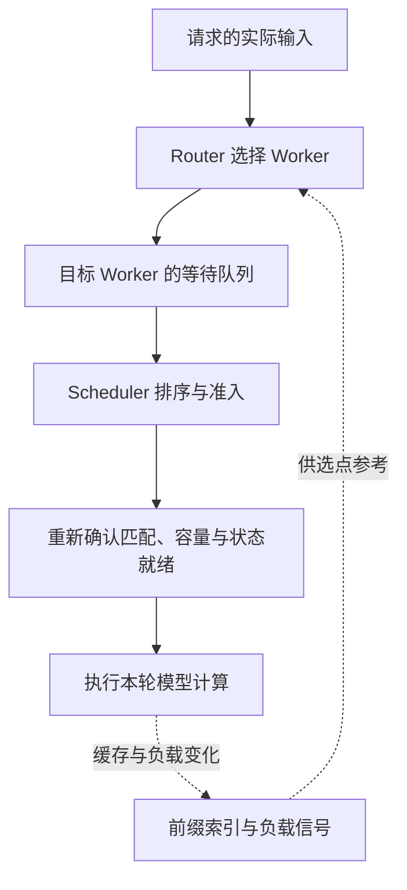
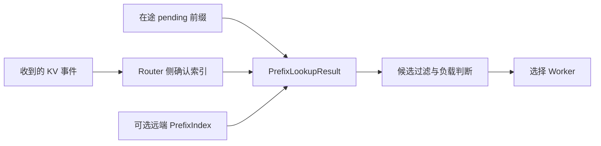

# 前缀亲和调度与缓存感知路由源码学习文档

一条请求有很长的缓存前缀，仍可能排队很久，也可能到了目标 Worker 才发现状态不足。要解释这些现象，必须分开两次选择：Router 决定把请求送到哪里；Worker 内的 Scheduler 决定本轮推进哪些请求。随后还有真正的匹配、分配与恢复。

本文是**源码分析型的跨系统学习资料**，核对 SGLang 实例内排序、当前 `sgl-router` 的候选生成，以及 Dynamo 固定版本的事件和预测模式。不依据索引名称做性能排名；没有启动集群或复现负载实验。

[本领域路线](README.md) · [先修：引擎与集群推理层](<推理引擎与集群推理层分工学习文档.md>) · [配套：Agent 暂停与 KV 保留](<../KV缓存/Agent 暂停与恢复时的 KV 保留与状态所有权学习文档.md>)

## 0. 固定源码与比较范围

| 项目 | SGLang / sgl-router | Dynamo |
| --- | --- | --- |
| 公开上游 | [sgl-project/sglang](https://github.com/sgl-project/sglang) | [ai-dynamo/dynamo](https://github.com/ai-dynamo/dynamo) |
| 分支或 tag | `main` 固定快照 | `v0.9.0` tag 对应提交 |
| commit | `074aeaf67499d06cc61300971fae90bcf4297670` | `76c1889aeb078219eb4fbd2b0c0fc21df75d8d0b` |
| 读取日期 | 2026-11-16 | 2026-11-16 |
| 工作区状态 | 按 commit 下载选定文件只读复核，未建立或修改上游检出 | 通过公开 tag 元数据固定 commit，再只读下载相关文件；未建立或修改上游检出 |
| 操作边界 | Worker 排序、Router 候选与前缀信号，不覆盖全部路由装配 | KV Router 的索引模式、选点及状态估计，不覆盖所有后端配置 |

Dynamo 选择 `v0.9.0` 是为了核对第三方文章实际引用的版本，不表示它是最新版本。两列日期与发布阶段不同，不能拿来排性能名次，也未验证它们与任意 vLLM/SGLang 后端组合兼容。Wiki 原有未提交内容保留。

资料入口为[《Sglang 和vllm深度比较：从kv cache展开到推理框架》][article]。结合全文和 8 张图阅读后，本篇只保留“缓存如何影响调度和选点”的学习问题，技术事实回到下表源码。图是整理者的控制关系示意，不是实际执行 trace。

### 术语速查

| 术语 | 人话解释 | 不能直接等同于 |
| --- | --- | --- |
| 实例内 Scheduler | 对本 Worker 的待执行请求排序、准入和分配 | 集群 Worker 选点 |
| LPM | 优先考虑匹配前缀更长的请求 | 永久保证命中更多或先到先服务 |
| Cache-aware Router | 把前缀复用信号与负载等信息用于选点 | 直接获得 Worker 的缓存锁 |
| Confirmed 前缀 | 根据已接收 KV 事件形成的索引记录 | 查询之后仍不可被驱逐的资源承诺 |
| Pending / prediction | 根据在途选择等信息估计将来的缓存位置 | 已完成计算并可立即读取的 KV |
| Indexer | 汇总缓存身份与位置的索引 | GPU KV allocator 或传输执行器 |
| Admission | 判断请求/候选能否进入下一步 | 已完成 forward |

## 1. 两次选择与最终恢复



**图意解读：** Router 的选择不能跳过 Worker 的准入和状态恢复。Worker 内 LPM 即使使用树匹配，也不能把已经到本机的请求自动搬到另一个 Worker；跨机迁移需要另外的实现。

| 决策 | 操作对象 | 典型输出 | 需要防止的误读 |
| --- | --- | --- | --- |
| Router 选点 | 候选 Worker / rank | 目标地址或 rank | 选中了就一定获得缓存 |
| Scheduler 排序 | 本 Worker 的 waiting 请求 | 本轮考虑顺序 | 排前面就一定准入成功 |
| 缓存匹配与恢复 | 当前实际状态及其位置 | 可用前缀、地址与恢复动作 | 索引命中就等于全部数据已就绪 |

这是整理者对固定接口的共同问题划分，不规定所有系统必须串行实现这三步。[S1][S3][D1]

## 2. SGLang Worker 内：LPM 在排什么

### 2.1 普通匹配与排序

`SchedulePolicy.calc_priority` 处理等待请求。缓存感知策略先计算匹配信息，再进入 LPM 或 DFS-weight 等排序；LPM 的 `_sort_by_longest_prefix` 根据 `num_matched_prefix_tokens` 排序，并可把暂时降权的请求放后。[S1][S2]

`_compute_prefix_matches` 还维护等待队列自身的临时树：若多条冷请求有共同前缀，可暂时让其中一些请求靠后，给前面的请求形成可复用缓存的机会。这不是“这些请求的 KV 已经由临时树算出来”。[S2]

**例子：** R1、R2 都匹配很少的已有缓存，但共享同一个长输入前缀。先推进一条，可能让后续请求复用它生成的稳定缓存；是否真的节省计算，仍取决于后续准入、缓存发布与资源压力。临时树只参与排序判断。

### 2.2 大队列中的回退与有界匹配

固定版本保留 `WAITING_QUEUE_PREFIX_MATCH_MAX=128`。`_determine_active_policy` 中，超过阈值的普通 LPM/HRRN 路径可回到 FCFS；但 `calc_priority` 之前还有 bounded-LPM 分支，满足竞争条件时在有界窗口中继续做局部匹配与排序。[S1]

因此，“队列超过 128，LPM 一定全部关闭”也不准确。要看配置、bounded 状态、门控和实际进入的分支。本篇不把这个实现阈值变成生产调优建议。

LPM、请求优先级、缓存驱逐优先级分别改变不同决策。源码中它们有不同分支，不能把几个开关列在一张表里，就视为任意组合均成立。

## 3. sgl-router 的候选与前缀信号

### 3.1 候选来自哪里

策略工厂的 `CacheAware` 分支创建 `CacheAwarePolicy`。[S0] 该策略的 `policies/cache_aware.rs::cache_candidate_proposal` 读取 `SelectionContext` 的 external prefix 结果，再把记录的地址与已注册 Worker URL 对齐。代码还限制匹配块数不能超过本次查询块数，按阈值过滤候选，并带上未命中 token 的估计。[S3]

这里的 external prefix 表示策略从上下文接收的索引结果，不自动意味着某一种远端服务。该仓库还保留 `policies_reorg/cache_aware.rs`，其中 `CacheSource` 明确区分本地 provider 和远端 `PrefixIndex`。[S4] 本篇分别记录这两处源码，不把重组模块的全部装配情况说成已运行验证。

### 3.2 事件记录与 pending 信号有不同确定程度

`RadixTreePrefixProvider.match_request_tokens` 先查树里的前缀深度，还可能读取 pending prefixes。返回对象单独记录 `pending_winners`，说明某些候选深度来自尚未成为 KV 事件确认结果的 stake。[S5]

这比“Router 维护一棵请求历史树”更具体：它会区分确认信息和在途估计。两者都仍是 Router 侧视图，不是把 Worker 内 UnifiedRadixCache 对象直接交给 Router 使用。



**图意解读：** 本图把已读的信号来源并列列出，不表示每次请求都同时启用全部来源。pending 信息不等于计算已完成；确认索引也可能落后于 Worker 的最新驱逐。

### 3.3 没有可用亲和候选时

在已读 `policies/cache_aware.rs` 分支中，亲和查询未启用或没有形成有效候选时，代码可转到带负载控制的 Power-of-Two Choices。形成缓存候选后还携带 shared prefill admission 所需的压力限制，不能只读候选初始排序就推断全部最终选择。[S3]

事件恢复也有失败边界：`index/fallback.rs` 的 gap 处理可以丢弃 snapshot graft、清理该 Worker 的索引状态，并按条件重试或回到较冷视图。[S6] 它修复的是 Router 的知识，不是在这里重建 GPU KV。

## 4. Dynamo v0.9.0：事件模式与预测模式共用选点主线

### 4.1 根据什么维护缓存地图

| 路径 | 固定源码行为 | 边界 |
| --- | --- | --- |
| `use_kv_events=true` | 创建索引并启动 KV event subscriber | 依赖事件接收与恢复，不能当作强一致资源锁 |
| `use_kv_events=false` | 为索引启用 TTL 与 pruning，并按实际路由选择记录预测位置 | TTL 是预测索引的过期机制，不是给引擎 KV 加了保留租约 |
| `overlap_score_weight=0` | 可不建立前缀索引 | 不应再假设每次选点都依赖前缀命中 |

这些分支直接见 `KvRouter::new`。[D1] 预测模式不是只在文件名中存在：`KvPushRouter::generate` 在非 query-only 且关闭 KV events 时调用 `process_routing_decision_for_request`，把路由选择反馈给索引。[D2]

`KvIndexer` 自己使用 RadixTree 来组织块哈希和 Worker 位置。[D3] 因此，不能把“有树”理解为 SGLang 独占，也不能把“预测模式”理解为 Dynamo 不支持。对照时应问：树维护什么身份、由什么事件更新、预测多久有效，以及它是否拥有真实资源。

### 4.2 索引如何参与选点

`find_best_match` 对输入 token 计算块哈希，取得各 Worker 的 overlap，再交给 scheduler。它返回 Worker/rank 和 overlap；这个调用不等于在 Worker 上取得一份可执行 KV。[D4]

固定版本的默认选择器使用预测负载，计算下列 score，较低者更有利；配置还可以改变权重或采样温度。[D5]

```text
score = overlap_score_weight × potential_prefill_blocks + decode_blocks
```

这不是毫秒估算，也不是本文提出的通用调优公式。`potential_prefill_blocks` 和 `decode_blocks` 是 scheduler 提供的候选负载估计，不能拿任意“队列长度”直接代入。

**教学算例：** 设权重为 1，预测器给 A 的两项为 4、40，给 B 的两项为 16、4，则 score 分别为 44、20。B 的新增 Prefill 更多，仍可能因为另一项负载较低而被选择。这个算例只演示代码里的权衡，不表示真实延迟下降了多少，也不等同于 SGLang Router 的实现公式。

## 5. 为什么估计命中了，Worker 仍会冷算

| 边界 | 可能发生什么 | 应保留的证据 |
| --- | --- | --- |
| 身份 | tokens、模型版本、adapter、salt 或块边界不一致 | 请求键、事件键、查询键及分块配置 |
| 时间 | 查询后发生驱逐，或预测比计算完成更早 | 查询、事件、实际 Worker 匹配的时间线 |
| 恢复 | 某个状态组缺检查点、窗口或可读副本 | 各状态组的恢复范围与动作 |
| 负载 | 持有最多缓存的 Worker 已拥塞或不满足准入 | 候选负载、过滤原因和最终选择 |
| 传输 | 其他层有副本，但尚未完成加载或无法接入 | 后端能力、完成事件、实际可见性 |

这些是由上述接口边界整理出的诊断方向，不是本次复现的故障。特别是 namespace 与多模态等字段，必须核对目标实现的实际支持，不能只从这张表推导完整隔离保证。进一步见[缓存 Salt 全链路键空间](<../KV缓存/KV Cache Salt 全链路键空间学习文档.md>)和[前缀恢复条件](<../KV缓存/前缀缓存命中后的恢复条件与状态所有权对比学习文档.md>)。

## 6. 同一条请求的排查顺序

先固定请求输入、模型/adapter/版本及路由条件，再沿四个观察点追踪：

1. **Router 查询时：** 选点使用确认事件、pending 还是预测？看到了哪些候选？
2. **Router 决策时：** 谁因负载、健康或准入被过滤？选中谁？
3. **Worker 准入时：** 实际可恢复前缀多长？是否需要回载、COW 或重新计算？
4. **执行与完成时：** 真正执行了多少工作？资源何时释放，索引何时获知变化？

只有把这些观察点连起来，才能解释命中率、TTFT 和系统负载。Router overlap 高、Worker 真正免算多、端到端更快，是三个不同判断，不能用一个数互相替代。

建议按 `[S1] → [S3] → [S5] → [D1] → [D4] → [D5]` 阅读；先确定谁在选什么，再看索引更新和压力分支。自测：预测索引的 TTL 为什么不是 KV Pin？同样有 RadixTree，为什么 Router 与 Worker 仍要分别管理正确性和资源？

## 7. 与仓内既有比较的关系

[SGLang 与 vLLM V1 架构差异](<../推理基础/SGLang 与 vLLM V1 架构差异源码学习文档.md>)保留自己的引擎快照；本文补足跨实例选点，不据此改写旧版进程图。[引擎与集群推理层分工](<推理引擎与集群推理层分工学习文档.md>)保留通用分层模型；本文用具体源码展示索引信号与选点方式。Agent 软引用、保留意图及跨层恢复另见[配套文档](<../KV缓存/Agent 暂停与恢复时的 KV 保留与状态所有权学习文档.md>)。

## 8. 固定源码索引

| 标记 | 对应行为 |
| --- | --- |
| S0 | [CacheAware 策略工厂][S0] |
| S1 / S2 | [排序主线与大队列分支][S1]、[匹配及 LPM 排序][S2] |
| S3 / S4 | [缓存候选及回退][S3]、[重组模块的本地/远端来源][S4] |
| S5 / S6 | [确认与 pending 信号][S5]、[索引 bootstrap/gap 回退][S6] |
| D1 / D2 | [事件模式与预测模式初始化][D1]、[记录预测路由选择][D2] |
| D3 / D4 / D5 | [Radix 索引][D3]、[查询与选点交接][D4]、[默认负载 score][D5] |

[article]: https://zhuanlan.zhihu.com/p/2082926853241696898
[S0]: https://github.com/sgl-project/sglang/blob/074aeaf67499d06cc61300971fae90bcf4297670/sgl-router/src/policies/factory.rs#L103
[S1]: https://github.com/sgl-project/sglang/blob/074aeaf67499d06cc61300971fae90bcf4297670/python/sglang/srt/managers/schedule_policy.py#L236
[S2]: https://github.com/sgl-project/sglang/blob/074aeaf67499d06cc61300971fae90bcf4297670/python/sglang/srt/managers/schedule_policy.py#L539
[S3]: https://github.com/sgl-project/sglang/blob/074aeaf67499d06cc61300971fae90bcf4297670/sgl-router/src/policies/cache_aware.rs#L28
[S4]: https://github.com/sgl-project/sglang/blob/074aeaf67499d06cc61300971fae90bcf4297670/sgl-router/src/policies_reorg/cache_aware.rs#L34
[S5]: https://github.com/sgl-project/sglang/blob/074aeaf67499d06cc61300971fae90bcf4297670/sgl-router/src/state/kv_events/prefix_provider.rs#L55
[S6]: https://github.com/sgl-project/sglang/blob/074aeaf67499d06cc61300971fae90bcf4297670/sgl-router/src/state/kv_events/index/fallback.rs#L75
[D1]: https://github.com/ai-dynamo/dynamo/blob/76c1889aeb078219eb4fbd2b0c0fc21df75d8d0b/lib/llm/src/kv_router.rs#L360
[D2]: https://github.com/ai-dynamo/dynamo/blob/76c1889aeb078219eb4fbd2b0c0fc21df75d8d0b/lib/llm/src/kv_router.rs#L906
[D3]: https://github.com/ai-dynamo/dynamo/blob/76c1889aeb078219eb4fbd2b0c0fc21df75d8d0b/lib/llm/src/kv_router/indexer.rs#L207
[D4]: https://github.com/ai-dynamo/dynamo/blob/76c1889aeb078219eb4fbd2b0c0fc21df75d8d0b/lib/llm/src/kv_router.rs#L503
[D5]: https://github.com/ai-dynamo/dynamo/blob/76c1889aeb078219eb4fbd2b0c0fc21df75d8d0b/lib/llm/src/kv_router/scheduler.rs#L489
