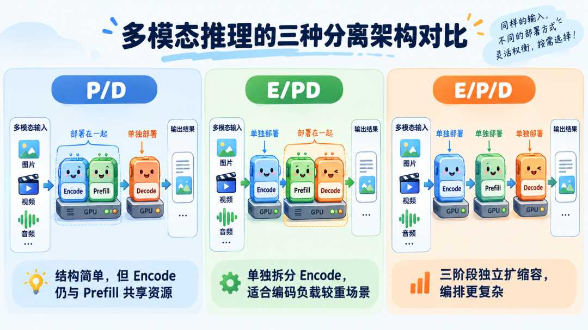
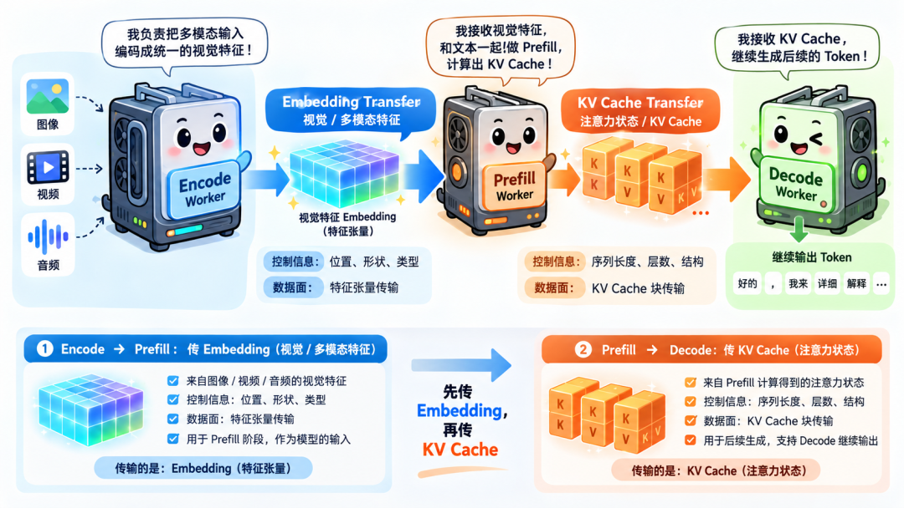
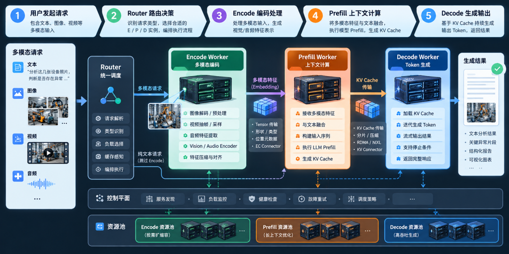
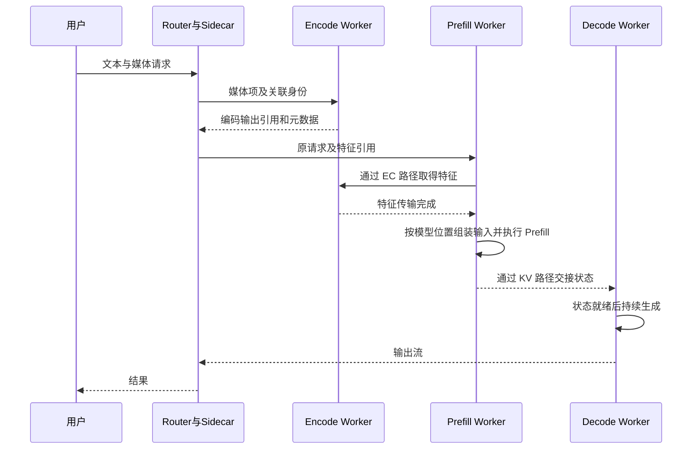

# 多模态 Encode 分离与 EPD 状态交接学习文档

多模态请求在处理文本上下文前，常常还要解码媒体、抽帧并运行视觉或音频编码器。把 Prefill 与 Decode 拆开，只处理了部分资源竞争；是否继续拆 Encode，要看媒体处理、特征传输和下游排队的总成本。

本文属于**第三方资料整理型学习资料**，以原文建立问题地图，对照 vLLM 与 llm-d 官方文档。没有部署 E/P/D、测试异构设备或复现性能；图和算例用于理解数据与生命周期。

## 0. 阅读基线与范围

| 项目 | 内容 |
| --- | --- |
| 原文标题 | PD 分离还不够：多模态推理为什么开始拆分 Encode？ |
| 原文链接 | [公众号原文](https://mp.weixin.qq.com/s/k9nZgwRBY_tYAe6oRG4txg) |
| 作者 | 张量叙事 |
| 发布时间 | 2026-10-12 08:05:00，Asia/Shanghai |
| 读取时间 | 2026-10-14 |
| 一手资料基线 | vLLM v0.30.0 文档；llm-d `df38ab3fabf16f893d4614c6013824f087ad5c1f`；llm-d-router `907c5fe84769a8f8e80ece112fd419dc6313453e` 的公开文档 |
| 整理范围 | E/PD、E/P/D 拓扑，EC 与 KV 交接、缓存身份、请求编排、性能判断 |
| 不展开 | 全模态生成调度、每个模型的融合层实现、生产容量结论 |
| 配图 | 检查原文 7 图，保留正文 6 图；题图重复信息省略；[来源与原文件哈希](../../images/multimodal-encode/SOURCES.md) |

先修：[引擎与集群推理层分工](<推理引擎与集群推理层分工学习文档.md>)。不熟悉视觉 token 时先读 [从 ViT 到 Omni](<../模型架构/从 ViT 到 Omni 的多模态表示与生成路线学习文档.md>)。

| 术语 | 人话解释 | 数据是什么 |
| --- | --- | --- |
| 预处理 | 下载、解码、抽帧、缩放和整理媒体 | 像素、采样点、patch 及位置元数据 |
| Encode | 运行模态编码网络 | 视觉或音频特征 |
| EC | Encoder Cache，编码器结果缓存 | embedding 等模型输入表示 |
| Prefill | 语言模型处理整段上下文 | 每层 KV 或其他模型状态 |
| Decode | 基于历史继续生成 | 输出 token 与持续增长/更新的状态 |
| Connector | 定义交接与完成通知的接口 | 能搬数据，不等于决定全局路由 |

## 1. E、P、D 到底分别做什么

**图意解读：** 原始媒体先变成模型可消费的表示，随后语言模型处理上下文并生成结果。图中把“LLM”和“Prefill”画成相邻工位，仅用来解释处理层次；**Prefill 与 Decode 本身就在执行语言模型**，不是在 Prefill 前还必经一次独立的“LLM 服务”。

以一条“比较两张设备照片”的请求为例：媒体读取器得到两张图；预处理保留裁剪顺序；视觉编码器得到特征；投影/合并模块把表示对齐到语言模型接口；Prefill 根据文本和图片位置建立状态；Decode 生成报告。具体投影在哪一侧执行取决于模型与实现，不能只看名字划分进程。

原始图片字节、编码器 patch 数和最终送入语言模型的 token 数是三个量。压缩或合并可能让它们不成比例；“文本只有十个 token”并不说明这个请求很轻。

## 2. 为什么先定位瓶颈，再选拓扑

**图意解读：** 左侧的媒体编码与文本 Prefill 竞争同一实例资源；右侧表示媒体较少时的另一种负载。图中 95% 和 40% 没有模型、硬件、测量方法和测试结果支撑，属于原文示意数字，不能用于容量规划。GPU 利用率也不能单独解释 TTFT。

CPU 图像解码慢、GPU 编码慢、语言模型 Prefill 慢，分别对应不同干预点。拆视觉编码 GPU 不能直接解决媒体下载排队；多加 Prefill 也可能只是在等待编码输出。

**图意解读：** 斜杠表示部署边界，不是数学除法。P/D 的多模态实现常为 EP/D；E/PD 只拆编码；E/P/D 则使三个阶段可分别配置。图中的音频/视频图标是逻辑说明，不证明每个引擎、模型、后端都支持所有模态。

| 拓扑 | 什么可独立扩容 | 新增的数据交接 | 常见阅读场景 |
| --- | --- | --- | --- |
| EP/D | Decode 与输入处理 | P→D 状态 | 编码成本尚可、主要关注 P/D 干扰 |
| E/PD | Encode 与完整语言模型 | E→PD 特征 | 编码明显占用资源，尚无拆 P/D 需求 |
| E/P/D | 三个阶段 | E→P 特征和 P→D 状态 | 两种资源竞争都值得独立处理 |

纯文本请求可以绕过独立 E。对于没有独立视觉编码器的模型，或者生成图像/音频的复杂输出链，不能直接照搬本篇输入侧 E→P→D 分解。

## 3. 两次交接，两个身份与生命周期

**图意解读：** E→P 搬的是输入特征；P→D 搬的是执行上下文后的注意力等状态。两者即使共享传输库，也有不同的键、布局、位置映射和可回收条件。“知道一块内存在哪里”不等于已经拥有其长期生命周期。

| 对象 | 身份至少关联什么 | 何时消费 | 回收边界 |
| --- | --- | --- | --- |
| 媒体/预处理结果 | 内容、裁剪、采样与预处理版本 | 编码器读取 | 本次或复用策略不再需要时 |
| EC 特征 | 编码器权重、预处理、内容、dtype/布局及必要位置配置 | 下游构造多模态输入 | 读取完成且缓存策略允许释放时 |
| LLM 状态 | 模型、完整上下文与位置、布局和适配版本 | Decode 继续计算 | 请求引用、缓存引用和在途写入都满足释放条件时 |

这张表是**整理者归纳的接口检查问题**，不声称所有实现已经采用同一种缓存键。尤其是同一图片用于不同文本上下文时，图像特征可能可复用，但语言模型 KV 不一定可复用。

### 一个可复算的传输账本

若编码结果为 `[N, H] = [4096, 4096]`，每元素 2 字节：

`S_EC = N × H × 2 = 33,554,432 bytes = 32 MiB`。

在有效带宽假设为 10 GiB/s 时，仅这块数据的理想搬运下界约为 `32 / 10240 s = 3.125 ms`。这是教学假设，未包括排队、控制往返、序列化、内存注册和额外拷贝，也不是任何模型的实测延迟。EC 可能经过 CPU 缓冲区；不能从“使用 NIXL”推导为 GPU 直达或零拷贝。

一个请求有多个媒体项时，必须保留项目身份、顺序、张量 shape/dtype、位置或网格信息。否则“数值传对了”仍可能被拼到错误的输入位置。

## 4. 请求怎么走，控制消息由谁发

**图意解读：** Router 负责选择执行位置，Worker 负责模型计算，Connector 负责交接。原图底部的资源池与控制平面表示职责，不是本文已部署的一套系统，也不能把图上缓存感知和自动扩缩容全部视为默认已实现。

下面是根据 llm-d 文档整理的 **vLLM 参考路径**，省略端口和协议细节：

**图意解读：** 箭头表达依赖，不意味着控制请求一定 Prefill-first；真实路由可先选择 Decode，再由 Sidecar 编排。EC 完成与 KV 就绪是两个门槛；请求取消时，两条通道各自需要完成通知和资源收尾。

### 截至本次读取的实现边界

| 来源 | 本次确认内容 | 不能据此断言 |
| --- | --- | --- |
| [vLLM v0.30.0 Disaggregated Encoder](https://docs.vllm.ai/en/v0.30.0/features/disagg_encoder/) | ECConnector 区分 scheduler/worker 职责；提供 E/PD、E/P/D 参考 | 示例 Connector 就是任意生产网络方案 |
| [llm-d 固定版本指南](https://github.com/llm-d/llm-d/blob/df38ab3fabf16f893d4614c6013824f087ad5c1f/guides/multimodal-serving/e-disaggregation/README.md) | vLLM 参考使用 ECCPU Connector、ZMQ 控制面、NIXL 数据面；列 v0.30.0、V2 runner 和 P2P NIXL 配置要求 | 旧版设置相同参数就发生远程特征复用 |
| 同一指南中的 SGLang E/PD | Router 选择 PD Worker，由 PD Worker 向静态配置的 Encode 端点分派；列 XPU Encode + GPU PD profile | 它与 vLLM Sidecar 路径完全一样，或已验证任意异构硬件 |
| [llm-d-router 固定文档](https://github.com/llm-d/llm-d-router/blob/907c5fe84769a8f8e80ece112fd419dc6313453e/docs/disaggregation.md) | `always-disagg-multimodal-decider` 根据媒体内容激活 E；文本绕过 E；Encode 路径标为 PoC | 完整的成本预测、缓存一致性、最优调度已经实现 |

指南特别说明，较早版本可能忽略 P2P NIXL 配置、下游重新编码而请求仍成功。因此“能回答图片问题”不是远程 EC 传输生效的充分证据。本文只读了资料，没有运行其中的部署命令。

## 5. 用端到端账本判断收益

**图意解读：** 多图、长上下文、长输出分别可能增加 E、P、D 压力。底部反馈闭环是规划方向，不能把它当作官方默认自动调度算法；扩容也不能消除下游接收缓冲区不足或网络争用。

整理者的串行近似账本为：

`TTFT ≈ 媒体获取/预处理 + 各阶段排队 + Encode + EC交接 + Prefill + KV交接 + 首输出所需后续计算`。

具体系统可能重叠这些项，首 token 也可能在 Prefill 产生，所以测量时必须定义起止点，不能把上式当作精确相加的 profiler 结果。拆分的潜在收益来自竞争减少、独立批处理和复用；新增成本来自传输、编排、缓存未命中及故障收尾。

| 现象 | 需要区分的原因 | 有用证据 |
| --- | --- | --- |
| 文本短但 TTFT 高 | CPU 预处理、E 排队或 P 排队 | 分阶段时间戳，而非 text token 数 |
| 加 Encode 节点无收益 | P、D、网络或共享存储成瓶颈 | 各队列长度及接收等待 |
| HTTP 成功但 Encode 仍重复 | 参数未生效、缓存键不匹配或回退 | 生产/消费端同一媒体身份、实际传输日志 |
| 同一图片复用后答案异常 | 预处理版本、位置和顺序不一致 | 缓存键、模型 revision、grid/position 元数据 |
| 取消后 buffer 不归还 | 在途读写与租约/引用未收尾 | 各通道完成通知和所有者状态 |

## 6. 自测与延伸

先用自己的话区分原始媒体、EC 特征和 LLM KV；再画一条纯文本绕过 E、图片请求经过 E 的路径。最后回答：即便 EC 与 KV 都使用 NIXL，为什么两者的就绪和回收条件仍不同？

继续阅读 [RDMA、IB 与 GPU 可见性](<P-D 分离的 RDMA、IB 与 GPU 可见性学习文档.md>)、[vLLM Connector 地图](<../../vllm/分离部署/vLLM V1 KV Connector 架构与实现地图源码学习文档.md>)。本篇新增的是输入表示交接这一层，其他文档仍以各自基线为准。
