# SGLang 与 vLLM V1 架构差异源码学习文档

本文面向已经知道 Prefill、Decode 和 KV Cache，但还不能把它们放回推理引擎架构的读者。我们沿同一条请求回答：**请求由谁接收、谁决定下一轮计算、工作怎样交给 GPU、消息怎样跨进程传递、结果和资源最后由谁收尾？**

这是**源码分析型的跨引擎学习资料**，以两个公开上游的固定提交为依据，并参考作者讲义与官方设计文档。架构图、对象对应表和例子是整理者归纳；没有运行模型、复现性能或验证所有部署组合。

[本领域阅读路线](README.md) · [先修：推理系统心智模型](<LLM 推理系统心智模型与 SGLang、vLLM 选型边界学习文档.md>) · [先修：Prefill 与 Decode](<LLM Prefill 与 Decode 阶段源码学习文档.md>)

阅读建议：第 1–4 节建立进程与通信地图，第 5–7 节解释调度、缓存与扩展，第 8 节比较结束、压力、取消、图捕获、停止字符串和延迟指标。公众号文章《LLM推理引擎解剖:vLLM与SGLang的五层进程切分》的有效增量已按这些问题融入正文，来源与独立版本边界见第 0.5 节。

## 0. 固定基线、比较范围与术语

### 0.1 源码基线

| 项目 | SGLang | vLLM |
| --- | --- | --- |
| 公开仓库 | [sgl-project/sglang](https://github.com/sgl-project/sglang) | [vllm-project/vllm](https://github.com/vllm-project/vllm) |
| 分支语境 | 官方 `main` 固定快照 | 官方 `main` 固定快照，研究 V1 引擎 |
| commit | `a16830deb5ea5b1e8c9874ad646f3ba95542191c` | `9a56d4fec6b0a30a0a989f1cd06cd3c2f7325619` |
| 读取日期 | 2026-11-04 | 2026-11-04 |
| 工作区状态 | 按固定提交下载相关文件只读核对，未建立或修改源码检出 | 按固定提交下载相关文件只读核对，未建立可运行检出 |
| 操作边界 | 启动、调度、执行接口、消息通路及缓存接口的静态分析 | 前端、EngineCore、执行器、消息通路及 KV Connector 的静态分析 |

Wiki 工作区已有未提交改动；本篇及关联引用在保留这些改动的基础上整理。上表是两个独立源码快照，不能与仓内其他文章的 commit 合并成一个“当前实现”。主基线的官方在线文档读取于 2026-11-04；第 0.5 节的文章与指标补充读取于 2026-11-13，未固定版本的在线说明单独标识。

### 0.2 把比较条件固定下来

主图采用：**普通 Python HTTP 文本生成服务、一个模型实例、单节点两张 CUDA GPU、TP=2、PP=1、DP=1、单 tokenizer 和单 detokenizer、vLLM 多进程执行器**。先不加入投机、多模态、HiCache 或 PD；后文将这些作为独立扩展。

这是源码教学拓扑，不是本次实际启动的配置。Rust 服务入口、Ray、非 CUDA 平台、多前端、多 detokenizer、DP Attention 与 PP 会改变装配或通信路径，应另外检查。本文不提供可照抄的生产参数组合，也不根据进程数或算法名称给出性能排名。

### 0.3 术语速查

| 术语 | 人话解释 | 读图时注意 |
| --- | --- | --- |
| 模块 / 对象 | 代码里的一组职责或一个实例 | 一个进程可以包含很多对象 |
| 进程 | 操作系统单独管理的一份程序运行环境 | 跨进程需要通信，普通方法调用不一定跨进程 |
| 模型实例 / 副本 | 合起来完成一份模型推理的服务单元 | TP=2 是两卡协作，不是两个完整模型副本 |
| rank | 并行协作中的参与者编号 | TP、PP、DP 的编号含义不同 |
| Scheduler | 决定本轮哪些请求推进多少工作 | 不等于实际执行 Attention 的 GPU kernel |
| Worker / ModelRunner | 管执行环境、准备本轮输入并调用模型 | 名字叫 Worker 不保证它另占一个进程 |
| IPC | 进程间通信 | 可经本机 socket、共享内存等方式完成 |
| ZMQ / ZeroMQ | 提供异步消息模式的通信库 | 不等于 TCP，不等于 RDMA，也不规定消息内容 |
| 序列化 | 把对象编码成另一端能解码的字节 | MsgPack 与 pickle 是编码方案，不是网络传输方式 |
| collective | 多个 rank 一起参与的通信操作，如 all-reduce | 必须按同一协议推进，不能当普通消息队列使用 |
| KV Connector / transfer backend | 把外部 KV 接入执行流程的接口 / 实际搬运实现 | 控制消息完成与 KV 可被 GPU 使用是不同条件 |

### 0.4 怎样使用离线对照台这份补充资料

本篇另复核了用户提供的 **《推理引擎对照台 · 本地离线版》（Inference Engine Atlas）**，包名 `inference-atlas-offline.zip`，内含 `index.html`、说明和许可；页面自署 DeepSeek Harness 插件 `@local/dsh-inference-atlas`，构建日期为 2026-11-04，未提供公开发布地址。文件指纹、原始画面与许可见 [图源记录][A1]。

包内声明的基线是 SGLang `v0.5.23` 与 vLLM 展示版本 `v0.33.0` / tag `v0.33.0rc3`。本篇**借鉴它的问题组织与对照方法，技术结论仍逐项回到第 0.1 节的固定 commit**，不把 release tag、在线文档和 `main` 快照合并成同一个版本，也不沿用“最新正式版”的称呼。

快速阅读时，先看第 1.4 节的差异地图，再选第 4 节通信、第 6 节缓存或第 8 节具体场景。每次对照按同一顺序读：**共同问题 → 两边的控制者和动作 → 真正的分叉点 → 完成条件与限制**。图中的步骤表示因果，不表示耗时或速度排名。

### 0.5 五层进程切分文章及补充复核基线

| 项目 | 内容 |
| --- | --- |
| 公众号原文 | [LLM推理引擎解剖:vLLM与SGLang的五层进程切分][W1]；AI圈的9527；2026-11-13 07:45（Asia/Shanghai，页面 `ct` 时间戳） |
| 英文来源 | Aditya Kumar，[Anatomy of an LLM Serving Engine][B3]；2026-10-28 发布，2026-11-01 更新；页面标注 CC BY 4.0 |
| 阅读时间与范围 | 2026-11-13；完整阅读正文、唯一一张技术图与英文来源，吸收职责划分、内存口径和测量问题；不重复搬入整篇摘要 |
| vLLM 补充基线 | 公开上游 `v0.32.0` 版本语境，固定 commit `5df63a7203cdb9328d824a27b682e77c7b9928be` |
| SGLang 补充基线 | 公开上游 `v0.5.22` 版本语境，固定 commit `baa9befa381511cd4d56f83980951e5a45fffc6d` |
| 工作区与操作边界 | 按固定提交下载相关文件，只读复核，未建立或修改外部源码检出；Wiki 已有改动保留；未启动模型、运行作者测量脚本或进行 GPU 性能实验 |
| 使用位置 | 第 1.3、2.1、4.4、6.3、8.5–8.7、9.5 节明确标识的补充内容；源码引用使用 `M` 前缀，与主基线引用分开 |

原图见第 9.5 节及[图源记录][A2]。文章本身属于第三方资料；下文的补充源码复核和算例由整理者完成。**两组 commit 不合并为同一个“当前实现”**，原作者的架构偏好和未实测预测也不改写成性能结论。指标对齐限定普通 Python 文本服务、单请求 `n=1`、非 PD，先排除投机、重试与中途取消，再单独讨论边界。

## 1. 先建立整体地图：谁与谁住在一个进程里

### 1.1 人话版

两者都要做接待、安排工作、执行模型、输出结果。主要差异在于这些职责怎样分组：

- **vLLM V1**：前端把请求交给 EngineCore；EngineCore 内的 Scheduler 制定计划，Executor 把计划交给 GPU Workers。
- **SGLang SRT**：前端把请求交给模型 rank；每个 rank 的进程内同时有 Scheduler 和模型执行链，输出经过独立 Detokenizer 返回前端。

SGLang 的多个 Scheduler 通过同步输入与 rank 协同推进工作，不能理解成每张 GPU 自己随意选择不同请求。[S1]、[S2]、[S3] vLLM 的 Scheduler 与 GPU Workers 在本篇多进程路径中分离；每个 DP rank 有自己的 EngineCore，并非整个集群只有一个调度器。[V1]、[V2]

### 1.2 同条件架构对照图

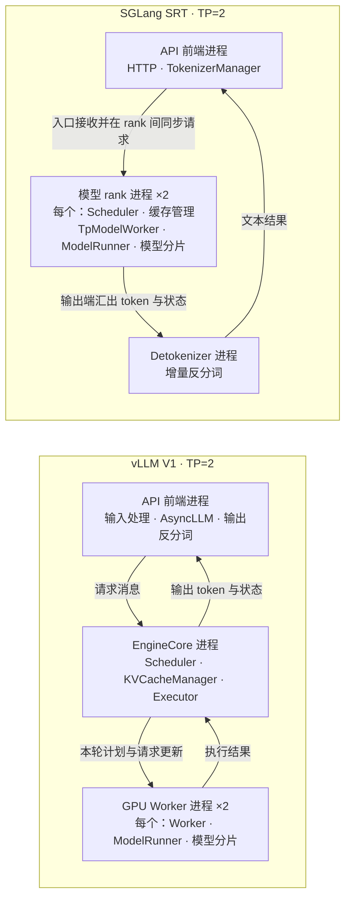

**图意解读：** 大外框是一份模型实例，内框是进程角色；`×2` 合画了两个 rank 进程。框内的类名是同进程对象，GPU 是这些进程使用的设备资源。图省略了 TP 张量通信、启动握手和监控通路；箭头不表示每一步都要等上一条请求全部结束。真实通信模式见第 4 节。

源码依据：SGLang 的 `Engine._launch_scheduler_processes` 按 rank 创建进程，Scheduler 构造 `TpModelWorker`，Worker 再持有 `ModelRunner`；vLLM 的 EngineCore 构造 Executor，`MultiprocExecutor` 启动并调用 Workers。[S1]、[S2]、[S4]、[V2]、[V3]

### 1.3 单卡与扩展模式为什么要另看

vLLM 的 `UniProcExecutor` 直接创建 `driver_worker` 对象，不能用上图断言单卡必然另起一个 GPU Worker 进程。[V4] SGLang 的多 detokenizer 模式会增加 worker 和路由进程；图中的单 detokenizer 只是本篇选定条件。[S1]

**小例子：** 从 SGLang 的 `Scheduler.run_batch` 跟进 Worker，在本篇条件下是本地方法调用；从 vLLM EngineCore 跟进多进程 Executor，则会遇到工作队列与远端执行入口。排查“这一层为什么慢”时，先判断它是本地调用、跨进程消息，还是设备通信。

**文章补充基线：** 在单 API、DP=1、PP=1、SGLang 单 detokenizer 的普通 Python 服务中，原文给出的主要服务进程数是 vLLM 的 TP=1/2 对应 2/4，SGLang 对应 3/4。vLLM 的单卡 `uni` 默认选择还有“未显式指定执行后端”的条件。[MVP][MSE] 这些是选定角色的计数，不是任意部署的 `ps` 结果。TP 从 1 改为 2 可能同时改变进程拓扑；单卡 CPU profile 没有测到多进程 Executor 的工作通路，也不能把多卡新增时间全部归为 IPC。

### 1.4 把差异落到共同问题

只记住“RadixAttention 对 PagedAttention”容易漏掉整个运行时。下面按同一个问题对齐，两边都有的能力直接说明共同点。

| 共同问题 | SGLang 的阅读主线 | vLLM V1 的阅读主线 | 真正要比较什么 |
| --- | --- | --- | --- |
| 请求交给谁？ | 前端 → Scheduler 所在模型 rank | 前端 → EngineCore → Executor / Worker | 调度和执行是否同进程；第 1–3 节 |
| 结果在哪里变成文字？ | Scheduler → 独立 Detokenizer → 前端 | EngineCore → 前端输出处理 | 反分词的进程归属和回程；第 4 节 |
| 每轮工作怎样表达？ | Req 集合、ScheduleBatch、extend / decode 准备 | token 进度、预算、SchedulerOutput 增量 | 准入条件和执行接口；两边都有预算与缓存约束，第 5 节 |
| 缓存怎样找、怎样放？ | Radix 路径 + 请求到 KV 位置的映射 | block hash + 请求 block table | 查找索引、物理分配、恢复条件，不能由树/块名称推断命中率；第 6 节 |
| 已完成、放不下或取消后怎么办？ | 结果收尾、cache checkpoint、retraction、分状态 abort | finish/free、block 引用、preemption、延迟释放 | 谁结束请求，谁仍持有资源；第 8 节 |
| 怎样接入更多执行和存储能力？ | overlap、Runner/Backend、HiCache、PD 角色循环 | async scheduling、graph mode、KV Connector 两侧契约 | 接口与状态放在哪里，不能据此断言对方缺少同类能力；第 7、8 节 |
| 延迟数字能否直接对照？ | TM、Scheduler、客户端分别记录；流式和非流式还有分支 | 前端接收计时、核心事件与客户端计时分开 | 起止事件、记录条件和样本权重；第 8.6–8.7 节按补充基线核对 |

**读图提示：** 同一颜色只标识同一引擎或同类状态；一个框是否跨进程要看外框和说明。把“谁持有状态”与“通过什么线传数据”分开，就能把差异变成可追踪的代码问题，而不是功能标签。

## 2. 模块对应：名字相近，不代表职责完全相同

| 要解决的问题 | vLLM V1 的主要入口 | SGLang SRT 的主要入口 | 对应关系的边界 |
| --- | --- | --- | --- |
| 接住 HTTP 请求并关联返回流 | API 层、`AsyncLLM`、输入/输出处理 | HTTP 层、`TokenizerManager` | 都有前端请求状态；不是 Scheduler 内部请求对象本身 |
| 驱动逐轮计算 | `EngineCore` 调用 Scheduler 与 Executor | `Scheduler` 的普通或 overlap event loop | SGLang 没有必要找一个同名 EngineCore 才能理解主循环 |
| 决定下一轮做什么 | `Scheduler.schedule` 产生 `SchedulerOutput` | `get_next_batch_to_run` 产生选批计划，使用 `ScheduleBatch` | 计划和模型张量不是同一个层次 |
| 组织模型执行 | Executor → Worker → ModelRunner | Scheduler → TpModelWorker → ModelRunner | 本篇路径的进程边界不同 |
| 管理本地 KV | KVCacheManager、各状态类型管理器、BlockPool | 前缀 cache、请求映射、KV allocator / pool | 都需要区分索引、分配和物理数据 |
| 把 token 变回文本 | 前端 OutputProcessor / detokenizer | 独立 DetokenizerManager，再回 TokenizerManager | 输出工作被放在不同进程位置 |
| 接入外部 KV | Scheduler 侧与 Worker 侧 KV Connector | HiCache 控制链；PD 专用队列、循环和 backend | HiCache 与 PD 不是同一条状态机 |

本表是职责映射，不是一一对应的类继承图。vLLM 的 EngineCore、SGLang 的 Scheduler 都承担多项协调工作；对象名称不足以判断控制权。[V2]、[V5]、[V6]、[S2]、[S5]、[S6]

### 2.1 五层职责怎样映射到两种进程切分

原作者把一层理解为“某项决策及其所需状态”。这个视角补充了上面的对象对应表，但不是要求所有系统部署五个进程。[B3]

| 职责 | 要回答的问题 | 对应到两种引擎时的重点 |
| --- | --- | --- |
| L1 前端 | 怎样把协议和文本变成输入，再组织输出？ | vLLM 的普通输出反分词在前端；SGLang 的前端职责分布于 Tokenizer、Detokenizer 等对象 |
| L2 调度 | 本轮让谁推进多少工作？ | vLLM 的 EngineCore 调度计划与 SGLang 的各 rank 本地调度，需要不同的协同方式 |
| L3 KV 管理 | 哪些位置属于谁、可否复用或回收？ | 账本、索引、引用与空闲位置，不等于物理数据本体 |
| L4 执行 | 怎样准备输入并执行模型？ | 持有模型分片、KV 字节及执行资源；同进程调用也可能产生设备同步 |
| L5 集群路由 | 把请求交给哪个服务副本？ | llm-d、Model Gateway 是原文举例，不是引擎必需或唯一的部署组件 |

**分叉点：** 请求准入要参考 KV 容量，所以 L2 和 L3 紧密关联；但物理 KV 位于 Worker，并不让 Worker 自动获得请求分配与回收策略。原文“Worker 只存字节”适合强调管理权，不能按字面理解成 Worker 不再进行显存 profile、资源准备或计算。[MVM]

同理，“每个 SGLang TP rank 跑完整引擎”是指调度、管理和执行链在各 rank 进程中装配；模型与 KV 仍按并行方式分片，不是每卡一个独立完整副本。原文关于无序集合或墙钟策略破坏 rank 一致性的论述是开发风险分析，不能当成已复现的故障或两种引擎的胜负依据。

## 3. 沿一条请求走完整个闭环

### 3.1 普通生成请求 R1

假设 R1 输入一段文字，最终生成两个输出 token；未命中前缀缓存，没有抢占、取消或投机。下面只列因果顺序，**不是耗时图或实测 Trace**。

| 阶段 | vLLM V1 | SGLang SRT |
| --- | --- | --- |
| 1. 接入 | 前端处理输入、建立请求及输出关联，向 EngineCore 发请求 | TokenizerManager 处理输入、记录请求状态，向 Scheduler 发消息 |
| 2. 接纳 | Scheduler 检查等待请求、本轮额度和 KV 条件 | Scheduler 接收并同步输入，建立内部请求，按准入条件组织 batch |
| 3. 首次计算 | SchedulerOutput 描述本轮工作，Executor 驱动 Workers | ScheduleBatch 交给 Worker，构造 ForwardBatch 后调用 Runner |
| 4. 首 token | 执行结果回到调度侧，输出进入前端处理 | Scheduler 处理结果，输出 token 交给 Detokenizer，再回前端 |
| 5. 继续生成 | 未完成请求在下一轮取得计算额度 | 请求继续参与 running batch 等后续调度 |
| 6. 结束 | 推进完成状态、返回最终结果，并依缓存引用和传输条件处理资源 | 推进完成状态、返回结果，并依缓存保护和传输条件处理资源 |

**读表提示：** Prefill 的结果可以直接产生首 token，不要额外画一次必须发生的 Decode 才能输出首字。请求横跨很多轮；本轮 batch 或执行计划结束，也不等于整个请求结束。两者的入口与结果主线见 [S2]、[S4]、[S5]、[S6]、[V2]、[V5]、[V6]。

### 3.2 三个“完成”要分清

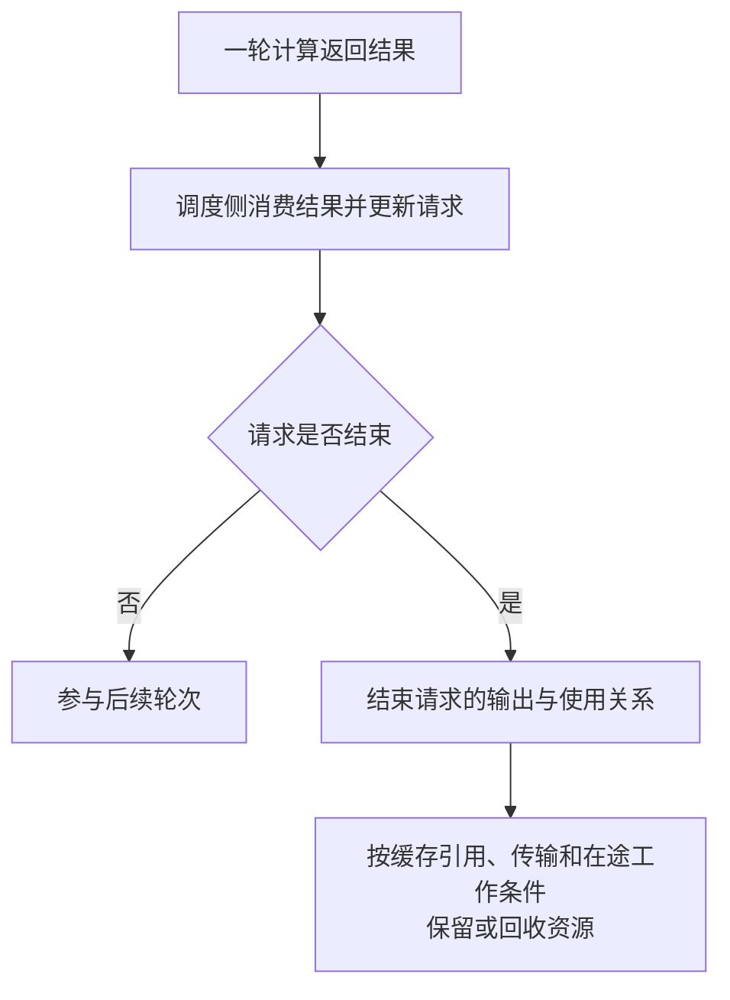

**图意解读：** 这是共同的生命周期教学模型，不是两套源码共享的一组枚举。一次消息发送完成、一次模型调用返回、一个请求结束、其所有物理 KV 可回收，是不同事件。可复用前缀可能在请求结束后保留；异步传输或在途执行也可能限制释放。完整资源条件继续读 [前缀缓存恢复与状态所有权](<../KV缓存/前缀缓存命中后的恢复条件与状态所有权对比学习文档.md>)，各篇基线独立。

## 4. 通信细节：先问哪条边，再问是不是 ZMQ

### 4.1 一张通信分层表

同一引擎内部会同时使用多种通信机制。`ZMQ` 是消息库，`ipc://` / `tcp://` 是端点传输方式，MsgPack / pickle 是序列化，NCCL / Gloo 则服务于不同类型的分布式通信。这些名字不能放在同一列当作互斥选项。

| 通信层次 | vLLM V1 | SGLang SRT | 主要载荷 |
| --- | --- | --- | --- |
| 客户端与服务前端 | HTTP 请求、流式响应 | HTTP 请求、流式响应 | 文本、采样参数、协议字段 |
| 前端与引擎核心 | 输入 ZMQ ROUTER → DEALER；输出独立 PUSH → PULL | 普通生成主链由三段 PUSH → PULL 组成 | token IDs、请求参数、输出与控制状态 |
| 调度与本 rank 执行 | 多进程 Executor 通过 MessageQueue 发工作；单进程执行器另有本地路径 | Scheduler → Worker → Runner 是进程内调用 | 本轮计划、请求更新或 batch 对象 |
| 多 rank 的控制协同 | Executor 广播工作、收集 Worker 回复 | 输入入口接收后向协作 rank 同步，普通 TP 分支可使用 CPU group 或共享内存 exchange | 请求列表、方法调用与调度元数据 |
| GPU 模型计算通信 | device communicator、collective / 点对点路径 | device communicator、collective / 点对点路径 | TP 中间张量、PP 激活等 |
| 跨实例 KV | Connector 控制面 + 对应传输或存储实现 | PD 队列 / 握手 + transfer backend；HiCache 另有存储接口 | 控制面携带位置、状态；数据面搬运 KV |

表中前端 socket 模式来自固定源码，不覆盖每条管理、监控、握手或 DP 协调通路。[C1]、[C2]、[C3]、[C4] 本机端点与跨机端点的配置不能互换；“采用 ZMQ”本身不说明数据一定经过物理网卡。

### 4.2 进程间请求与输出：两边都用 ZMQ，连接形态不同

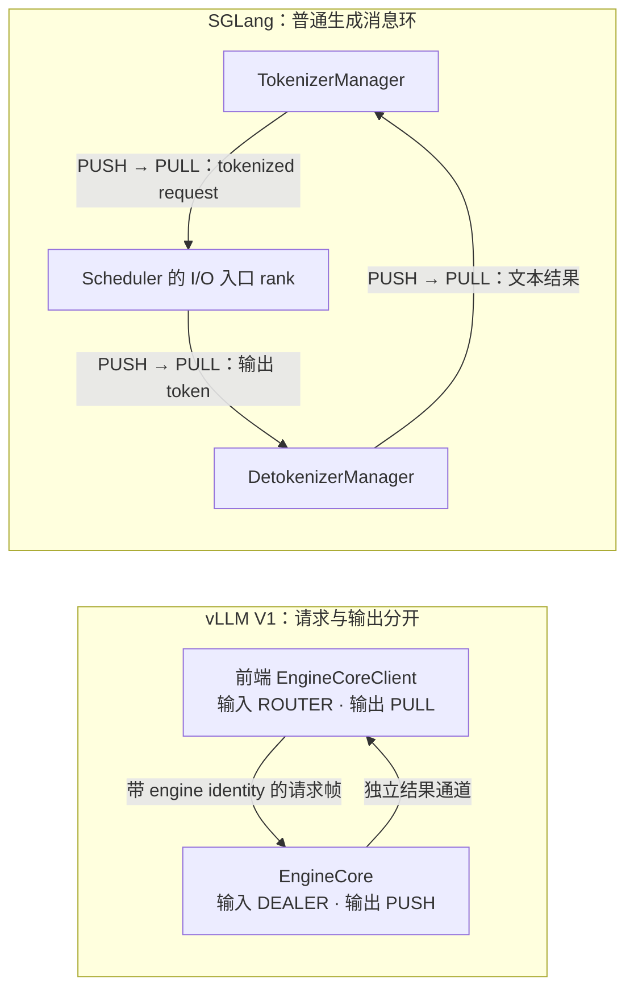

**图意解读：** 标签中的 socket 类型按发送端 → 接收端排列。vLLM 的输入端前端为 ROUTER、核心为 DEALER；不要凭“谁是服务端”的直觉把两端颠倒。它的输出另走 PUSH/PULL，不是 ZMQ REQ/REP 式的一问一答。SGLang 普通生成输出走 Detokenizer；管理消息、跳过 tokenizer 或其他后端可能另走通路。[C1]、[C2]、[C3]、[C4]

vLLM 本篇路径由前端绑定输入 ROUTER 和结果 PULL，EngineCore 连接对应 DEALER 与 PUSH。[C3]、[C4]

普通 SGLang 主链的方向是：Tokenizer 绑定输入 PUSH，Scheduler 连接 PULL；Detokenizer 绑定接收 PULL，Scheduler 连接输出 PUSH；Tokenizer 绑定结果 PULL，Detokenizer 连接 PUSH。**bind/connect 与消息方向不是同一件事**，PUSH 和 PULL 都可以是绑定端，取决于这条边的装配。[C1]、[C2]

初次接触 ZMQ 时，可以先这样理解下列模式。模式语义依据 [ZeroMQ 官方 socket 文档](https://libzmq.readthedocs.io/en/latest/zmq_socket.html)（读取于 2026-11-04）：

| 模式 / 操作 | 人话解释 | 本文中的用途 |
| --- | --- | --- |
| PUSH / PULL | 发送端把工作交给接收端；有多个接收者时通常分派，不保证每个都收到同一份 | SGLang 普通请求和输出；vLLM 输出 |
| ROUTER / DEALER | ROUTER 按连接身份路由消息，DEALER 异步收发；无需按同步请求 / 回复节拍轮流进行 | vLLM 前端按 engine identity 发往 EngineCore |
| XPUB / SUB | 发布与订阅；发布方可处理订阅信息，适合把消息交给订阅的 readers | vLLM MessageQueue 的相应 socket 分支 |
| bind / connect | 一端建立可连接的地址，另一端连到该地址 | 决定端点怎样建立，不决定业务消息往哪边走 |

SGLang 的 `PortArgs` 普通本机路径生成 `ipc://` 地址，另有按配置构造 TCP 地址的分支。[C12] vLLM 前端与 EngineCore 的 socket 地址也来自装配参数。[C3] 因此“socket 模式”“地址传输”“对象编码”应分开记录；不能看见 ROUTER 就断言跨机，看见 `ipc://` 就断言使用共享内存 ring buffer。

### 4.3 序列化也必须按通路比较

| 通路 | 本篇固定基线的编码方式 | 需要保留的条件 |
| --- | --- | --- |
| vLLM 前端 ↔ EngineCore | `MsgpackEncoder/Decoder`，请求类型、engine identity 与载荷通过 multipart frames 组织 | 支持 tensor / ndarray 的附加缓冲区或可选 OOB（out-of-band，主消息之外的传递）机制；不能据此宣称全链路零拷贝 |
| SGLang 前端 / Scheduler / Detokenizer | `sock_send/sock_recv` 按 `SGLANG_USE_PICKLE_IPC` 选择编码；本提交该开关声明默认值为 `True`，对应 `send_pyobj/recv_pyobj` 的 pickle 路径 | 关闭开关时使用 msgspec MsgPack；MsgPack 模式下部分不透明字段还有显式 PickleWrapper |
| vLLM Executor → Worker 的 MessageQueue | pickle 编码工作对象，支持附加 buffers，再走共享内存或 socket 分支 | 不能把前端的 MsgPack 结论套到所有内部通信 |

源码入口分别是 [vLLM 序列化][C5]、[SGLang IPC 编码][C6]、[SGLang 开关声明][C11]和 [vLLM MessageQueue][C7]。声明默认值不代替部署时的生效环境变量；本文没有实际启动进程核对运行配置。因此“vLLM 用 MsgPack、SGLang 用 pickle”最多描述特定默认前端通路，不能概括整个引擎。编码方案不同也不能直接推导端到端延迟；还要看消息数量、对象大小、复制、等待和接收侧工作。

### 4.4 共享内存：vLLM 工作队列与 SGLang 请求同步分别出现在哪里

vLLM `MultiprocExecutor.collective_rpc` 将方法、参数和目标回复 rank 放入广播 MessageQueue，再从回复队列取得执行结果。它是引擎内部的方法调用协议，不表示采用了 HTTP 或 gRPC。[V3]

MessageQueue 在存在本机 readers 时使用共享内存环形缓冲区；消息超过槽位容量时走本地 socket 溢出分支，远端 readers 则通过 TCP 上的 XPUB/SUB 接收。通知、就绪与取消还各有消息处理。因此它不是“所有 Executor 工作都走 ZMQ TCP”，也不是“启用共享内存后不再需要 socket”。[C7]

SGLang 的普通 TP 输入同步先检查可用的共享内存 exchange；没有该 exchange 时，将请求列表通过 `broadcast_pyobj` 和 TP 的 CPU group 传播。它同步的是输入与控制信息，不能把这条边当成 GPU Attention 张量的 all-reduce。[S3] 这一事实也说明：共享内存不是只属于某一引擎的能力标签，必须指出所在通路和启用条件。

**文章补充基线：** `baa9bef` 的普通 TP 请求同步分支使用 CPU group 上的 `broadcast_pyobj`，与上面主基线的 exchange 分支分开阅读；其入口还处理控制消息，不能把“各 rank 本地选批”扩写成“只在新请求到达时同步，之后完全零进程间同步”。模型 collective 和其他控制协同也没有因此消失。[MSR]

### 4.5 TP、PP 与 PD：三种“大数据通信”也不同

在本篇 CUDA 语境中，两者都有 CPU group 与 device group。CPU group 的 Gloo 路径用于相应控制/对象通信；device group 和设备 communicator 承担模型张量操作，具体可以涉及 NCCL 或专用优化实现。看到 device group 为 NCCL，也不能推断每个 all-reduce 一定走同一个 NCCL 调用；源码还可能按条件选择其他设备通信实现。[C8]、[C9]

| 场景 | 搬的是什么 | 完成条件应看哪里 |
| --- | --- | --- |
| TP | 同一层计算需要交换或合并的张量 | 相应 collective 与设备执行依赖 |
| PP | 前一 stage 产出的隐藏状态等中间激活 | 点对点发送/接收、对应 stage 的输入就绪 |
| PD | 从 Prefill 角色交给 Decode 角色的 KV / 所需状态 | 分配、布局兼容、传输结果与设备可用条件 |

PD 中即使握手使用了 ZMQ，也不表示 KV 本体经过该消息 socket。实际搬运要沿 Connector / backend 继续追踪；例如本篇 SGLang Mooncake 实现会调用 Transfer Engine 的 `batch_transfer_sync`。[C10] 完整传输契约见 [vLLM V1 KV Connector 地图](<../../vllm/分离部署/vLLM V1 KV Connector 架构与实现地图源码学习文档.md>)和 [SGLang 通信与传输机制](<../../sglang/并行方法/SGLang 通信与传输机制学习文档.md>)；它们保留各自基线。

**排障例子：** API 已接收 R1、ZMQ send 已返回，只说明走过了前端消息边界；R1 可能仍在等待预算、KV、前一轮结果或跨实例传输。应继续查请求状态和对应通路，不能用“消息已发送”证明 GPU 已计算或 KV 已可读。

### 4.6 同一条请求，分别记三本消息账

**人话版：** 用户发来的请求、引擎发给 Worker 的计算计划、输出给用户的结果，是三类不同的消息。它们可能都叫“request”或“output”，但不能因为名字相近就合画成一条线。

| 观察点 | SGLang | vLLM V1 | 分叉点 |
| --- | --- | --- | --- |
| 请求到达调度侧 | TokenizerManager PUSH → Scheduler PULL；之后还要向 TP ranks 同步 | 前端 ROUTER → EngineCore DEALER；类型帧与请求载荷进入核心 | 外部消息由谁接住，不等于谁执行模型 |
| 本轮计划进入执行 | Scheduler 在本 rank 直接调用 TpModelWorker；把 ScheduleBatch 转成 ForwardBatch | Executor 广播工作，Worker 消费；回复经 response MessageQueue 返回 | 本地对象调用与跨进程执行协议不同 |
| 一份输出返回前端 | Scheduler → Detokenizer → TokenizerManager | EngineCore → 前端 OutputProcessor / detokenizer | 本篇普通文本路径下，SGLang 反分词位于中间进程，vLLM 位于前端 |
| 非生成控制 | Scheduler IPC 另接 `rpc_ipc_name` 的 DEALER 通道；不能把 Worker 当成 socket 的直接接收者 | ABORT、UTILITY 等类型化消息由 CoreClient / EngineCore 处理 | 生成消息、管理调用、执行 RPC 不是同一个接口 |

源码入口为 [S3]、[S4]、[V3]、[C2]、[C3]、[C4]。上表是**一次消息经过的边界**，不统计真实请求产生多少个流式包；输出合并、批处理和传输设置都会影响次数。因此“两段回程对一段回程”不直接等于延迟高低。

离线包用固定的左右两列与相同观察点呈现这件事，很利于查找分叉点；但其中“core→worker 不走 ZMQ”的绝对说法不纳入本文。正确边界是：**不经过前端 ↔ EngineCore 那条 socket；MessageQueue 自身仍有 ZMQ socket 分支**，见第 4.4 节。

## 5. 调度与执行接口：计划怎样变成模型输入

### 5.1 vLLM V1：用统一进度描述本轮工作

`Scheduler.schedule` 用 `num_computed_tokens` 与 `num_tokens_with_spec` 的关系描述尚待计算的工作，再受 token budget、KV 容量和其他条件约束。它不会只靠一个“Prefill 队列 / Decode 队列”二分模型解释所有请求。[V7]

输出的 `SchedulerOutput` 包含新请求、已有请求的更新、本轮每请求 token 数等信息。EngineCore 调用 Executor，Worker 侧结合自己保存的状态组织执行输入。官方 V1 博客将增量更新与 persistent batch 作为降低输入准备开销的设计思路；本文不据此断言另一引擎没有复用缓冲区。[V2]、[V7]、[B1]

### 5.2 SGLang：显式维护 batch 模式和请求集合

SGLang `get_next_batch_to_run` 处理上一轮与 running batch 的关系，检查 Prefill 是否应延后，再选择可运行 batch；`ScheduleBatch` 的准备逻辑区分 extend 与 decode。[S2]、[S7]

本次固定基线的普通 Worker 入口接受 `ScheduleBatch`，通过 `ForwardBatch.init_new` 构造执行描述，再调用 ModelRunner。[S4] **本篇链路直接写作 `ScheduleBatch → ForwardBatch`**；读取其他版本时应核对其真实接口，不补入本篇路径不存在的中间对象。仓内 [Worker 与 ModelRunner 执行边界](<../../sglang/source-study/05-model-execution/01-Worker与ModelRunner执行边界.md>)可以帮助理解对象责任，但其固定基线需另读。

### 5.3 同一个 A/B 例子，两个阅读入口

教学条件：A 已经开始生成，B 的长 prompt 尚未算完；暂不考虑投机、特殊模型和资源不足。

| 阅读问题 | vLLM V1 | SGLang |
| --- | --- | --- |
| A 本轮怎样继续？ | 看 A 的未计算进度和分到的 token 数 | 看 A 所在 running batch 怎样被更新和选入 |
| B 怎样分段推进？ | 看 B 的进度差、本轮剩余预算及单请求限制 | 看 Prefill 准入、chunked request 和 batch 准备 |
| A、B 能否同轮执行？ | 看统一计划最终给两者发放的工作 | 看 mixed / batch 组合路径及其配置条件 |
| 谁先运行？ | 看策略、已有请求、等待请求和容量判断 | 看选批、Prefill 延后判断及相应模式 |

**整理者归纳：** 前者适合从“本轮发出什么计划”切入，后者适合从“请求和 batch 怎样变形”切入。这是源码组织差异，不是公平性或性能优劣结论。历史 [Chunked Prefill 与共推文章](<../调度方法/Chunked Prefill 与 Prefill-Decode 共推学习文档.md>)中的 SGLang `muxi-main` 分支不能代替本篇公开基线。

## 6. 缓存组织：索引、位置与所有权分开看

**人话版：** 缓存索引像目录，告诉你过去的计算在哪里；分配器安排新工作可写的位置；物理 KV 则是 GPU 真正读写的数据。目录查到了，不代表数据已经就绪或当前请求能直接覆盖它。

| 问题 | vLLM V1 | SGLang |
| --- | --- | --- |
| 用什么找可复用前缀？ | block hash 与缓存块映射 | Radix 前缀匹配及相应 cache 实现 |
| 谁管理资源关系？ | KVCacheManager、各类型管理器 / Coordinator、BlockPool | 请求映射、前缀 cache 保护、KV allocator / pool |
| 执行层使用什么？ | 块映射和 Attention 所需元数据 | 请求到槽位的映射、写位置和 ForwardBatch 元数据 |
| 分层缓存怎样进入主线？ | 通过具体 offload / Connector 路径衔接 | HiCache 组织匹配、预取、回载与写回 |

源码入口：[V8]、[V9]、[S2]、[S8]；HiCache 层次解释来自 [官方设计文档][D1]。

“vLLM 只有分页、SGLang 才有前缀复用”混淆了物理组织与复用策略；两者都有这两类问题。进一步，“树必然逐 token 命中，hash 必然整物理块命中”也不成立：本篇 SGLang 普通 Radix 有页对齐约束，vLLM BlockPool 存在有条件的部分尾块登记路径。[S8]、[V9]

### 6.1 同样 10 个相同 token，先把边界对齐

离线包把“树命中 10/12、块命中 8/12”画在同一条 token 刻度上，形象地呈现了索引方式；但它同时给树使用 token 级边界、给块使用 4-token 边界。这个例子不能证明 SGLang 天然多命中两个 token。[A1]

换成可比较的教学条件：两个输入前 10 个 token 相同；只看普通完整页/块的索引边界；两边的示例匹配粒度均为 4，关闭部分块复用，不引入混合状态恢复条件。这里的 4 只是教学参数，不是推荐配置。

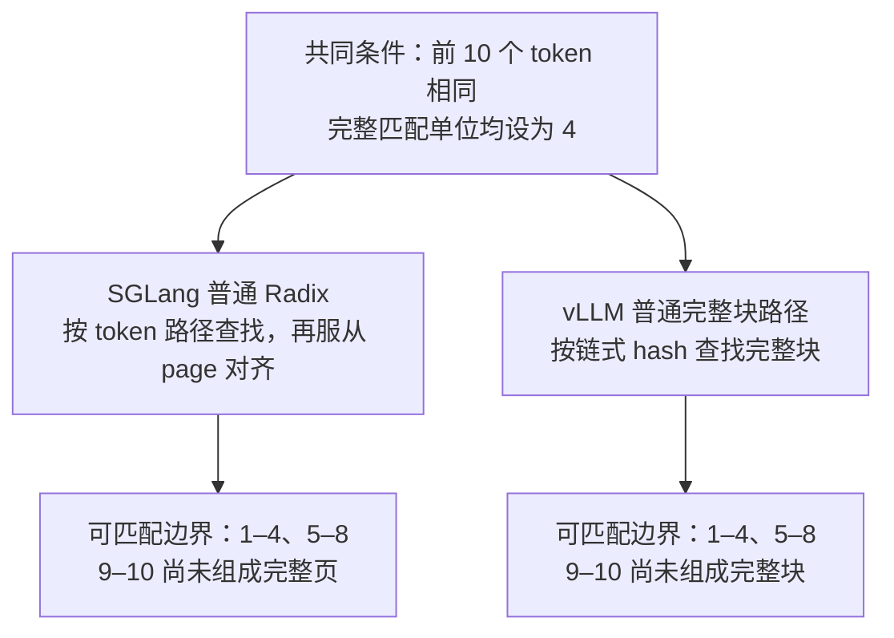

**图意解读：** 在这些简化条件下，两边都落在 8-token 边界，索引形状仍然不同。把 SGLang 示例 `page_size` 改为 1 才可讨论 10-token 边界；那已改变粒度条件。实际可跳过的计算还受 logits 重算、状态组、cache salt 和已物化 KV 等限制，不能把图中数值当成运行测量。[S8]、[V8]、[V9]

### 6.2 查找索引与执行地址是两层

| 时刻 | SGLang | vLLM V1 |
| --- | --- | --- |
| 判断是否命中 | token 路径、Radix key 与 cache 实现检查 | block hash、缓存映射及各状态组检查 |
| 得到可复用位置 | 命中路径对应已有 KV 位置，建立保护关系 | 命中块进入请求的块关系，增加引用 |
| 准备模型执行 | 请求行与 KV 位置形成执行元数据 | block table 与 slot / Attention 元数据形成执行输入 |
| 请求结束 | 请求退出；部分 KV 可能转为缓存保留 | 请求引用退出；块仍可能带 hash 留在池中 |

**分叉点：** 树节点与 hash 表负责“找到什么”，请求映射与 block table 负责“到哪里读写”；都还需要生命周期管理。尾部如何分配、是否 COW、是否能登记部分块，必须检查相应实现，不把离线包中的完整块示意推广到所有状态类型。详见 [恢复条件与状态所有权对比](<../KV缓存/前缀缓存命中后的恢复条件与状态所有权对比学习文档.md>)，各篇基线独立。

### 6.3 同样的显存比例，为什么不代表同样的 KV 容量

本节使用第 0.5 节的文章补充基线。跨引擎搬配置时，要比较实际容量与运行余量，不能仅让参数数值相同。

| 观察点 | vLLM | SGLang |
| --- | --- | --- |
| 比例参数 | `gpu_memory_utilization` 参与自动内存预算 | `mem_fraction_static` 参与静态占用与运行预留的分配 |
| KV 自动预算 | 预算减去 profile 的 non-KV 占用及适用的 CUDA Graph 估计 | 模型加载后可用量减去 `pre_model_load_memory × (1 − mem_fraction_static)`，再处理其他适用预留 |
| 不能省略的分支 | 显式 `kv_cache_memory_bytes` 有独立路径，不再按 utilization 自动推导 KV 预算 | 特殊状态、多模态和捕图后定容有额外条件 |
| 真正应记录 | 实际 KV 字节、block 数、模型/Graph/后端和运行余量 | 实际 token/page 容量、各类状态池、模型/Graph/后端和运行余量 |

依据：[MVM][MSM]。两边都设成 `0.9` 不构成等容量对照；参数也不是操作系统强制执行的显存硬隔离。提高 `mem_fraction_static` 会减小公式中的运行预留，不等于增加设备总显存。进一步阅读 [vLLM KV 全生命周期](<../../vllm/KV缓存/vLLM V1 KV Cache 管理全生命周期源码学习文档.md>)与 [SGLang 显存预算](<../../sglang/运行时/SGLang Chunked Prefill 与调度器显存预算学习文档.md>)，各篇保留自己的版本。

**存储格式也别读错：** 原文 vLLM 路径的 `int8` backing allocation 是按字节分配缓冲区，再按 cache spec 建立视图；不能据此认定 KV 已量化为 INT8。实际数值格式要继续查 spec、dtype 和 kernel。[MVB]

## 7. 重叠调度与跨实例接入分别改变什么

### 7.1 两者都能重叠 CPU 调度与 GPU 执行

SGLang 的 overlap loop 保留结果队列，在适用条件下先启动本轮计算，再消费前一轮结果；还要处理需要提前消费的依赖。vLLM 的 AsyncScheduler 则维护输出占位等状态，与异步执行路径配合推进后续工作。[S2]、[V10]

共同目标是让准备工作与设备计算重叠；**不能把“是否有 overlap”作为两者架构的二元差异**。应该比较：下一轮提前知道了哪些信息，哪些 token 或状态仍在途中，结果何时提交，取消或回收是否还受在途工作约束。

SGLang 官方 v0.4 博客与 vLLM V1 官方博客分别解释了各自的历史设计动机。[B1]、[B2] 它们的性能数字属于当时配置，本文不拿来为两个 2026 年源码快照排名。

### 7.2 vLLM 的 Connector 把调度侧与执行侧分开

`KVConnectorBase_V1` 的 Scheduler 侧接口报告外部命中、协调分配及请求完成；Worker 侧接口加载或保存 KV，并把完成、失败等信息反馈回去。[V11]

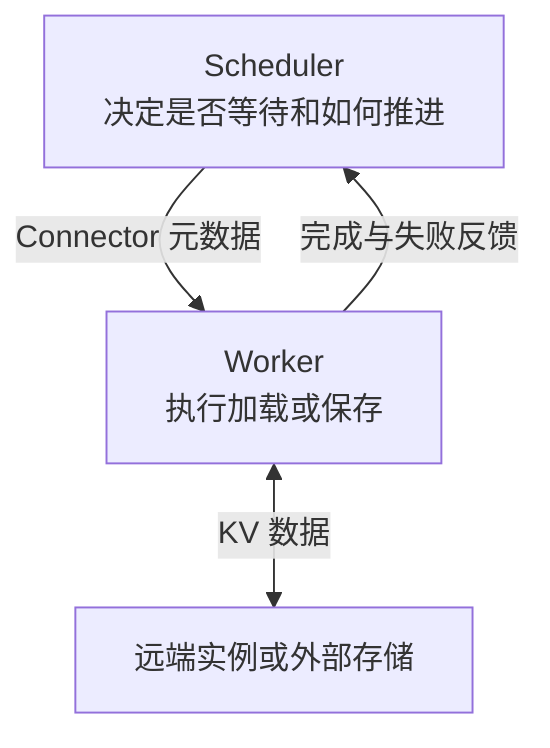

**图意解读：** 上面的小消息协调请求状态，下面的 KV 数据由具体实现搬运；后端能访问 buffer，不等于它拥有全部调度权。Connector 的工作完成后仍需与本地请求和缓存生命周期对齐。

### 7.3 SGLang 的 HiCache 与 PD 要分别追踪

HiCache 把 L1 GPU、L2 Host 与 L3 后端组织成缓存层次；L1/L2 属于实例私有范围，L3 是否跨实例共享取决于后端与配置。[D1] PD 则由 `DisaggregationMode` 选择角色专用 event loop，配合 bootstrap、预分配、传输队列与后端推进。[S2]

**整理者归纳：** vLLM 的接入对照适合先读 Connector 两侧契约；SGLang 适合先判断自己研究的是缓存分层还是 P/D 角色交接，再读相应状态机。两边都需要实际传输实现及外部服务组织，不能把模块化方式直接等同于某一方“功能更多”。

## 8. 同题异路：沿具体场景看控制权与完成条件

这一组借鉴离线包的有效组织方式：两边面对同一个事件，依次比较**触发 → 状态变化 → 资源动作 → 后续影响**。以下聚焦普通生成与对应代码分支；特殊模型、PD 和异步传输的例外单独标出。图均为固定源码整理，不是实际执行 Trace。

### 8.1 请求正常结束，KV 为什么还在

**人话版：** 请求交还使用权，与缓存丢弃数据是两件事。归还的物理位置可能仍保存可复用前缀，也可能已经成为可覆盖的位置。

| 观察点 | SGLang 普通 Radix 路径 | vLLM BlockPool 路径 |
| --- | --- | --- |
| 触发 | 请求完成，进入 KV 释放路径 | Scheduler 结束请求并释放其块关系 |
| 保留可复用内容 | `release_kv_cache(..., checkpoint=True)` 可先调用 `tree_cache.checkpoint`，普通 Radix 插入页对齐前缀 | 已登记的缓存块保留 hash；释放请求引用不自动清除它 |
| 退出使用关系 | 非保护部分归还，解锁 cache lock，释放请求行 | `free_blocks` 递减 `ref_cnt`；归零块进入 free queue |
| 真正驱逐 | 从可驱逐叶子中选择，释放对应 KV 并删除树节点 | 对选中缓存块移除 hash 映射；随后位置可被新内容占用 |
| 后续影响 | 新请求可能再次锁定缓存路径 | 新请求可能命中 free queue 中仍带 hash 的块 |

依据：[S8]、[L1]、[V9]。本篇 SGLang 固定提交已通过 `checkpoint` / `release_kv_cache` 表达这条链；不能直接复制离线包的 `cache_finished_req` 函数名来描述本版本。

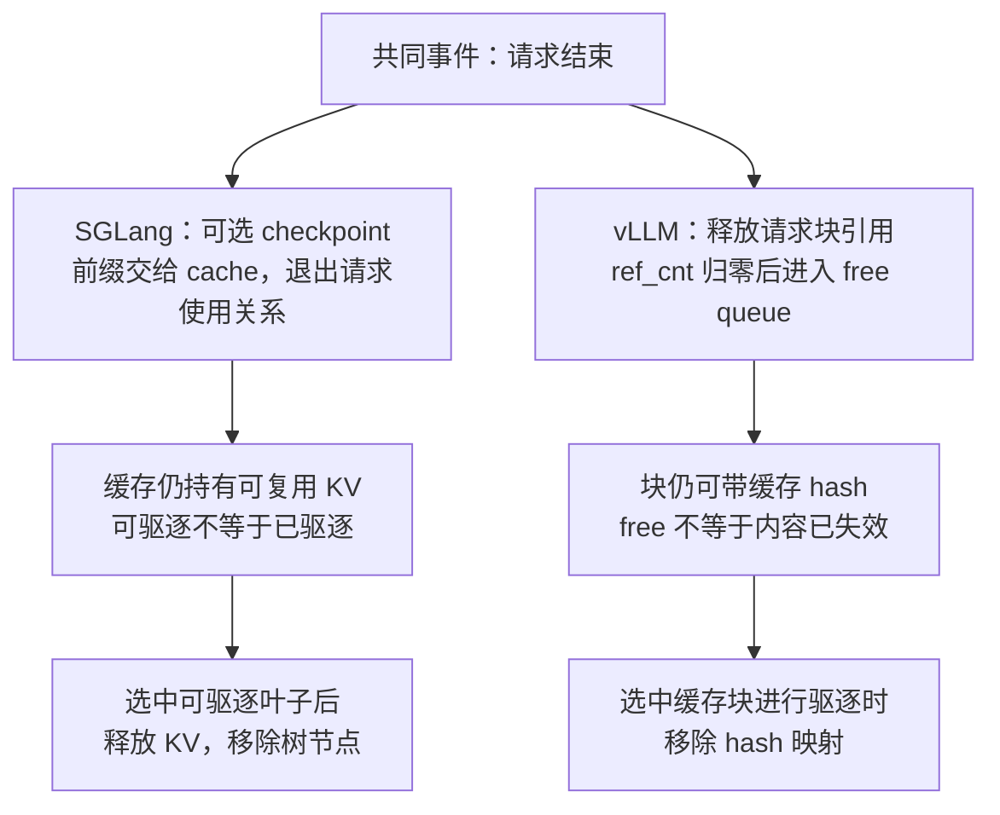

**图意解读：** 两列都明确画出“请求已结束，但缓存还有效”的中间态。图中没有把保留 KV 画成显存泄漏，也没有把 free queue 画成全是空白数据的区域。检查内存时应分别问：请求是否持有、缓存是否可命中、分配器是否可再次使用。

### 8.2 Decode 的 KV 容量不足，谁退回等待

**人话版：** 调度器可以暂停部分请求，腾出 KV 位置让其余请求继续。代价是被暂停请求的等待和恢复工作；这条机制不能处理所有 GPU 分配失败。

| 观察点 | SGLang | vLLM V1 |
| --- | --- | --- |
| 触发 | `update_running_batch` 的 Decode 内存检查；若在途结束结果即将释放 KV，可先暂缓本轮 | 调度分配无法为所选请求满足 KV 条件时，选择 preemption 路径 |
| 状态动作 | `retract_decode` 选择撤下的请求；可恢复者离开 running 并重新入队 | `_preempt_request` 设置 `PREEMPTED`，`num_computed_tokens=0`，请求前插 waiting |
| 资源动作 | 释放相关 KV、重置恢复状态；有在途 offload 时先处理其读取依赖 | 释放块与相关状态；存在在途写时可能延迟真正归还 |
| 后续影响 | 重新准入、恢复或重算；根据剩余请求重新估计 `new_token_ratio` | 再次调度计算；异步路径还要识别在途结果，避免修改重置后的计数 |
| 例外 | 不可恢复、特定 beam 分支或最后一个请求仍装不下时可中止 | 不能把 preemption 当成任意模型加载、kernel workspace OOM 的兜底 |

依据：[L2]、[L3]、[L4]、[L5]。离线包中的“下调 `new_token_ratio`”在本篇改成**重新估计并赋值**，源码不支持把所有回撤后的数值变化写成单向下降。

**分叉点：** SGLang 从 batch 的容量与恢复条件切入；vLLM 显式重置单请求的计算进度并重新排队。两边都可能损失已完成的 KV 工作，不由 `retraction` / `preemption` 名字决定谁更快。

### 8.3 取消请求：还在排队与已经发射，必须分开画

**人话版：** 可以停止给请求分配新工作，但不能凭一个取消消息，假设已经发射的 GPU 工作或传输立即消失。

| 观察点 | SGLang | vLLM V1 |
| --- | --- | --- |
| 入口 | `AbortReq` 进入 Scheduler 请求通路 | 前端发送 ABORT 类型帧，经 ROUTER → EngineCore DEALER |
| 尚未发射 | 队列按请求匹配取消；`RequestRetirer.abort_queued` 处理结束、回传与已持有资源 | `finish_requests(FINISHED_ABORTED)` 从 waiting / running 等集合移除并设置结束状态 |
| 已在途 | `Scheduler.abort_request` 对匹配的在途 Req 调用 `request_finish`；复用后续结果收尾路径 | `_free_request` / `_free_request_blocks` 检查 Connector 与在途写条件，必要时延迟释放 |
| 前端完成 | 队列取消可回传 AbortReq；在途结束沿结果/输出路径传播，不应全部画成同一种回执 | 请求完成集合与 EngineCore 输出参与前端清理；不等于远端客户端已确认收到 |
| 必须区分 | 标记结束、消费结果、释放资源、关闭输出流 | 移出调度集合、完成反馈、传输结束、物理块可回收 |

依据：[L5]、[L6]、[L7]、[V2]、[C3]。SGLang 固定源码还明确注释在途取消会继续经过一次 Decode forward 的结束路径；不要将其画为收到 AbortReq 就立刻 free。

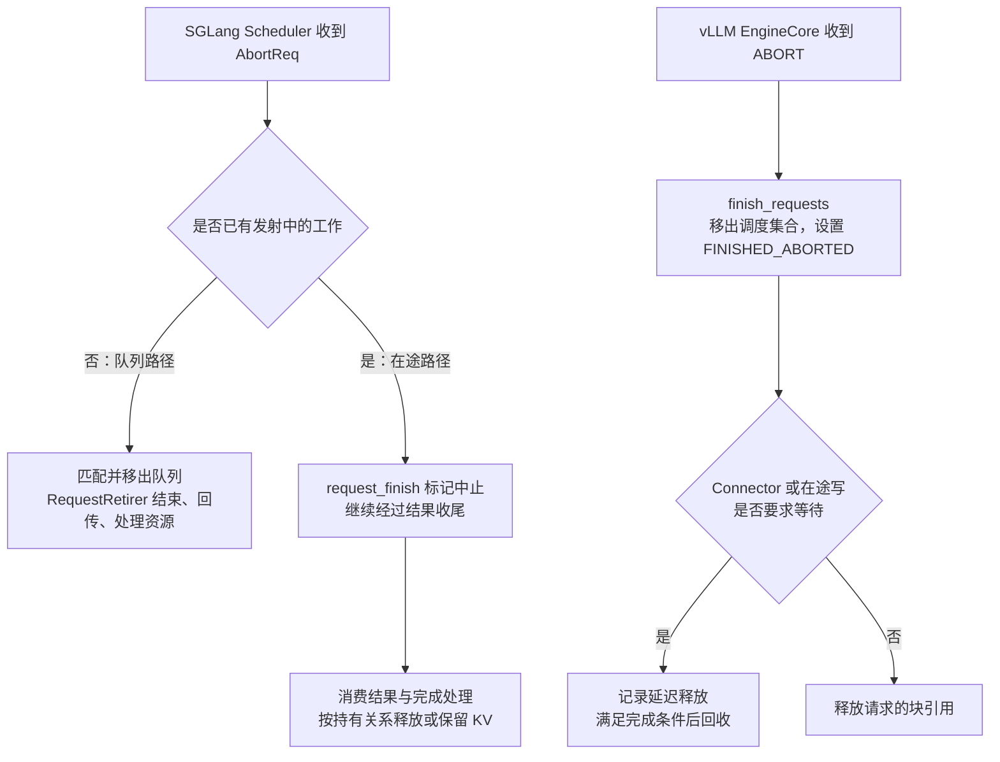

**图意解读：** 两条路径分别保留各自分支，箭头只表达控制依赖。前端流结束与物理资源可回收没有被强行排成统一的一条直线；离线包“收到取消 → 清场 → 回执”的简图在这里被补全。

### 8.4 CUDA Graph：比较捕获边界，而不是“有或没有”

**人话版：** CUDA Graph 记录可重复的执行，用 replay 减少逐个 launch 的开销。比较时先问“哪些区域录进图、哪些留在图外”，再问“当前输入能否命中已经捕获的形状”。

| 观察点 | SGLang 的相关路径 | vLLM V1 的相关路径 |
| --- | --- | --- |
| 策略表达 | Runner 管执行场景与形状；Backend 管捕获方式。BCG 是一种 backend | `CompilationConfig` 与 `CUDAGraphMode` 表达策略，dispatcher 结合 batch descriptor 选择实际模式 |
| 动态边界 | BCG 在显式 Attention / Mamba 等标记处划分 graph segments，边界逻辑在图外执行 | PIECEWISE 将不兼容操作留在图外；FULL、PIECEWISE、NONE 是不同运行选择 |
| 当前输入能否重放 | BCG `can_run` 检查 `shape_key` 是否已有图；BCG 不消除静态 shape / 地址约束 | dispatcher 检查 token 数、允许模式和捕获 key；符合条件才返回 FULL 或 PIECEWISE，否则在允许时返回 NONE |
| 与编译的关系 | 此 BCG backend 不依赖 `torch.compile` | full CUDA graph 可在启用或不启用 compilation 时使用；piecewise 有对应编译条件 |
| 默认值怎样读 | 不把某一 backend 写成所有模型的必选路径 | 配置说明列出 FULL_AND_PIECEWISE 的 Decode/Prefill 分工；实际生效还受版本、后端与限制调整 |

依据：[G1]、[G2]、[G3]；更完整的 Runner / Backend 原理见 [SGLang BCG 专项](<../../sglang/运行时/SGLang Breakable CUDA Graph 与 Prefill 捕获学习文档.md>)，该文保留自己的资料基线。

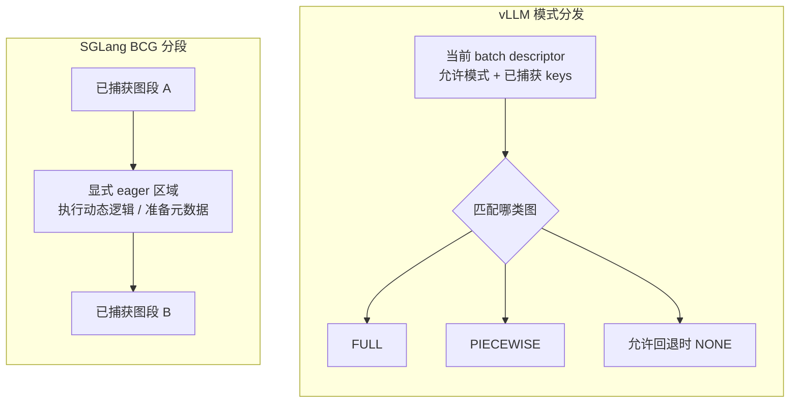

**图意解读：** BCG 一侧是一个 backend 内的执行边界，vLLM 一侧是模式选择入口，两图明确不声称处于同一抽象层。vLLM 的 PIECEWISE 也能把动态操作留在图外；SGLang 也要做形状选择。真正值得追踪的是分段和选择如何实现，而不是“只有谁能图外执行”。图中块的大小与箭头长度不表示耗时。

**小例子：** 某一轮输入超过已捕获 token 桶，不能仅因“开启 CUDA Graph”就宣称已 replay。应分别检查本轮形状、命中的 key、被选中的 backend / mode，再讨论 launch 开销。

### 8.5 停止字符串：谁最先知道请求应该结束

本节及第 8.6–8.7 节采用第 0.5 节的补充基线。停止条件可以暴露前端与调度状态之间的边界，不能只比较参数名。

| 观察点 | vLLM `5df63a7` | SGLang `baa9bef` |
| --- | --- | --- |
| 字符串匹配的位置 | 前端 `OutputProcessor` 调用增量反分词器，发现停止字符串 | Scheduler 的结果处理调用 `Req.update_finish_state`，经 `_check_str_based_finish` 检查字符串，必要时解码输出尾部 |
| 怎样结束调度 | 若 EngineCore 尚未结束，前端把请求放进 `reqs_to_abort`，由 AsyncLLM 发送 abort | 匹配结果写入 Req 的结束状态，再进入该结果处理链的收尾 |
| 资源何时回收 | 还要看核心处理 abort、在途工作及引用/传输条件 | 还要看结果收尾、缓存保护及在途工作条件 |

依据：[MVA][MVO][MSB][MSBP]。SGLang 有独立 Detokenizer，不代表所有字符串工作都只发生在那里；vLLM 前端已经停止输出，也不代表核心同一时刻已经归还全部 KV。

**小例子：** 停止字符串若由两个 token 组成，把它替换为其中一个 `stop_token_id` 会改变结束语义。只有语义等价时才适合比较两种停止方式；这里说明的是控制链差异，没有同负载实验可据此断言谁更快。

<a id="latency-metric-alignment"></a>

### 8.6 延迟指标：同名并不代表同一个观察位置

**人话版：** 调度侧生成了结果、前端取到了结果、客户端看到了文字，是不同事件。指标在哪层停表，决定它包含哪些等待。下面先对齐事件，再对齐样本数量。

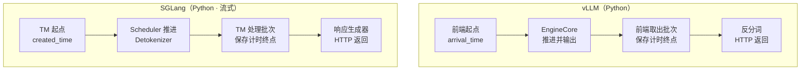

**图意解读：** TTFT 使用首输出，E2E 使用终态输出。框和箭头仅表达普通路径的因果顺序，没有时间比例，两列长度不表示性能差异；最终客户端接收均发生在各自的 HTTP 返回链上。SGLang 图限定流式请求，非流式的 TTFT 有下面所列的独立分支。[MVA][MVO][MSTM]

#### 起点和终点的对照

| 指标或问题 | vLLM `5df63a7` | SGLang `baa9bef` | 可比边界 |
| --- | --- | --- | --- |
| TTFT，`time_to_first_token_seconds` | 前端取首批核心输出时的 `iteration_timestamp − arrival_time`，发生在该批次反分词之前 | 流式通常为 TM 处理首输出的 `first_token_time − created_time`；非流式可能采用 Scheduler 的首 token 时间 | 都不等于客户端首段文字延迟；先区分流式与非流式 |
| E2E，`e2e_request_latency_seconds` | 终态批次的前端 `iteration_timestamp − arrival_time` | TM 的 `finished_time − created_time` | 前者终点在最终批次反分词前，后者普通文本回程已经过 Detokenizer；均早于客户端完整读取 |
| 首次排队 Histogram | `request_queue_time_seconds`：首次 `SCHEDULED − QUEUED`，在请求结束记录 | `queue_time_seconds`：首次 forward 入口减等待队列入口，在首次 forward 记录 | 起点和记录时刻不同；两者都不直接表示全部中途等待 |
| ITL，`inter_token_latency_seconds` | 非首轮核心输出的相邻 `engine_core_timestamp` 差；所读路径每次加入一个观测 | TM 处理输出时的观测间隔按新增 completion token 数平均分摊，再贡献相应数量的观测 | 一个样本可能对应一次输出，也可能对应一个分摊后的 token，不能直接比较 p99 |
| 每请求 TPOT，`request_time_per_output_token_seconds` | 核心首末 token 区间除以 `N−1`；`N≤1` 时该实现记录 0 | TM 时间账本的首末区间除以 `N−1`，有终止原因、token 数和区间有效性筛选 | 即使公式相似，计时层次和有效样本集合仍不同 |
| Prefill / Decode / Inference | 分别为首次调度→首 token、首→末 token、首次调度→末 token；不是 GPU kernel 专用计时 | 需查看 Scheduler 阶段、TM 时间账本及具体 collector；不能套用 vLLM 的指标分解 | 不把一个引擎的阶段 Histogram 当成另一引擎的同义项 |

表中共同名字分别加 `vllm:` 或 `sglang:` 前缀；实现入口为 [vLLM 时间账本][MVT]、[记录器][MVL]、[SGLang TM][MSTM]、[时间账本][MST]与 [collector][MSC]。

vLLM 普通 chat renderer 在渲染入口记录 `arrival_time`，输入处理也允许继承或显式传入时间；SGLang TM 接受 `received_time`，未提供时才在建立状态时取 `perf_counter`。两者都不能凭字段名解释为“网络收到第一个字节”。vLLM 的前端墙钟与核心单调时钟分开使用；SGLang 的时间账本也有跨进程传递规则，不能混合绝对时间戳相减。[MVR][MVI][MSTM][MST]

#### SGLang 的非流式 TTFT，以及两种排队时间

本次补充版本的 `_get_scheduler_first_token_time` 在非流式请求、存在返回时间账本、且 `created_time < prefill_finished_time ≤ 当前时刻` 时，尝试采用 Scheduler 的 `prefill_finished_time`；条件不满足则退回 TM 首输出时刻。它不是保证所有非流式调用都具有精确模型首 token 时间的承诺。[MSTM]

这与仓内 [Metrics、日志与 Trace 课程](<../../sglang/source-study/10-serving-operations/04-Metrics日志与Trace关联.md>)的 `72d5c5b` 旧基线不同。旧文继续解释旧版本，本节不把两个版本合成一个默认行为。

SGLang `baa9bef` 还把已结算的等待段累加到 `queue_duration_s`，通过 `get_queueing_time` 输出到请求元数据；重排后再次进入 forward 时可继续累计。而 Prometheus 的 `sglang:queue_time_seconds` 只在首次 forward 入口记录一个样本。**请求元数据中的累计 queue time 和同名观测领域的 Histogram 不是一笔账。**[MST][MSTM]

vLLM 的 `scheduled_ts` 只记录首次调度，抢占后不覆盖；中途等待因此进入 Prefill/Decode/Inference 区间。该提交的 `metrics.md` 仍用“最近一次 SCHEDULED”解释区间，与实现不一致，本节按实现限定说明。[MVT][MVS][MVD]

**教学例子：** 首次等待 20 ms，开始生成后又等待 60 ms。不能因为首次 queue Histogram 仍显示 20 ms，就断言请求没有中途排队；SGLang 的累计请求账本和 vLLM 的核心 Inference 区间可能从不同角度包含这段等待。异常终止、尚未重新进入 forward 的等待还需另查，不能机械相加。

#### ITL 与 TPOT：先数清一个样本代表什么

设两边在**各自的观察层**都有一个 200 ms 的间隔，随后一次收到 2 个新增输出 token；这是为了比较记账方法的假设，不是同条件压测：

| 观测 | vLLM 所读路径 | SGLang 默认 collector |
| --- | --- | --- |
| 这次 ITL 的 `_count` 增量 | 1 | 2 |
| 这次 ITL 的 `_sum` 增量 | 0.2 s | 0.2 s |
| 写入的观测 | 一个 200 ms 区间 | 两个各 100 ms 的平均分摊值 |

依据：[MVT][MVL][MSC]。这两个 100 ms 并没有测出两个 token 各自的准确生成或客户端到达时刻。因此“单请求时所有 Histogram 的 count 都应增 1”是错的；它最多适用于满足记录条件的每请求指标，不适用于 ITL。

SGLang 本版本的 TPOT 仅在非 Prefill 角色、正常 `stop`/`length`、输出数 `N>1` 且首末区间为正时记录。vLLM 所读完成请求路径则会把 `N≤1` 算为 0，再写入 TPOT Histogram。短输出、取消、失败和 PD 流量混入后，两边的平均值即使同名也可能对应不同样本集合。[MSTM][MST][MVT][MVL] 统计上“没有观测”和“观测值为零”必须分开。

### 8.7 怎样把架构差异变成可检查的测量

**共同外部口径：** 比较用户体验时，先让同一个客户端用同一套解析规则记录 `发出请求→首个有效内容增量`、`发出请求→完整读取响应`。首个 HTTP 字节、角色字段、空 SSE 或 reasoning/tool 输出是否算“首内容”要提前定义；不能拿一边的内部 TTFT 与另一边的客户端 TTFT 排名。

服务端指标随后用于解释各自内部发生了什么。先固定模型与 tokenizer、模板、实际输入/输出 token 数、停止语义、硬件、并行和执行后端、缓存、Graph、流式与输出合并条件；相同比例参数不自动代表相同内存容量。

#### 单请求直方图增量的使用范围

1. 热身后隔离实例，保证窗口内只有目标请求，无重启、counter reset 或其他流量；固定同一实例及完整 labels。
2. 分别在请求前、请求结束且指标已写入后抓取值。对 E2E 等满足条件的每请求 Histogram，检查 `Δ_count=1`，再取 `Δ_sum`；ITL 和有条件记录的 TPOT 使用各自样本规则。
3. 记录是否 streaming、实际输出数、结束原因、重排次数和客户端时间。缺失、跳过和零值分别保留，不用 0 补齐所有字段。
4. 对齐同一请求后再讨论残差；跨实例、跨 rank 或不同采样窗口的数据不能直接拼接。

Histogram 的 sum/count 与分位数口径参考 [Prometheus 官方说明][D2]（读取于 2026-11-13）。平均值可以由匹配样本的 sum/count 得到，但两组 p99 相减既不保留请求配对关系，也不是“p99 组件耗时”。

#### vLLM 原文的残差公式能说明什么

仅在原文的普通正常请求及上述隔离条件下，记客户端总时间为 C，vLLM E2E 为 E，首次队列为 Q，Prefill/Decode/Inference 为 P/D/I：

```text
I = P + D
R_front = E − Q − I
R_outer = C − E
C = Q + I + R_front + R_outer
```

| 剩余区间 | 可能包含 | 不能直接当作 |
| --- | --- | --- |
| R_front | 输入准备、进入核心前的传递与等待、末次核心输出到前端取出之间的传递与等待 | 纯 ZMQ、序列化 CPU 时间或全部 token 的 IPC 总耗时 |
| R_outer | `arrival_time` 之前的接入，以及最终输出批次计时之后的反分词、发送和客户端读取 | 纯反分词或纯网络时间 |

**教学算例，非实测：** C=240 ms、E=210 ms、Q=20 ms、P=50 ms、D=110 ms，则 I=160 ms，两项残差都是 30 ms。只能确认这些计时区间留下的余量；不能把 30 ms 直接记到某个组件头上。这里减的是各自时钟的时间差，仍须排除墙钟跳变和采样错配；明显负残差应先查口径，不截断成 0。[MVT][MVA]

这套公式不能直接替换成 SGLang 同名指标：观察位置、累计等待与样本条件已经不同。若要得到对称的组件拆分，需要在两边增加意义一致的事件点，并用 Trace 或 profile 验证；本文没有实施这些埋点或运行实验。

原作者预测并发为 1 时，R_front 随输出变长应大致稳定，并明确未运行 GPU 测量脚本。[B3] 本文只把它作为待验证假设；曲线增长也可能受批次、队列、事件循环和计时误差影响，不能单凭曲线确认根因。原文引用的 API 33%、调度 29%、GPU 38%，属于 vLLM 官方 2024 年 Llama 3 8B、单 H100 的历史 profile，不是本节固定版本的比例。[B4]

## 9. 回看原始架构图：哪些信息被省略了

以下原图作为资料证据保留，第 9.1–9.4 节的链接、页码、文件哈希及处理方式见[架构图源清单](../../images/sglang-vllm-architecture/SOURCES.md)，第 9.5 节单独见[五层文章图源][A2]。前两张来自作者在 CMU 2025 春季课程中的讲义，反映历史解释；第三张来自本文固定 vLLM 提交。本文的 Mermaid 是整理者为各节明确条件绘制的图，不能与这些原图混成同一个版本。

### 9.1 SGLang 作者讲义，第 6 页

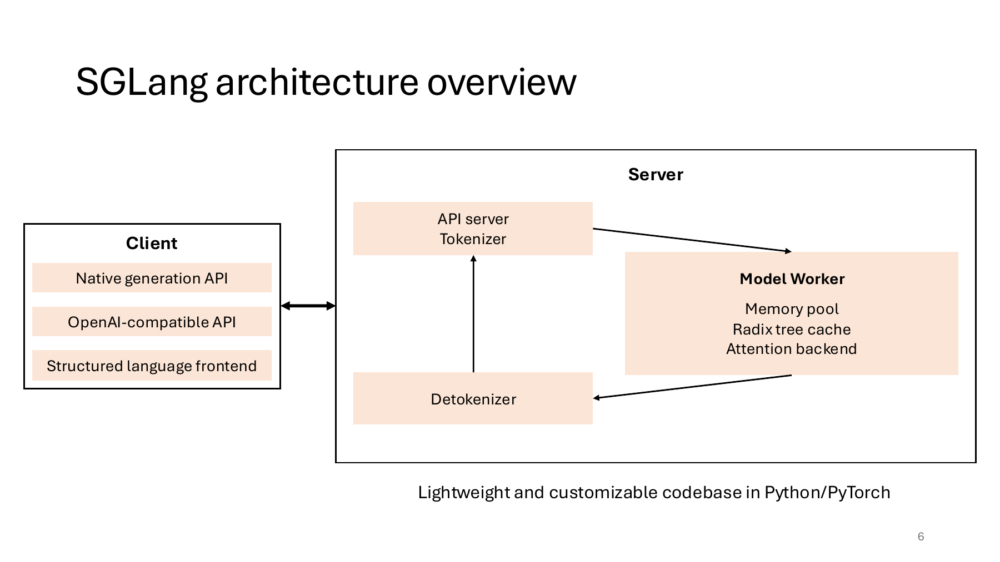

**图意解读：** API server / Tokenizer、Model Worker、Detokenizer 形成输出闭环；Model Worker 区域把 memory pool、Radix tree 和 Attention backend 放在一起，强调执行与缓存的配合。这个大框并不是源码里一个类的完整字段清单，也没有画出全部 rank 进程。客户端列出的 structured language frontend 是一种入口，不表示每个 OpenAI API 请求都必须先经过 DSL。[P1]

### 9.2 vLLM 作者讲义，第 83 页

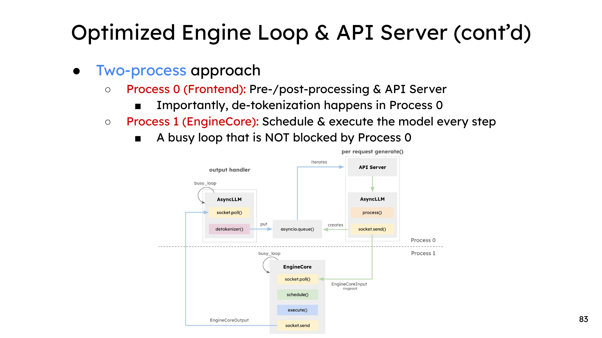

**图意解读：** 虚线划分前端与 EngineCore；反分词在前端，核心循环处理调度与执行。图中的两进程解释用于说明前后处理怎样离开核心循环，不是所有 TP/PP 部署的完整进程数量。跨进程消息、前端输出队列与 GPU 执行也不是同一个队列。[P2]

### 9.3 vLLM 固定源码文档中的 TP=4 图

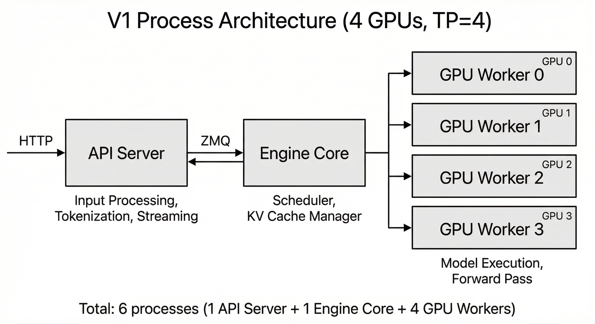

**图意解读：** 这张图明确展开 API、EngineCore 与四个 GPU Worker，适合说明集中调度和分布式执行的进程边界。它的 TP=4 与本文主图的 TP=2 不同；不能把卡数不同当成引擎差异。图中的 EngineCore → Worker 箭头也没有展开共享内存、RPC 工作队列和回复路径，需结合第 4 节阅读。[V1]

### 9.4 离线对照台怎样让差异一眼可见

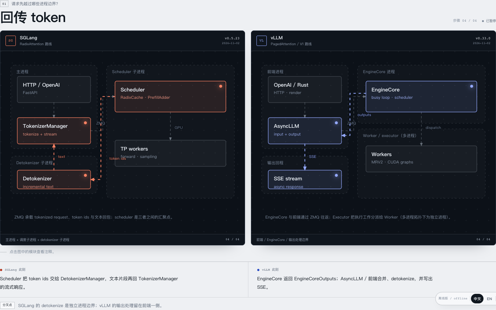

**图意解读：** 两边共享“回传 token”这个问题，保留整体进程框，仅点亮当前经过的路径；底部同时给 SGLang 此刻、vLLM 此刻和分叉点。它把架构与请求阶段联系起来，避免读者面对两张总图自行寻找差异。图中 Rust frontend、MRV2 与版本标签属于包内范围；本文仍使用第 0 节的 Python HTTP 条件。[A1]

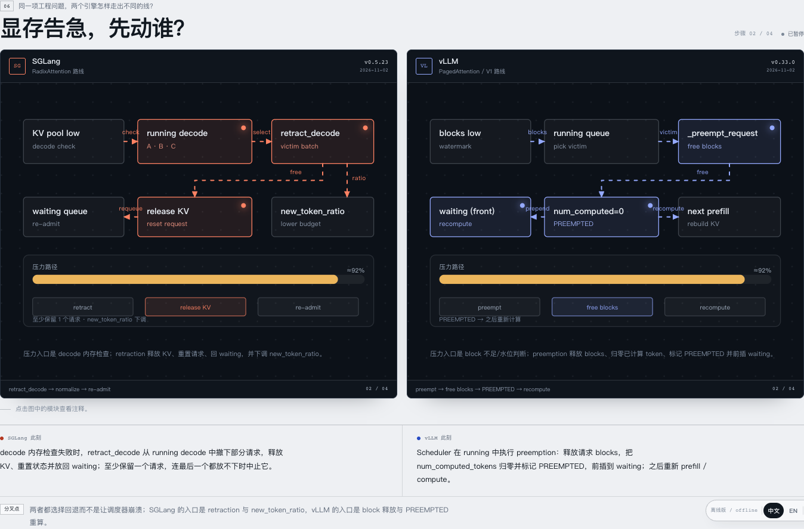

**图意解读：** 先展示相同问题，再把触发、回退、状态重置、重新入队放在相近位置，底部解释下一步代价。本文采用这种问题对齐方式，但不采用图中约 92% 的压力数值作为触发阈值，也不将 `new_token_ratio` 写成必然下降；固定源码结论见第 8.2 节。[A1]

前缀画面的 [原始 10/12 对 8/12 例子](../../images/sglang-vllm-architecture/05-atlas-prefix.png)也保留以便核对。它的相同 token 刻度有教学价值，但混用了匹配粒度；本文第 6.1 节的图先统一边界，再解释索引方式。截图均未改写原图文字，来源、步骤和哈希见 [图源记录][A1]。

### 9.5 五层进程切分文章的双卡图

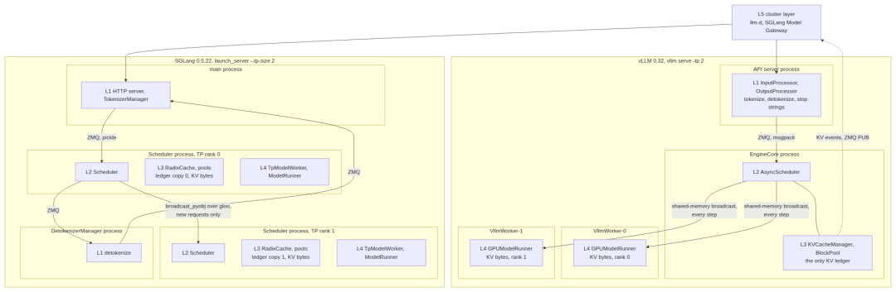

**图意解读：** 图对应第 0.5 节的 SGLang `baa9bef` 与 vLLM `5df63a7`，以 TP=2 展开“决策、账本、执行”怎样进入进程。上方集群层挑选副本，不直接接管实例内部的选批和 KV 位置。图中 L1 分散到多个进程，说明职责层不是进程数；左侧 rank 持有模型/KV 分片，不是两套完整副本。[W1][B3]

原图省略了部分返回、collective 和辅助通路，不能将“new requests only”读成全系统之后再无同步，也不能由四个进程推导相同延迟。原图为 1080×353 的白底宽图，小屏可打开本地图片放大；正文第 2.1、4、8 节提供可独立阅读的表与解释。完整来源、许可说明和哈希见 [图源记录][A2]；未改字、裁剪或重绘。

## 10. 小白排障地图与源码阅读路线

### 10.1 先定位等待发生在哪条边

| 现象 | vLLM 先查什么 | SGLang 先查什么 | 尚不能证明什么 |
| --- | --- | --- | --- |
| HTTP 能连接，但请求无首字 | 前端发出、EngineCore 接收、准入及执行进度 | Tokenizer 发出、入口 rank 接收与同步、准入 | HTTP 可用不证明模型完成计算 |
| ZMQ 已发送，仍无输出 | 接收解码、请求排队、Executor 工作和回复 | 接收解码、rank 同步、选批和结果处理 | send 返回不等于对端业务已完成 |
| 多卡中有 rank 不推进 | Worker 工作队列、方法执行、collective 对齐 | 请求广播 / exchange、各 rank 状态及 collective 对齐 | 一个 rank 正常不证明整个 TP 组正常 |
| GPU 有空隙 | 前端与核心隔离、调度、队列、输入准备和同步 | 选批、overlap 依赖、输入准备和结果消费 | 不能只凭框架名判定是 CPU 还是通信瓶颈 |
| 有缓存命中，但仍做计算 | 命中边界、状态组、Connector 返回与就绪 | Radix 页边界、HiCache 回载与状态恢复 | 文本相同或索引命中不等于全部计算可跳过 |
| 请求结束后 KV 仍占用 | 缓存引用、保留策略、传输责任 | cache 保护、请求引用、在途执行或传输 | 占用仍在不自动等于泄漏 |

本表是定位入口，不是未经日志或实验就确认的根因。

### 10.2 按问题读源码

| 学习问题 | vLLM 固定源码入口 | SGLang 固定源码入口 |
| --- | --- | --- |
| 进程怎样装配 | [EngineCore][V2]、[MultiprocExecutor][V3]、[UniProcExecutor][V4] | [Engine 启动][S1]、[Scheduler 初始化][S2] |
| 一轮怎样推进 | [EngineCore.step][V2]、[Scheduler.schedule][V7] | [普通 / overlap 循环与选批][S2] |
| 计划怎样变成输入 | [SchedulerOutput 的构造][V7]、[Executor 调用][V3] | [ScheduleBatch 准备][S7]、[Worker / ForwardBatch 转换][S4] |
| 请求和结果怎样过进程 | [CoreClient][C3]、[EngineCore 输入输出线程][C4]、[序列化][C5] | [Tokenizer][C1]、[Scheduler IPC][C2]、[Detokenizer][S6]、[编码][C6] |
| 多进程工作怎样传递 | [MessageQueue][C7] | [RequestReceiver][S3]及其 exchange / broadcast 分支 |
| 模型张量怎样通信 | [parallel_state][C9]及所选 device communicator | [parallel_state][C8]及所选 device communicator |
| 谁持有缓存、何时释放 | [KVCacheManager][V8]、[BlockPool][V9] | [cache / allocator 装配][S2]、[RadixCache][S8] |
| 外部 KV 怎样接入 | [KVConnectorBase_V1][V11] | [PD 循环分发][S2]、[Mooncake backend][C10]、[HiCache 设计][D1] |
| 压力下怎样重新排队 | [_preempt_request][L4]、[在途释放条件][L5] | [Decode 容量检查][L2]、[retract_decode][L3] |
| 取消何时真的释放 | [finish_requests / _free_request][L5] | [在途取消][L6]、[队列取消][L7]、[KV 释放][L1] |
| 图捕获与回退 | [CUDAGraphMode][G2]、[dispatch][G3] | [BreakableCudaGraphBackend][G1] |

第一次只追普通生成主线；第二次再选择一条通信或缓存扩展。函数存在只证明有实现入口，不证明目标模型、平台与所有开关组合可用。

### 10.3 自测

1. 为什么 SGLang 的 Worker 不一定另占一个进程，而 vLLM 的多进程 Worker 又确实有进程边界？
2. vLLM 输入侧谁是 ROUTER、谁是 DEALER？为什么不能把它叫作同步 REQ/REP？
3. SGLang 普通输出经过哪三个 manager？请求进入模型 rank 后还需要什么协同？
4. 为什么“前端用 MsgPack”和“Executor 内部用了 pickle”可以同时成立？
5. ZMQ send 完成、Worker 回复、collective 完成、PD KV 就绪分别说明什么？
6. 两者都有前缀缓存与 overlap，架构比较还有哪些真正需要解释的差异？

7. 同样 10 个相同 token，为什么不能仅凭 Radix / hash 名称断言谁多复用两个？
8. 为什么 `ref_cnt=0`、请求取消、GPU 写入完成与物理块可回收不是同一状态？
9. BCG 的图外区域，与 vLLM 的 graph mode 分发，分别处于哪层？
10. 同样一次收到两个新 token，为什么两边 ITL Histogram 的样本数可能不同？
11. SGLang 非流式 TTFT、首次 queue Histogram 和累计 queue 元数据，各自有什么版本与计时条件？

答案应落回进程边界、具体通路、接口载荷和生命周期；不要只回答一个库名。

## 11. 与仓内旧资料怎样衔接

| 已有资料 | 本篇补足什么 | 保留的边界 |
| --- | --- | --- |
| [心智模型与选型边界](<LLM 推理系统心智模型与 SGLang、vLLM 选型边界学习文档.md>) | 把选型维度落实为进程、对象与通信接口 | 原文的第三方来源与压测方法不改称本篇源码实测 |
| [三引擎交付范围与机制比较](<../分布式服务/DeepInfer、vLLM 与 SGLang 的交付范围与机制比较学习文档.md>) | 单独深入 SGLang / vLLM 的运行时结构 | 不把 DeepInfer 或其他版本拼进本篇双引擎主图 |
| [SGLang 系统边界](<../../sglang/运行时/SGLang 系统边界与学习地图学习文档.md>)与 [架构课程](<../../sglang/source-study/architecture/README.md>) | 提供与 vLLM 的对应入口 | 原有单卡图、课程与各自固定提交继续独立成立 |
| [vLLM 引擎工作流](<../../vllm/运行时/vLLM 从连续批处理到 PagedAttention 的引擎工作流学习文档.md>) | 补充明确的 V1 进程与执行器视图 | 旧文的 V0 历史示例不自动升级为 V1 行为 |
| [Chunked Prefill 与共推](<../调度方法/Chunked Prefill 与 Prefill-Decode 共推学习文档.md>) | 连接进度预算、batch 模式和执行接口 | 旧 SGLang `muxi-main` 的选批结论不泛化 |
| [SGLang 通信机制](<../../sglang/并行方法/SGLang 通信与传输机制学习文档.md>)与 [vLLM Connector](<../../vllm/分离部署/vLLM V1 KV Connector 架构与实现地图源码学习文档.md>) | 按通路比较 IPC、控制协同与 KV 数据面 | 各专项的协议细节与验证范围继续看原文 |
| [普通请求生命周期](<../../sglang/运行时/SGLang 普通请求运行时与资源生命周期学习文档.md>)、[vLLM KV 全生命周期](<../../vllm/KV缓存/vLLM V1 KV Cache 管理全生命周期源码学习文档.md>)与 [BCG 专项](<../../sglang/运行时/SGLang Breakable CUDA Graph 与 Prefill 捕获学习文档.md>) | 把结束、压力、取消与图捕获放入相同问题表 | 原有状态机、函数名和博客实验条件分别保留 |

**整合价值复核：** 本篇完成“架构 → 模块对应 → 请求 → 通信 → 状态”的跨引擎整合。缓存恢复、动态验证预算与 PD 传输已有专项；本轮没有足以支持独立性能排名或统一故障恢复结论的新实测证据，不再拆出重复的比较文章。

### 11.1 离线对照台提供了哪些分析增量

这次完整阅读了离线包 6 章、24 个观察步骤、模块注释、通信表、4 张场景表及来源清单，并实际查看了对应图形。它的价值主要在**选题与表达**，不是给两个引擎排列功能胜负。

| 离线包怎样分析 | 清晰之处 | 本篇吸收的位置 |
| --- | --- | --- |
| 进程骨架：入口、调度、执行、回程 | 同一阶段左右对照，进程外框与模块内框分开 | 第 1.4 节总问题表；第 1–3 节维持进程/对象区分 |
| 通信面：入口、回程、执行、管理 | 每条边同时给两端角色和消息内容 | 第 4.6 节消息账；保留第 4.3–4.4 节编码与共享内存细节 |
| 前缀缓存：查找、分配、共享、增长 | 用同一条 token 刻度连接索引与地址 | 第 6 节改成同粒度例子，并拆开索引与执行地址 |
| 调度心跳：收集、预算、重叠、结果 | 相同观察步骤下展示请求/batch 与进度预算 | 第 5 节 A/B 请求例子；不采用未经同条件定义的预算条长度 |
| 分离扩展：路由、KV、分层、并行 | 把实例内部结构延伸到外部服务 | 第 7 节保留 Connector、PD、HiCache 各自契约；不把 DP coordinator 等同于 P/D 路由器 |
| 同题异路：结束、压力、取消、图捕获 | 每个问题统一按触发、动作、资源与后续代价对齐 | 第 8 节四场景的表与图，补足在途和完成条件 |

**表达上保留的做法：** 先问问题；对齐两边观察点；图只突出本节主线；图后用“分叉点”解释职责差异，再说明这会把排障入口带到哪里。每个节点的长说明放入正文和源码入口，避免把所有细节挤进一张总图。

**未照搬的简化：** token 树不自动保证比块缓存命中更多；MessageQueue 不等于彻底不用 ZMQ；SGLang 在途取消不等于立即回收；vLLM 的 block table 是地址映射，不是 KV 数据本体；graph mode 与 compilation 也不是同一件事。原图中含这些简化的画面作为参考材料保留，不能代替上文固定源码结论。[A1]

复核了仓内普通请求生命周期、vLLM KV 全生命周期和 BCG 专项：它们已有各自深入主线，本次只补跨引擎的关联入口与基线提示，不重写其历史实现。四个场景已在本篇形成有依据的整合，没有再拆一篇重复对照文章的必要。

### 11.2 五层文章与指标课程的整合结果

| 新旧资料关系 | 正文中的处理 | 保留的证据边界 |
| --- | --- | --- |
| 公众号五层图与已有进程/模块对照大幅重叠 | 将职责视角融入第 2 节，原图保留在第 9.5 节；不再单独维护一篇架构摘要 | 原文的小引擎行数没有重算，不能作为复杂度排名；作者的架构偏好不作为性能结论 |
| 显存参数可与已有容量文档衔接 | 第 6.3 节解释跨引擎同值配置为何不等容量；旧显存文明确提高的是 `mem_fraction_static` | 自动定容、显式字节和特殊状态分支各有条件，旧文历史基线保留 |
| 原文停止字符串与已有结束/取消状态机互补 | 第 8.5 节补充前端匹配与 Scheduler 结果处理的不同控制位置 | 没有将匹配成功直接等同于物理 KV 立即可回收 |
| 原文 vLLM 指标与仓内 SGLang Metrics 课程可以对齐问题 | 第 8.6–8.7 节按新固定快照重新复核两边的起止点、样本权重和记录条件 | SGLang 非流式 TTFT、累计 queue、TPOT 与旧课程存在版本差异，旧文不被静默覆盖 |

Rust 前端仍是单独的扩展边界：文章补充版本的 vLLM README 保留 Rust 前端→Python EngineCore 的 ZMQ/MessagePack 接口；SGLang 的嵌入式 Rust 启动分支则跳过 Python Tokenizer/Detokenizer，并通过 rank-0 Scheduler 的进程内 ring 接收请求。[MVX][MSE][MSR] 这说明职责与进程装配可分开变化，不保证总进程数、功能覆盖或指标实现与 Python 主线相同。

本篇已形成“进程归属 → 状态所有权 → 完成条件 → 指标可比范围”的整合。进一步的组件开销或双引擎性能排名需要同条件实验，当前资料不足以支持，不再拆出重复的对比文章。

## 12. 参考资料与证据索引

所有源码链接固定到第 0 节对应的 commit：`M` 前缀使用第 0.5 节的文章补充基线，其余源码引用使用第 0.1 节主基线。下表中的作者资料用于解释设计动机和原图；技术细节优先回到固定源码核对。图源及哈希分别见[架构图记录](../../images/sglang-vllm-architecture/SOURCES.md)与[五层文章图源][A2]。

| 标识 | 资料、作者与日期 | 本篇使用范围 |
| --- | --- | --- |
| P1 | Ying Sheng，*Efficient LLM Inference with SGLang*，CMU 2025 春季课程讲义；确切讲授日未在所读页确认 | 第 6 页原始架构图；不采用历史性能数字 |
| P2 | Woosuk Kwon，*PagedAttention & vLLM for Efficient LLM Inference*，CMU 2025 春季课程讲义；确切讲授日未在所读页确认 | 第 83 页前端 / EngineCore 图 |
| B1 | vLLM Team，*vLLM V1: A Major Upgrade to vLLM's Core Architecture*，2025-01-27 | V1 的分层、增量输入与历史设计动机 |
| B2 | SGLang Team，*SGLang v0.4: Zero-Overhead Batch Scheduler, Cache-Aware Load Balancer, Faster Structured Outputs*，2024-12-04 | overlap 的历史设计动机 |
| D1 | SGLang 官方在线文档，*HiCache System Design and Optimization*；读取于 2026-11-04 | 层次范围与缓存工作流；不是本篇已运行的配置 |
| V1 | vLLM 固定提交的 *Architecture Overview* | V1 进程职责、TP=4 原图；单卡例外另核对 V4 |
| W1 / B3 | AI圈的9527 中文文章 / Aditya Kumar 英文原文；日期见第 0.5 节 | 五层职责、原始双卡图及待验证的测量思路 |
| B4 | vLLM Team，*vLLM v0.6.0: 2.7x Throughput Improvement and 5x Latency Reduction*，2024-09-05 | 仅核对 33%/29%/38% 历史 profile，不作本文版本的测量 |
| D2 | Prometheus 官方 *Histograms and summaries*，读取于 2026-11-13 | sum/count、分布与聚合口径；不代替引擎自身的记录条件 |

[S1]: https://github.com/sgl-project/sglang/blob/a16830deb5ea5b1e8c9874ad646f3ba95542191c/python/sglang/srt/entrypoints/engine.py
[S2]: https://github.com/sgl-project/sglang/blob/a16830deb5ea5b1e8c9874ad646f3ba95542191c/python/sglang/srt/managers/scheduler.py
[S3]: https://github.com/sgl-project/sglang/blob/a16830deb5ea5b1e8c9874ad646f3ba95542191c/python/sglang/srt/managers/scheduler_components/request_receiver.py#L94
[S4]: https://github.com/sgl-project/sglang/blob/a16830deb5ea5b1e8c9874ad646f3ba95542191c/python/sglang/srt/managers/tp_worker.py#L623
[S5]: https://github.com/sgl-project/sglang/blob/a16830deb5ea5b1e8c9874ad646f3ba95542191c/python/sglang/srt/managers/tokenizer_manager.py
[S6]: https://github.com/sgl-project/sglang/blob/a16830deb5ea5b1e8c9874ad646f3ba95542191c/python/sglang/srt/managers/detokenizer_manager.py
[S7]: https://github.com/sgl-project/sglang/blob/a16830deb5ea5b1e8c9874ad646f3ba95542191c/python/sglang/srt/managers/schedule_batch.py
[S8]: https://github.com/sgl-project/sglang/blob/a16830deb5ea5b1e8c9874ad646f3ba95542191c/python/sglang/srt/mem_cache/radix_cache.py
[V1]: https://github.com/vllm-project/vllm/blob/9a56d4fec6b0a30a0a989f1cd06cd3c2f7325619/docs/design/arch_overview.md
[V2]: https://github.com/vllm-project/vllm/blob/9a56d4fec6b0a30a0a989f1cd06cd3c2f7325619/vllm/v1/engine/core.py
[V3]: https://github.com/vllm-project/vllm/blob/9a56d4fec6b0a30a0a989f1cd06cd3c2f7325619/vllm/v1/executor/multiproc_executor.py
[V4]: https://github.com/vllm-project/vllm/blob/9a56d4fec6b0a30a0a989f1cd06cd3c2f7325619/vllm/v1/executor/uniproc_executor.py#L51
[V5]: https://github.com/vllm-project/vllm/blob/9a56d4fec6b0a30a0a989f1cd06cd3c2f7325619/vllm/v1/engine/async_llm.py
[V6]: https://github.com/vllm-project/vllm/blob/9a56d4fec6b0a30a0a989f1cd06cd3c2f7325619/vllm/v1/engine/output_processor.py
[V7]: https://github.com/vllm-project/vllm/blob/9a56d4fec6b0a30a0a989f1cd06cd3c2f7325619/vllm/v1/core/sched/scheduler.py#L706
[V8]: https://github.com/vllm-project/vllm/blob/9a56d4fec6b0a30a0a989f1cd06cd3c2f7325619/vllm/v1/core/kv_cache_manager.py
[V9]: https://github.com/vllm-project/vllm/blob/9a56d4fec6b0a30a0a989f1cd06cd3c2f7325619/vllm/v1/core/block_pool.py
[V10]: https://github.com/vllm-project/vllm/blob/9a56d4fec6b0a30a0a989f1cd06cd3c2f7325619/vllm/v1/core/sched/async_scheduler.py
[V11]: https://github.com/vllm-project/vllm/blob/9a56d4fec6b0a30a0a989f1cd06cd3c2f7325619/vllm/distributed/kv_transfer/kv_connector/v1/base.py#L3
[C1]: https://github.com/sgl-project/sglang/blob/a16830deb5ea5b1e8c9874ad646f3ba95542191c/python/sglang/srt/managers/tokenizer_manager.py#L718
[C2]: https://github.com/sgl-project/sglang/blob/a16830deb5ea5b1e8c9874ad646f3ba95542191c/python/sglang/srt/managers/scheduler_components/ipc_channels.py#L34
[C3]: https://github.com/vllm-project/vllm/blob/9a56d4fec6b0a30a0a989f1cd06cd3c2f7325619/vllm/v1/engine/core_client.py#L637
[C4]: https://github.com/vllm-project/vllm/blob/9a56d4fec6b0a30a0a989f1cd06cd3c2f7325619/vllm/v1/engine/core.py#L2074
[C5]: https://github.com/vllm-project/vllm/blob/9a56d4fec6b0a30a0a989f1cd06cd3c2f7325619/vllm/v1/serial_utils.py#L135
[C6]: https://github.com/sgl-project/sglang/blob/a16830deb5ea5b1e8c9874ad646f3ba95542191c/python/sglang/srt/managers/io_struct.py#L2787
[C7]: https://github.com/vllm-project/vllm/blob/9a56d4fec6b0a30a0a989f1cd06cd3c2f7325619/vllm/distributed/device_communicators/shm_broadcast.py#L495
[C8]: https://github.com/sgl-project/sglang/blob/a16830deb5ea5b1e8c9874ad646f3ba95542191c/python/sglang/srt/distributed/parallel_state.py
[C9]: https://github.com/vllm-project/vllm/blob/9a56d4fec6b0a30a0a989f1cd06cd3c2f7325619/vllm/distributed/parallel_state.py
[C10]: https://github.com/sgl-project/sglang/blob/a16830deb5ea5b1e8c9874ad646f3ba95542191c/python/sglang/srt/disaggregation/mooncake/conn.py
[C11]: https://github.com/sgl-project/sglang/blob/a16830deb5ea5b1e8c9874ad646f3ba95542191c/python/sglang/srt/environ.py#L370
[C12]: https://github.com/sgl-project/sglang/blob/a16830deb5ea5b1e8c9874ad646f3ba95542191c/python/sglang/srt/server_args.py#L795
[B1]: https://vllm.ai/blog/2025-01-27-v1-alpha-release
[B2]: https://www.lmsys.org/blog/2024-12-04-sglang-v0-4/
[D1]: https://docs.sglang.io/docs/advanced_features/hicache_design
[P1]: https://llmsystem.github.io/llmsystem2025spring/assets/files/llmsys-25-sglang-72edc5043338f59db34d47e5b96ac870.pdf#page=6
[P2]: https://llmsystem.github.io/llmsystem2025spring/assets/files/llmsys-22-vLLM_woosuk_kwon-1f34697dbb1a1fb5b798daf6eff14b67.pdf#page=83

[A1]: ../../images/sglang-vllm-architecture/SOURCES.md
[L1]: https://github.com/sgl-project/sglang/blob/a16830deb5ea5b1e8c9874ad646f3ba95542191c/python/sglang/srt/mem_cache/common.py#L443
[L2]: https://github.com/sgl-project/sglang/blob/a16830deb5ea5b1e8c9874ad646f3ba95542191c/python/sglang/srt/managers/scheduler.py#L4786
[L3]: https://github.com/sgl-project/sglang/blob/a16830deb5ea5b1e8c9874ad646f3ba95542191c/python/sglang/srt/managers/schedule_batch.py#L2884
[L4]: https://github.com/vllm-project/vllm/blob/9a56d4fec6b0a30a0a989f1cd06cd3c2f7325619/vllm/v1/core/sched/scheduler.py#L1841
[L5]: https://github.com/vllm-project/vllm/blob/9a56d4fec6b0a30a0a989f1cd06cd3c2f7325619/vllm/v1/core/sched/scheduler.py#L3046
[L6]: https://github.com/sgl-project/sglang/blob/a16830deb5ea5b1e8c9874ad646f3ba95542191c/python/sglang/srt/managers/scheduler.py#L6052
[L7]: https://github.com/sgl-project/sglang/blob/a16830deb5ea5b1e8c9874ad646f3ba95542191c/python/sglang/srt/managers/scheduler_components/request_retirer.py#L40
[G1]: https://github.com/sgl-project/sglang/blob/a16830deb5ea5b1e8c9874ad646f3ba95542191c/python/sglang/srt/model_executor/runner_backend/breakable_cuda_graph_backend.py#L65
[G2]: https://github.com/vllm-project/vllm/blob/9a56d4fec6b0a30a0a989f1cd06cd3c2f7325619/vllm/config/compilation.py#L695
[G3]: https://github.com/vllm-project/vllm/blob/9a56d4fec6b0a30a0a989f1cd06cd3c2f7325619/vllm/v1/cudagraph_dispatcher.py#L233


[W1]: https://mp.weixin.qq.com/s/pbzBiFfBR-KpVBpxYGSk4Q
[B3]: https://hiraditya.github.io/posts/anatomy-of-an-llm-serving-engine/
[B4]: https://vllm.ai/blog/2024-09-05-perf-update
[MVT]: https://github.com/vllm-project/vllm/blob/5df63a7203cdb9328d824a27b682e77c7b9928be/vllm/v1/metrics/stats.py#L478
[MVL]: https://github.com/vllm-project/vllm/blob/5df63a7203cdb9328d824a27b682e77c7b9928be/vllm/v1/metrics/loggers.py#L960
[MVD]: https://github.com/vllm-project/vllm/blob/5df63a7203cdb9328d824a27b682e77c7b9928be/docs/design/metrics.md#L212
[MVA]: https://github.com/vllm-project/vllm/blob/5df63a7203cdb9328d824a27b682e77c7b9928be/vllm/v1/engine/async_llm.py#L849
[MVO]: https://github.com/vllm-project/vllm/blob/5df63a7203cdb9328d824a27b682e77c7b9928be/vllm/v1/engine/output_processor.py#L681
[MVR]: https://github.com/vllm-project/vllm/blob/5df63a7203cdb9328d824a27b682e77c7b9928be/vllm/renderers/base.py#L1287
[MVI]: https://github.com/vllm-project/vllm/blob/5df63a7203cdb9328d824a27b682e77c7b9928be/vllm/v1/engine/input_processor.py#L402
[MVS]: https://github.com/vllm-project/vllm/blob/5df63a7203cdb9328d824a27b682e77c7b9928be/vllm/v1/core/sched/scheduler.py#L1571
[MVM]: https://github.com/vllm-project/vllm/blob/5df63a7203cdb9328d824a27b682e77c7b9928be/vllm/v1/worker/gpu_worker.py#L635
[MVB]: https://github.com/vllm-project/vllm/blob/5df63a7203cdb9328d824a27b682e77c7b9928be/vllm/v1/worker/utils.py#L570
[MVP]: https://github.com/vllm-project/vllm/blob/5df63a7203cdb9328d824a27b682e77c7b9928be/vllm/config/parallel.py#L1080
[MSR]: https://github.com/sgl-project/sglang/blob/baa9befa381511cd4d56f83980951e5a45fffc6d/python/sglang/srt/managers/scheduler_components/request_receiver.py#L112
[MSM]: https://github.com/sgl-project/sglang/blob/baa9befa381511cd4d56f83980951e5a45fffc6d/python/sglang/srt/mem_cache/kv_cache_configurator.py#L2688
[MSE]: https://github.com/sgl-project/sglang/blob/baa9befa381511cd4d56f83980951e5a45fffc6d/python/sglang/srt/entrypoints/engine.py#L1136
[MVX]: https://github.com/vllm-project/vllm/blob/5df63a7203cdb9328d824a27b682e77c7b9928be/rust/README.md
[MSTM]: https://github.com/sgl-project/sglang/blob/baa9befa381511cd4d56f83980951e5a45fffc6d/python/sglang/srt/managers/tokenizer_manager.py#L2729
[MST]: https://github.com/sgl-project/sglang/blob/baa9befa381511cd4d56f83980951e5a45fffc6d/python/sglang/srt/observability/req_time_stats.py#L404
[MSC]: https://github.com/sgl-project/sglang/blob/baa9befa381511cd4d56f83980951e5a45fffc6d/python/sglang/srt/observability/metrics_collector.py#L1976
[MSB]: https://github.com/sgl-project/sglang/blob/baa9befa381511cd4d56f83980951e5a45fffc6d/python/sglang/srt/managers/schedule_batch.py#L1913
[MSBP]: https://github.com/sgl-project/sglang/blob/baa9befa381511cd4d56f83980951e5a45fffc6d/python/sglang/srt/managers/scheduler_components/batch_result_processor.py#L1015
[A2]: ../../images/inference-process-latency/SOURCES.md
[D2]: https://prometheus.io/docs/practices/histograms/
