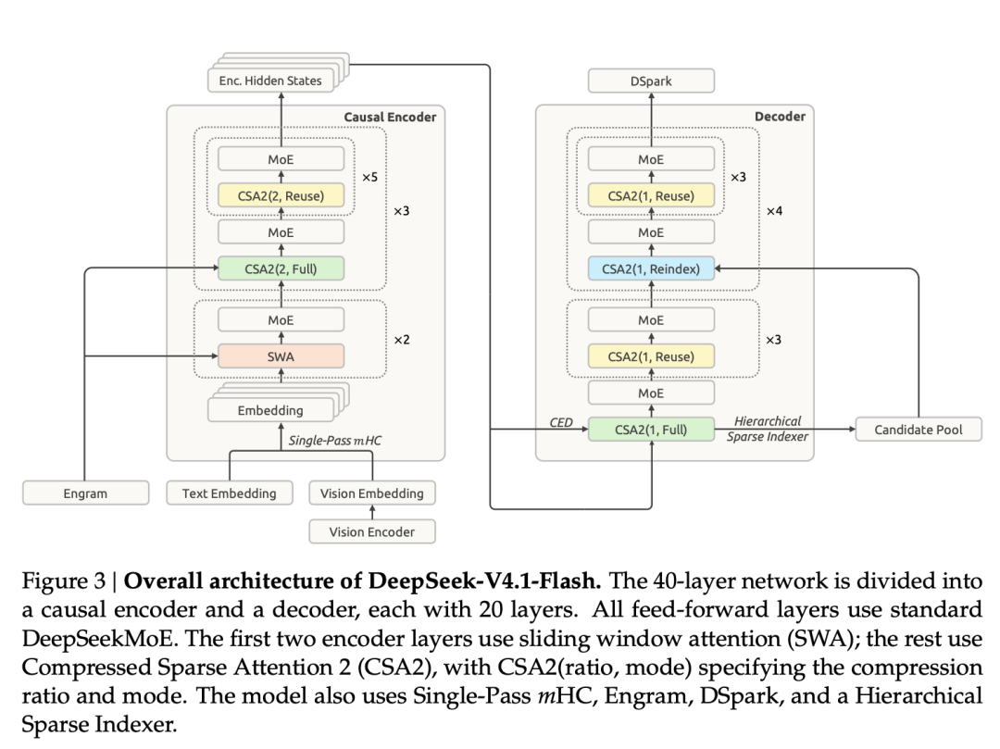
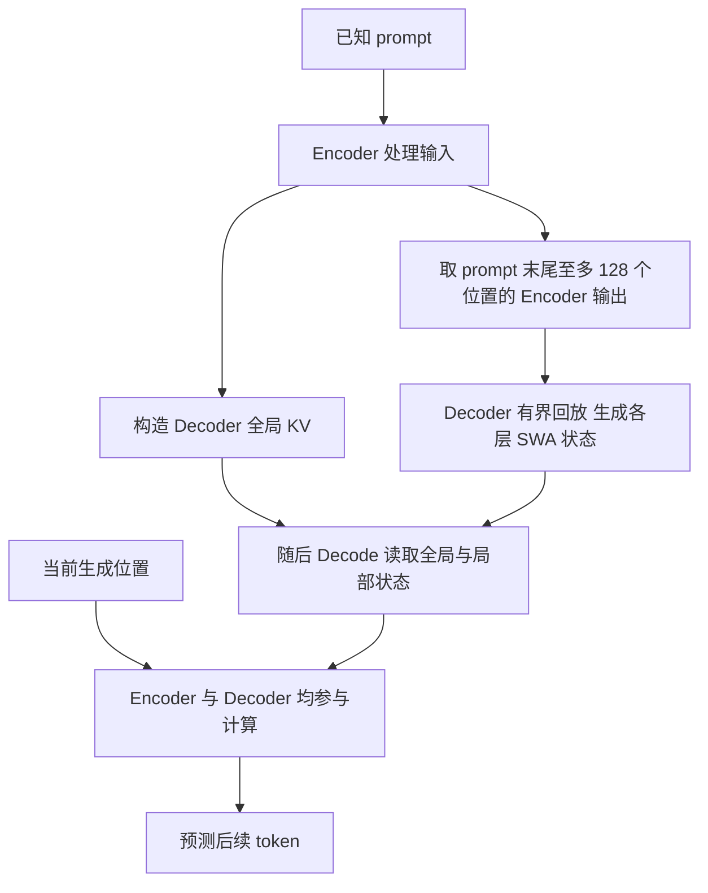
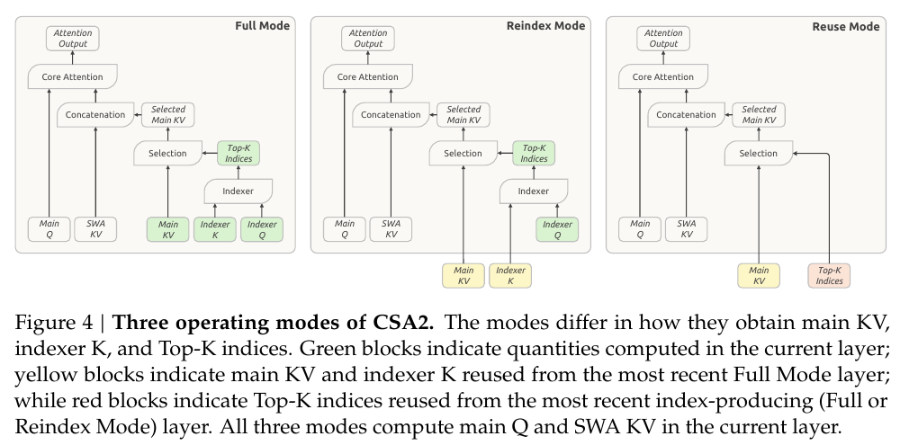
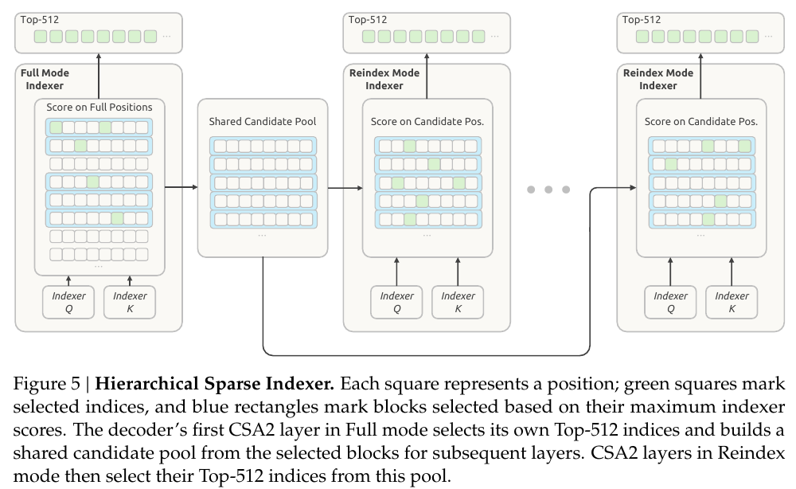
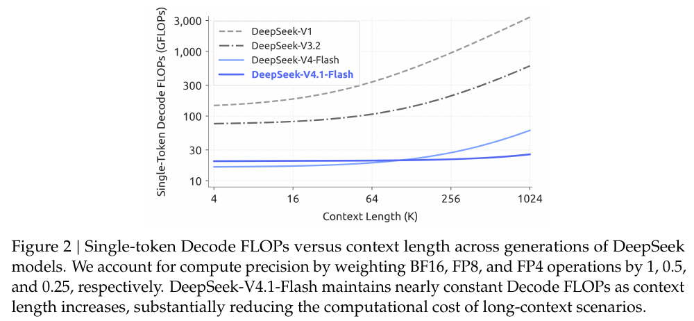

# DeepSeek V4.1 Flash 的 CED、CSA2 与缓存分工学习文档

长上下文推理要分别解决三个问题：读入新内容需要多少计算，历史状态需要保存多少，以及再次命中前缀时还缺哪些状态。V4.1 Flash 的设计把这三个问题联系起来，但它们的收益不能合成一个通用“加速倍数”。

本文是**第三方资料整理型学习资料**。以架构笔记为入口，对照 DeepSeek-AI 技术报告，解释 CED、CSA2、FP4 主 KV 与 SWA 的分工。没有运行模型、审计引擎全部实现或复现质量与性能实验。

## 0. 来源、增量与范围

| 项目 | 内容 |
| --- | --- |
| 原文 | [DeepSeek V4.1 Flash：架构学习笔记](https://mp.weixin.qq.com/s/a0syC_KNq49t0jZT-90-Rw) |
| 作者 | 薛定谔的爆米花 |
| 发布时间 | 2026-09-11 08:22:08，Asia/Shanghai，按页面时间戳换算 |
| 读取日期 | 2026-10-27 |
| 原文引用 | [Hugging Face 技术报告](https://huggingface.co/deepseek-ai/DeepSeek-V4.1-Flash/blob/53e70b17d9acb8e0c423f0e4fe5702f25562b63d/DeepSeek_V41_Tech_Report.pdf)，文件提交日期为 2026-09-10 |
| 本次实际复核 | [作者发布的 arXiv v1 报告][report]，2026-09-17；重点为 §2.2、§2.3、§2.4.4、§3.2、§4.2.1 与 Figures 2–5 |
| 版本边界 | 原 PDF 下载超时，改读 arXiv v1 HTML；未验证两个报告文件逐字或字节一致。本文结论以明确引用的 v1 章节为准，不扩展到后续模型版本 |
| 收录理由 | 仓内已有 DeepInfer 工程与 SWA 恢复资料，尚缺 CED 到 CSA2 模式、候选池和缓存口径的连续解释 |
| 不展开 | 视觉编码器、Engram、Single-Pass mHC、训练配方、DSpark 调度源码和模型榜单 |
| 配图 | 原文全部 4 张技术图，来源为官方报告；逐张核对图意，见 [图源清单](../../images/deepseek-v41-cache/SOURCES.md) |

先修：[Transformer 架构与推理流程](<Transformer 架构与推理流程学习文档.md>)。模型架构、引擎实现和生产系统是不同证据层：本文说明模型需要哪些状态；[DeepInfer 工程文档](<../分布式服务/DeepInfer 专用推理引擎与生产系统边界学习文档.md>)说明固定实现如何组织它们。

| 术语 | 人话解释 |
| --- | --- |
| Causal Encoder | 只能利用当前位置及此前信息，为后段产生表示；不是双向编码器 |
| main KV / indexer K | 真正供主注意力读取的历史记录 / 帮助挑选记录的索引键 |
| main Q / indexer Q | 本层如何读取历史 / 本层如何给候选记录打分；两种查询职责不同 |
| SWA | 每层自己的近期窗口状态，与共享全局 KV 分开维护 |
| Reindex / Reuse | 重选位置 / 沿用位置；均不表示跳过整层 |
| persistent cache | 为之后的前缀复用长期保存的状态，不等于当前请求的全部运行状态 |

## 1. CED：全局记忆的来源改变，局部计算仍在

### 人话版

前段读完整份输入，为后段准备全局记忆。后段不用为所有输入逐层重建同样的全局记忆，但它自己的局部窗口仍需计算。

**图意解读：** 左右两框分别是语言主干的 Encoder、Decoder，各 20 层。跨框连线表示 Decoder 的全局 KV 来源于最后一层 Encoder 的表示；它不是把两半放到不同服务器的部署图。图中的 Vision Encoder 是另一个组件，不能与语言主干的 Causal Encoder 混称。其余模块保留图中位置，但不在本文展开。

**报告事实：** CED 从 Encoder 最终隐状态投影 Decoder 全局 KV；Decoder 的 SWA KV 仍由各层自己的隐状态生成。常规生成时，当前 token 仍经过前后两段。报告的 Prefill 约 8B、Decode 约 16B 是激活参数口径，16B 包含整条生成主干，不是只计后 20 层。[§2.1–2.2][ced]

**图意解读：** 这是职责图，不是 GPU 调度顺序；前缀缓存已命中时，Encoder 还有自身的恢复分支，见第 5 节。因果约束禁止看未来，不要求已知 prompt 按 token 串行执行。

**教学算例：** 假设没有可复用的前缀缓存，只数“token 经过多少层”，令完整路径为 `40N`，CED 主线近似为 `20N + 20×min(N,128)`，忽略投影等开销。N=8192 时，两者为 327680 与 166400 个 token-layer；N=128 时都是 5120。这个人为简化模型解释长输入为什么更受益，不能预测 TTFT；不同层、缓存命中和图填充的真实代价并不相同。

## 2. CSA2：共享记录和共享选择，是两件事

**图意解读：** 绿色标出本层新产生的数据，黄色是借用的 KV，红色是沿用的位置索引。无论哪种模式，左侧 main Q 与 SWA KV 都由当前层计算。数据可共享，不代表每层的读取意图和输出相同。

**报告事实，按数据责任整理：** 三种模式是层的静态配置，不是每个请求随意切换的动态策略。[§2.3.1][modes]

| 模式 | main KV 与 indexer K | Top-K 位置 | 本层仍负责 |
| --- | --- | --- | --- |
| Full | 新建；Decoder 与 CED 结合时，从 Encoder 最终表示构造全局 KV | 用本层 indexer Q 新选 | main Q、SWA KV、注意力输出及后续层计算 |
| Reindex | 复用最近可用 Full 层的一组 | 新的 indexer Q 对共享 key 重打分 | 保持缓存共享，同时改变选择 |
| Reuse | 复用该组全局 KV | 沿用针对同组 KV 的最近 Full / Reindex 选择 | 新的 main Q 和局部状态；不再运行新索引 |

**教学例子：** 将共享 KV 记为 K，某 Full 层选 `{2,7}`，下一个 Reuse 层仍读这两个位置，但用自己的 Q 计算，结果不必相同。后续 Reindex 层可以在同一个 K 中改选 `{4,7}`，再由下一层 Reuse 沿用。复用位置不是复用最终 Attention 输出。

### 本模型的四组全局 KV 从哪里来

报告 §4.2.1 给出的实际配置如下；这是该模型配置，不是 CSA2 的通用层数要求。[模型设置][setup]

| 层范围 | 模式组合 | 序列压缩率 | 全局 KV 组数 |
| --- | --- | --- | --- |
| Encoder 前 2 层 | 仅 SWA | 不适用 | 0 |
| Encoder 后 18 层 | 3 组，每组 Full + 5×Reuse | 2 | 3 |
| Decoder 20 层 | Full + 3×Reuse，随后 4 组 Reindex + 3×Reuse | 1 | 1 |

因此 38 个带全局分支的层对应 4 组全局 KV。每组是随历史增长的一套记录，不能把它读成“四条记录”，也不能用 `38/4` 推出相对上一代的压缩倍数。

**整理者归纳：** 层复用减少“保存几套”，序列压缩减少“每套几条”，量化减少“每条多少字节”，Top-K 减少“本次读哪些”。这些维度不能互相替代。压缩率 1 的 Decoder 仍可通过层复用节省存储；稀疏读取也不意味着删除未选中的历史。

## 3. 分层检索：候选池不是最终读取集合

**图意解读：** 第一个 Full 索引器扫描因果可见范围，既选自己的 Top-K，也用块内最高分选择候选块；蓝色框组成后续层可搜索的范围。Reindex 层在同一个候选池里各自重选，绿色最终位置不必一致。这个池对应当前 query，不能理解成永久固定的全会话白名单。

报告设置最多 `2048×8=16384` 个候选位置，最终注意力选最多 512 条全局记录，并结合局部窗口。分层索引只用于 Decoder，后训练施加相同的候选限制。[§2.3.2][indexer] [§4.2.1][setup]

**教学例子：** 假设当前有 100000 个可见全局位置，Full 仍需要完成第一遍全范围打分。后续 Reindex 最多给 16384 个候选位置打分，再选 512 个；它没有给全部 100000 个位置重新排序。换一个 query，需要新的打分和选择，不能沿用本例数字当作命中记录。

**复杂度边界：** 固定候选上限时，后续索引器的每-query 打分规模有界；第一遍扫描和随上下文增长的缓存依然存在。“后续检索成本有界”不能改写为“整个模型长上下文成本恒定”。

## 4. FP4：先算记录大小，再谈总容量

报告对 main KV 采用 E2M1，16 个通道共用一个 E4M3 缩放系数；后训练引入 QAT，读取后反量化再参与注意力。局部 SWA KV 保留 FP8。这里主要压缩存储，不表示注意力矩阵乘直接用 FP4。[§2.4.4][fp4]

**独立算术核对：** `16×4+8=72 bit`，即这两项合计每数 `4.5 bit`。这是主 KV 数值和该 scale 的账目；不能把 indexer K、布局对齐或整套模型状态都按这个数直接计算。

| 报告指标 | 正确使用的口径 | 不包含的推论 |
| --- | --- | --- |
| 全局 KV 约 890 B/token | 该模型配置的全局 KV 存储；报告称约为 V4-Flash 的 1/4 | 总显存减至 1/4；所有缓存都采用 FP4 |
| 持久化 KV 约为上一代 1/8 | 报告相同工作负载下的部署结果，还包含不再长期保存 SWA 的策略 | 任意多轮请求都固定节省 8 倍 |
| 4K→1M 时单 token Decode FLOPs 约增 25% | 图中的精度加权计算量 | 延迟仅增 25%，或吞吐一定不变 |

**图意解读：** 横轴为上下文长度，纵轴为单 token Decode GFLOPs，两轴均为对数尺度。BF16、FP8、FP4 分别按 1、0.5、0.25 加权。曲线比较的是报告定义的运算量，不含一套统一部署中的实测时延；不能从图上反推出显存带宽利用率、通信时间或 GPU 吞吐排名。[Figure 2 与引言][flops]

**容量例子：** 若只按 890 B/token，十进制 100 万 token 对应 `890000000 B = 0.89 GB ≈ 0.829 GiB` 的全局 KV。局部状态、模型权重、临时工作区、分配对齐及可能的复制需要另算；这个数不能直接拿来决定可服务并发。

## 5. 为什么共享全局 KV 后，还要恢复 SWA

**人话版：** 找回共享档案，不等于每层桌面上的近期工作状态也找回了。报告区分长期全局 KV、短期 Encoder SWA 和 Decode 所需的 Decoder SWA。[§3.2][serving]

| 对象 | 保存与恢复责任 | 边界 |
| --- | --- | --- |
| 全局 KV | 长期保留用于前缀复用 | 命中后仍须确认局部状态与读取就绪 |
| Encoder SWA | 活跃会话短期内存池；缺失时重放已命中前缀末尾窗口 | 重放前缀复用既有全局 KV，不覆盖它；新输入仍生成全局与局部状态 |
| Decoder SWA | 每次 Prefill 从 prompt 末尾窗口的 Encoder 输出重建 | 供随后的生成使用，不进入前缀持久化缓存 |

窗口为 128；报告以 20 层 Decoder 的 `20×128=2560` 个位置说明精确重建依赖的扩展。有界重放只保留末尾窗口并截断更早局部依赖，得到近似状态。质量影响很小是作者实验结论，不是数学等价证明；本篇未复现。[§3.2.2][replay]

**比“状态近似”更具体的边界：** 报告指出，Encoder 恢复时的近似还会影响随后未缓存后缀所生成的状态，不同缓存命中位置不保证数学相同。因此不能只检查“旧全局 KV 未覆盖”，就断言整个后续请求与冷 Prefill 等价。

### 用一次多轮请求分清两个回放窗口

**教学假设：** 使用从 1 开始的闭区间编号；旧前缀长 4096，命中了全局 KV，但 Encoder SWA 已过期。新一轮追加 64 个 token，完整 prompt 长 4160；窗口为 128。以下只示意报告的数据依赖，不模拟引擎分块、异步执行或真实耗时。[§3.2.2][replay]

| 工作 | 位置范围 | 全局与局部状态发生什么变化 |
| --- | --- | --- |
| 找到旧前缀 | 1–4096 | 复用已保存的全局 KV，不意味着 Encoder SWA 同时命中 |
| 恢复 Encoder 窗口 | 3969–4096，共 128 个位置 | 重放边界附近输入，重建局部 SWA；这些位置的既有全局 KV 不覆盖 |
| Encoder 处理新增输入 | 4097–4160，共 64 个位置 | 产生新位置的全局 KV 和 SWA；它们依赖本次恢复的局部状态 |
| 准备 Decoder 窗口 | 4033–4160，共 128 个位置 | 使用完整 prompt 最后 128 个位置的 Encoder 输出，重建 Decoder 各层 SWA |

这里 Encoder 的回放窗口以**旧前缀末尾**为界，Decoder 的回放窗口以**完整 prompt 末尾**为界；两个窗口重叠但不相同。Decoder 窗口包含 64 个旧位置和 64 个新位置。即便 Encoder SWA 直接命中，不需要第一种恢复，报告描述的 Decoder 窗口准备仍有独立职责。

**排障提示：** 命中后仍看到一段输入参与计算，先辨认它是在恢复 Encoder SWA、处理新后缀，还是准备 Decoder SWA；不能仅凭“执行了旧 token”判定全局缓存失效。复用率、重放量和新输入量应分别计数，这个例子也不表示每次命中都固定额外执行两段 128-token 的完整模型。

原文用“旧持久化容量近一半是 SWA，剩余全局 KV 压到 1/4”解释约 1/8。这个乘法说明报告工作负载下的组成关系，不能泛化成与会话长度、命中模式无关的固定常数。

详细恢复与所有权问题沿用 [前缀缓存恢复条件专题](<../KV缓存/前缀缓存命中后的恢复条件与状态所有权对比学习文档.md>)；具体存储区、命中和重放路径读 [DeepInfer 工程文档](<../分布式服务/DeepInfer 专用推理引擎与生产系统边界学习文档.md>)，不把报告的部署策略当作所有引擎的默认行为。

## 6. 阅读检查与延伸

| 自测问题 | 应能说清的答案 |
| --- | --- |
| Decoder 共用 KV，为什么每层输出还能不同？ | 每层有自己的 Q、SWA 与后续计算，Reindex 还可改变选择 |
| 只选 512 条，全局缓存为什么还增长？ | 选的是本次读取集合，未选记录可能供之后的 query 使用 |
| 16384 候选上限能证明总计算恒定吗？ | 不能，第一次全范围扫描仍在；需区分局部步骤与整个模型 |
| 命中全局 KV 为什么仍有 Prefill 工作？ | 新输入需要计算，缺失局部状态还可能需要重放 |
| 图中 FLOPs 少，能直接给系统排性能名次吗？ | 不能，图的精度加权口径与实际硬件执行时间不同 |

本篇补足模型层的共享与选择机制；[原有跨模型架构比较](<混合注意力、索引压缩与残差流架构对比学习文档.md>)仍保留 DeepSeek V4 的 CSA/HCA 基线。动态验证预算另读 [DeepInfer、SGLang 与 vLLM 的取舍](<../高级生成/动态投机验证预算：DeepInfer、SGLang 与 vLLM 的取舍学习文档.md>)，不把 KV 压缩的收益与草稿验证收益混成同一个指标。

**整合评估：** 本次新增价值由单篇架构主线承载；缓存恢复的跨系统比较已有专题，现有证据也不能支持统一质量或性能排名，因此不再提出重复的整合文档。

[report]: https://arxiv.org/html/2609.19969v1
[ced]: https://arxiv.org/html/2609.19969v1#S2.SS2
[modes]: https://arxiv.org/html/2609.19969v1#S2.SS3.SSS1
[indexer]: https://arxiv.org/html/2609.19969v1#S2.SS3.SSS2
[fp4]: https://arxiv.org/html/2609.19969v1#S2.SS4.SSS4
[serving]: https://arxiv.org/html/2609.19969v1#S3.SS2
[replay]: https://arxiv.org/html/2609.19969v1#S3.SS2.SSS2
[setup]: https://arxiv.org/html/2609.19969v1#S4.SS2.SSS1
[flops]: https://arxiv.org/html/2609.19969v1#S1.F2
