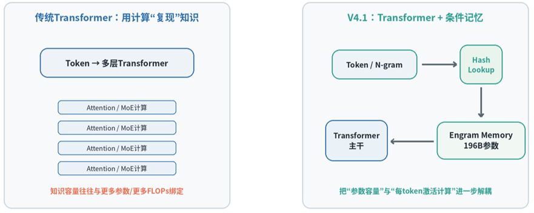
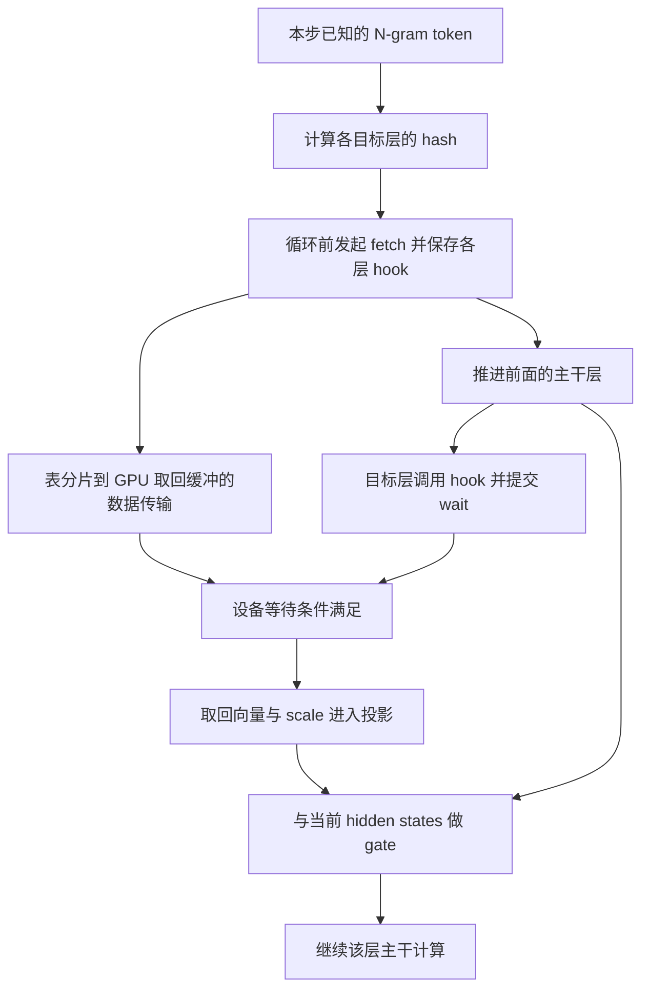

# Engram 条件记忆与 KV 分层缓存学习文档

为什么有的数据可以在层计算前就去取，有的却必须等 query 或路由结果？答案首先取决于**什么时候知道地址**，其次才是数据放在 HBM、主存还是远端。

本文是**第三方资料整合型学习资料，含固定源码复核**。围绕 Engram、前缀 KV 回载、稀疏 KV 访问和专家权重，比较数据身份、生命周期、取数依赖与可重叠窗口；没有执行模型、GPU/RDMA 实验或给不同系统排性能名次。

## 0. 来源、基线与阅读范围

| 来源 | 本文采用什么 | 证据边界 |
| --- | --- | --- |
| [《DeepSeek V4.1 Flash为什么“不再坚持Decoder-only”？》][article] | Engram 条件记忆的入门问题和第 6 张概念图 | 作者“崴和Gpt合砍83分”，公众号“崴什么”；页面发布时间 2026-09-10 20:08:00（Asia/Shanghai）。2026-11-02 完整读取正文和 6 张图；不采用产业需求预测 |
| [DeepSeek V4.1 技术报告 v1][report]，§2.4.2、§3.1.3 | 确定性寻址、条件门控与不同阶段的表放置 | DeepSeek-AI 官方报告；报告中的部署与训练经验不等于本次运行观察 |
| [KV Cache 与 MoE 权重的分层内存](<../KV缓存/KV Cache 与 MoE 权重的分层内存学习文档.md>) | OasisKV 的预测预取、SAC 的真实索引访问、专家池的激活传输 | 保留原文所列论文 v1、硬件及 measured / modeled 边界，本次未重跑实验 |
| [DeepInfer 工程文档](<../分布式服务/DeepInfer 专用推理引擎与生产系统边界学习文档.md>)、[前缀恢复条件与状态所有权](<../KV缓存/前缀缓存命中后的恢复条件与状态所有权对比学习文档.md>) | 模型层接入位置、缓存身份、恢复和退役条件 | 沿用各篇独立版本；本次追加下表列明的 Engram 源码读取 |

**补充源码基线**

| 项目 | DeepInfer | DeepEP |
| --- | --- | --- |
| 公开仓库 | [deepseek-ai/DeepInfer][di-repo] | [deepseek-ai/DeepEP][ep-repo] |
| 分支 / 固定提交 | `main` / `553741557a57df44a46fb3ab72b6aafeaf945337` | DeepInfer 的 `vendor/DeepEP` gitlink / `f6aa38fe06cd4a0489e7730365d4e0114970a2f3` |
| 读取日期 | 2026-11-02 | 2026-11-02 |
| 工作区状态 | 干净，无本地修改或未跟踪文件 | 子模块干净，HEAD 与固定 gitlink 相同 |
| 操作边界 | 只读模型调用、hash 元数据、表初始化和运行时 | 只读 Python 接口与 C++ fetch / wait 编排；未审计底层 RDMA kernel、驱动或硬件 |

先修：[Transformer 与逐步生成](<Transformer 架构与推理流程学习文档.md>) → [KV 容量地图](<../KV缓存/KV Cache 容量优化技术地图学习文档.md>)。CED 与 CSA2 的架构背景另见 [V4.1 缓存分工](<DeepSeek V4.1 Flash 的 CED、CSA2 与缓存分工学习文档.md>)。

| 术语 | 人话解释 |
| --- | --- |
| N-gram | 包含当前位置的一小段相邻 token；不是完整历史上下文 |
| 条件记忆 | 根据输入选取模型已经学好的表项，再结合当前状态使用 |
| 确定性寻址 | 已知输入及固定映射规则后，可以计算表地址；不意味着地址没有碰撞或数据已到达 |
| prefetch / wait hook | 前者提前发起取数，后者在消费位置建立就绪依赖 |
| 前缀缓存 | 保存某模型处理某段输入后产生的运行状态，以便后续请求复用 |

## 1. 先拆开模型参数、请求状态和本步临时量



**图意解读：** 右侧从 token / N-gram 指向表查询，再把结果送回主干，表达“大参数表不必每步全部参与稠密计算”。图中 196B 是报告所述 Engram 参数规模，不是请求 KV 容量，也不是每步传输量。原图省略了投影、上下文门控及取数完成条件；左侧也不能理解成传统模型没有参数记忆。本节补上这些边界，不把图当成准确 kernel 顺序。[报告 §2.4.2][engram-report]

| 对象 | 内容从哪里来 | 如何确定本次需要什么 | 生命周期与共享 |
| --- | --- | --- | --- |
| Engram 参数表 | 训练学到的模型参数 | 固定 tokenizer 映射、N-gram 和目标层 / hash head | 固定模型版本下供多请求读取，不因某条会话结束而删除表内容 |
| 前缀 KV | 模型对具体输入的计算结果 | 前缀身份、模型和布局等条件；还需检查可恢复边界 | 请求间可共享合法前缀，淘汰和回收受引用与运行状态约束 |
| 专家权重 | 训练学到的参数 | 通常先由当前隐藏状态的 router 选专家 | 权重可常驻专家池；本步选择和激活是动态的 |
| Engram 取回向量、投影与 gate | 本步查询和主干计算 | 取回表项后结合当前隐藏状态 | 是本步中间量，不能当成长期请求缓存 |

**容易混淆的名字：** DeepInfer 的 `Engram.forward` 有 `fused_kv_projection`。它产生供 Engram 门控使用的 K/V 张量，并接入当前 hidden states；这不是向 Attention 的历史 KV cache 追加 token。[`Engram.forward`][di-engram-forward]

## 2. 地址可以提前算，使用结果仍依赖上下文

### 先知道“去哪取”，后知道“怎样用”

报告的 Engram 路径包含 token 映射、多头 hash、上下文门控与多分支接入；V4.1 没有沿用早期 Engram 的短因果卷积。报告中两处模块位于零起始的第 1、14 层，采用 2/3/4-gram。[报告 §2.4.2][engram-report]

固定源码把依赖拆得很清楚：

1. [`CompressedVocabulary`][di-metadata] 建立原 token 到压缩 token 的映射；[`NgramHashMapping`][di-hash-mapping] 固定各层的乘子、表大小与偏移。这些规则属于模型查表身份，不能随意替换。
2. [`DeepseekModel.forward`][di-forward] 在逐层循环前，用 `ngram_token_ids` 和这些元数据计算 hash，随后调用 `EngramRuntime.fetch`。
3. [`Engram.forward`][di-engram-forward] 到真正的消费位置才调用 hook，把取回向量做投影，再用当前 `hidden_states` 参与 gate。

因此“地址不必等当前层 hidden state”与“Engram 输出不依赖 hidden state”是不同命题。源码支持前者，gate 明确否定后者。

### 同样的短语，不意味着同样的 KV

**整理者例子：** 两条请求拥有不同的长前缀，但当前位置前的 4 个压缩 token 完全相同。在模型、token 映射、目标层与 hash head 相同时，对应局部 N-gram 可以命中相同 Engram 表项；这并不意味着两条请求的隐藏状态相同，最终 gate 和主干输出也不必相同。

同样不能凭这 4 个 token 就复用整段 Attention KV：KV 是模型处理具体上下文后的状态，复用仍要满足前缀身份与恢复条件。反过来，hash 相同也不能被解释成语义完全相同，hash 本身允许碰撞。

### Prefill 与 Decode 的“提前”有边界

Prefill 已知当前输入序列，因而有机会在进入目标层前计算相关地址。Decode 也只能对已经知道的输入 token 与历史窗口计算地址；尚未采样出的未来 token 不能凭空寻址。

投机草稿可以提供候选 token，但候选地址不等于未来一定消费的地址：未接受草稿的取数可能浪费。本文没有从这条可能性推导 DeepInfer 已实现跨未来步的 Engram 预取。

## 3. DeepInfer 的调用链：发起、等待、投影、门控

**人话版：** 先把各 Engram 层需要的表项交给传输端，然后继续主干计算；到某层要使用它时，再经过该层的等待入口。能否隐藏传输时间，要看传输完成是否早于消费点。



**图意解读：** 这是依据固定源码绘制的依赖图，箭头表达先决条件，不按长度表示真实耗时。hook 返回不意味着 CPU 已同步等完；C++ 入口将 wait 提交到当前 CUDA stream，再返回结果视图，让后续设备操作遵循依赖。图没有声称所有传输都成功被计算覆盖，也不覆盖底层网络可见性的完整证明。

| 责任 | 固定源码锚点 | 可确认的行为 |
| --- | --- | --- |
| 表布局与分片 | [`NgramEmbeddingParameters`][di-parameters] | 按 Engram 并行组划分参数表，记录每 rank 的表范围 |
| 表驻留配置 | [`allocate_engram`][di-userbuffer]、[加载位置选择][di-load] | 根据 `DEEPINFER_ENGRAM_FORCE_GPU_STORAGE` 选择 CPU/GPU 存储；同时存在 GPU 取回缓冲 |
| 初始化与原参数存储释放 | [`EngramRuntime.initialize`][di-runtime] | 写入运行时 buffer，随后释放原 embedding 存储；不是每请求重新加载整张表 |
| 提前发起查询 | [`DeepseekModel.forward`][di-forward]、[`EngramRuntime.fetch`][di-fetch] | 在层循环前生成 hash，取得按 layer ID 对应的 hook |
| 分层等待 | [DeepEP Python `EngramBuffer.fetch`][ep-fetch]、[C++ fetch / hook][ep-fetch-native] | 接收多层索引；先发起 fetch，再为各层创建调用 `launch_engram_fetch_wait` 的 hook |
| 当前层如何消费 | [`Engram.forward`][di-engram-forward]、[`DeepseekDecoderLayer.forward`][di-layer] | hook → 投影 → gate；以 `hc_post_intervention` 接入 `attn_norm_forward` |

**放置条件不能抹平：** 报告描述推理时从 host memory 预取，也明确 RL rollout 使用 GPU 常驻表；固定实现又提供 CPU/GPU 存储开关。因此“Engram 永远放 CPU”不是机制定义。本文只确认分支和调用关系，未验证任意平台都能启用同一路径。[报告 §3.1.3][training-engram]

## 4. 与 KV 和专家权重比较：先问哪种地址已经知道

| 路径 | 地址何时可知 | 可以提前做什么 | 仍需满足什么 |
| --- | --- | --- | --- |
| Engram 查表 | 本步 N-gram、固定映射和目标层已知后 | 进入目标层前取表项 | 表版本和布局一致，传输完成，消费时仍有 gate |
| 完整前缀 KV 回载 | 请求前缀命中且缓存身份、位置已确认后 | 当前层 query 产生前回载已有前缀 | 不是所有状态都会同时命中；需保护缓冲并完成必要恢复 |
| SAC 一类稀疏 KV 访问 | 本层 query / indexer 给出实际 Top-K 后 | 只访问实际所需条目 | 索引计算、地址映射、传输和消费者就绪 |
| OasisKV 一类预测预取 | 草稿 / 前瞻给出预测访问集合后 | 在真实需求前准备热点 KV | 预测质量、未命中成本与近似质量条件 |
| ReRAM 专家池 | 本层 router 确定专家后 | 把激活发往已有权重的资源池 | 路由倾斜、池间传输与计算资源匹配；不是每步跨池搬全套权重 |

后三条沿用[分层内存旧文](<../KV缓存/KV Cache 与 MoE 权重的分层内存学习文档.md>)中的机制与版本。它们的模型、精度、硬件和指标不同，这张表比较依赖，不比较快慢。

**关键纠偏：** 不能概括成“Engram 能提前取，KV 都得等 query”。整段前缀回载可以很早确定；真正依赖当前 query 的是某些细粒度选择路径。也不能将主存中的参数表与远端 KV 服务视为一个缓存系统：同样使用 RDMA，并不赋予它们相同的身份、更新或淘汰策略。

## 5. 预取窗口：能提前不代表来得及

下面是整理者的简化预算模型，未使用实测数据。设地址确定时刻为 `t_addr`，消费者原本到达的时刻为 `t_need`；从发起到可消费的总耗时为 `T_fetch`，包含提交、排队、有效传输和完成处理。

```text
可用提前量 L = t_need - t_addr
理想化暴露等待 = max(0, T_fetch - L)
```

这个式子假设取数不会拖慢并行的主干计算。若两者争用带宽、通信资源或 GPU 执行资源，就必须重新测量 `t_need`；不能把两条独立路径的最好耗时直接拼在一起。

**教学算例：** 假设离目标层还有 0.8 ms，取数需要 0.5 ms，那么在上述假设下可被覆盖；若排队使取数变成 1.1 ms，仍会暴露 0.3 ms 等待。这些数字只说明预算关系，不是 DeepInfer benchmark。

单步流量也不能拿整张表的参数量代入。粗略拆成：

```text
实际搬运字节 ≈ 实际搬运条目数 × 每条向量宽度 × 元素字节
              + scale、对齐、元数据和协议开销
```

实际条目数受 token 数、N-gram 阶数、head、层和实现影响；不能默认重复地址已经去重。参数多可以扩大常驻容量需求，却不按同一比例扩大每 token 的查表计算。反之，每步只读少量条目，也不保证主存或网络没有排队。

## 6. 现象怎样反查到正确边界

| 现象 | 优先核对 | 不能直接得出的结论 |
| --- | --- | --- |
| 已调用 fetch，目标层仍等待 | 地址就绪、发起、完成与消费时刻，实际传输量及并发排队 | 预取代码没有执行 |
| 表搬到主存后 HBM 仍占不少 | GPU 取回缓冲、scale、激活及其他权重；实际存储开关 | 整张 Engram 表仍常驻 GPU |
| 相同短语输出不同 | 更长前缀、当前 hidden states、gate 与主干计算 | hash 查表不确定 |
| 前缀命中却仍有计算 | 新后缀、SWA 等局部状态恢复和模型前向职责 | Engram 表项必须像 KV 一样按请求重建 |
| 增大 batch 吞吐变化小 | 取数排队、流量、目标层等待、专家负载和端到端 SLO | 只需继续增加缓存容量 |

进一步实验至少固定模型及 tokenizer、两个源码提交、存储分支、精度、并行组、硬件与网络、输入输出分布及并发；分别记录地址就绪延迟、字节数、暴露等待和 TTFT/TPOT。本文没有做这些实验，不能据结构推断 SSD 需求增长或硬件厂商受益。

## 7. 自测与关联复核

1. Engram 表与请求 KV 都可能在主存，为什么不能共用一套生命周期解释？前者是模型参数，后者是带请求 / 前缀身份的运行状态。
2. 同一 N-gram 能保证同一输出吗？只能在固定映射条件下讨论表地址；gate 和主干还依赖上下文。
3. 在层循环前拿到 hook，是否等于向量已可用？不是；消费路径仍经过分层 wait。
4. 全量前缀回载与稀疏 KV 选择，哪一个通常需要当前层 query？后者；前者可依据已确认的缓存身份准备。
5. 为什么不能把参数容量、取数流量和端到端加速合成一个比例？三者分别受表规模、本步访问集合和关键路径影响。

**关联复核（2026-11-02）：** DeepInfer 旧文已有 Engram hook 位置，本篇在同一固定提交下补齐 hash → fetch → wait → gate；分层内存旧文保留 OasisKV、SAC 和专家池原有证据，只补充本篇入口；V4.1 缓存文档继续限定 CED、CSA2 与重放，不把参数表计入 890 B/token。模型架构 README 为唯一正文入口，KV 目录提供交叉阅读。

已授权的整合问题由本篇承载。下一步需要的是运行验证，而不是再写一篇同义综述；在缺少可比实验时，不新增性能排名选题。

图像地址、校验值与采用范围见 [图片来源记录](../../images/engram-memory/SOURCES.md)。

[article]: https://mp.weixin.qq.com/s/QrFXRFBMuuiNoYgHrjH7Xg
[report]: https://arxiv.org/html/2609.19969v1
[engram-report]: https://arxiv.org/html/2609.19969v1#S2.SS4.SSS2
[training-engram]: https://arxiv.org/html/2609.19969v1#S3.SS1.SSS3
[di-repo]: https://github.com/deepseek-ai/DeepInfer/tree/553741557a57df44a46fb3ab72b6aafeaf945337
[ep-repo]: https://github.com/deepseek-ai/DeepEP/tree/f6aa38fe06cd4a0489e7730365d4e0114970a2f3
[di-metadata]: https://github.com/deepseek-ai/DeepInfer/blob/553741557a57df44a46fb3ab72b6aafeaf945337/deepinfer/model_executor/models/v4_modules/engram_metadata.py#L16
[di-hash-mapping]: https://github.com/deepseek-ai/DeepInfer/blob/553741557a57df44a46fb3ab72b6aafeaf945337/deepinfer/model_executor/models/v4_modules/engram_metadata.py#L98
[di-forward]: https://github.com/deepseek-ai/DeepInfer/blob/553741557a57df44a46fb3ab72b6aafeaf945337/deepinfer/model_executor/models/deepseek.py#L177
[di-engram-forward]: https://github.com/deepseek-ai/DeepInfer/blob/553741557a57df44a46fb3ab72b6aafeaf945337/deepinfer/model_executor/models/v4_modules/engram.py#L139
[di-parameters]: https://github.com/deepseek-ai/DeepInfer/blob/553741557a57df44a46fb3ab72b6aafeaf945337/deepinfer/model_executor/models/v4_modules/engram_parameters.py#L16
[di-userbuffer]: https://github.com/deepseek-ai/DeepInfer/blob/553741557a57df44a46fb3ab72b6aafeaf945337/deepinfer/model_executor/parallel_utils/userbuffer.py#L127
[di-load]: https://github.com/deepseek-ai/DeepInfer/blob/553741557a57df44a46fb3ab72b6aafeaf945337/deepinfer/model_executor/models/deepseek.py#L473
[di-runtime]: https://github.com/deepseek-ai/DeepInfer/blob/553741557a57df44a46fb3ab72b6aafeaf945337/deepinfer/model_executor/models/v4_modules/engram.py#L195
[di-fetch]: https://github.com/deepseek-ai/DeepInfer/blob/553741557a57df44a46fb3ab72b6aafeaf945337/deepinfer/model_executor/models/v4_modules/engram.py#L214
[di-layer]: https://github.com/deepseek-ai/DeepInfer/blob/553741557a57df44a46fb3ab72b6aafeaf945337/deepinfer/model_executor/models/decoder_layer.py#L111
[ep-fetch]: https://github.com/deepseek-ai/DeepEP/blob/f6aa38fe06cd4a0489e7730365d4e0114970a2f3/deep_ep/buffers/engram.py#L157
[ep-fetch-native]: https://github.com/deepseek-ai/DeepEP/blob/f6aa38fe06cd4a0489e7730365d4e0114970a2f3/csrc/buffers/engram.hpp#L159
