# 从 ViT 到 Omni 的多模态表示与生成路线学习文档

读多模态模型，先分清三个问题：输入怎样变成表示，模态之间在哪里交互，输出按什么规则生成。“统一”可能指共享模型、共享表示、共享训练目标或覆盖更多模态，这几件事不必同时发生。

本文属于**第三方资料整理型学习资料**。以原文的演进路线为入口，对照论文与官方项目资料，保留全部 13 张技术图并修正若干归类和图注。没有训练模型、复现榜单或验证服务延迟。

## 0. 阅读基线与范围

| 项目 | 内容 |
| --- | --- |
| 原文标题 | 从ViT到全模态Omni：一文读懂多模态大模型演进史 |
| 原文链接 | [公众号原文](https://mp.weixin.qq.com/s/jzcgVGhSOzXlPeZUibZnTA) |
| 作者 | 请务必优秀 |
| 发布时间 | 2026-04-27 16:04:20，Asia/Shanghai |
| 读取时间 | 2026-10-14 |
| 范围 | ViT、CLIP、视觉语言连接器、理解/生成表示、Chameleon、Janus、OneCAT、BAGEL 与 Omni |
| 不展开 | 未逐项核对的“最新”模型排名、世界模型预测、完整训练配方与商业产品能力对比 |
| 一手核对 | ViT、CLIP、Janus-Pro、OneCAT、Qwen3-Omni 的论文；Chameleon、Qwen2-VL、Ming-Omni 的摘要/项目；BAGEL 官方项目与训练配置，见末尾 |
| 验证边界 | 静态文献与图文核对；论文报告属于各自版本，未做独立性能复现 |
| 图片清单 | [13 张原图及 SHA-256](../../images/multimodal-evolution/SOURCES.md)，文件保持原样，勘误写在图下 |

先修：[Transformer 架构与推理流程](<Transformer 架构与推理流程学习文档.md>)。本文聚焦模型表示；部署拆分另见 [Encode 分离与 EPD](<../分布式服务/多模态 Encode 分离与 EPD 状态交接学习文档.md>)。

### 术语速查

| 术语 | 人话解释 | 容易混淆之处 |
| --- | --- | --- |
| Patch | 一小块图像 | 一个 patch 不总等于最终一个语言模型 token |
| Embedding | 连续数值表示 | 不一定是文本词表中的离散 ID |
| Connector / projector | 将视觉表示接入语言模型 | 模型内连接器与服务间 EC Connector 不同 |
| VQ tokenizer | 把视觉表示量化到有限码本 | 只是一类视觉表示，不代表所有图像生成 |
| VAE latent | 连续潜在表示 | 不必进行离散码本量化 |
| AR | 按先后依赖生成后续 token 或尺度 | 串行步数减少不等于总计算降至线性 |
| Flow / diffusion | 在潜在空间中通过多步更新生成内容 | 可与自回归文本共享部分网络 |
| Omni | 覆盖多类输入/输出的模型方向 | 能理解某模态，不保证能生成该模态 |

## 1. 从时间线换成三个比较维度

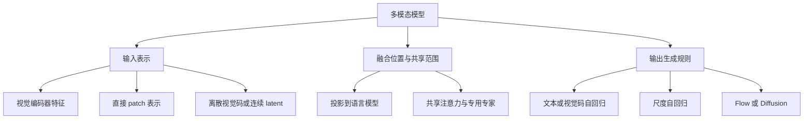

**图意解读：** 整理者的比较地图，不把不同研究当成必然替代的单线升级。一个模型可以使用 ViT 理解、VAE latent 生成、MoT 融合和 flow matching 训练，仍属于统一多模态模型。

## 2. ViT 与 CLIP：会表示图像，不等于会回答问题

### ViT：把二维图像变成序列

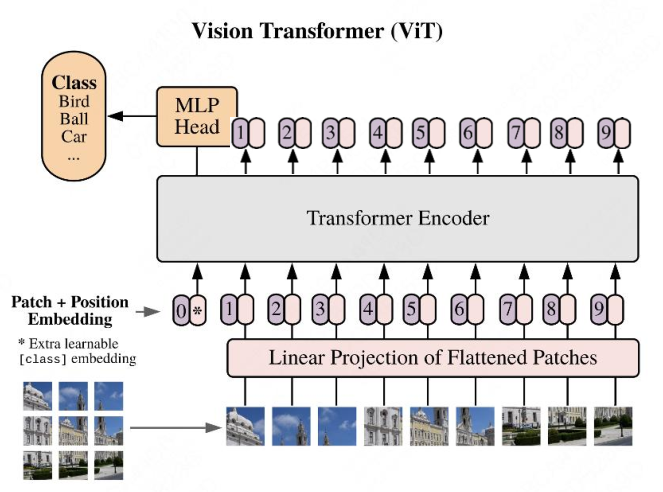

**图意解读：** 图像切块并线性投影，加入位置表示后送入 Transformer Encoder；上方分类头输出类别。它是图像分类结构，不包含能够回答用户问题的语言生成器。[ViT 论文 v2](https://arxiv.org/abs/2010.11929v2)

教学算例：`224×224×3` 图像按 `16×16` 切块，得到 `14×14=196` 块；每块展平成 768 个数，经过投影得到 `[196,d]`。若添加分类 token 则为 `[197,d]`。这里只演示固定尺寸 ViT，不代表动态分辨率模型的全部输入规则。

### CLIP：学会匹配图文

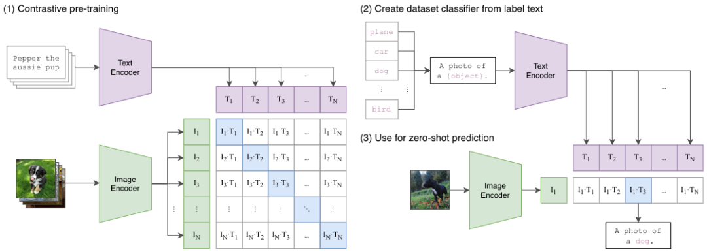

**图意解读：** 图像编码器和文本编码器分别产生向量，训练时提高匹配图文的相似度，推理时可将类别文字编码后比较。控制“匹配哪对”的是训练目标，不是把图像翻译成了一串中文。原论文使用 4 亿图文对，也研究不同视觉骨干；不能说 CLIP 必然等于 ViT。[CLIP 论文](https://arxiv.org/abs/2103.00020)

一个检索系统可以用这种共同表示找出“猫的照片”，但输出一段描述还需要生成模型。编码对齐解决了相似度问题，没有自动解决长文本生成、空间定位和所有 OCR 任务。

## 3. 连接视觉编码器与语言模型

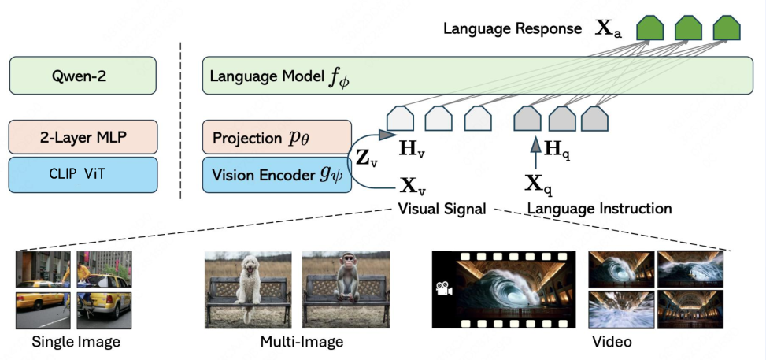

**图意解读：** 图片经过视觉编码器，再经 projection 接到语言模型，文本问题从另一条路径进入。原图同时标了 Qwen-2、两层 MLP 和多图/视频，是 LLaVA 家族式教学示意，不能作为最初 2023 LLaVA 精确架构或底座的证据。这里保留的是“编码—对齐—生成”的职责关系。

若视觉输出为 `[N_v,d_v]`，projector 可将其变成 `[N_v,d_lm]`，再按模型协议与文本 embedding 一起使用；有压缩、重采样或跨注意力时，形状和接入点还会变化。投影改变接口表示，不保证无损保存所有视觉信息。

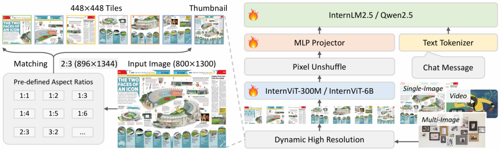

**图意解读：** 左边先按宽高比选择图块和缩略图，右边视觉编码结果经 Pixel Unshuffle、MLP 接到语言模型。编码前切图影响算量，编码后压缩影响下游序列长，两者应分开计数。图中语言骨干并列出现 InternLM2.5 / Qwen2.5，本身也说明不能把同一家族所有版本归成同一底座。

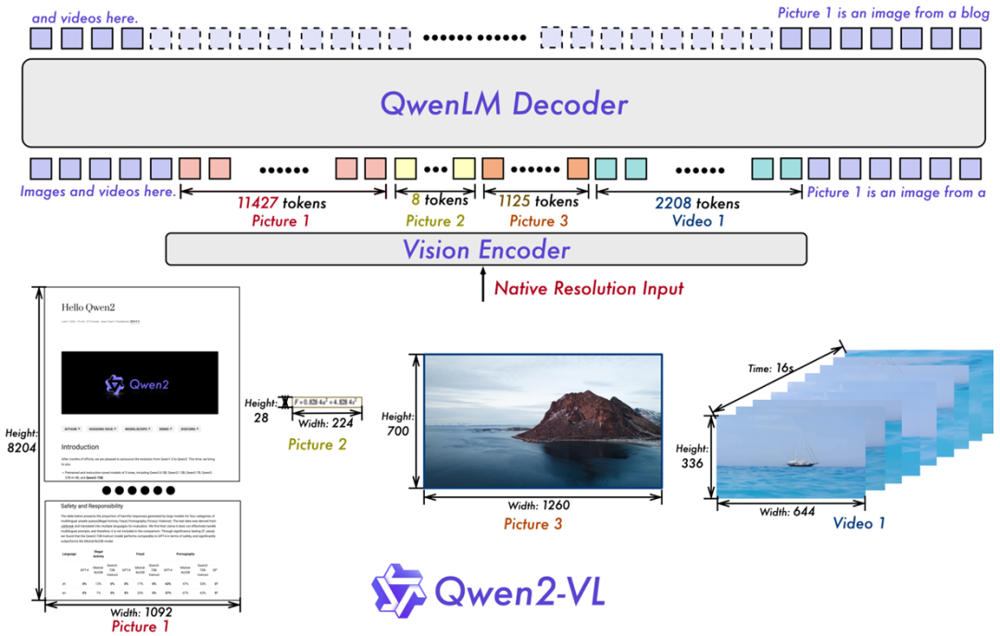

**图意解读与勘误：** 原文图注称 Qwen2.5-VL，但图内清楚写着 **Qwen2-VL**。不同尺寸图像和视频形成不同长度的视觉序列；图中的具体 token 数是图示样例，不是所有 Qwen-VL 的固定预算。可对照 [Qwen2-VL 报告](https://arxiv.org/abs/2409.12191)，不要用这张图证明 2.5 版本的全部细节。

到这里，应该能解释为什么仅凭文本 token 数难以判断多模态请求成本：图块数量、视觉网络开销、压缩比和语言模型上下文长度分别影响不同阶段。

## 4. 理解与生成的表示需求不同，但不是二选一定律

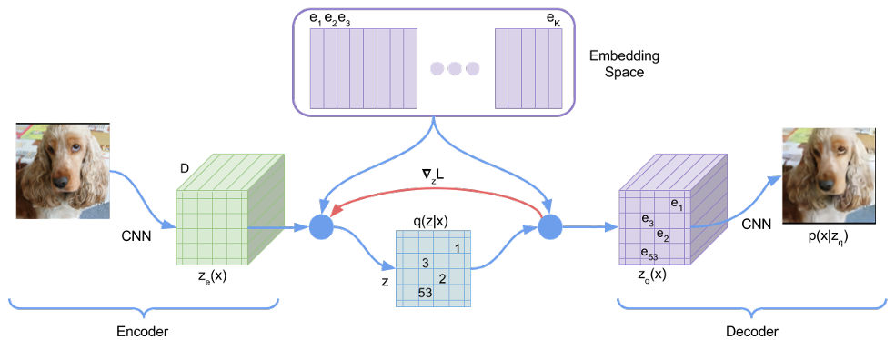

**图意解读：** 编码器产生连续表示，量化步骤选取码本项，解码器尝试还原图像。码本保存离散表示的候选，不是语言模型的 KV 缓存。图强调重建路径，但不能据此判断量化表示完全没有语义。

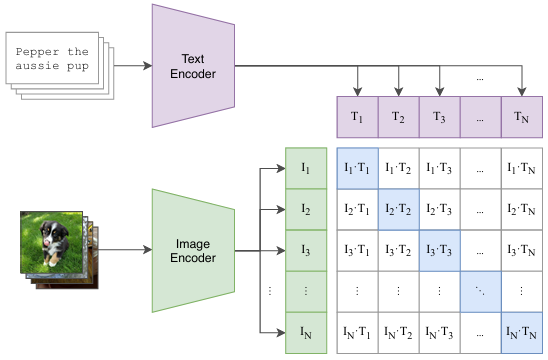

**图意解读与勘误：** 原文把它标为“图像理解 Tokenizer：ViT”，实际画的是双编码器和图文相似度矩阵。**ViT 是骨干结构，CLIP 是一种训练方法，VQ 是表示量化方式**，它们不是同一分类维度。视觉生成也可使用连续 VAE latent 与 flow/diffusion，不限于 VQ-VAE 离散码。

整理者的学习结论是：理解任务常要求语义和位置对齐，生成任务还要保留可重建的细节；它们可以通过不同表示和训练目标协调。不能从某一模型的结果推出“一种 tokenizer 永远不行”或“早期融合必然更好”。

## 5. 四种统一路线，逐一核对共享了什么

### Chameleon：混合离散序列的早期融合

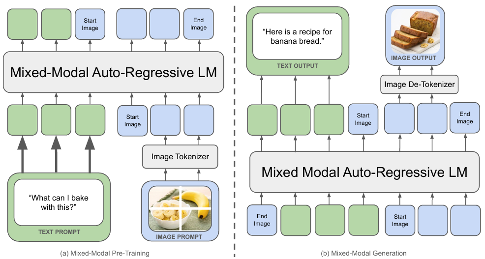

**图意解读：** 文本与图像 token 进入同一个自回归序列，生成端根据图像边界把视觉码交给解码器。共享序列不等于不需要图像 tokenizer/de-tokenizer。原文“理解很差”“单 tokenizer 行不通”是过强评价；[Chameleon 论文](https://arxiv.org/abs/2405.09818) 报告多类任务结果，不能据一篇概述判定路线失败。

### Janus-Pro：解耦视觉表示，共享自回归骨干

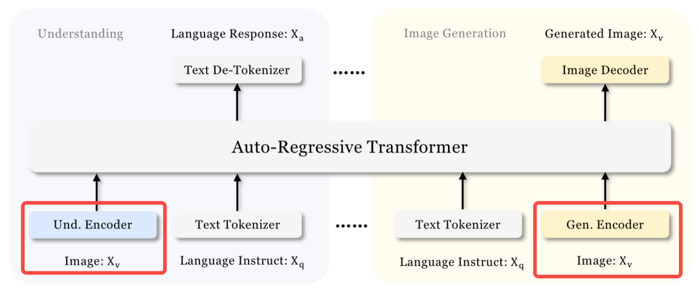

**图意解读：** 左侧理解用语义编码器，右侧生成用另一套视觉表示，两者经适配进入共享 Transformer。所谓“解耦”主要在视觉编码路径，不意味着两套完全独立大模型。

[Janus-Pro v1 第 3.1 节](https://arxiv.org/html/2501.17811v1) 明确列出 **DeepSeek-LLM** 底座、**SigLIP-Large-Patch16-384** 理解编码器，以及视觉生成码本；因此原文把 Janus-Pro 归为 Qwen 底座、把理解编码器一概称 CLIP ViT，应予修正。不同项目采用 Qwen 的事实不能推广到所有多模态模型。

### OneCAT：直接 patch 输入与尺度自回归

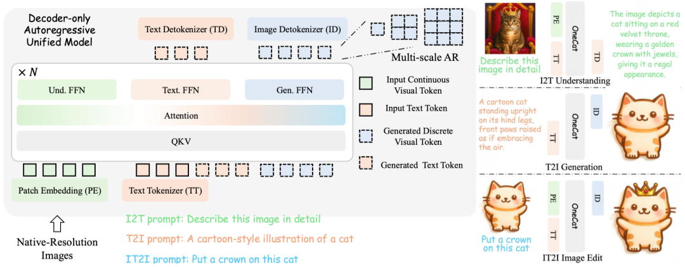

**图意解读：** 图里视觉 patch 直接接入 decoder，共享 QKV/注意力，按文本、理解、生成分配 FFN 专家；图像生成从粗到细推进尺度。论文中的路由按模态与任务确定，不应套成一般 token Top-K 动态 MoE。[OneCAT v1 第 3 节](https://arxiv.org/html/2509.03498v1)

原文把复杂度写成从 `O(H²W²)` 到 `O(L)`，没有充分定义 L 和计算口径。更稳妥的理解是**尺度级预测减少串行生成步数**；每个尺度内部仍有注意力和大量 token 计算，不把步数减少当成总 FLOPs 直接降到线性。

### BAGEL：自回归文本与连续图像生成的组合

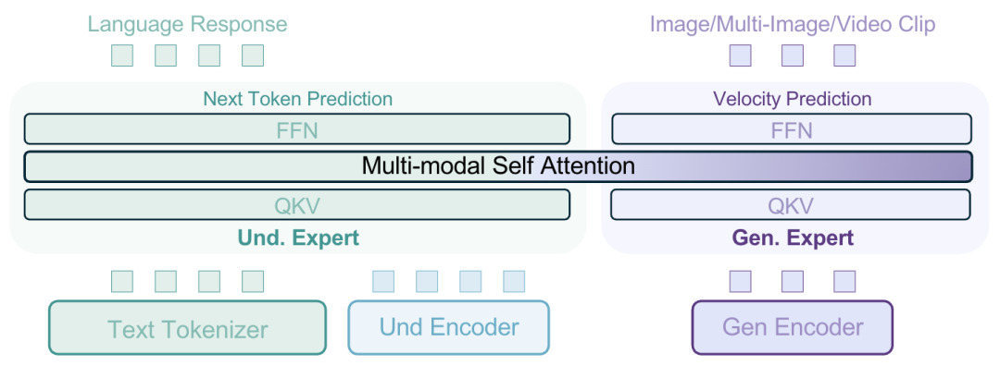

**图意解读与勘误：** 左侧是理解专家，右侧是生成专家；图中 QKV 和 FFN 分别画在各专家内，通过多模态自注意力交换信息，生成侧写的是 velocity prediction。底部也明确存在编码器。**这不是 OneCAT 式的“无 ViT、无扩散纯自回归”路线。**

BAGEL 官方 [训练配置](https://github.com/ByteDance-Seed/Bagel/blob/a2fa77dd8caeefc41e6607ae0ec17408d3f4ee9f/TRAIN.md) 明确含 SigLIP ViT 与用于 latent diffusion 的 VAE；[官方项目页](https://bagel-ai.org/) 介绍统一理解与生成。理解可消费语义特征，图像生成在连续 latent 上预测更新；即使共享大模型骨干，也不能抹去视觉编码和生成采样成本。

| 路线 | 主要共享点 | 仍需区分的部件 |
| --- | --- | --- |
| Chameleon | 混合离散 token 的 AR 序列 | 文本与视觉码的解释/解码 |
| Janus-Pro | AR Transformer | 理解与生成编码器和适配器 |
| OneCAT | decoder 内跨模态注意力 | 专用 FFN、任务路由与尺度输出 |
| BAGEL | 可跨模态交互的 MoT | 理解/生成专家、ViT、VAE 及生成过程 |

本表为整理者归纳，比较机制，不排序模型优劣。

## 6. Omni：输入、输出与实时性分别核对

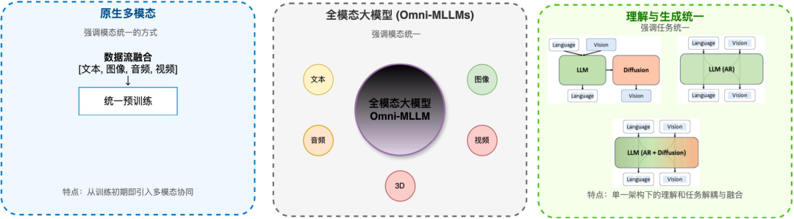

**图意解读：** 图将原生训练、多模态覆盖、理解/生成统一放在不同栏。它们是能力维度，不是同一个“全模态完成度”。“支持视频输入”不推出“支持生成视频”；训练时统一也不保证部署只有一个串行阶段。

Qwen3-Omni 的 Thinker/Talker 将理解与文本、语音输出协同起来。它不等同于“先生成完整文本，再启动一套普通 TTS”；Talker 使用与 Thinker 相关的表示和流式输出机制。输入音视频的编码、文本推理、音频 codec 和输出缓冲都有自己的计算与延迟。

[Qwen3-Omni v1 报告](https://arxiv.org/html/2509.17765v1) 的口径是：119 种**文本交互**语言、19 种**语音理解**语言、10 种**语音生成**语言。原文把 119 写成语音识别语言数，属于误读。报告中的 234 ms 是冷启动设定下的**理论首包延迟**，不是所有部署的端到端 SLO；本文不采用原文给 Qwen2.5-Omni 的 211 ms，也不补造其条件。

原文还列“32 项开源最佳、22 项 SOTA”等排名。它们属于相应论文版本的评测集合，不是 2026-10-14 对所有模型的实时排名；本篇不据此作选型结论。

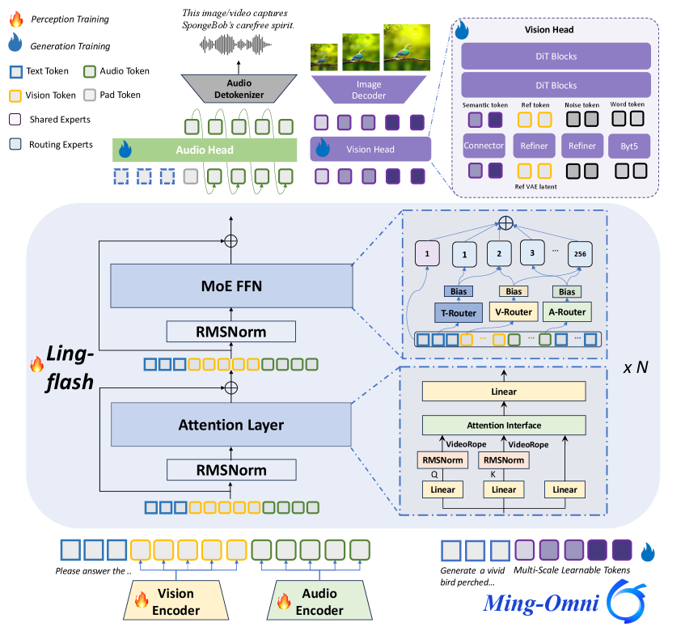

**图意解读：** 下方有视觉、音频编码器，中部为共享注意力与专家模块，上方分别接文本、音频和图像输出头。图中能看到模态相关路由，但**仅凭多路由器不能证明每个 token 动态改变激活专家数量**。图片水印与原文版本称呼也不足以确定某个 Flash 版本的完整配置。

[Ming-Omni 原始论文](https://arxiv.org/abs/2506.09344) 和 [官方 Ming 项目](https://github.com/inclusionAI/Ming/tree/2a0c02ae3130190160c215f89fce7de3005db483) 是核对具体版本的入口；本文保留图中的职责关系，不把原文 AnyExperts、MingTok 或“首个”的表述推广到全部 Ming 模型。原文的 Qwen3.5-Omni、GPT/Gemini 综合排名亦不进入已验证事实表。

## 7. 回到 Infra：一张图片怎样改变系统成本

以两张图加一句问题为例，先确认图片如何切块、是否复用编码结果，再确认进入语言模型的表示数量，最后确认输出只是文本还是还有语音/图像。这三步分别改变编码算量、上下文状态以及输出生成调度。

| 观察到的现象 | 先沿哪条链查 |
| --- | --- |
| 图片分辨率升高，首输出变慢 | 预处理 → patch 数 → 编码 → 视觉压缩 → LLM Prefill |
| 同一图片搭配不同问题能否复用 | 编码特征身份与 LLM 上下文身份分别检查 |
| 图像生成时间明显长于文本 | 生成规则、latent 大小、采样步数与解码器 |
| 音频首包快但后续断续 | 首包口径、流式生产速率、缓冲和消费速度 |
| 模型写“统一”，部署仍有多个进程 | 共享训练/参数与部署角色不是同一维度 |

这些是整理者的排查问题，未指认任何模型现存故障。下一步进入 [Encode 分离与 EPD](<../分布式服务/多模态 Encode 分离与 EPD 状态交接学习文档.md>)，把模型内的表示边界对应到跨实例传输。

## 8. 自测与参考路线

能画出 ViT、CLIP 和带语言生成器的 VLM 三种输出，就理解了起步区别。进一步回答：Janus 与 BAGEL 各共享什么；OneCAT 少的是哪个独立组件；为什么 Omni 的输入覆盖不能直接填成相同的输出覆盖？

推荐按机制回看一手资料：

1. [ViT v2](https://arxiv.org/abs/2010.11929v2) 与 [CLIP](https://arxiv.org/abs/2103.00020)：序列化图像与图文对齐。
2. [Qwen2-VL](https://arxiv.org/abs/2409.12191)：动态分辨率与视觉序列。
3. [Chameleon](https://arxiv.org/abs/2405.09818)、[Janus-Pro v1](https://arxiv.org/html/2501.17811v1)：混合序列和解耦视觉编码。
4. [OneCAT v1](https://arxiv.org/html/2509.03498v1)、[BAGEL 项目](https://bagel-ai.org/)：分开理解尺度 AR 与连续生成；本次 BAGEL arXiv HTML 获取失败，使用官方项目与固定训练配置核对。
5. [Qwen3-Omni v1](https://arxiv.org/html/2509.17765v1)、[Ming-Omni](https://arxiv.org/abs/2506.09344)：按输入、输出、实时性三列阅读能力边界。
