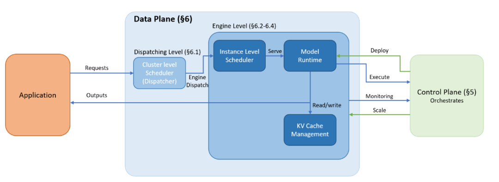
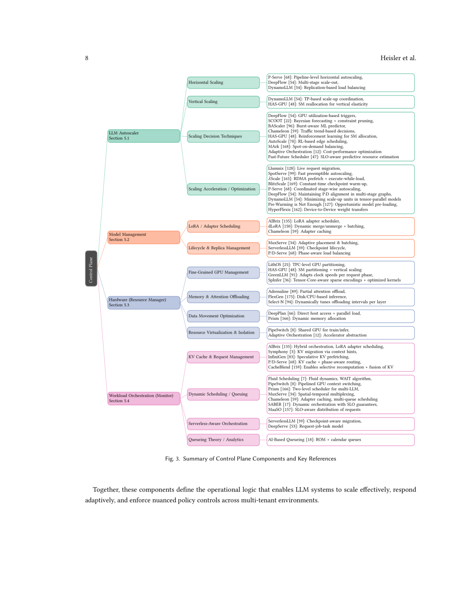
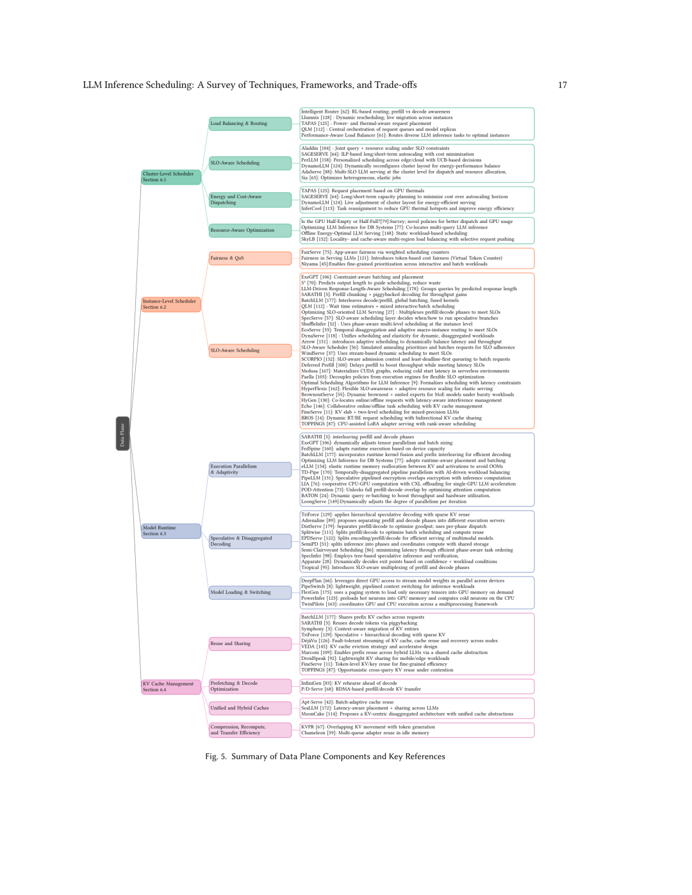
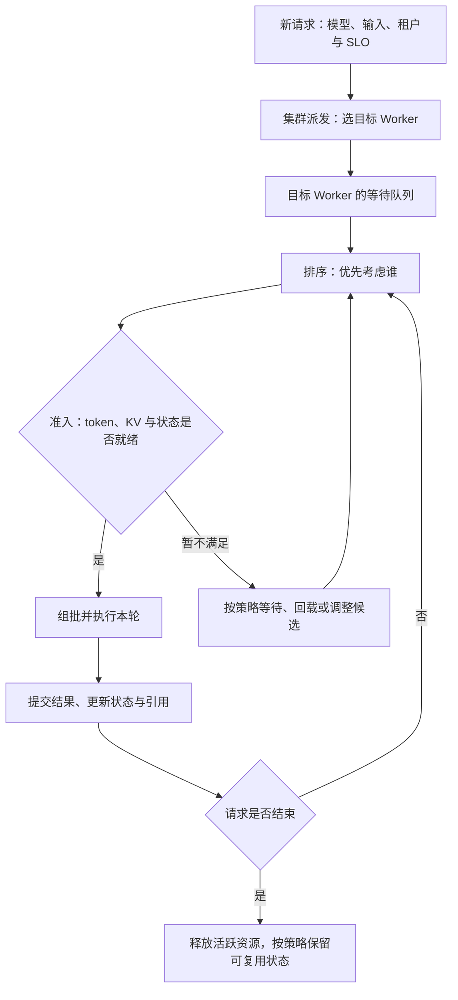

# LLM 推理调度的分层决策与 SLO 取舍学习文档

同样叫“调度”，有人在决定增加几组 GPU，有人在为请求选择 Worker，也有人在决定下一轮推进哪些 token。把这些决策混在一起，就容易出现“命中率很高，首 token 仍然很慢”“GPU 很忙，达标请求却很少”等难以解释的现象。

本文面向已经了解 Prefill、Decode 和 KV Cache 的读者，是**第三方资料整理型学习文档**。以推理调度综述建立职责地图，再用一手论文和仓内专题说明公平性、服务目标与状态成本；没有运行论文代码或复现性能结果。

[调度方法路线](README.md) · [先修：推理系统心智模型](<../推理基础/LLM 推理系统心智模型与 SGLang、vLLM 选型边界学习文档.md>) · [配套：服务弹性与模型驻留](<../分布式服务/LLM 弹性扩缩容、模型驻留与冷启动学习文档.md>)

## 0. 阅读基线与范围

| 项目 | 内容 |
| --- | --- |
| 入口文章 | [《大模型推理调度综述分享》][article]，一起推理吧，2026-11-11 |
| 原始综述 | *LLM Inference Scheduling: A Survey of Techniques, Frameworks, and Trade-offs*，Morgan Lindsay Heisler 等；华为及 Simon Fraser University、清华大学、University of British Columbia 的共同工作 |
| 综述版本 | 作者资料库标注 2025 年、v1.0；原文给出 [TechRxiv v1 DOI][survey-doi] |
| 实际读取文件 | 作者资料库固定提交 `3cd4e7c81e49e1f2ab197e6b5e02028ef8d72eac` 中的 [`LLM_Scheduling_Survey_03Nov2025.pdf`][survey-pdf]，共 41 页；同时核对该提交的 [README][survey-repo]。这里固定的是实际读取文件，不宣称它与 DOI 入口文件逐字一致 |
| 读取时间 | 2026-11-23 |
| 整理范围 | 控制平面、集群派发、实例内调度、运行时、KV 管理之间的职责和约束；SLO、公平性与缓存的取舍 |
| 图片 | 已读取入口文章全部三张技术图，原样保存；对应综述 Fig. 1、Fig. 3、Fig. 5 |
| 验证边界 | 综述用于分类；VTC 公平性机制回到 OSDI 2024 正式论文。仓内源码文章各自保留固定版本；未审计所有被引系统，未验证部署组合 |

正文中的“综述分类”表示作者组织材料的方式；“整理者归纳”表示用于教学的抽象、算例或排查方法。一篇综述把两项技术放在同一类，不证明它们具备相同接口或可以直接组合。

### 术语速查

| 术语 | 人话解释 | 需要分开的对象 |
| --- | --- | --- |
| Control plane | 配置资源、模型和策略，改变服务未来能怎样运行 | 不等于所有名称带 Scheduler 的组件 |
| Dispatch | 为请求选择实例，必要时决定是否改派 | 与实例内部的执行顺序不同 |
| Instance scheduler | 在当前实例中选择可执行请求和本轮工作量 | 与全集群扩容不同 |
| Admission | 检查是否有条件接纳请求或本轮 token | 排序靠前不代表一定接纳 |
| HOL blocking | 前面的任务拖住后面的任务，即队首阻塞 | 长 Prefill 干扰、等待容量、加载模型的原因不同 |
| SLO | 明确的服务目标，如首 token 或输出间隔上限 | 需要写明测量起点、阈值与达标规则 |
| Goodput | 满足指定目标的有效吞吐 | 必须说明按请求、token 还是其他单位计量 |
| Fairness | 按约定的服务成本和租户权重分配机会 | 不自动等于相同请求数或相同延迟 |

## 1. 先建立整体地图：谁在决定什么



**图意解读：** 原综述 Fig. 1 把 Cluster-level Scheduler、Instance-level Scheduler、Model Runtime 和 KV Cache Management 放在数据平面中，右侧控制平面通过部署、扩缩容与监测协调它们。蓝色请求路径经过多个决策点；它不是“请求进入 GPU 后才有数据平面”。图中的模块是职责划分，不要求每块都对应一个独立进程。

### 为什么旧文有时把 Scheduler 称为控制面

这是观察范围不同。在[推理系统心智模型](<../推理基础/LLM 推理系统心智模型与 SGLang、vLLM 选型边界学习文档.md>)中，实例内 Scheduler 相对于张量计算拥有控制权；这篇综述从整套服务看，把逐请求路由和组批视作执行路径的一部分。两个说法可以同时成立。

阅读时先问“控制什么、影响谁、何时生效”，再看层的名字。控制平面与数据平面也不等于“CPU 与 GPU”。

| 决策 | 修改的对象 | 生效位置 | 一条容易误读的边界 |
| --- | --- | --- | --- |
| 资源规划与扩缩容 | 副本数、P/D 比例、并行配置、可用设备 | 后续可用容量 | 发出扩容动作不等于副本已经可接流量 |
| 模型管理 | 模型/Adapter 的位置、加载、预取与淘汰 | 可执行候选集合 | 权重已驻留不等于该请求的 KV 也存在 |
| 集群派发 | 请求与目标实例的对应关系 | 当前或后续请求 | Router 的索引不能替 Worker 锁定缓存 |
| 实例内调度 | 排序、准入、token budget、抢占 | 本轮或后续轮次 | 本轮能放下不等于整个生成过程不会出现容量压力 |
| 模型运行时 | 张量组织、算子、并行通信、投机验证 | 一次模型执行 | 更快的局部执行不自动抵消排队与状态搬运 |
| KV 管理 | 身份、位置、引用、回载和回收 | 执行前后及跨请求复用 | 找到副本、完成传输、GPU 可读是不同条件 |

## 2. 控制平面：把策略变成未来可用的资源



**图意解读：** 原综述 Fig. 3 把扩缩容、模型管理、硬件资源管理和工作负载编排并列展示。右侧论文名提供检索线索，不能直接当成功能验收表。尤其要区分“决定预取哪些数据”和“实际把数据搬到可使用位置”。图中 Model Management 的分组与正文 §5.2 的“驻留感知派发、预加载、淘汰”并非一一对应，学习时以具体问题和原始论文为准。

### 四项职责如何连接

扩缩容器决定要不要增加服务能力；模型管理器决定这些资源上应当放什么；硬件管理器判断计算、显存与互联能否满足要求；编排器让新配置与正在执行的请求衔接起来。它们共享状态，但不因此合并成一个万能调度器。

例如，新增一个 Decode 副本至少要回答：它能否装下目标模型和 KV 预算、何时 Ready、P 侧能否向它交接状态、Router 何时开始派发。若输入突然变长而输出没有变长，瓶颈可能在 Prefill，继续增加 Decode 副本未必有用。

横向/纵向扩容、模型预加载与淘汰的详细机制见[服务弹性与模型驻留](<../分布式服务/LLM 弹性扩缩容、模型驻留与冷启动学习文档.md>)。这里保留职责总览，不重复部署层的全部细节。

## 3. 数据平面：请求到了，也还没有获得执行机会



**图意解读：** 原综述 Fig. 5 分开集群派发、实例内调度、模型运行时与 KV 管理。一个系统可能横跨多栏，表示它同时处理多个问题，不表示同一栏中的系统具有相同能力或相同性能。原图保留论文名称和编号便于回查；本文不逐项采信图中的短评。

### 3.1 派发、排序、准入和执行是四步



**图意解读（整理者归纳）：** 图表示逻辑依赖，不要求实现严格串行。CPU 准备、GPU 执行与数据回载可以重叠，但提交和使用状态仍必须满足各自依赖。未接纳请求的处理也可能是拒绝或超时，取决于服务策略。

### 3.2 “负载最小”需要单位

只有两条请求的 Worker，可能正承担两个超长生成；有十条请求的 Worker，也可能即将完成。如果只看请求数，就漏掉输入长度、输出增长、KV 占用和当前执行阶段。

综述 §6.1 提供的是决策维度：请求级快速派发、全局 SLO 优化、成本/能耗与资源感知。是否需要全局优化器、输出长度预测或在线迁移，应由证据决定。预测方法还需要处理误差和分布变化，不能把预知真实输出长度的结果当作在线能力。

源码层面的选点、pending、事件确认与最终恢复，见[前缀亲和调度与缓存感知路由](<../分布式服务/前缀亲和调度与缓存感知路由源码学习文档.md>)。

## 4. SLO 与公平性：需要回答两个不同的问题

### 4.1 SLO 检查“是否按时”，公平性检查“谁获得多少服务”

两类租户各处理十条请求，不代表资源分配公平：一方的请求可能只有很短输入，另一方每条都有长输入和长输出。反过来，即使双方获得相近服务量，也可能因为一个不可切开的长 Prefill 而同时违反输出间隔目标。

| 目标 | 需要定义 | 容易遗漏的代价 |
| --- | --- | --- |
| 首 token 目标 | 从接入到首 token 的测量边界、分位数与阈值 | Router、加载、排队与回载可能不在模型执行计时内 |
| 生成阶段目标 | 逐间隔 ITL/TBT、平均 TPOT 或其他定义 | 平均 TPOT 可以掩盖个别很长的输出停顿 |
| 租户公平 | 服务成本、权重、参与竞争的时间区间 | 请求数相同不代表工作量相同 |
| Goodput | 达标单位、统计窗口、失败及拒绝规则 | 只统计成功接纳请求，可能隐藏被拒绝或超时的需求 |

### 4.2 VTC：按已经提供的服务记账

[Fairness in Serving Large Language Models][vtc] 的 §3、§4.1 和 Algorithm 2 给出一种具体做法：为每个 Client 维护虚拟计数器，在接纳新请求时优先选择计数较小的 Client，再取其最早等待的请求。输入接纳与逐步 Decode 都更新记账。它建立在 Continuous Batching 上，不需要先知道真实输出长度。

一种论文使用的服务成本表示为：

```text
service = wp × 已处理的输入 token 数 + wq × 已生成的输出 token 数
```

这里的 `wp`、`wq` 是服务成本权重，不是自动测得的每 token GPU 毫秒数。Client 重新进入等待队列时还有 counter lift，防止空闲期累计的“欠服务”变成回来后长期独占的额度。只摘“选计数最小者”会漏掉这个条件。

**教学算例（整理者构造）：** 为方便计算暂取 `wp=wq=1`。A 已处理 100 个输入 token、20 个输出 token，B 已处理 800 个输入 token、20 个输出 token，记账分别为 120 和 820。若两者都有等待请求且满足相应条件，调度应考虑 A 获得的服务较少。这个权重只服务算例，不是生产推荐，也不等于 A 的 GPU 时间恰好更少。

VTC 的服务差上界依赖论文对 backlogged Client、输入长度和 batch 容量等条件的定义；不能把它改写为“延迟最多相差两倍”或任意部署下的 SLO 保证。本文没有把 VTC 接入 SGLang/vLLM。

### 4.3 为什么切小 chunk 还不够

Chunked Prefill 缩短一次不可重新决策的计算区间；租户记账决定下次机会给谁；准入决定当前是否有容量；SLO 策略决定能否承受本轮耗时。它们互相配合，但解决的不是同一个问题。

因此，“开启 chunking”“FIFO”“优先短请求”都不能单独证明租户公平。持续优先短请求还需要考虑长请求等待是否无界。执行机制继续读[Chunked Prefill 与 Prefill-Decode 共推](<Chunked Prefill 与 Prefill-Decode 共推学习文档.md>)；本文不改变该文保留的历史源码基线。

## 5. 缓存、模型驻留与执行速度为什么不能各自最优

### 人话版

缓存多的地方可能队列更长；模型预加载越积极，留给活跃 KV 的显存可能越少；让某个 Prefill 算得更快，也可能挤占正在 Decode 的请求。局部省下的成本，要放回整条请求判断。

以下是**整理者构造的简化算例**，假设请求使用同一模型，所有路径都能最终恢复完整正确状态，表中时间互不重叠：

| 候选 | 排队 | 额外准备 | 剩余 Prefill | 到首 token 的简化合计 |
| --- | --- | --- | --- | --- |
| A：本地已有兼容前缀 | 90 ms | 0 ms | 10 ms | 100 ms |
| B：无前缀，但模型已就绪 | 5 ms | 0 ms | 50 ms | 55 ms |
| C：需读取远端兼容前缀 | 5 ms | 20 ms 回载 | 10 ms | 35 ms |

算例只说明需要比较总成本，不能据此得出“远端 KV 总比重算快”。如果 C 的传输变成 100 ms，或目标 Worker 无法恢复所需状态，结论就改变。真实系统存在重叠与资源竞争，应沿依赖图测量关键路径，不能把所有组件耗时直接相加。

同样，GPU 显存预算应分清：

```text
模型权重 + 活跃/保留 KV + 激活与工作区 + 运行时预留 <= 可用显存
```

对普通完整注意力，在层数、KV 头数、维度与精度固定时，KV 字节量随保留 token 数近似线性增长；不能把注意力计算量的二次关系直接套给 KV 容量。混合注意力与状态模型还需分状态组记账，详见[容量优化技术地图](<../KV缓存/KV Cache 容量优化技术地图学习文档.md>)。

## 6. 怎样把综述当成可用的学习入口

### 6.1 机制分类与系统能力表分开使用

该综述是 2025 年的研究快照，其 Table 3 没有给出每项框架能力的固定提交。例如表中 vLLM 的 Preemption 标为 No，不能据此覆盖仓内固定源码文章已说明的抢占/重算路径。当前实现需回到[引擎架构差异](<../推理基础/SGLang 与 vLLM V1 架构差异源码学习文档.md>)和[vLLM 请求生命周期](<../../vllm/运行时/README.md>)，而不是复制这张表成为当前选型表。

原综述和作者 README 的个别图注、编号或短评也存在需要回查的地方。例如 DynamoLLM 在部分控制平面条目中被标成 `[54]`，而参考文献对应项为 `[124]`。本篇将它直接连接到[原始论文][dynamollm]；它是节能研究系统，不能因名称接近就当作 NVIDIA Dynamo。

### 6.2 已有专项资料从这里继续

| 想回答的问题 | 仓内阅读入口 | 与本文的关系 |
| --- | --- | --- |
| 下一轮怎样组织 Prefill 与 Decode | [Chunked Prefill 与共推](<Chunked Prefill 与 Prefill-Decode 共推学习文档.md>) | 执行机制，不替代租户公平规则 |
| Router 看到的前缀能否实际使用 | [前缀亲和与缓存感知路由](<../分布式服务/前缀亲和调度与缓存感知路由源码学习文档.md>) | 固定源码中的选点、估计与恢复 |
| 哪些 KV 留下、怎样转换或回收 | [KV 与调度协同优化](<../性能工程/KV Cache 与推理调度协同优化学习文档.md>) | 比较不同状态对象和证据范围 |
| 跨 Worker 交接后如何继续生成 | [PD 与投机的状态交接](<../高级生成/PD 与投机解码的状态交接、回滚及容量学习文档.md>) | 补足执行与生命周期约束 |
| 增加资源为什么没有立即增加产能 | [弹性扩缩容与模型驻留](<../分布式服务/LLM 弹性扩缩容、模型驻留与冷启动学习文档.md>) | 展开控制平面的实际成本 |

这些资料的模型、版本和实验条件不同，适合对照机制与边界，不构成统一性能排名。本文保留综述的研究问题，不复制其全部论文目录和缺少版本约束的能力判断。

## 7. 排障地图与自测

| 现象 | 先区分什么 | 值得观察的证据 |
| --- | --- | --- |
| GPU 很忙，用户仍然超时 | 平均吞吐与达标吞吐是否一致 | 分租户 TTFT/ITL、队列、拒绝与超时 |
| Prefix 命中高，首 token 很慢 | 索引命中、实际恢复和排队成本 | Router 估计、Worker 匹配、回载完成与准入时间 |
| 加了 Decode 副本，等待没减少 | 瓶颈是否在 Prefill、传输或加载 | 分阶段排队、Time To Ready、KV 交接 |
| 短请求很快，某租户长期排队 | 长短优先与租户公平是否混淆 | 按租户累计服务量、等待年龄、优先级和权重 |
| 本地参数最优，集群表现反而差 | 是否把动作和共享资源的成本漏掉 | 重配置窗口、模型加载、网络与状态迁移 |

自测：同一个 Scheduler 为什么能在一种图里叫控制面、在另一种图里叫数据面？为什么“相同请求数”和“相同 token 数”也未必代表相同服务成本？为什么增加缓存命中仍可能损害 SLO？能沿职责和依赖回答这三个问题，再进入某个引擎的源码，比从论文名清单开始更容易建立完整认识。

## 8. 来源与延伸

1. 一起推理吧：[《大模型推理调度综述分享》][article]，2026-11-11；三张原图的来源入口。
2. Heisler 等：[TechRxiv v1 DOI][survey-doi]；[作者固定资料库][survey-repo]；[本次读取的 PDF][survey-pdf]。本文主要使用 §5、§6、§9 的分类与问题，Table 3 仅作为历史资料讨论。
3. Ying Sheng 等：[Fairness in Serving Large Language Models][vtc]，OSDI 2024，§3、§4.1、Algorithm 2；[正式 PDF](https://www.usenix.org/system/files/osdi24-sheng.pdf)。
4. Jovan Stojkovic 等：[DynamoLLM: Designing LLM Inference Clusters for Performance and Energy Efficiency][dynamollm]，arXiv v1，2024-08-01；此处用于核对系统身份，详细机制见配套文档。

原图保留作者图中的文字和编号，图片出处与许可副本见[图片说明](../../images/llm-scheduling/README.md)。所有数字算例均为本文教学构造，没有据此声称运行收益。

[article]: https://mp.weixin.qq.com/s/vk5fdcqsP0wXIAsOtuRZ0w
[survey-doi]: https://doi.org/10.36227/techrxiv.176238087.79673350/v1
[survey-repo]: https://github.com/Intelligent-Cloud-Infrastructure-Lab/llm-inference-scheduling-survey/blob/3cd4e7c81e49e1f2ab197e6b5e02028ef8d72eac/README.md
[survey-pdf]: https://github.com/Intelligent-Cloud-Infrastructure-Lab/llm-inference-scheduling-survey/blob/3cd4e7c81e49e1f2ab197e6b5e02028ef8d72eac/LLM_Scheduling_Survey_03Nov2025.pdf
[vtc]: https://www.usenix.org/conference/osdi24/presentation/sheng
[dynamollm]: https://arxiv.org/abs/2408.00741v1
