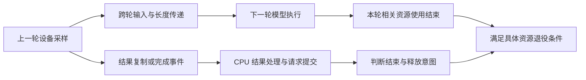
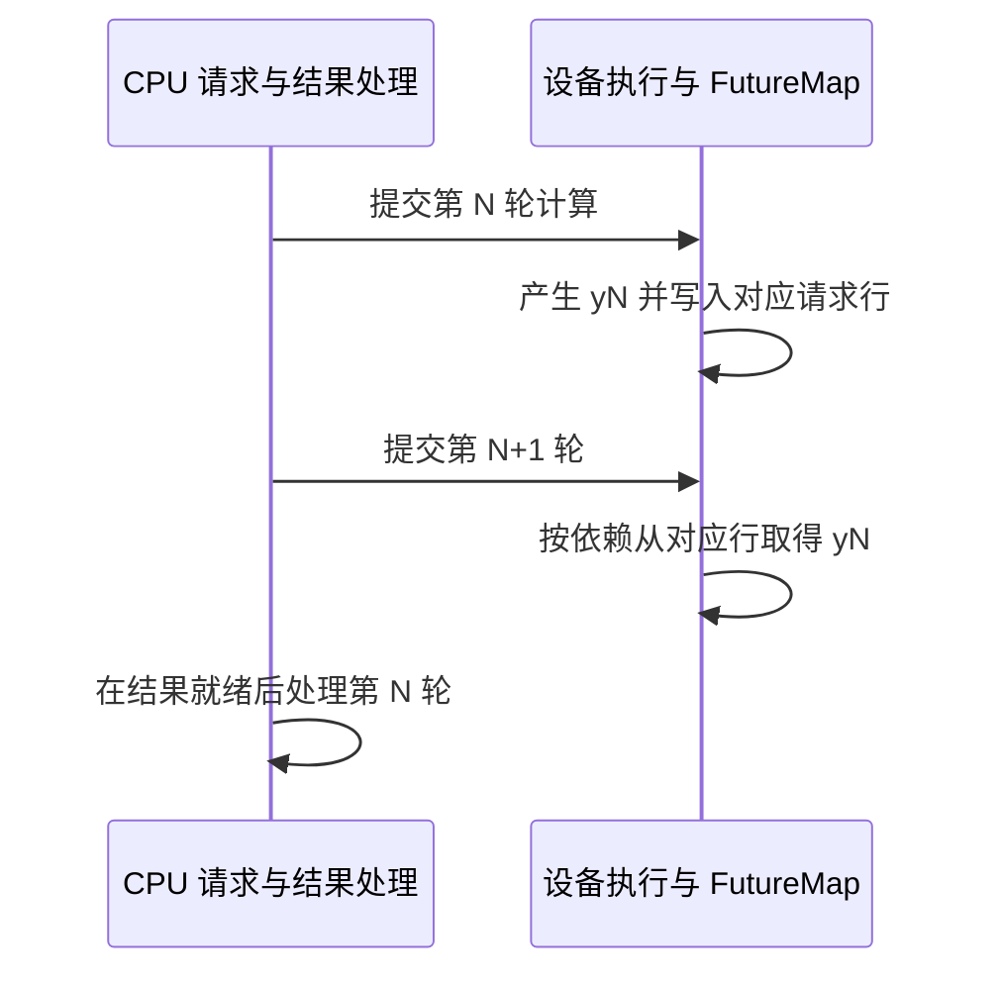

# SGLang Overlap 与 DeepInfer ZOS 的依赖和状态提交对比学习文档

下一轮计算已经提交，CPU 却还没把上一轮结果写回请求：输入从哪里来，Grammar 是否已经推进，旧 buffer 又什么时候才能复用？这些问题决定重叠调度是否成立。

本文比较 SGLang Overlap 与 DeepInfer ZOS 的代表路径，沿**设备输入、CPU 结果提交、共享数据保护和收尾**建立依赖地图。两者都希望减少设备等待 CPU 的时间，但并不使用同一套对象或同步协议。

本文属于**源码分析型的跨引擎整合学习资料**，以固定源码和仓内专项文档为依据。流程图、比较表和教学算例是整理者归纳；没有运行引擎、采集 GPU trace、复现并发故障或测量加速比。

## 0. 基线、主线与比较方法

| 项目 | SGLang | DeepInfer |
| --- | --- | --- |
| 公开仓库 | [sgl-project/sglang](https://github.com/sgl-project/sglang) | [deepseek-ai/DeepInfer](https://github.com/deepseek-ai/DeepInfer) |
| 分支语境 | 官方 `main` 历史快照 | 官方 `main` 历史快照 |
| commit | `72d5c5bb73cadd7ffbf5114e5f81e29d36b6c61a` | `553741557a57df44a46fb3ab72b6aafeaf945337` |
| 读取时间 | 2026-10-27 | 2026-10-27 |
| 工作区状态 | 固定 Git 对象只读；检出目录存在未跟踪资料，保留且未采用 | 检出干净，只读 |
| 主线 | 普通 CUDA 文本生成、非投机、单实例代表路径 | `Worker.execute_model_step` 的 ZOS Decode 路径 |
| 单独讨论 | Grammar 延迟采样、投机长度与 WAR 事件边界 | 变长验证、序列长度校正、Prefill 与 flush |
| 未覆盖 | 全部 backend、PD/PP 组合、所有取消与退出分支 | 生产入口、外部缓存编排、全部设备后端和故障恢复 |

这不是同模型、同硬件、同负载的性能实验。SGLang 普通生成与 DeepInfer 变长投机不能放在同一条时间轴上声称谁更快；先比较共同依赖，再单列增加的条件。

先修：[Chunked Prefill 与共推](<Chunked Prefill 与 Prefill-Decode 共推学习文档.md>)。深入背景：[SGLang Overlap 专项源码课][sg-course]、[SGLang 请求调度主线][sg-runtime]、[DeepInfer 框架分析][di-local]。本文未引入外部原图，所有图均为可维护的 Mermaid 教学图。

### 术语速查

| 术语 | 人话解释 |
| --- | --- |
| launch / submit | 把设备工作提交出去；函数返回不一定表示设备完成 |
| forward | 根据输入和历史状态计算本步模型结果 |
| sample | 根据 logits、规则和相应验证结果决定 token |
| post-process | 消费结果，推进请求状态并形成输出等；具体职责以各引擎为准 |
| FutureMap / MetadataZOS | 两套实现各自跨轮传递输入和元数据的机制，不能互换 |
| WAR | 后一轮写不能覆盖前一轮尚未读完的共享数据 |
| flush / drain | 没有新计算时，仍要处理已经在途的结果与状态 |

## 1. “下一轮能开始”不要求 CPU 已做完所有上一轮工作

### 人话版

可以让厨师开始下一道菜，同时由前台登记上一道菜的结果。前提是厨师拿到了正确食材，前台不会覆盖厨师正在看的订单，而且不能把还没做完的菜算进已交付数量。

推理中至少有三种不同进度：

| 进度 | 关心的问题 | 代表对象 |
| --- | --- | --- |
| 设备执行进度 | 下一步需要的 token、长度和映射能否正确取得？ | GPU token 缓冲、序列元数据、执行流 |
| CPU 请求进度 | 上一步接受了什么、是否结束、该输出给谁？ | 请求对象、结果队列、后处理状态 |
| 资源使用进度 | 旧张量、映射和状态是否仍被设备或复制任务使用？ | 引用、event、allocator 记录 |

**整理者归纳：** 重叠调度允许它们有受控的时间差，不能允许它们对应不同请求或不同轮次。



**图意解读：** 从设备结果分出两条通路：一条服务下一轮计算，一条服务 CPU 状态。资源退役另受实际使用者约束。箭头是语义依赖，不指定同一条 CUDA stream，也不意味着两个引擎都有同名对象。

## 2. SGLang：结果排队，设备 token 先走自己的通路

### 从 event loop 看顺序

固定 [`event_loop_overlap`][sg-loop] 的代表顺序是：接收请求、选择下一批、按分支决定是否先处理旧结果、运行当前批、保存当前结果配对、处理旧批、按需延迟采样，再更新 `last_batch`。

```text
普通重叠轮次：选择 B → 提交 B → 保存 B 的结果配对 → 处理 A
禁止本轮重叠：先处理 A → 再提交 B
```

不能把第一行写成所有轮次的硬规则。源码有 `disable_overlap_for_batch` 分支；没有当前 batch 但仍有上一批时，也要处理旧结果。

### CPU 还没记录 y1，下一轮怎样使用 y1

普通生成路径用 `_relay_forward_payload` 把采样 token 交给 `FutureMap.stash`；下一轮 `resolve_forward_inputs` 根据请求池行，从设备侧 token 缓冲获得输入。[中转][sg-relay]、[输入解析][sg-input]



**图意解读：** “提交第 N+1 轮”与“第 N+1 轮实际读取输入”是两件事。设备读取必须排在所需写入之后；CPU 可以提前提交，不等于模型可以在 yN 尚不存在时正确计算。

FutureMap 的索引是请求池行，不是业务请求 ID 字符串；它也不负责接纳请求或决定结束。把设备中转省略后，只画 CPU 的 `output_ids`，会误以为下一步必然等待 CPU 回写。

### 结果与 batch 必须保持对应

`result_queue` 保存 batch 与结果的配对。`batch.copy()` 用于保留结果处理所需的成员关系和字段，并不是深复制每个请求或整份 KV；共享对象内部仍可能变化。另有引用保留机制避免已提交工作使用的对象过早释放。[源码课的对象分析][sg-course]

因此应分别问“结果属于谁”和“数据还活着吗”，不能用一份浅拷贝同时回答两者。

## 3. DeepInfer：当前 forward 与上一轮后处理错开

固定 [`Worker.execute_model_step`][di-worker] 把一轮组织为四个阶段：

| 当前第 N 轮 | 行为 | 关键条件 |
| --- | --- | --- |
| 1 | 准备所需校正，提交当前主模型 forward | 输入和长度可能需要按上一轮设备结果调整 |
| 2 | `_post_process_step(prev_step_state)` | 等上一轮采样事件，再做后处理 |
| 3 | 当前 `execute_sample` | 变长路径先等待长度镜像并更新采样元数据 |
| 4 | 处理或保存当前状态 | Prefill / 非 ZOS 当场处理；ZOS Decode 留在 `prev_step_state` |

`WorkerStepState` 保存这一步的序列元数据、调度输出、采样结果和事件等信息。它是待后处理的一步状态，不是“CPU 已经提交完了”的标记。

### 当前输入与长度从哪里来

[`_correct_seqlens_qk`][di-correct] 在当前与上一轮请求有交集时建立 remap，并构造 `MetadataZOS`，其中携带上一轮设备侧的 sampled tokens、predict tokens、accepted counts 以及校正后的长度等信息。主模型执行收到这份元数据。

这与 SGLang FutureMap 都在解决“CPU 账本尚未完全更新时，设备输入如何继续”的问题，但容器、索引、长度规则与算法分支不同；不能直接把 `prev_step_state` 重命名为 FutureMap 来解释。

### 三种容易漏掉的同步

1. `_post_process_step` 在 CPU 消费采样结果前等待 `sample_end_evt`。
2. 变长验证会把校正后的长度异步写回 pinned buffer；CPU 更新采样元数据前等待对应 `d2h_evt`。
3. `flush_inflight_reqs` 通过处理残留的 `prev_step_state` 收尾，因此也可能同步。

**源码结论：** ZOS 把部分等待放到更有机会与设备计算重叠的位置，没有删除等待本身。[后处理与 flush][di-post]

## 4. 两套实现按同一组问题对照

| 问题 | SGLang 本文代表路径 | DeepInfer 本文代表路径 |
| --- | --- | --- |
| CPU 何时推进旧请求？ | 当前批提交后处理旧结果；特定分支会提前 | 当前主模型 forward 之后处理 `prev_step_state` |
| 下一步输入依赖怎样传递？ | FutureMap 的 token / 元数据中转与执行入口解析 | `MetadataZOS` 等把上一轮设备采样结果和校正值交给执行路径 |
| 待处理结果如何组织？ | `result_queue` 中的 batch / result 配对 | `prev_step_state` 指向待回收的上一步状态 |
| CPU 何时可读结果？ | 结果复制完成等条件，见专项源码课 | 等 `sample_end_evt`；变长元数据还有独立事件 |
| 是否每轮都采用同一顺序？ | 否，禁用重叠与延迟采样等会改变顺序 | 否，Prefill、非 ZOS、placeholder 和变长分支各有条件 |
| 没有下一轮时怎么办？ | 普通循环仍需处理旧批；完整退出另审 | 明确调用 flush 处理残留状态 |
| 是否据此证明并发安全？ | 否，还需证明具体共享读写范围和生命周期 | 否，还需覆盖具体状态、设备路径与外部使用者 |

**整理者归纳：** 真正可迁移的是依赖问题，而非函数名。代码把队列换成单槽、把拷贝流换成其他安排，都不自动改变必须满足的正确性条件。

## 5. 等待发生在哪条边，比“有没有 wait”更重要

### 读写顺序与资源存活是两个问题

| 条件 | 防止的问题 | 不替代什么 |
| --- | --- | --- |
| 输入准备完成后再读 | 读取尚未写好的值 | 不证明未来不会覆盖 |
| 共享读取结束后再写 | 后一轮覆盖前一轮仍在读取的数据 | 不证明全部模型和复制操作结束 |
| D2H 完成后 CPU 再消费 | 读取未完成的主机副本 | 不等于所有设备资源可释放 |
| 保留对象引用或记录 stream 使用 | 分配器过早重用内存 | 不保证数据值已准备好 |
| 请求逻辑结束 | 不再向用户提交新的有效输出 | 不等于所有在途工作已经停止 |

SGLang 普通 CUDA 路径中，forward 与 schedule 的依赖、WAR 屏障、copy stream 和结果消费分别承担这些不同职责。`wait_event` 一类流依赖与 CPU 阻塞式同步的影响也不同，不能只根据函数名统计“同步次数”来推断性能。[专项源码课][sg-course]

### WAR 事件必须与实际最后读取匹配

固定 [`_apply_war_barrier`][sg-war] 优先使用 runner 发布的共享读取结束事件，否则等待 forward stream。这里等待的是 scheduler-shared 数据的读取边界，不是所有未来任务的全局完成。

该 SGLang 基线还有一个必须保留的审计边界：[`_resolve_shared_read_ends`][sg-read-ends] 在 backend 声明 `IN_REPLAY`、却缺少图内 marker 时返回 `PRE_REPLAY`；源码 TODO 明确指出它早于所声明位置。因此不能把“存在 WAR 机制”写成“所有 backend 和图路径都已经证明安全”。本次只核对静态分支，没有复现故障，也不判断后续版本是否已修复。

### 保留两轮引用也不是完成证明

[`record_batch_in_overlap`][sg-keep] 使用两格轮转结构保留 batch 及字段引用。它说明实现正在保护存活期；不能推导“任何异步操作过两轮都已结束”，更不能用两轮常量替代网络 DMA 或其他未覆盖使用者的完成协议。

## 6. Grammar 与变长投机增加了不同依赖

### Grammar：forward 已有结果，采样仍可能要等

SGLang 的普通非投机 Grammar 路径可以把采样包装成 `delay_sample_func`。主循环先处理上一批结果，再调用延迟采样，使当前 token 选择使用已推进的约束状态。采样完成后才中转 token、安排复制，并清掉闭包及不再需要的大对象。[延迟采样源码][sg-delay]

这不是“forward 可以不依赖上一个 token”。模型输入依赖已经由设备中转满足，采样还另有 Grammar 状态依赖。两个等待解决不同问题。

### 变长投机：下一步工作量也可能暂时未知

DeepInfer 的变长路径先用 CPU 调度预算限定总量，再根据上一轮设备置信度和接受数调整每条请求的长度。`_correct_seqlens_qk` 负责相应校正；CPU 采样元数据又必须跟实际长度对齐。[长度校正][di-correct]

所以“已知下一 token”不总是足够，还可能需要：本轮验证多少候选、历史长度推进多少、请求行如何 remap，以及拒绝候选的状态怎样处理。

| 条件 | 普通单 token 代表路径 | 变长投机路径需要增加的问题 |
| --- | --- | --- |
| 本轮推进量 | 可以按普通规则准备 | 实际接受长度何时可用？ |
| 下一步输入 | 设备 token 中转 | 候选、bonus token 与 draft 状态怎样对应？ |
| 执行元数据 | 稳定的批次与长度规则 | CPU 预算和设备实际长度何时对齐？ |
| 结果提交 | 提交有效 token，检查结束 | 只提交接受部分，并处理相关回退 |

SGLang 也有投机相关长度与中转分支，但本文普通主线不能替代对其具体算法的核验。**从共同问题进行比较，不把两套投机协议混成一种实现。**

## 7. 填充、稳态、收尾都要讲清楚

### 教学轮次

以下只示意“下一批已提交，旧结果随后处理”的稳定模式；不覆盖禁用重叠、Grammar 和异常分支。

| 阶段 | 当前可提交的工作 | 待处理的旧结果 | 需要关注 |
| --- | --- | --- | --- |
| 首轮填充 | 第一批 forward / sample | 通常没有旧结果 | 不能假设每轮都能同时覆盖后处理 |
| 稳态 | 下一批 | 上一批 | 输入、元数据和请求身份正确配对 |
| 最后一批之后 | 可能没有新的有效工作 | 仍有最后结果 | 显式处理或 drain，不能直接退出 |
| 取消 / 结束交错 | 可能已经提交额外在途工作 | 已产生但不再应对用户提交的结果 | 有效输出与设备执行量分别记账 |

SGLang 专项课程给出了“设备可能多算一批，但有效输出达到上限后不再保留”的教学场景。这不意味着每种算法总是固定多算一轮，也不能推出资源可以提前释放。[轮次分析][sg-course]

DeepInfer 的 `flush_inflight_reqs` 则提供直接的最后状态回收入口。它证明正常收尾有处理动作，不证明生产入口的所有超时、进程异常和跨服务取消都由这个函数覆盖。[flush][di-post]

### 取消需要检查哪些边

一个可审查的取消分析至少要追踪：取消消息被谁接收、哪些工作已提交、哪些结果应丢弃、哪些状态已提交、资源最后被谁使用，以及谁确认可以重用。本文没有完成两套系统的全路径取消证明；这些是后续测试和源码审查的问题入口。

## 8. 为什么有正确的重叠机制，仍可能看到设备空隙

**整理者简化模型：** 假设每轮只有可独立重叠的 CPU 工作 C 和设备工作 G，没有额外依赖、资源争用和流水线填充，则串行耗时为 C+G，理想稳态下界为 `max(C,G)`。真实系统不满足这些简化条件时，不能直接把这个下界当预测结果。

例如 CPU 1 ms、设备 8 ms 的构造例子，理想重叠下界是 8 ms，而不是“节省掉全部调度时间后一定得到 8 ms”。Grammar、长度回传、跨 rank 协调和资源不足，都可能增加暴露在关键路径上的等待；短请求还要承担填充与收尾。

| 观察 | 先区分什么 | 建议证据 |
| --- | --- | --- |
| forward 之间有间隙 | 没有可运行请求，还是准备/依赖未完成？ | batch 形成时刻与设备提交时刻 |
| CPU 卡在同步 | 正在等哪个轮次、哪份结果？ | 事件记录点、关联请求和实际完成时间 |
| 高并发才异常 | 共享数据覆盖、索引复用还是容量问题？ | batch 身份、请求行和引用变化 |
| Grammar 路径比普通路径慢 | 必须的状态依赖，还是实现开销增加？ | forward、旧结果处理、mask 与 sample 时间线 |
| 变长投机吞吐不升 | 少验证的收益是否被校正、采样或其他瓶颈抵消？ | 接受长度、验证长度、step 时间与有效输出量 |

不能用 GPU 平均利用率、开关名称或源码中的“异步”字样代替这些证据。离线 step 吞吐和客户端 token 间隔也不是同一个指标，参见 [指标口径文档](<../../sglang/性能工程/SGLang 指标口径与性能定位学习文档.md>)。

## 9. 一组可复用的源码审查问题

| 审查问题 | SGLang 阅读入口 | DeepInfer 阅读入口 |
| --- | --- | --- |
| 下一批究竟依赖哪些上一轮值？ | `resolve_forward_inputs`、`FutureMap` | `_correct_seqlens_qk`、`MetadataZOS` |
| 当前结果属于哪个请求集合？ | `result_queue`、`batch.copy()` | `WorkerStepState`、remap |
| CPU 什么时候可以消费？ | 结果复制和消费路径，见专项课 | `_post_process_step`、长度 `d2h_evt` |
| 谁保护还在被读取的对象？ | WAR、batch 引用保留、复制相关存活机制 | 步状态及具体执行/采样的引用和事件；不能只看单个字段 |
| 哪些分支不能套稳态顺序？ | `disable_overlap_for_batch`、延迟采样 | Prefill、非 ZOS、placeholder、变长验证 |
| 最后一步怎样收尾？ | 无当前批时的旧结果处理；退出路径另查 | `flush_inflight_reqs`；外部服务路径另查 |

**完成标志：** 能画出设备输入通路与 CPU 结果通路，指出它们在哪里重新对齐；能解释为什么等待、浅拷贝、引用保留和状态提交不能互相替代。

继续阅读 [缓存恢复条件与状态所有权](<../KV缓存/前缀缓存命中后的恢复条件与状态所有权对比学习文档.md>)，把跨轮数据依赖接到缓存复用和资源退役；或读 [PD 与投机状态一致性](<../高级生成/PD 与投机解码的状态交接、回滚及容量学习文档.md>)，扩展到跨角色交接。缓存存储与路由、跨引擎 EPLB 是不同问题，不在本文顺带扩写。

## 10. 固定源码入口

| 机制 | 锚点 |
| --- | --- |
| SGLang event loop 与旧结果消费 | [`scheduler.py::event_loop_overlap`][sg-loop] |
| 普通设备输入解析 | [`overlap_utils.py::resolve_forward_inputs`][sg-input] |
| 采样结果中转 | [`scheduler.py::_relay_forward_payload`][sg-relay] |
| Grammar 延迟采样 | [`scheduler.py::launch_batch_sample_if_needed`][sg-delay] |
| 后续调度写与共享读的关系 | [`scheduler.py::_apply_war_barrier`][sg-war] |
| 图执行共享读边界限制 | [`decode_cuda_graph_runner.py::_resolve_shared_read_ends`][sg-read-ends] |
| batch 与字段引用保留 | [`scheduler.py::record_batch_in_overlap`][sg-keep] |
| DeepInfer 四阶段执行 | [`worker.py::execute_model_step`][di-worker] |
| 输入与长度校正 | [`worker.py::_correct_seqlens_qk`][di-correct] |
| 结果等待与尾部收回 | [`worker.py::_post_process_step`、`flush_inflight_reqs`][di-post] |

[sg-loop]: https://github.com/sgl-project/sglang/blob/72d5c5bb73cadd7ffbf5114e5f81e29d36b6c61a/python/sglang/srt/managers/scheduler.py#L1928
[sg-input]: https://github.com/sgl-project/sglang/blob/72d5c5bb73cadd7ffbf5114e5f81e29d36b6c61a/python/sglang/srt/managers/overlap_utils.py#L87
[sg-relay]: https://github.com/sgl-project/sglang/blob/72d5c5bb73cadd7ffbf5114e5f81e29d36b6c61a/python/sglang/srt/managers/scheduler.py#L4457
[sg-delay]: https://github.com/sgl-project/sglang/blob/72d5c5bb73cadd7ffbf5114e5f81e29d36b6c61a/python/sglang/srt/managers/scheduler.py#L4510
[sg-war]: https://github.com/sgl-project/sglang/blob/72d5c5bb73cadd7ffbf5114e5f81e29d36b6c61a/python/sglang/srt/managers/scheduler.py#L1879
[sg-read-ends]: https://github.com/sgl-project/sglang/blob/72d5c5bb73cadd7ffbf5114e5f81e29d36b6c61a/python/sglang/srt/model_executor/runner/decode_cuda_graph_runner.py#L515
[sg-keep]: https://github.com/sgl-project/sglang/blob/72d5c5bb73cadd7ffbf5114e5f81e29d36b6c61a/python/sglang/srt/managers/scheduler.py#L4139
[di-worker]: https://github.com/deepseek-ai/DeepInfer/blob/553741557a57df44a46fb3ab72b6aafeaf945337/deepinfer/worker/worker.py#L89
[di-correct]: https://github.com/deepseek-ai/DeepInfer/blob/553741557a57df44a46fb3ab72b6aafeaf945337/deepinfer/worker/worker.py#L191
[di-post]: https://github.com/deepseek-ai/DeepInfer/blob/553741557a57df44a46fb3ab72b6aafeaf945337/deepinfer/worker/worker.py#L247
[sg-course]: <../../sglang/source-study/03-scheduling/05-Overlap中的CPU与GPU依赖.md>
[sg-runtime]: <../../sglang/运行时/SGLang 调度器请求生命周期与重叠调度学习文档.md>
[di-local]: <../分布式服务/DeepInfer 专用推理引擎与生产系统边界学习文档.md>
