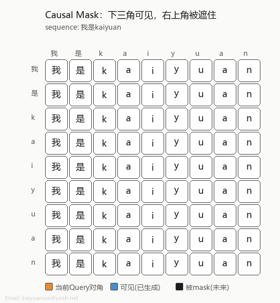
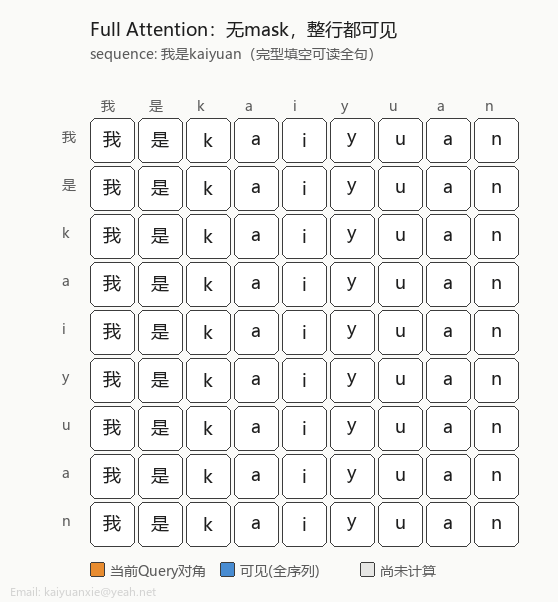
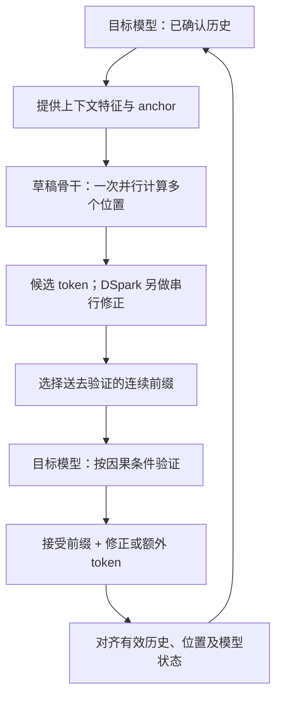
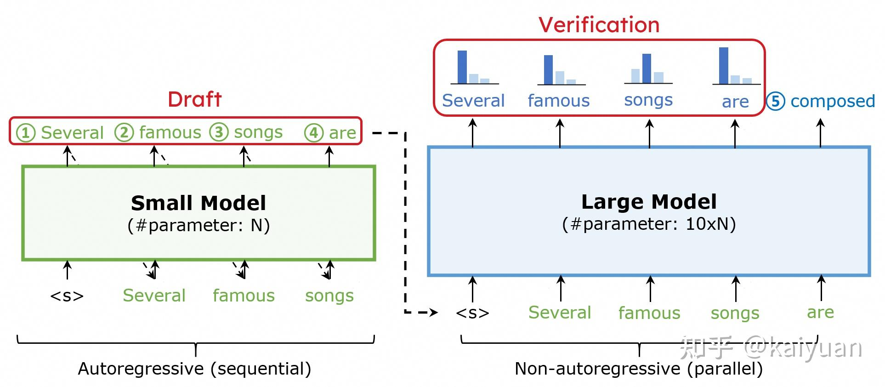
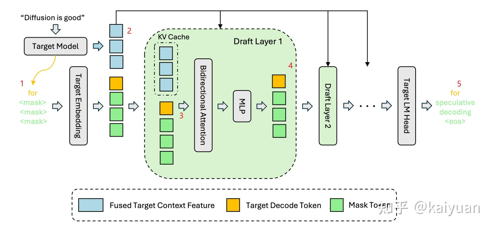
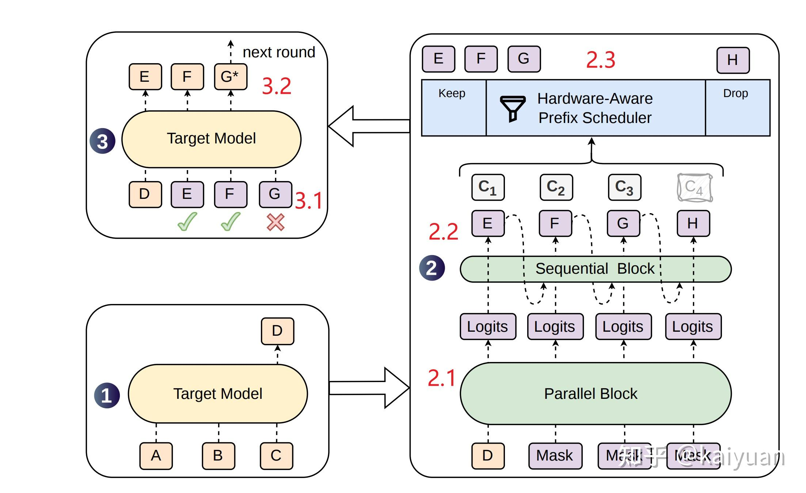

# DFlash 与 DSpark 并行投机解码学习文档

普通自回归生成需要知道上一个 token，才能决定下一个。投机解码让便宜的草稿模型先提出一段候选，再由目标模型验证。DFlash 进一步把草稿阶段的大部分计算改成一次并行填块；DSpark 在并行骨干后加上轻量的串行模块，并按预计收益选择验证长度。

本文是**第三方资料整理型学习资料**，面向了解 Prefill、Decode，但还不熟悉并行草稿的读者。以原文的机制讲解为主，并用 DFlash、DSpark 论文复核特征注入、预测位置和调度条件；不收录部署命令与实测部分，没有运行模型或性能实验。

## 0. 阅读基线与范围

| 项目 | 内容 |
| --- | --- |
| 原文标题 | 并行投机解码(DFlash/DSpark)的快速理解与vLLM实测 |
| 原文链接 | [kaiyuan 的文章](https://zhuanlan.zhihu.com/p/2069029506447417522) |
| 作者 | kaiyuan |
| 发布时间 | 页面元数据：2026-08-07 15:55:05，Asia/Shanghai |
| 更新时间 | 页面元数据：2026-08-23 18:01:42，Asia/Shanghai |
| 读取时间 | 2026-11-19；读取现有已登录浏览器中的全文与配图 |
| 整理范围 | 原文第 1 节：计算模式、投机流程、DFlash、DSpark 与前缀调度 |
| 第一方复核 | [DFlash v2][dflash]，2026-05-28；[DSpark v1][dspark]，2026-07-06；仅核对相关机制，不作完整论文综述 |
| 配套材料 | 作者 [Notebook 固定快照][notebook]，`48e358a4b5119c24cf472adc64d0b4f86f894e99`；只读其中的机制演示代码，未执行 |
| 配图 | 保留机制部分 5 张独立图，其中 2 张为原始 GIF；不收重复的放大图与实测图。见[图片来源](../../images/parallel-speculative-decoding/SOURCES.md) |

先修：[Prefill 与 Decode](<../推理基础/LLM Prefill 与 Decode 阶段源码学习文档.md>)。已经了解投机流程，可以直接读第 3 节。需要跟踪对象、KV 与提交位置时，再读 [SGLang Draft / Verify / Commit](<../../sglang/source-study/08-advanced-generation/03-投机解码的DraftVerifyCommit.md>)；那篇使用自己的固定源码版本。

| 术语 | 人话解释 | 要分清的边界 |
| --- | --- | --- |
| Target / Draft | 负责最终验证的目标模型 / 提出候选的草稿模型 | 草稿只是提议，不能直接算作输出 |
| Anchor / Bonus | 已由目标模型确定、用来衔接下一轮的 token | Anchor 强调本轮起点，bonus 强调上一轮新产生的结果 |
| Mask token | 给待预测位置放的占位 token | 不等于 Attention 中限制可见范围的 mask |
| Block | 一次草稿计算覆盖的一组位置 | 输入位置数、候选数、接受数要分别计数 |
| Target hidden / Draft KV | 目标模型的中间特征 / 草稿模型自己的上下文状态 | 前者经草稿投影生成后者，不是直接复制目标 KV |
| Confidence / Survival | 条件接受率估计 / 整段前缀都被接受的概率估计 | 两者都不是目标模型已经完成的验证 |

## 1. 并行的到底是哪一步

### 自回归依赖与 Attention 可见性

原文用“词语接龙”解释自回归，用“完形填空”解释并行草稿。这两个比喻有助于理解生成依赖：前者先确定上一个 token，后者先放好一组占位位置，再同时计算各位置的预测。



**图意解读：** 每一行表示一个 query 位置，因果约束允许它读取自身及更早的位置，屏蔽未来位置。动画逐行展示可见范围，不代表 GPU 必须逐行计算整个矩阵。已知完整输入时，训练、Prefill 和投机验证仍可并行计算多个位置；逐 token 生成的串行性来自“下一个实际 token 尚未确定”。



**图意解读：** 图展示各 query 可以读取整块输入。用于草稿时，尚未生成的位置里放的是占位 token，不能理解成模型提前知道了正确答案。块内双向可见，也不意味着可以读取任意块之外的未来内容。

因此，“一次算多个位置”本身不足以区分这些方法。真正要问的是：**草稿预测当前位置时，能否利用块内前一个位置刚采样出来的 token？** 自回归草稿能利用；DFlash 的并行骨干不能直接利用；DSpark 在骨干之后用一个便宜的串行头补上这种依赖。

### 先画完整的一轮



**图意解读：** 这是整理者归纳的职责图，不是进程拓扑或 GPU 时间线。“并行”主要描述草稿骨干内部的块计算；图中没有声称 Draft 与 Target 同时执行。DSpark 的调度也只是决定验证工作量，最终接受权仍在目标模型。

## 2. 投机为什么能一轮前进多个 token



**图意解读：** 左边的小模型先提出多个候选，右边的大模型把候选当作已知输入，一次计算多个位置的目标预测。右侧图注的“Non-autoregressive”描述的是这次计算的并行性，不能理解为目标模型改成了非因果模型。图中的模型大小比例也是示意，不是所有投机方法的固定配比。

用一个**贪心解码的教学例子**走一轮：目标模型已确定起点 `D`，草稿提出 `E、F、G、H`；目标预测依次支持 `E、F`，但第三个位置选择 `G*`。这一轮便接受 `E、F`，再输出目标给出的 `G*`，从 `G*` 开始下一轮。即使后面的 `H` 碰巧与某个预测一致，也不能跨过第一次拒绝继续接到输出中。

随机采样时，需要对应的接受概率和拒绝后的修正采样，不能把上述“是否相等”当成通用验证算法。本文用贪心例子解释连续前缀，不推导随机采样的完整证明。

接受后的状态也要一起收尾：被拒绝的候选不能成为下一轮历史；刚输出的 bonus，其 KV 可能要到后续一步才计算出来。文本输出长度、草稿接受数和已经物化的 KV 长度，并不总是同一个数。详细账本见 [DFlash 源码课程](<../../sglang/source-study/08-advanced-generation/05-DFlashNgram与自适应投机.md#3-dflash一次填块按连续前缀接受>)。

## 3. DFlash：用目标上下文支持一次并行填块

### 为什么需要目标特征

一次预测多个位置减少了草稿的串行 forward 次数，但草稿仍要知道已有上下文在说什么。DFlash 抽取目标模型若干层的 hidden states，融合成上下文表示，再让草稿各层通过自己的 K/V 投影读取它。[论文 §4.1][dflash]



**图意解读：** 蓝色块来自目标模型的上下文特征，黄色块是目标已经确定的 anchor，绿色块是待填位置。上方的连线把上下文送进各个草稿层；草稿侧 query 读取由上下文与当前草稿块共同构成的 K/V。右边得到的是候选，仍须送回目标验证。红色编号是原文的讲解标注。

把一层 Attention 简化成下面的形状，可以看清数据来自哪里。设 `H_ctx` 有 `L` 个历史位置，草稿块 `H_d` 有 `B` 个位置，省略多头、位置编码和归一化细节：

```text
Q = H_d W_Q                         # B 个 query
K = concat(H_ctx W_K, H_d W_K)      # L+B 个 key
V = concat(H_ctx W_V, H_d W_V)      # L+B 个 value
Attention 输出仍对应 B 个草稿位置
```

这是便于理解的计算示意。各草稿层使用自己的投影权重；目标 hidden 可以来自多个目标层的融合。**注入的是目标特征经过草稿投影得到的上下文 K/V，而不是把目标模型自己的 K/V 原样搬过去。** 论文附录 A.3 进一步讨论了这一机制。[DFlash 附录][dflash]

### Anchor、占位位置与候选数

DFlash 的典型块输入可以写成 `[D, MASK, MASK, MASK]`。其中 `D` 已知，后三个位置一次产生三个候选。块内 Attention 可以交换占位位置的表示，但这一轮后一个位置的预测，并没有等前一个位置采样出真实 token 后再重新运行骨干。

这也解释了它的取舍：重计算并行，草稿可以用更有能力的骨干；然而块内新采样 token 之间缺少直接条件依赖，后缀仍可能不协调，接受概率也会下降。并行提出十个候选，不保证最后能接受十个，更不保证验证它们一定划算。

不要把“扩散”理解成这里必然要做多轮去噪。本文讨论的是 DFlash 在单次 forward 中提出草稿块的路径，不概括所有 diffusion language model。

## 4. DSpark：重骨干并行，轻输出头串行

### 为什么加一点串行计算

假设上下文允许“of course”和“no problem”两种续写。独立的并行位置可能各自选出高分词，组合成“of problem”。DSpark 让后一个位置的输出头看到前一个刚采样的 token，从而减少这类块内组合问题；昂贵的骨干仍然只运行一次。[DSpark §3.1][dspark]



**图意解读：** 右下的 parallel block 同时产生多个位置的特征与基础 logits；sequential block 从左向右形成候选并给出置信度。Scheduler 先舍弃 `H`，只让 `E、F、G` 进入验证；左上目标接受 `E、F`，拒绝 `G`，给出 `G*`。`H` 是没被放行验证，`G` 是验证后被拒绝，两者处在不同阶段。图中没有单独画出的目标特征输入仍然存在。

### Markov head 修正了什么

论文给出 Markov head 和 RNN head 两种串行模块。Markov 版本只利用块内紧邻的前一个 token：

```text
U_k = 并行骨干提前算好的第 k 个位置的基础 logits
bias_k = W_1[x_(k-1)] W_2
p_k = softmax(U_k + bias_k)
x_k ~ p_k
```

`W_1` 将前一个 token 映射到低维空间，`W_2` 再投影到词表，避免直接保存完整的“词表 × 词表”转移矩阵。这里串行的是轻量修正与采样，不是对每个候选都重跑整个 Transformer。RNN 版本可以在小状态中积累更长的块内历史；论文将其作为另一种实现，而非所有 DSpark 的必需组件。[论文 §3.1][dspark]

还有一个计数差异：DFlash 原始设计从 mask 位置取预测；DSpark 论文让 anchor 所在位置也承担第一个预测，因此 `γ` 个输入位置（anchor 加 `γ−1` 个 mask）可得到 `γ` 个草稿预测。**同样叫 block size，不能不看位置约定就换算成同样的候选数。** 作者配套 Notebook 的机制演示也区分了这两种取法。[配套代码][notebook]

### Confidence 不是当前 token 的 softmax 分数

DSpark 的 `c_k` 估计：在前面候选都通过的条件下，第 `k` 个候选能通过目标验证的概率。论文中的置信度头读取当前位置骨干特征和前一个 token 的 Markov embedding；它不是直接把当前抽中 token 的草稿概率当作接受率。[论文 §3.2.1][dspark]

论文用目标分布与草稿分布之间的总变差构造软接受率标签，并对前缀概率做 Sequential Temperature Scaling 校准。这部分是在复核论文时补充的解释：调度要使用概率的数值大小计算收益，仅仅能把候选排出高低顺序还不够。本文没有验证某个实际模型的校准效果。

## 5. 草稿可以生成很长，验证只选连续前缀

### 从每位置信度走到整段收益

如果前三个位置的条件接受率估计是 `0.9、0.8、0.5`，走到第三个位置的前缀存活估计为 `0.9×0.8×0.5=0.36`。第三位自身的 `0.5` 没有计入前两位失败的风险。

沿用论文符号，`R` 是请求数，`ℓ_r` 是第 r 条请求获准验证的草稿前缀长度：

```text
a_(r,j) = ∏(i=1..j) c_(r,i)               # 连续前缀存活估计
B = Σ_r (1 + ℓ_r)                        # 目标本轮输入位置数
τ = Σ_r (1 + Σ(j=1..ℓ_r) a_(r,j))        # 简化的期望推进量
Θ = τ × SPS(B)                           # 期望 token/s
```

乘积来自条件概率链，不要求各位置独立。`SPS(B)` 是测量所得的每秒执行步数，不是 token/s；乘上每步期望推进量，才得到吞吐估计。这里每请求的 `+1` 是用于衔接、修正或额外输出的基础位置；公式忽略停止、取消和输出长度上限，不能直接当成每轮的实际产出。[论文 §3.2.2][dspark]

**教学假设，不是性能数据：** 一条请求使用上面的三项置信度，并假设不同输入长度的 SPS 如下。

| 获准验证的草稿数 ℓ | 输入位置数 B | 期望推进量 τ | 假设 SPS | 预计 token/s |
| --- | --- | --- | --- | --- |
| 0 | 1 | 1.00 | 100 | 100.0 |
| 1 | 2 | 1.90 | 80 | 152.0 |
| 2 | 3 | 2.62 | 60 | 157.2 |
| 3 | 4 | 2.98 | 50 | 149.0 |

第三个候选仍有正的预计收益，但整步变慢得更多，所以此例选择验证前两个。它们最终是否接受，还要经过目标模型；`ℓ=2` 不等于承诺输出两个草稿 token。

### 多请求怎样分名额

在给定总验证预算时，论文按各请求的前缀 survival 排序分配额外位置。由于同一请求的 survival 不递增，选中的位置可以构成连续前缀；相同分数仍需遵守前缀依赖。不能跳过第一个低分候选，直接把第三个高分词接到输出中。

原文介绍的 Algorithm 1 从基础位置开始逐项扩展，预计吞吐不再增加便早停。这有两个条件需要一起阅读：一是早停只有在相应目标曲线呈单峰等条件下才得到全局最优；二是随机采样下，准入决策不能偷看将被裁剪的当前或后续候选值。后续位置的 confidence 可能读取当前已采样 token，随意对整条当前草稿做回溯选长会产生选择偏差。[论文 §3.2.2 与附录 A][dspark]

### 生产实现为什么还会改变搜索方式

DSpark 论文 §5.2 单独处理硬件曲线的台阶和异步调度：用前两步的历史置信度先确定本步总容量，再用较新的置信度给当前请求分配前缀。历史预算与当前候选之间形成因果隔离后，容量搜索可以跨过局部吞吐下降点，去掉理论算法中的早停。

所以，**“收益一下降就停”是原文讲解的一条算法路径，不是 DSpark 所有运行方式的固定规则**。也不能只因为目标模型仍负责最终验证，就认定任意置信度裁剪策略都严格保持随机输出分布。进一步的轮次、成本曲线和布局分析见[动态验证预算学习文档](<动态投机验证预算：DeepInfer、SGLang 与 vLLM 的取舍学习文档.md>)；各引擎版本仍以那篇的独立基线为准。

## 6. 用一张表回忆机制

| 问题 | DFlash | DSpark 论文中的扩展 |
| --- | --- | --- |
| 昂贵的草稿骨干如何计算 | 一次处理整个块 | 保留并行骨干 |
| 怎样利用已有上下文 | 目标特征融合，再投影为草稿上下文 K/V | 延续这一类上下文支持 |
| 怎样利用块内新采样 token | 并行骨干不逐 token 等待它们 | 轻量 Markov / RNN 模块补充依赖 |
| 哪些位置送目标验证 | 不由“并行草稿”这个概念单独决定 | 置信度、前缀 survival 与硬件成本共同选择 |
| 候选何时成为正式历史 | 目标验证、接受与状态提交之后 | 同样需要验证与提交 |

这张表比较论文机制，不是具体引擎支持矩阵，也不给出性能排名。

自测时应能回答：为什么目标因果验证能并行计算多个位置？`MASK` 与 causal mask 有何不同？为什么目标 hidden 不是目标 KV？DSpark 加了串行模块，为什么仍能保留并行草稿的主要收益？候选置信度高，为什么也可能不值得多验证？

## 7. 相关资料与复核记录

| 仓内资料 | 与本文的关系 | 本次判断 |
| --- | --- | --- |
| [DFlash、Ngram 与自适应投机](<../../sglang/source-study/08-advanced-generation/05-DFlashNgram与自适应投机.md>) | 已覆盖 DFlash 上下文、块构造、接受与 KV 账本 | 本文补机制入门与 DSpark 串行头；增加交叉入口，保留旧源码范围 |
| [动态验证预算](<动态投机验证预算：DeepInfer、SGLang 与 vLLM 的取舍学习文档.md>) | 已深入比较 survival、成本、历史轮次与布局 | 补充 DSpark 论文的条件接受率与校准入口，不改各引擎固定实现结论 |
| [PD 与投机的状态交接](<PD 与投机解码的状态交接、回滚及容量学习文档.md>) | 解释目标状态、草稿状态及提交生命周期 | 与本文相容，无需改写；本文不扩展为分离部署说明 |
| [DeepInfer 专用引擎](<../分布式服务/DeepInfer 专用推理引擎与生产系统边界学习文档.md#6-dspark少验证低收益草稿而不是免除验证>) | 已介绍 DSpark 预算与异步协同 | 保留其引擎与实验口径，不把论文概念覆盖为所有实现的统一行为 |

本次没有另起跨资料整合专题：预算、状态交接已有专文，本文新增价值在于从并行填块走到串行修正的入门解释；更深入的实现或效果比较，需要独立源码及运行证据。

参考：[原文][article]、[DFlash 论文][dflash]、[DSpark 论文][dspark]、[作者配套 Notebook 固定快照][notebook]。

[article]: https://zhuanlan.zhihu.com/p/2069029506447417522
[dflash]: https://arxiv.org/html/2602.06036v2
[dspark]: https://arxiv.org/html/2607.05147v1
[notebook]: https://github.com/CalvinXKY/InfraTech/blob/48e358a4b5119c24cf472adc64d0b4f86f894e99/llm_infer/dflash_dspark_principle.ipynb
