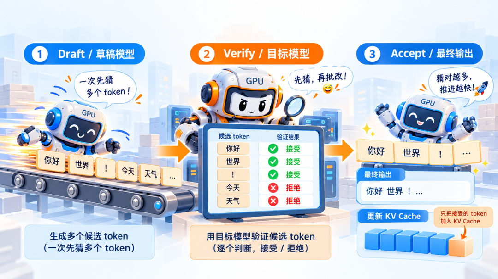
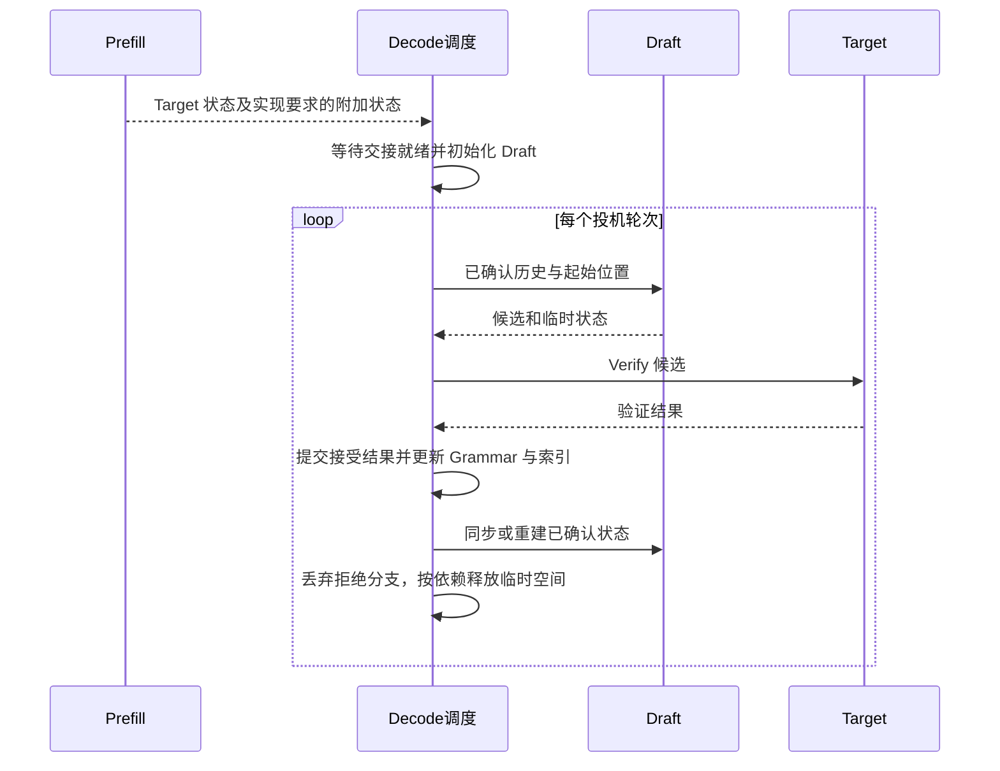
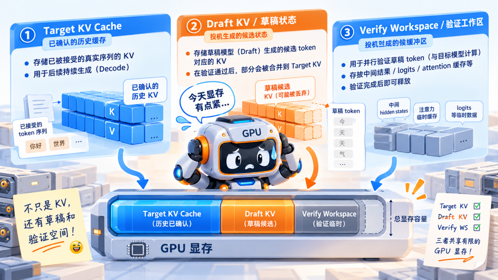
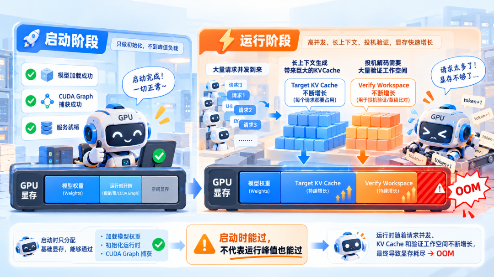
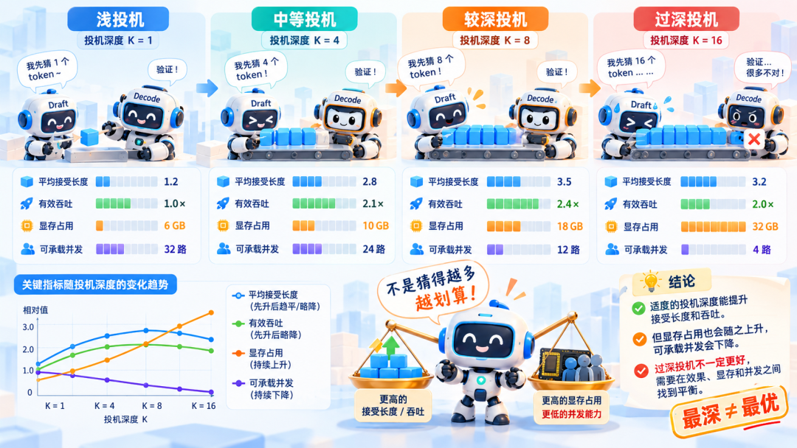

# PD 与投机解码的状态交接、回滚及容量学习文档

PD 分离把输入计算与持续生成交给不同实例；投机解码在生成内部增加候选、验证和提交。组合后的难点，是让模型状态、缓存、语法约束和请求位置按照同一份已确认序列前进。

本文属于**第三方资料整理型学习资料**，整理原文并核对公开 Issue 与 RFC。没有复现故障、运行 GPU/RDMA 测试或审计所有投机实现；问题报告中的诊断保留其报告者与环境边界。

## 0. 阅读基线与范围

| 项目 | 内容 |
| --- | --- |
| 原文标题 | PD 分离遇上投机解码，为什么事情突然变复杂了？ |
| 原文链接 | [公众号原文](https://mp.weixin.qq.com/s/DH6-ylxoy44punfc518d-w) |
| 作者 | 张量叙事 |
| 发布时间 | 2026-10-14 08:20:00，Asia/Shanghai |
| 读取时间 | 2026-10-14 |
| 一手资料 | SGLang #36140、#38341、#29110 问题记录，#35789 RFC；下文逐项记录状态与适用环境 |
| 范围 | Draft 初始状态、Target/Draft 生命周期、回滚、显存峰值、集群收益 |
| 不展开 | EAGLE、MTP、DFlash 各自完整算法，精确采样分布证明、未核对的动态 batch 故障 |
| 配图 | 检查 5 图，保留正文 4 图；重复题图不收；[来源与哈希](../../images/pd-speculative/SOURCES.md) |

先修：[Prefill 与 Decode](<../推理基础/LLM Prefill 与 Decode 阶段源码学习文档.md>)、[KV 容量](<../KV缓存/KV Cache 容量优化技术地图学习文档.md>)。引擎机制衔接 [SGLang 模型状态与高级生成](<../../sglang/高级生成/SGLang 模型状态与高级生成机制学习文档.md>)。

| 术语 | 人话解释 | 特别注意 |
| --- | --- | --- |
| Draft | 提出候选的模型或预测机制 | 不必是与 target 同结构的小模型 |
| Verify | 目标模型评估候选 | 候选多不等于最终输出多 |
| Accept / commit | 将可接受的结果变成真实序列 | 接受长度与 KV 已物化长度可能有偏移 |
| Scratch / workspace | 本轮临时计算空间 | 不能因为有地址就当作可共享前缀 |
| Committed state | 已确认历史对应的状态 | 与待验证候选分开管理 |
| Grammar | 输出约束状态机 | 只能按实际提交序列推进 |

## 1. 少走几次串行步骤，要多付哪些成本

**图意解读：** 图用“先猜、再批改”表示候选验证。实际接受逻辑依赖算法和采样设置，不是简单比较几个词是否“语义正确”；也不能从图中勾选规则推导严格分布保持。接受的候选前缀之外还可能产生修正或额外 token，后者的 KV 可能在后续步骤物化。

整理者的单请求近似模型：

`S ≈ E[每轮实际推进 token 数] × 普通 Decode 单步时间 / (Draft 时间 + Verify 时间 + 提交及其他开销)`。

这是理解关系的算式，不预测并发吞吐。假设普通单步 10 ms，一轮 Draft 4 ms、Verify 12 ms、提交 2 ms，实际平均推进 3 个 token，则 `S≈30/18≈1.67`；若只推进 1.5 个，则 `S≈15/18≈0.83`。所有数字均为教学假设。

## 2. P→D 交接的不一定只有 Target KV

人话版：一个学生要接着做题，不仅要拿到老师的答案，还要有自己能使用的草稿状态。不同模型内部表示不同，不能把 Target 的缓存直接改个名字交给 Draft。

| 对象 | 从哪里建立 | 持续使用者 | 不能替代什么 |
| --- | --- | --- | --- |
| Target 上下文状态 | Target Prefill | Target Verify / Decode | Draft 模型专属状态 |
| Draft 上下文、特征或预测头状态 | P 侧准备并交接，或 D 侧按算法初始化/重建 | Draft 执行 | 不总是“复制一份 Target KV” |
| 当前 token、序列长度与位置 | 请求协议及已提交输出 | 调度、采样、两个模型 | 不能只靠传 tensor 推断 |
| 传输索引与布局 | 接收侧预分配和后端映射 | KV Connector | 不拥有接受/拒绝策略 |

常见实现把紧密交替的 Draft/Verify 放在 D 侧，以减少每轮网络往返，但这不说明 P 侧永远无需投机相关配置。是否需要匹配的状态、捕获层或预测设置，要按算法、混合模型和后端逐项核对。

**图意解读：** 这是跨实现的职责示意，不规定某个具体 SGLang batch 调用顺序。关键是新一轮从已确认历史继续，而不是从上一轮所有候选继续。

## 3. 三种状态，不能共用一个模糊的生命周期

**图意解读与纠偏：** 原图能帮助区分 Target KV、Draft 状态和 workspace，但图内“部分 Draft KV 合并到 Target KV”的说法过度简化。一般是**分别提交/保留各自模型对接受前缀的状态并同步索引**，不把不同层、不同表示空间的 Draft KV 直接变成 Target KV。特殊共享设计需单独证明。

设真实序列当前有 100 个 token，提出候选 `a,b,c,d`，验证只接受前缀 `a,b`。必须让真实序列、Target/Draft 已确认状态、位置索引和 Grammar 对齐到正确前缀，拒绝分支不能进入下轮可见历史。如果验证又输出修正 token `x`，要额外区分“文本已经输出 x”和“x 的缓存已经计算”，不可机械要求所有长度永远相等。

| 状态 | 可跨轮次保留吗 | 可以进入共享缓存吗 | 拒绝后处理 |
| --- | --- | --- | --- |
| 已确认 Target 历史 | 可以，受模型状态规则约束 | 依实现的前缀身份与引用管理 | 不能误删已确认历史 |
| 已确认 Draft 历史 | 依算法与重建策略 | 只有明确建模且兼容的状态 | 保留正确覆盖范围 |
| 候选分支状态 | 尚未确认前不可作为历史 | 不应当作已确认前缀暴露 | 回滚映射或丢弃；等待计算完成再复用 |
| Verify 工作区 | 常可复用物理 buffer | 不等于内容缓存 | 本轮依赖完成后归还/复用 |

### Sidecar 与 Scratch 是 RFC 提议，不是通用既成事实

[RFC #35789](https://github.com/sgl-project/sglang/issues/35789) 于 2026-08-21 提出，读取时仍为 open。其针对 Draft SWA 的设计把可复用已确认状态作为 sidecar，把 Verify 临时状态单独建模为 scratch。它讨论所有权和缓存生命周期，并不要求推翻 Target `unified_kv` 的物理布局。

这提供了一个有用的阅读方法：分别问“内容属于哪个已确认前缀”和“这块地址怎样快速执行”。本次只核对 RFC，未证明对应功能已经全面合并或覆盖所有算法。

## 4. 为什么启动正常，进入流量后才 OOM

**图意解读：** 启动时的权重加载和 graph capture 只覆盖当时的分配场景；真实流量可能让多个请求的 KV、临时验证张量和缓冲区同时达到峰值。对于预分配 KV 池，token 增多可能只是占用更多池内槽位，而非持续向 CUDA 新申请内存，原图应按概念占用理解。

整理者的容量分解为：

`可用显存 ≥ 常驻权重 + 常驻池/图缓冲 + 运行时增量峰值 + 其他必要余量`。

这里必须避免重复记账：若 graph 私有池已包含某个 Verify buffer，就不能再把它完整加一次；若 Target/Draft 共享部分物理存储，也应按实际分配去重。还要同时检查 KV **槽位容量**，因为 CUDA 可用字节与逻辑可容纳 token 数不是一个约束。

## 5. 用公开问题建立排障地图

下表是**截至 2026-10-14 的公开记录快照**，不是本仓复现结论，也不以 open/closed 状态直接判断任意发布版本是否修复。

| 记录 | 原始环境/现象 | 可迁移的检查问题 |
| --- | --- | --- |
| [#36140](https://github.com/sgl-project/sglang/issues/36140)，2026-08-24，读取时 open | 0.5.16-based `kimi-k3` 镜像、Kimi-K3 DFlash、RTX 6000D、Mooncake RDMA；PD Decode 报 `spec_info` 缺失并触发 watchdog | PD scheduler 是否初始化了该算法的状态？不能先归咎网络带宽 |
| [#38341](https://github.com/sgl-project/sglang/issues/38341)，2026-09-07，读取时 open | qwen4 支持开发分支（#36497 时期）加 DFlash PD dispatch；P/D 各 8×A800 80GB、TP8、122B GDN/MoE target、6 层 draft；较大候选窗运行中 OOM | 流量下 Verify 峰值与常驻池是否能并存？不能把开发分支问题扩写为所有正式版本必现 |
| [#29110](https://github.com/sgl-project/sglang/issues/29110)，2026-06-24，读取时 closed | 6 月 nightly 的 PD+EAGLE+Grammar 重复接受 token；报告称 main 的 #28682 修复其场景 | Grammar 与投机提交路径是否对同一 token 重复推进？closed 不等于用户镜像含修复 |

#38341 报告者调低静态内存比例后遇到 KV 容量不足，调高又遇到 Verify 申请失败。这里采纳的是“双重容量约束”的排障线索；没有把报告者的根因推断提升成跨版本普遍定理。原文还提 GLM 动态 batch 问题，本次没有取得足够独立证据，不扩写成具体已确认缺陷。

## 6. 单请求加速与集群吞吐要分开算

**图意解读：** 图试图说明深度、推进长度、显存和并发之间的取舍。但 1.2×、2.4×、6–32 GB、4–32 路等数字没有对应硬件、模型、负载与测量记录，只能作为原图示意，不能作为 benchmark。`K=1` 栏的推进长度也不可直接当作单纯候选接受率来读。

公平比较需要同时记录有效输出 token/s、成功请求/s、TTFT/TPOT 分位数、错误率、平均推进长度、Draft/Verify 时间和池内剩余容量。减少并发后单请求变快，不一定增加满足 SLO 的请求量。

进一步用教学算例看瓶颈：假设 P 每秒完成 20 个等长请求，D 每秒能完成 10 个，D 加速到 15 个可能改善整体吞吐；若 P 原本只能完成 8 个，即使 D 从 10 提升到 15，整体仍受 P 限制。真实请求长度不同，需按工作量与队列衡量，不能直接拿 token/s 与 request/s 比大小。

## 7. 自测与下一步

| 自测问题 | 应能说出的边界 |
| --- | --- |
| Target 前缀命中，Draft 就一定可复用吗？ | 两者身份、状态覆盖和重建规则独立 |
| 拒绝候选只删除输出 token 就够了吗？ | KV 映射、递推状态、Grammar 与临时 buffer 都要一致 |
| 接受率提高是否必然加速？ | 还要计入推进长度、Draft/Verify 成本和可承载并发 |
| GPU graph capture 通过能证明容量足够吗？ | 不能覆盖所有活跃 KV 与验证峰值组合 |

继续阅读 [KDA 检查点与投机回滚](<../模型架构/KDA Cache 检查点、前缀复用与投机回滚学习文档.md>)，理解递推状态为什么不能简单“删掉最后几页”；或回到 [分布式服务](<../分布式服务/README.md>)，将取消与传输收尾加入同一条请求链。
