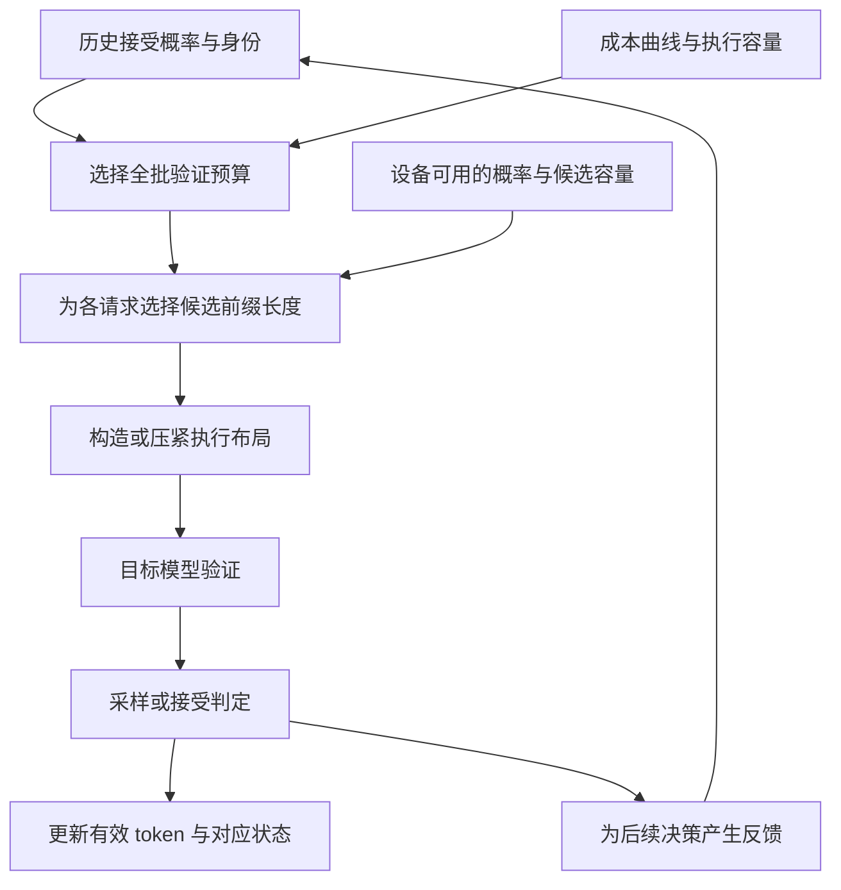
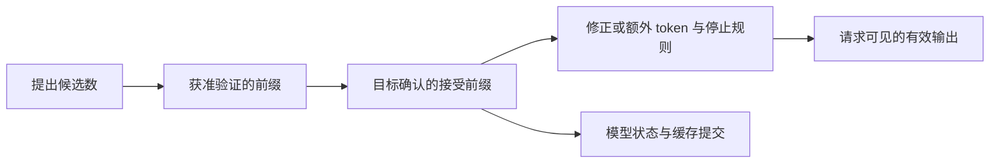

# 动态投机验证预算：DeepInfer、SGLang 与 vLLM 的取舍学习文档

投机解码先生成候选，再由目标模型验证。候选越多，一轮可能走得越远，也可能只是多计算了一批最终丢弃的位置。动态验证要决定的不是“哪个词直接成为答案”，而是**本轮值得验证多少候选、分给哪些请求，以及执行和提交如何与这个决定保持一致**。

本文是**源码分析型的跨引擎整合学习资料**。沿固定源码比较三套实现的概率、成本、预算、布局和提交边界。比较表、公式与算例是整理者归纳；没有运行模型、CUDA kernel 或在线服务，没有验证三引擎的性能高低、输出分布或逐位一致性。

## 0. 源码基线与主线

| 项目 | DeepInfer | SGLang | vLLM |
| --- | --- | --- | --- |
| 公开仓库 | [deepseek-ai/DeepInfer](https://github.com/deepseek-ai/DeepInfer) | [sgl-project/sglang](https://github.com/sgl-project/sglang) | [vllm-project/vllm](https://github.com/vllm-project/vllm) |
| 分支语境 | 官方 `main` 快照 | 官方 `main` 历史快照 | 本次解析官方 `main` 后固定快照 |
| commit | `553741557a57df44a46fb3ab72b6aafeaf945337` | `72d5c5bb73cadd7ffbf5114e5f81e29d36b6c61a` | `05a303fdc8681f0dd586a8ac22103f3b4a8bf4ad` |
| 读取日期 | 2026-10-27 | 2026-10-27 | 2026-10-27 |
| 工作区状态 | 本地检出干净，只读 | 从固定 Git 对象导出阅读；原检出有既存未跟踪资料，未采用也未修改 | 只下载固定提交的相关文件，未建立可运行检出 |
| 主线 | `MTPVarlen`、ZOS 设备长度校正、普通输出提交 | DSpark 非 static planner、ragged layout 与接受/提交接口 | GPU runner 的 Adaptive Verification、在线接受率估计与结果反馈 |
| 本文未覆盖 | 全部平台内核、故障与外部服务路径 | 全部模型、后端、PD/PP 与 recurrent commit 实现 | 所有 speculator、后端、混合模型状态恢复和分布式组合 |

这些提交不是同一发布时间的对照组。本文的 vLLM 基线也不是仓内 KV 生命周期文章所用的 `f727951d…`，不可把新行为回填到旧版本。

先修：[Draft / Verify / Commit](<../../sglang/source-study/08-advanced-generation/03-投机解码的DraftVerifyCommit.md>)。来源背景：[三引擎比较文章整理](<../分布式服务/DeepInfer、vLLM 与 SGLang 的交付范围与机制比较学习文档.md>)、[DeepInfer DSpark](<../分布式服务/DeepInfer 专用推理引擎与生产系统边界学习文档.md#6-dspark少验证低收益草稿而不是免除验证>)、[Kimi K3 协同优化](<../../sglang/模型适配/SGLang Kimi K3 推理协同优化学习文档.md>)。本篇新增价值是把这些资料中的“动态验证”落实为可核对的决策链，不重复原图或 benchmark。

### 术语速查

| 术语 | 人话解释 | 不等于 |
| --- | --- | --- |
| draft length | 草稿提出多少候选 | 本轮实际验证多少 |
| conditional acceptance estimate | 前面通过时，当前候选也能通过的估计概率 | 某次验证已经通过 |
| survival | 从第一个候选连续走到该位置的估计概率 | 只看当前位置的分数 |
| budget | 给候选验证的计算名额 | 成功输出量或显存实际占用 |
| query / verify length | 本轮执行布局中的长度，可能含基础位置 | 纯 draft 数；各引擎字段必须分别核对 |
| graph tier | 实际执行可能填充到的图档位 | 有效候选数 |
| admitted / accepted / committed | 获准验证 / 验证通过 / 正式推进状态 | 三者不是同一阶段 |

## 1. 先画一轮：两次选择，最后才提交

### 人话版

可以把一批请求看成一组学生的草稿。先决定这一轮老师总共批改多少题，再决定每个学生批改到哪里。批改名额只决定投入多少工作；实际答对几题，仍须批改之后才能知道。



**图意解读：** 预算和每请求长度可以使用不同轮次的数据。箭头表示职责依赖，不代表所有动作串行，也不规定统一的 CPU/GPU 划分。只有经过接受判定的结果，才有资格进入状态提交；图省略了停止、取消及异常分支。

三方入口分别是 [DeepInfer `MTPVarlen::schedule`][d-budget]、[SGLang `compute_verify_token_budget`][s-budget] 和 [vLLM `AdaptiveVerificationManager.get_num_tokens`][v-budget]。它们解决相似问题，却没有统一的 `budget` 单位与状态容器。

## 2. 为什么要比较累乘概率，而不是逐位置分数

### 条件概率与连续前缀

设请求 i 的候选位置 j 有条件接受率估计 p(i,j)，其连续前缀存活估计为：

```text
s(i,j) = p(i,1) × p(i,2) × … × p(i,j)
E[接受的 draft 数，验证到 l] ≈ Σ(j=1..l) s(i,j)
```

这里的乘积按条件概率链理解，不假设各位置独立；预测器是否真的校准，仍需验证。期望接受数量可以写成到达各位置概率的和，不是只看最后一个位置。

**源码事实：** DeepInfer 在 [process_MTPInfo][d-feedback] 将每位置置信度累乘为 `accept_rates`；SGLang 的 [compute_sort_survival][s-topk] 与 vLLM 的 [设备预算分配][v-assign] 也按位置累乘。概率合法时 survival 不递增，使全局高分名额可以落实为每请求的连续前缀；不能跳过第 2 个候选，只验证第 3 个就直接把它接到输出中。

### 一个完整算例

**以下完全是教学假设，已独立核算，不是三引擎的实测输入。** 两条纯 Decode 请求，各有 3 个候选：

| 请求 | 每位置条件概率估计 | 连续 survival |
| --- | --- | --- |
| A | 0.90、0.80、0.20 | 0.90、0.72、0.144 |
| B | 0.60、0.50、0.10 | 0.60、0.30、0.030 |

额外预算 b=2 时选 A 的前两项，b=3 时再选 B 的第一项。这并不意味着偏爱 A 的请求身份，而是该轮概率估计下的排序结果。相同分数如何打破平局由实现决定，不能据此承诺各请求的公平性。

假设每条请求有 1 个基础位置，忽略 EOS/停止，预计输出量为 `2 + 选中 survival 的和`；整步耗时假设已经包含草稿、验证和提交，执行总长度不超过 4 时为 2 ms，进入 8-token 图档位时为 4 ms：

| 额外预算 b | 有效 query 总数 | 图档位 | 预计输出 token | 假设整步耗时 | 预计 token/ms |
| --- | --- | --- | --- | --- | --- |
| 0 | 2 | 4 | 2.000 | 2 ms | 1.000 |
| 2 | 4 | 4 | 3.620 | 2 ms | 1.810 |
| 3 | 5 | 8 | 4.220 | 4 ms | 1.055 |
| 6 | 8 | 8 | 4.694 | 4 ms | 1.174 |

此例最优预算是 2。多验证 B 的第一项仍有 0.6 的预计收益，却跨过了成本台阶。反过来，在同一图档位内减少一个候选，若耗时不变而产出减少，也可能得不偿失。

“每请求 +1”只适用于这里的纯 Decode 简化。真实混合 Prefill/Decode、停止与输出上限改变基础产出；vLLM 的预算实现就单独统计能产生采样结果的请求数，没有把所有 batch 成员都计为一个输出。[vLLM 预算源码][v-budget]

## 3. 共同目标，不同成本模型

整理者用下面的表达统一比较目的，不声称三方计算同一个公式：

```text
选预算 b，使 预计有效推进量(b) / 预计执行代价(b) 尽量大
同时满足候选容量、图形状、logits 空间及布局条件
```

| 实现 | 所读基线的预计产出 | 成本依据 | 需要保留的限制 |
| --- | --- | --- | --- |
| DeepInfer | 请求基础量 + 历史 survival 排序的前缀和 | 启动 forward 曲线 + 运行时 forward 修正 + sampler 估计 | 这是内部选预算的模型，不是完整客户端延迟模型 |
| SGLang DSpark | 请求基础量 + 历史 survival 前缀和 | SPS 表，或 additive 时间表 | 读取到未初始化的平坦表时会退化为全量验证，不能以开关证明动态收益 |
| vLLM AV | 可采样请求基础量 + 合法候选 survival 前缀和 | draft 成本按请求数索引，verify 成本按执行 token 数索引 | 不把 CPU、路由和所有外部等待都显式列入这两个表 |

### DeepInfer：运行反馈会修正启动测量

[update_runtime][d-runtime] 将 forward 相对基线的残差归一化到图大小，并维护运行统计；sampler 使用相同请求数的历史中位数，不足时退到全局历史。[schedule][d-budget] 用非负修正斜率、候选图大小和 sampler 估计求时间，再比较预计吞吐。这里没有把“少一个 token”假设成固定省掉一份时间。

### SGLang：有 planner，不等于有有效成本表

[HostConfidenceBudgetPlanner][s-history] 调用预算函数。普通 SPS 表和 additive 表是不同路径：前者用预计产出乘查到的 steps/s，后者用预计产出除以预计 step 时间。[初始化分支][s-init] 会检查成本表是否未初始化，并提示全量验证退化；`compact` 路径还可复用均匀布局。这种回退不能归因于 confidence head 一定失效。

### vLLM：图档位内不虚构连续边际成本

[build_cost_tables_from_curves][v-cost] 在捕获范围内按下一个图大小取阶梯成本，在捕获范围外才做连续处理。图内若用平滑插值，会误以为裁掉几个有效 token 就减少了同等比例的执行时间。预算同时受单个 rejection-sampling logits chunk 的容量约束。[预算容量][v-budget]

**共同边界：** 成本表需要代表实际模型、硬件、并发形状和上下文条件。三方不同的曲线来源、更新方式与成本覆盖，足以阻止直接把它们的预测吞吐拿来排性能名次。

## 4. 为什么历史概率和当前设备概率要分开

### DeepInfer：用计数器辨认概率来自哪一轮

[MTPVarlen::schedule][d-budget] 通过 `schedule_cnt` 与 `process_cnt` 判断 CPU 后处理是否追上调度。代码明确用 N−2 轮概率挑总预算，用较新的概率分配请求长度；ZOS 下后一步由设备校正。这个设计还带有“后续位置置信度不能影响更早候选是否被验证”的源码约束，不能把滞后只解释成无关紧要的缓存优化。

[Worker 长度校正][d-worker] 按当前/上一批请求 remap 读取设备结果，把总预算重新分配成 `seqlens_q`，并修正历史长度。变长路径把实际 query 长度回传主机，采样元数据更新前仍要等待对应事件。其 GPU 排序使用的概率和 CPU 先前看到的概率不要求完全相同，但身份、总预算与布局必须一致。

### SGLang：请求池行还要搭配 generation

[历史概率管理][s-history] 区分 relay 已产生的滞后与额外 carry，并用 `generation` 防止请求池行复用后读取前一请求的概率。历史不匹配时，该路径使用全 1 survival 作为回退；不能把这个回退读成真实预测器确认了 100% 接受。

函数名 `_two_steps_prior_survival` 也不应替代配置分析：实际取数涉及 `lag_steps`、relay 与额外 carry。每请求长度再由 [ScheduleVerifyLensTopk][s-topk] 形成，并在 [planner][s-layout] 中进入同步与布局构造。

### vLLM：预算读取旧副本，设备再分配实际名额

[record_confidences][v-history] 用两个 D2H 槽位维护后续预算可读的历史概率；新请求初始化及槽位重置独立处理。[get_num_tokens][v-budget] 选择总预算后，[reallocate_drafts][v-reallocate] 用设备侧概率和每请求合法容量分配实际 draft 名额。

**整理者归纳：** 这里至少要记录四种身份：业务请求、池槽位、槽位代次以及概率所属轮次。只记录一个 batch ID，可能不足以说明一次预算究竟基于哪份证据。

## 5. 验证预算必须真正进入执行布局

### 人话版

决定“本轮只批改 6 道题”，与真的只把 6 道题交给计算设备，是两件事。如果后端仍按原长度读取、KV 写地址仍按旧位置生成，逻辑上省了预算，实际执行可能没有省下工作，甚至用错请求边界。

| 对象 | DeepInfer | SGLang | vLLM |
| --- | --- | --- | --- |
| 总预算 | `best_bsz` 包含基础 query | `VerifyBudgetDecision.budget` 是额外候选预算 | `draft_budget` 与非 draft token 数分开 |
| 每请求长度 | `seqlens_q`，ZOS 下设备校正 | `verify_lens`，默认含至少 1 个基础位置 | GPU admitted draft 数 + non-draft 数 |
| 实际形状 | 设备长度、图选择和采样镜像 | ragged layout、图档位、TP/DP 条件 | 压紧 batch，重建 `query_start_loc`、`cu_num_logits` |
| 不能直接当输出量的字段 | `total_q` | `budget` / `graph_num_tokens` | scheduled / admitted drafts |

### vLLM 的 CPU 占位长度不是真实 GPU 分配

[compact_batch][v-compact] 在预算被裁剪时，可在 CPU 侧均匀分配占位长度；[设备重分配][v-reallocate] 才按 survival 决定各请求的实际名额，并重建偏移。CPU 与 GPU 的**总数一致，不意味着每请求边界相同**。依赖 CPU 边界制定执行计划的 backend 因而不能自动兼容。

同一源码还保留一种额外同步：batch-sharded sampling 若需要真实 admitted 分割，就把计数送回主机。因此不能从“GPU 决策”推出 CPU 永远不等待。

### SGLang 的预算与图填充也不是同一件事

[schedule_layout][s-layout] 区分 `static`、`cap-accept` 和 `compact` 等分支。本文只把 `compact` 路径作为压紧执行的入口；不能把接受长度上限缩短等同于已经缩小 forward。

[图档位对齐分支][s-align] 在显式开启相应选项时，可以把预算向实际图档位补齐，再做候选分配；该选项在所读代码注释中标为默认关闭。它说明“原先数学预算”“有效验证长度”“实际图大小”应分别记录，而不是假设一个整数贯穿全程。

## 6. 概率估计器本身也有输入与反馈边界

DeepInfer 和本篇 SGLang DSpark 路径读取模型 confidence head。SGLang 非 static 模式若缺少该 head，会在 [初始化][s-init] 拒绝；这不是声称所有 SGLang 自适应投机都依赖这一套机制。

vLLM 则提供另一条路径：[DSpark speculator][v-dspark] 有 head 时使用它；通用 [speculator][v-speculator] 可建立 `OnlineAcceptanceEstimator`，从 draft logits 提取特征，并用目标验证结果周期更新。预测只是估算工具，最终接受仍交给验证/采样。

### 不把采样出来的 token 自身分数当作自由裁剪依据

[vLLM 特征核][v-feature] 使用 draft 分布的最大概率相对其余概率的 log-odds 特征，而不是已抽中 token 的概率。源码注释明确把这作为避免准入选择依赖被裁候选值的设计条件。本文记录这一条件及其动机，不把静态阅读等同于已经证明所有随机采样路径保持分布。

### 未验证的位置没有失败标签

[在线估计器观察掩码][v-observe] 只给实际接受的候选和首个被拒绝候选提供标签。第一次拒绝后的后缀、预算根本未放行的候选，不会被一律标为失败。

**教学例子：** 草稿提出 5 个，预算放行前 3 个；目标接受第 1 个，在第 2 个拒绝。可观察标签是第 1 个成功、第 2 个失败。第 3 个处在拒绝后的后缀，第 4–5 个未获验证名额，不能据此追加三个失败样本。否则预算选择会反过来污染接受率训练数据。

## 7. 接受、输出和缓存提交的计数不能互换



**图意解读：** 有效输出可能含修正/额外 token，也可能被 EOS、长度上限或取消截短；新输出的 KV 还可能在后续一步才物化。因此不能把“accepted draft 数”“本步输出数”和“KV 长度增量”简单写成相同的数字。

| 引擎 | 本次核对的提交入口 | 事实与边界 |
| --- | --- | --- |
| DeepInfer | [Scheduler::process_outputs][d-commit] | 收集通过的 draft、加入本步输出、逐项检查停止；Decode 将乐观推进的缓存计数按实际 token 数修正 |
| SGLang | [accept_and_finalize][s-commit] | 接受结果经过长度 finalize，形成 `commit_lens`、`new_seq_lens`、输出等；folded 路径从图内结果读回。不是 planner 直接提交 |
| vLLM | [postprocess_sampled][v-commit] | 消费实际采样数、拒绝数和 query 边界，更新请求状态，再调用模型专属 postprocess；后续反馈与生成新草稿由 runner 组织 |

这里核对的是状态交接入口，不是全部模型的 KV/recurrent 回滚证明。KDA 的递推状态、草稿状态和普通历史 KV 不能套用同一种删除尾部操作，详见 [KDA 检查点与投机回滚](<../模型架构/KDA Cache 检查点、前缀复用与投机回滚学习文档.md>)、[PD 与投机状态交接](<PD 与投机解码的状态交接、回滚及容量学习文档.md>)。

尤其不能把本文的概率裁剪与 SWA 有界近似重放混在一起：前者决定验证工作量，后者改变特定状态恢复的计算语义。它们各自需要不同的正确性证据。

## 8. 开关与组合限制为什么存在

| 所读路径的条件 | 源码原因或证据 | 不应推广的结论 |
| --- | --- | --- |
| vLLM AV 需要可支持设备决定长度的 backend | [manager 创建检查][v-backend] 校验长度不匹配及 varlen graph 能力 | 一个 attention backend 可用，不证明所有模型硬编码后端都可用 |
| vLLM AV 拒绝 LoRA、PP，并要求含 full graph 的模式 | [配置验证][v-config]：LoRA 使用 CPU 占位边界，PP 的概率和成本曲线只在最后 rank 等 | 不代表未来版本或其他算法永远不能组合 |
| vLLM 无 head 的估计器需要 draft logits | [speculator 初始化][v-speculator] 拒绝与 local argmax reduction 同时使用 | 不代表所有 head 路径都有相同限制 |
| SGLang 非 static DSpark 需要 head 和有意义的成本表 | [planner 初始化][s-init] 与对应回退 | 不能看到 DSpark 类名就认为默认已动态省算 |
| DeepInfer README 的确定性配置关闭变长验证 | [固定 README][d-readme] 同时要求 batch invariant、NVIDIA 与固定 seed | 不能把变长吞吐结果与另一组确定性保证拼成一次实验 |

这些条件解释了可组合性为什么必须逐版本核验。本篇没有启动命令推荐，也不把配置检查通过当作运行正确性的证明。

## 9. 从现象反查哪份证据

| 观察到的现象 | 优先核对 | 建议记录 |
| --- | --- | --- |
| 开启动态验证，长度一直不变 | 成本表是否有效、预算是否触顶、是否走 verify-all/static | 模式、成本表来源、预算与候选容量 |
| 验证少了，step 时间没变 | 是否仍在同一图档位、是否只限制接受而未压紧 | 有效 query、填充量、图大小与设备 trace |
| 预计收益高，真实吞吐低 | 概率校准、曲线代表性、未覆盖等待和草稿成本 | 预计/实际接受量，draft/verify/采样/提交分段时间 |
| 新请求或重排后结果异常 | 池行代次、remap、概率轮次和布局对应 | 请求身份、generation、索引及偏移 |
| token 数正确但下一轮异常 | query/KV/状态提交是否错位 | admitted、accepted、输出量、各类状态位置 |
| 长度越裁越短 | 反馈是否把未观察位置当失败 | 实际观察掩码、校准样本和工作负载变化 |

**整理者建议的可比实验：** 固定 target/draft checkpoint、tokenizer、采样参数、精度、硬件拓扑、上下文分布与并发；分别记录冷启动/成本校准和稳态。对照全量验证与动态验证时，观察有效输出、质量/正确性、内存和端到端 SLO，而不只看接受率。

已有 DeepInfer 的 +5.4% / −1.5% 来自其特定 EP64/DP64 工作点的估算；[原口径](<../分布式服务/DeepInfer 专用推理引擎与生产系统边界学习文档.md#6-dspark少验证低收益草稿而不是免除验证>)保持不变。Kimi K3 的模型状态与硬件条件另有来源，本篇没有把这些数字并入三引擎排行榜。

## 10. 阅读路线、自测与验证边界

第一次读可先看第 1–3 节，把预算和收益算清楚；随后读第 4–5 节理解轮次与布局；最后读第 6–8 节检查概率、提交与组合条件。进一步连接 [Overlap 与 ZOS](<../调度方法/SGLang Overlap 与 DeepInfer ZOS 的依赖和状态提交对比学习文档.md>)，追踪设备和 CPU 如何在不同阶段推进。

自测应能回答：

1. 单个候选的接受率 0.9，为什么其 survival 可能只有 0.3？
2. 预算减少，为什么 CUDA Graph 实际工作量可能不变？
3. CPU batch 的总长度正确，为什么仍不能按它的每请求边界构造所有算子元数据？
4. 未被预算选中的候选，为什么不能当作接受率训练中的负样本？
5. 验证长度、接受 draft 数、有效输出数与 KV 提交位置，分别由谁决定？

本次完成固定源码入口核对、独立算例复算、旧资料关联检查及仓内文档检查。Mermaid 按源码语义和文字静态核对；没有 GPU 测试、图形渲染测试或完整分布保持证明。原仓内三引擎比较中的 vLLM 证据缺口，在本文限定路径上补为固定提交；其余模型与组合不因本篇而获得验证。

## 11. 固定源码锚点

下面的链接均指向第 0 节固定提交。符号名用于回到源码，不要求读者按表逐行读完。

| 问题 | 阅读入口 |
| --- | --- |
| DeepInfer 总预算与成本更新 | [MTPVarlen::schedule][d-budget]、[update_runtime][d-runtime] |
| DeepInfer 概率轮次与设备分配 | [process_MTPInfo][d-feedback]、[Worker 长度校正][d-worker] |
| DeepInfer 输出提交 | [Scheduler::process_outputs][d-commit] |
| SGLang 预算与历史身份 | [compute_verify_token_budget][s-budget]、[HostConfidenceBudgetPlanner][s-history] |
| SGLang 候选排序与执行形状 | [compute_sort_survival][s-topk]、[schedule_layout][s-layout]、[图档位对齐][s-align] |
| SGLang 初始化与提交 | [DSparkVerifyPlanner][s-init]、[accept_and_finalize][s-commit] |
| vLLM 成本与预算 | [build_cost_tables_from_curves][v-cost]、[get_num_tokens][v-budget] |
| vLLM 概率传递与布局 | [record_confidences][v-history]、[compact_batch][v-compact]、[reallocate_drafts][v-reallocate]、[设备名额分配][v-assign] |
| vLLM 概率来源与更新 | [DSpark head 路径][v-dspark]、[通用估计器入口][v-speculator]、[特征定义][v-feature]、[观察掩码][v-observe] |
| vLLM 提交与限制 | [postprocess_sampled][v-commit]、[配置检查][v-config]、[后端能力检查][v-backend] |

[d-budget]: https://github.com/deepseek-ai/DeepInfer/blob/553741557a57df44a46fb3ab72b6aafeaf945337/csrc/engine/mtp_varlen.hpp#L150
[d-runtime]: https://github.com/deepseek-ai/DeepInfer/blob/553741557a57df44a46fb3ab72b6aafeaf945337/csrc/engine/mtp_varlen.hpp#L139
[d-feedback]: https://github.com/deepseek-ai/DeepInfer/blob/553741557a57df44a46fb3ab72b6aafeaf945337/csrc/engine/scheduler.hpp#L1196
[d-worker]: https://github.com/deepseek-ai/DeepInfer/blob/553741557a57df44a46fb3ab72b6aafeaf945337/deepinfer/worker/worker.py#L191
[d-commit]: https://github.com/deepseek-ai/DeepInfer/blob/553741557a57df44a46fb3ab72b6aafeaf945337/csrc/engine/scheduler.hpp#L872
[d-readme]: https://github.com/deepseek-ai/DeepInfer/blob/553741557a57df44a46fb3ab72b6aafeaf945337/README.md#L28
[s-budget]: https://github.com/sgl-project/sglang/blob/72d5c5bb73cadd7ffbf5114e5f81e29d36b6c61a/python/sglang/srt/speculative/dspark_components/dspark_planner.py#L934
[s-history]: https://github.com/sgl-project/sglang/blob/72d5c5bb73cadd7ffbf5114e5f81e29d36b6c61a/python/sglang/srt/speculative/dspark_components/dspark_planner.py#L1003
[s-topk]: https://github.com/sgl-project/sglang/blob/72d5c5bb73cadd7ffbf5114e5f81e29d36b6c61a/python/sglang/kernels/ops/speculative/dspark/dspark_schedule.py#L49
[s-layout]: https://github.com/sgl-project/sglang/blob/72d5c5bb73cadd7ffbf5114e5f81e29d36b6c61a/python/sglang/srt/speculative/dspark_components/dspark_planner.py#L410
[s-align]: https://github.com/sgl-project/sglang/blob/72d5c5bb73cadd7ffbf5114e5f81e29d36b6c61a/python/sglang/srt/speculative/dspark_components/dspark_planner.py#L515
[s-init]: https://github.com/sgl-project/sglang/blob/72d5c5bb73cadd7ffbf5114e5f81e29d36b6c61a/python/sglang/srt/speculative/dspark_components/dspark_planner.py#L70
[s-commit]: https://github.com/sgl-project/sglang/blob/72d5c5bb73cadd7ffbf5114e5f81e29d36b6c61a/python/sglang/srt/speculative/dspark_components/dspark_verify.py#L105
[v-budget]: https://github.com/vllm-project/vllm/blob/05a303fdc8681f0dd586a8ac22103f3b4a8bf4ad/vllm/v1/worker/gpu/spec_decode/adaptive_verification.py#L399
[v-cost]: https://github.com/vllm-project/vllm/blob/05a303fdc8681f0dd586a8ac22103f3b4a8bf4ad/vllm/v1/worker/gpu/spec_decode/adaptive_verification.py#L163
[v-history]: https://github.com/vllm-project/vllm/blob/05a303fdc8681f0dd586a8ac22103f3b4a8bf4ad/vllm/v1/worker/gpu/spec_decode/adaptive_verification.py#L373
[v-compact]: https://github.com/vllm-project/vllm/blob/05a303fdc8681f0dd586a8ac22103f3b4a8bf4ad/vllm/v1/worker/gpu/spec_decode/adaptive_verification.py#L469
[v-reallocate]: https://github.com/vllm-project/vllm/blob/05a303fdc8681f0dd586a8ac22103f3b4a8bf4ad/vllm/v1/worker/gpu/spec_decode/adaptive_verification.py#L509
[v-assign]: https://github.com/vllm-project/vllm/blob/05a303fdc8681f0dd586a8ac22103f3b4a8bf4ad/vllm/v1/worker/gpu/spec_decode/adaptive_verification.py#L128
[v-dspark]: https://github.com/vllm-project/vllm/blob/05a303fdc8681f0dd586a8ac22103f3b4a8bf4ad/vllm/v1/worker/gpu/spec_decode/dspark/speculator.py#L106
[v-speculator]: https://github.com/vllm-project/vllm/blob/05a303fdc8681f0dd586a8ac22103f3b4a8bf4ad/vllm/v1/worker/gpu/spec_decode/speculator.py#L253
[v-feature]: https://github.com/vllm-project/vllm/blob/05a303fdc8681f0dd586a8ac22103f3b4a8bf4ad/vllm/v1/worker/gpu/spec_decode/acceptance_estimator.py#L284
[v-observe]: https://github.com/vllm-project/vllm/blob/05a303fdc8681f0dd586a8ac22103f3b4a8bf4ad/vllm/v1/worker/gpu/spec_decode/acceptance_estimator.py#L68
[v-commit]: https://github.com/vllm-project/vllm/blob/05a303fdc8681f0dd586a8ac22103f3b4a8bf4ad/vllm/v1/worker/gpu/model_runner.py#L1739
[v-config]: https://github.com/vllm-project/vllm/blob/05a303fdc8681f0dd586a8ac22103f3b4a8bf4ad/vllm/config/vllm.py#L3154
[v-backend]: https://github.com/vllm-project/vllm/blob/05a303fdc8681f0dd586a8ac22103f3b4a8bf4ad/vllm/v1/worker/gpu/spec_decode/adaptive_verification.py#L585
